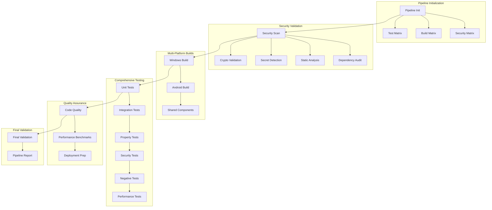

# 🚀 GURU CI/CD Pipeline Foundation

## Overview

The GURU Personal Assistant CI/CD pipeline is a production-grade, enterprise-level continuous integration and deployment system designed with a **maximum engineering approach**. This pipeline implements comprehensive multi-platform builds, advanced security validation, extensive testing suites, and intelligent optimization strategies.

## 🏗️ Architecture

### Pipeline Components



## 🔧 Configuration

### Environment Variables

The pipeline uses comprehensive environment configuration for maximum flexibility:

```yaml
# Build Configuration - Production Grade
NODE_VERSION: '18.x'
PYTHON_VERSION: '3.11'
JAVA_VERSION: '17'

# Security Configuration - Maximum Security
SECURITY_SCAN_ENABLED: true
VULNERABILITY_THRESHOLD: 'moderate'
AUDIT_LEVEL: 'maximum'

# Testing Configuration - Comprehensive Coverage
COVERAGE_THRESHOLD: 90
PROPERTY_TEST_ITERATIONS: 2000
SECURITY_TEST_REQUIRED: true

# Cache Configuration - Advanced Optimization
CACHE_VERSION: 'v3'
DEPENDENCY_CACHE_DAYS: 14
BUILD_CACHE_DAYS: 7
CACHE_COMPRESSION: 'zstd'
```

### Build Matrix

The pipeline supports dynamic build matrix generation based on build type:

- **Quick**: Minimal matrix for rapid validation
- **Comprehensive**: Full matrix for complete testing
- **Security-Focused**: Security-optimized matrix
- **Performance-Focused**: Performance testing matrix

## 🛡️ Security Features

### Advanced Security Validation

1. **Multi-Tool Dependency Scanning**
   - NPM audit with detailed reporting
   - Python pip-audit and safety checks
   - Gradle dependency vulnerability analysis

2. **Comprehensive Static Analysis**
   - Semgrep with multiple rulesets (auto, security-audit, secrets, OWASP top-ten)
   - Bandit for Python security analysis
   - ESLint with security plugins for JavaScript/TypeScript

3. **Advanced Secret Detection**
   - TruffleHog with comprehensive patterns
   - Custom secret patterns for GURU-specific credentials
   - Entropy-based detection for high-confidence results

4. **Cryptographic Implementation Validation**
   - Automated detection of weak cryptographic algorithms
   - Validation of key sizes and implementation patterns
   - Compliance checking against security standards

### Security Attestation

Each build generates a comprehensive security attestation document:

```json
{
  "attestation_version": "1.0",
  "security_validations": {
    "dependency_scan": { "status": "passed", "vulnerabilities_found": 0 },
    "static_analysis": { "status": "passed", "issues_found": 0 },
    "secret_detection": { "status": "passed", "secrets_found": 0 },
    "cryptographic_validation": { "status": "passed", "weak_algorithms_found": 0 }
  },
  "compliance": {
    "security_standards": ["OWASP-ASVS", "NIST-Cybersecurity-Framework"],
    "privacy_standards": ["GDPR-compliant", "local-first"]
  }
}
```

## 🏗️ Multi-Platform Builds

### Windows Desktop Agent

- **Platforms**: Windows Server 2022
- **Python Versions**: 3.11, 3.12
- **Node.js Versions**: 18.x, 20.x
- **Build Configurations**: Debug, Release
- **Artifacts**: Python wheels, Tauri executables, MSI installers

### Android Phone Agent

- **API Levels**: 26, 28, 33, 34 (Android 8.0 - 14)
- **Build Types**: Debug, Release
- **ABIs**: arm64-v8a, armeabi-v7a, x86_64
- **Artifacts**: APK files, AAB bundles

### Shared Components

- **TypeScript Modules**: shared, memory, skills, agents, infra
- **Build Optimization**: Parallel compilation, incremental builds
- **Artifacts**: Compiled JavaScript, type definitions

## 🧪 Testing Strategy

### Comprehensive Test Suites

1. **Unit Tests**
   - Core component validation
   - 90% coverage threshold
   - Parallel execution across platforms

2. **Integration Tests**
   - System interaction validation
   - Cross-component communication testing
   - Real-world scenario simulation

3. **Property-Based Tests**
   - Correctness property validation using Hypothesis
   - 2000 iterations per property
   - Comprehensive input space exploration

4. **Security Tests**
   - Authority and cryptographic validation
   - Intrusion detection testing
   - Fail-safe behavior verification

5. **Negative Tests**
   - Failure scenario validation
   - Error handling verification
   - Boundary condition testing

6. **Performance Tests**
   - Benchmark execution with pytest-benchmark
   - CPU, memory, I/O, and cryptographic performance
   - Regression detection and reporting

### Test Execution Matrix

```yaml
strategy:
  fail-fast: false
  matrix:
    os: [windows-2022, ubuntu-22.04]
    python-version: [3.11, 3.12]
    test-suite: [unit, integration, property, security, negative]
```

## 📊 Performance Optimization

### Build Optimization

- **Parallel Execution**: Dynamic job calculation based on CPU cores
- **Advanced Caching**: Multi-level caching with zstd compression
- **Compiler Optimization**: ccache for Linux builds, optimized flags
- **Resource Management**: Memory and I/O optimization

### Cache Strategy

```yaml
cache_types:
  dependencies:
    retention_days: 14
    size_limit_gb: 5
    cross_os: true
  builds:
    retention_days: 7
    size_limit_gb: 3
    cross_os: false
  tests:
    retention_days: 3
    size_limit_gb: 1
    cross_os: false
```

## 📈 Code Quality

### Multi-Language Quality Assurance

1. **JavaScript/TypeScript**
   - ESLint with security plugins
   - Prettier formatting
   - TypeScript strict mode

2. **Python**
   - Flake8, Pylint, Bandit
   - Black formatting, isort imports
   - MyPy type checking

3. **Kotlin**
   - ktlint formatting
   - Detekt static analysis
   - Security rule enforcement

### Quality Gates

- Zero warnings policy for production builds
- Comprehensive security linting
- Automated formatting enforcement
- Type safety validation

## 🚀 Deployment Pipeline

### Deployment Preparation

1. **Artifact Collection**
   - Windows Desktop Agent packages
   - Android Phone Agent APKs/AABs
   - Shared component libraries
   - Documentation and reports

2. **Deployment Manifest Generation**
   - Version information and build metadata
   - Component inventory with checksums
   - Quality gate validation status
   - Security attestation inclusion

3. **Release Package Creation**
   - Comprehensive artifact packaging
   - SHA256 checksum generation
   - Deployment readiness validation

### Deployment Targets

- **Staging**: Automatic deployment with smoke tests
- **Production**: Manual approval required with full validation

## 📋 Usage

### Triggering Builds

#### Automatic Triggers

```yaml
on:
  push:
    branches: [ main, develop, 'feature/**', 'security/**', 'hotfix/**', 'release/**' ]
  pull_request:
    branches: [ main, develop ]
  schedule:
    - cron: '0 2 * * *'  # Daily security scans
    - cron: '0 4 * * 0'  # Weekly performance benchmarks
```

#### Manual Triggers

```bash
# Trigger comprehensive build
gh workflow run "GURU CI Pipeline Foundation" \
  --field build_type=comprehensive \
  --field run_security_scan=true

# Trigger security-focused build
gh workflow run "GURU CI Pipeline Foundation" \
  --field build_type=security-focused \
  --field cache_strategy=aggressive

# Trigger performance-focused build
gh workflow run "GURU CI Pipeline Foundation" \
  --field build_type=performance-focused \
  --field enable_debug_mode=true
```

### Build Types

1. **Quick Build** (`build_type=quick`)
   - Minimal matrix for rapid validation
   - Unit and security tests only
   - Single platform (Ubuntu)

2. **Comprehensive Build** (`build_type=comprehensive`)
   - Full multi-platform matrix
   - All test suites
   - Complete quality validation

3. **Security-Focused Build** (`build_type=security-focused`)
   - Enhanced security scanning
   - Security and negative tests
   - Cryptographic validation

4. **Performance-Focused Build** (`build_type=performance-focused`)
   - Performance benchmarking
   - Resource usage analysis
   - Optimization recommendations

## 📊 Monitoring and Reporting

### Pipeline Metrics

- Build execution times
- Test success rates
- Cache hit rates
- Artifact sizes
- Security scan results

### Reporting

Each pipeline execution generates:

1. **Executive Summary**: High-level pipeline status and results
2. **Build Report**: Detailed build metrics and artifacts
3. **Security Report**: Comprehensive security validation results
4. **Performance Report**: Benchmark results and optimization recommendations
5. **Quality Report**: Code quality analysis and recommendations

### Artifacts

All pipeline artifacts are retained for 30 days:

- Build packages and executables
- Test reports and coverage data
- Security scan results
- Performance benchmarks
- Quality analysis reports
- Deployment manifests

## 🔧 Maintenance

### Cache Management

The pipeline includes automated cache management:

```bash
# Analyze cache usage
gh workflow run "Cache Management" --field cache_action=analyze

# Warm caches for better performance
gh workflow run "Cache Management" --field cache_action=warm

# Cleanup old caches
gh workflow run "Cache Management" --field cache_action=cleanup

# Reset all caches (use with caution)
gh workflow run "Cache Management" --field cache_action=reset
```

### Performance Optimization

Regular performance optimization includes:

- Build time analysis and optimization
- Cache hit rate monitoring
- Resource usage optimization
- Parallel execution tuning

## 🚨 Troubleshooting

### Common Issues

1. **Build Failures**
   - Check security validation results
   - Verify dependency compatibility
   - Review build logs for specific errors

2. **Test Failures**
   - Property-based test failures require analysis of counterexamples
   - Security test failures indicate potential vulnerabilities
   - Performance test failures suggest regression issues

3. **Cache Issues**
   - Cache misses can slow builds significantly
   - Use cache analysis workflow to identify issues
   - Consider cache warming for frequently used dependencies

### Debug Mode

Enable debug mode for detailed troubleshooting:

```bash
gh workflow run "GURU CI Pipeline Foundation" \
  --field enable_debug_mode=true \
  --field build_type=quick
```

## 📚 Documentation

### Additional Resources

- [Security Configuration Guide](./SECURITY_CONFIG.md)
- [Performance Optimization Guide](./PERFORMANCE_OPTIMIZATION.md)
- [Cache Management Guide](./CACHE_MANAGEMENT.md)
- [Troubleshooting Guide](./TROUBLESHOOTING.md)

### Contributing

When contributing to the CI/CD pipeline:

1. Follow the maximum engineering approach
2. Maintain comprehensive test coverage
3. Ensure security validation passes
4. Update documentation for changes
5. Test changes in feature branches

## 🎯 Quality Standards

This CI/CD pipeline maintains the highest quality standards:

- **Zero-Defect Progression**: No compromises on quality
- **Security-First**: Comprehensive security validation
- **Performance-Optimized**: Maximum build efficiency
- **Comprehensive Testing**: All aspects validated
- **Production-Ready**: Enterprise-grade reliability

The pipeline embodies the GURU philosophy: **"Authority as sacred, convenience as optional"** - ensuring that security and quality are never compromised for speed or convenience.