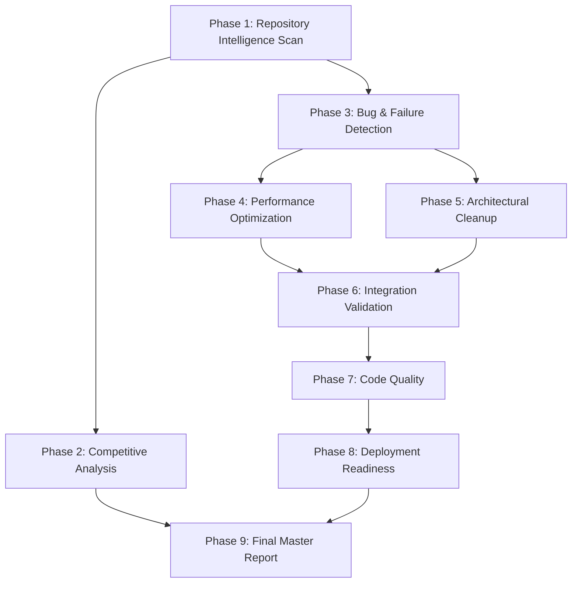
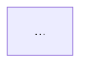

# Design Document: Agent Guru World-Class Audit

## Overview

This document specifies the complete technical design for the Agent Guru World-Class Audit system — an automated, multi-phase audit, optimization, and validation toolchain that brings the Agent Guru codebase to production-ready, world-class quality.

The audit system operates as a Python 3.11+ orchestrated pipeline that executes 9 sequential phases, each writing structured findings to a single master report (`AUDIT_REPORT_MASTER.md`). Every phase is gated by the enforcement rules in Requirement 10: zero tolerance for regressions, no placeholder fixes, no shadow files, and full test-suite validation after every batch of changes.

### Scope

The audit covers the entire `Agent_Guru/` package (30+ modules, ~15,000+ lines of Python) across:
- Speech pipeline (wake word, STT, TTS, VAD, audio capture)
- Vision engine (face detection, recognition, emotion, liveness)
- LLM runtime (4 providers, model router, context management)
- Reasoning engine (intent classification, fast trie router, neural classifier)
- Memory system (knowledge graph, conversation memory, encryption)
- Security system (Ed25519 identity, biometric auth, audit trail)
- Policy engine (RBAC, rule evaluation, access control)
- Avatar system (emotion controller, renderer, lip sync)
- Agent orchestration (multi-agent coordination, task decomposition)
- Platform integration (Windows, macOS, Linux, Android, iOS)
- Deployment system (installer builder, rollback manager)
- Integration orchestrator (end-to-end pipeline wiring)

### Key Findings from Repository Analysis

Before designing the audit system, the existing `ARCHITECTURE.md` reveals these critical gaps that the audit must address:

1. **Wake word uses Vosk, not pvporcupine** — Vosk is ~50MB, higher CPU. pvporcupine is <1MB, <5% CPU.
2. **No `ConversationMemory` with LRU** — Missing 50-turn LRU conversation store.
3. **No lock-free ring buffer** — `MicrophoneCapture` uses blocking `sd.rec()`.
4. **TTS playback not integrated** — `CoquiTTSEngine.synthesize()` returns WAV bytes but nothing plays them.
5. **Duplicate files** — `llm/runtime.py` vs `llm/llm_runtime.py`, `vision/engine.py` vs `vision/vision_engine.py`, `agents/orchestrator.py` vs `agents/orchestration_system.py`, `agents/decomposer.py` vs `agents/task_decomposer.py`.
6. **No end-to-end pipeline wiring** — Components exist independently with no top-level orchestrator.
7. **No `integration/gpu_pool.py`** — GPU memory pooling is absent.
8. **No `reasoning/response/response_cache.py`** — LRU response cache is absent.


## Architecture

### Audit System Architecture Overview

The audit system is implemented as a Python package at `audit/` (sibling to `Agent_Guru/`) with the following top-level structure:

```
audit/
├── __init__.py
├── runner.py                    # Main orchestrator — runs all 9 phases in DAG order
├── report.py                    # AUDIT_REPORT_MASTER.md writer
├── models.py                    # Shared data models (Finding, Phase, etc.)
├── enforcement.py               # Enforcement gate (pytest + black + ruff + mypy)
├── phases/
│   ├── __init__.py
│   ├── phase1_repo_scan.py      # Repository Intelligence Scan
│   ├── phase2_competitive.py    # World-Leader Competitive Analysis
│   ├── phase3_bug_detection.py  # Full Bug & Failure Detection
│   ├── phase4_performance.py    # Extreme Performance Optimization
│   ├── phase5_cleanup.py        # Architectural Cleanup
│   ├── phase6_integration.py    # Integration Validation
│   ├── phase7_quality.py        # World-Class Code Quality
│   ├── phase8_deployment.py     # Deployment & Production Readiness
│   └── phase9_report.py         # Final Master Audit Report
└── tests/
    ├── conftest.py
    ├── test_models.py
    ├── test_report.py
    ├── test_phase1.py
    ├── test_phase3_properties.py
    ├── test_phase4_properties.py
    ├── test_phase6_properties.py
    ├── test_phase7_properties.py
    └── test_phase9_properties.py
```

### Phase Execution DAG

The 9 phases have explicit dependencies. Phase 1 must complete before any other phase can begin (it produces the baseline inventory). Phases 3–8 can run after Phase 1 but have internal ordering constraints. Phase 9 runs last.



**Rationale for ordering:**
- Phase 1 first: all subsequent phases need the module inventory and dependency DAG.
- Phase 3 before Phase 4: performance optimizations must not introduce new bugs; bug detection establishes the zero-defect baseline.
- Phase 3 before Phase 5: cleanup decisions (what to remove) depend on the full bug/duplicate analysis.
- Phases 4 and 5 before Phase 6: integration validation tests the optimized, cleaned codebase.
- Phase 6 before Phase 7: code quality checks run on the integrated, validated codebase.
- Phase 7 before Phase 8: deployment readiness requires zero quality violations.
- Phase 9 last: consolidates all findings.

### Enforcement Gate Design

After every batch of changes (defined as all changes within a single phase), the enforcement gate runs:

```python
# audit/enforcement.py

import subprocess
import sys
from pathlib import Path

PACKAGE_ROOT = Path("Agent_Guru")

def run_enforcement_gate(phase_name: str) -> bool:
    """Run the full enforcement gate after a batch of changes.

    Runs in order: pytest → black → ruff → mypy.
    Stops and returns False on first failure.
    Logs all output to AUDIT_REPORT_MASTER.md enforcement section.

    Args:
        phase_name: Name of the phase that just completed.

    Returns:
        True if all checks pass, False if any check fails.
    """
    checks = [
        ["pytest", "Agent_Guru/", "-x", "--tb=short", "-q"],
        ["black", "--check", "Agent_Guru/"],
        ["ruff", "check", "Agent_Guru/", "--select", "ALL"],
        ["mypy", "Agent_Guru/", "--strict"],
    ]
    for cmd in checks:
        result = subprocess.run(cmd, capture_output=True, text=True)
        if result.returncode != 0:
            _log_gate_failure(phase_name, cmd, result)
            return False
    return True

def run_auto_fix_gate(phase_name: str) -> bool:
    """Run auto-fixable tools (black + ruff --fix), then re-check.

    Args:
        phase_name: Name of the phase that just completed.

    Returns:
        True if all checks pass after auto-fix, False otherwise.
    """
    subprocess.run(["black", "Agent_Guru/"], check=True)
    subprocess.run(["ruff", "check", "Agent_Guru/", "--fix"], check=True)
    return run_enforcement_gate(phase_name)
```


## Components and Interfaces

### Core Data Models (`audit/models.py`)

```python
from __future__ import annotations
from dataclasses import dataclass, field
from enum import Enum
from pathlib import Path
from typing import Optional


class Severity(str, Enum):
    CRITICAL = "CRITICAL"
    HIGH = "HIGH"
    MEDIUM = "MEDIUM"
    LOW = "LOW"
    INFO = "INFO"


class FindingCategory(str, Enum):
    COMPILE_ERROR = "COMPILE_ERROR"
    TYPE_ERROR = "TYPE_ERROR"
    LINT_VIOLATION = "LINT_VIOLATION"
    SECURITY_ISSUE = "SECURITY_ISSUE"
    CIRCULAR_IMPORT = "CIRCULAR_IMPORT"
    BROKEN_IMPORT = "BROKEN_IMPORT"
    ASYNC_ANTIPATTERN = "ASYNC_ANTIPATTERN"
    RACE_CONDITION = "RACE_CONDITION"
    RESOURCE_LEAK = "RESOURCE_LEAK"
    UNUSED_CODE = "UNUSED_CODE"
    DUPLICATE_IMPL = "DUPLICATE_IMPL"
    PLATFORM_GUARD = "PLATFORM_GUARD"
    PERFORMANCE = "PERFORMANCE"
    DEAD_CODE = "DEAD_CODE"
    MISSING_DOCSTRING = "MISSING_DOCSTRING"
    LAYER_VIOLATION = "LAYER_VIOLATION"
    HARDCODED_SECRET = "HARDCODED_SECRET"


@dataclass
class Finding:
    """A single audit finding with full traceability.

    Attributes:
        id: Unique finding identifier (e.g., "BUG-001").
        phase: Audit phase number (1-9).
        category: Finding category.
        severity: Finding severity.
        file_path: Relative path to the affected file.
        line_number: Line number of the finding (0 if file-level).
        rule: Tool rule code (e.g., "E501", "B101", "mypy:error").
        description: Human-readable description of the finding.
        remediation: Specific remediation action taken or required.
        fixed: Whether the finding has been fixed.
    """
    id: str
    phase: int
    category: FindingCategory
    severity: Severity
    file_path: str
    line_number: int
    rule: str
    description: str
    remediation: str = ""
    fixed: bool = False


@dataclass
class ModuleInventory:
    """Inventory entry for a single Python module.

    Attributes:
        file_path: Relative path from repo root.
        line_count: Total lines including blanks and comments.
        public_class_count: Number of public classes (not prefixed with _).
        public_function_count: Number of public functions.
        import_count: Number of import statements.
        imports: List of imported module paths.
    """
    file_path: str
    line_count: int
    public_class_count: int
    public_function_count: int
    import_count: int
    imports: list[str] = field(default_factory=list)


@dataclass
class DependencyEdge:
    """A directed dependency edge in the module DAG.

    Attributes:
        source: Importing module path.
        target: Imported module path.
        import_type: "import" or "from".
        symbol: Specific symbol imported (empty for module-level import).
    """
    source: str
    target: str
    import_type: str
    symbol: str = ""


@dataclass
class PerformanceMetric:
    """A before/after performance measurement.

    Attributes:
        metric_name: Human-readable metric name.
        unit: Measurement unit (e.g., "ms", "MB", "%").
        before_p95: P95 value before optimization.
        after_p95: P95 value after optimization.
        target: Target value from quality.md.
        meets_target: Whether after_p95 meets the target.
    """
    metric_name: str
    unit: str
    before_p95: float
    after_p95: float
    target: float
    meets_target: bool


@dataclass
class RemediationItem:
    """A prioritized remediation backlog item.

    Attributes:
        id: Unique item identifier.
        phase: Audit phase that identified this item.
        severity: Item severity.
        affected_module: Module path affected.
        description: Description of the required change.
        expected_improvement: Expected metric improvement with unit.
        estimated_effort_hours: Estimated effort in hours.
        competitive_impact_score: Gap magnitude x platforms affected.
    """
    id: str
    phase: int
    severity: Severity
    affected_module: str
    description: str
    expected_improvement: str
    estimated_effort_hours: float
    competitive_impact_score: float


@dataclass
class IntegrationCheckResult:
    """Result of a single integration validation check.

    Attributes:
        check_id: Check identifier (1-12).
        description: Human-readable check description.
        passed: Whether the check passed.
        details: Additional details or error message.
    """
    check_id: int
    description: str
    passed: bool
    details: str = ""


@dataclass
class AuditReport:
    """The complete audit report state, written to AUDIT_REPORT_MASTER.md.

    Attributes:
        findings: All findings across all phases.
        inventory: Module inventory from Phase 1.
        dependency_edges: Module dependency DAG edges.
        performance_metrics: Before/after performance table.
        remediation_backlog: Prioritized remediation items.
        integration_results: Integration validation check results.
        coverage_by_module: Per-module test coverage percentages.
    """
    findings: list[Finding] = field(default_factory=list)
    inventory: list[ModuleInventory] = field(default_factory=list)
    dependency_edges: list[DependencyEdge] = field(default_factory=list)
    performance_metrics: list[PerformanceMetric] = field(default_factory=list)
    remediation_backlog: list[RemediationItem] = field(default_factory=list)
    integration_results: list[IntegrationCheckResult] = field(default_factory=list)
    coverage_by_module: dict[str, float] = field(default_factory=dict)
```


### Phase 1: Repository Intelligence Scan (`audit/phases/phase1_repo_scan.py`)

**Objective:** Produce a complete, machine-readable inventory of every file, module, class, function, import, dependency, and runtime flow.

**Implementation approach:**

```python
import ast
import importlib.util
from pathlib import Path
from typing import Iterator
import networkx as nx  # For DAG construction and cycle detection

class RepositoryScanner:
    """Scans the Agent_Guru package and produces a complete inventory.

    Uses Python's ast module for static analysis — no imports are executed,
    so the scan is safe and fast regardless of missing dependencies.
    """

    def __init__(self, package_root: Path) -> None:
        self.package_root = package_root
        self.graph = nx.DiGraph()  # Module dependency DAG

    def scan_all_modules(self) -> list[ModuleInventory]:
        """Scan every .py file under package_root.

        Returns:
            List of ModuleInventory entries, one per .py file.
        """
        inventories = []
        for py_file in self._iter_python_files():
            inventory = self._scan_module(py_file)
            inventories.append(inventory)
        return inventories

    def build_dependency_dag(
        self, inventories: list[ModuleInventory]
    ) -> tuple[nx.DiGraph, list[list[str]]]:
        """Build the module dependency DAG and detect cycles.

        Args:
            inventories: Module inventories from scan_all_modules().

        Returns:
            Tuple of (DAG, list of cycles). Each cycle is an ordered
            list of module paths forming the cycle.
        """
        for inv in inventories:
            self.graph.add_node(inv.file_path)
            for imported in inv.imports:
                self.graph.add_edge(inv.file_path, imported)

        cycles = list(nx.simple_cycles(self.graph))
        return self.graph, cycles

    def _scan_module(self, py_file: Path) -> ModuleInventory:
        source = py_file.read_text(encoding="utf-8", errors="replace")
        tree = ast.parse(source, filename=str(py_file))
        visitor = _ModuleVisitor()
        visitor.visit(tree)
        return ModuleInventory(
            file_path=str(py_file.relative_to(self.package_root.parent)),
            line_count=len(source.splitlines()),
            public_class_count=visitor.public_class_count,
            public_function_count=visitor.public_function_count,
            import_count=visitor.import_count,
            imports=visitor.imports,
        )

    def _iter_python_files(self) -> Iterator[Path]:
        for path in self.package_root.rglob("*.py"):
            if "__pycache__" not in path.parts:
                yield path
```

**Voice Pipeline Trace:** The scanner produces a dedicated pipeline trace document by following the call graph from `speech/audio/capture.py` through each stage, recording the function name, input type, and output type at each boundary. This is implemented as a separate `VoicePipelineTracer` class that uses AST analysis to follow `__call__` and `async def` boundaries.

**Startup Lifecycle Analysis:** A `StartupAnalyzer` class parses `main.py` and traces every `asyncio.create_task()`, `threading.Thread()`, and `subprocess.Popen()` call, recording the coroutine/function name and whether a corresponding cancellation/join is present.

**Output:** Writes the "Repository Intelligence" section to `AUDIT_REPORT_MASTER.md` with:
- Module inventory table (file path, line count, classes, functions, imports)
- Dependency DAG as a Mermaid diagram (top 20 most-connected nodes)
- Cycle list (if any)
- Voice pipeline trace table
- Startup lifecycle table
- External service boundary table
- Configuration entry point table
- `__pycache__` / `.pyc` count

### Phase 2: Competitive Analysis (`audit/phases/phase2_competitive.py`)

**Objective:** Produce a metric-by-metric comparison against 7 competitors and a prioritized remediation list.

**Implementation approach:**

The competitive baselines are stored as a static data file (`audit/data/competitive_baselines.json`) with the published metrics for Alexa, Siri, Google Assistant, ChatGPT Desktop, Claude Desktop, Open Interpreter, and OpenVoiceOS. These are sourced from published benchmarks and product documentation.

```python
@dataclass
class CompetitorBaseline:
    name: str
    wake_word_p95_ms: Optional[float]
    stt_wer_percent: Optional[float]
    e2e_p95_ms: Optional[float]
    idle_cpu_percent: Optional[float]
    idle_ram_mb: Optional[float]
    offline_capable: bool
    multi_platform: bool
    open_api: bool

class CompetitiveAnalyzer:
    """Compares Agent Guru metrics against competitor baselines."""

    def compute_gap_analysis(
        self,
        agent_guru_metrics: dict[str, float],
        baselines: list[CompetitorBaseline],
        quality_targets: dict[str, float],
    ) -> tuple[list[RemediationItem], list[dict]]:
        """Compute gaps and produce prioritized remediation list.

        The competitive impact score for each gap is:
            score = gap_magnitude_normalized * platforms_affected

        Args:
            agent_guru_metrics: Current measured metrics.
            baselines: Competitor baseline data.
            quality_targets: Targets from quality.md.

        Returns:
            Tuple of (remediation_items sorted by score desc, matrix rows).
        """
        ...
```

**Prioritization formula:**
```
competitive_impact_score = (gap_magnitude / target_value) * platforms_affected
```
Where `platforms_affected` is the number of competitor platforms that already meet the target.

### Phase 3: Bug and Failure Detection (`audit/phases/phase3_bug_detection.py`)

**Objective:** Run all static analysis tools and detect every defect category.

**Tool invocation sequence:**

```python
class BugDetector:
    """Orchestrates all static analysis tools."""

    def run_all(self) -> list[Finding]:
        findings = []
        findings.extend(self._run_py_compile())      # Req 3.1
        findings.extend(self._run_ruff_all())         # Req 3.2
        findings.extend(self._run_mypy_strict())      # Req 3.3
        findings.extend(self._run_bandit())           # Req 3.4
        findings.extend(self._detect_circular_imports())  # Req 3.5
        findings.extend(self._detect_broken_imports())    # Req 3.6
        findings.extend(self._detect_async_antipatterns())  # Req 3.7
        findings.extend(self._detect_race_conditions())   # Req 3.8
        findings.extend(self._detect_resource_leaks())    # Req 3.9
        findings.extend(self._run_ruff_unused())      # Req 3.10
        findings.extend(self._detect_duplicates())    # Req 3.11
        findings.extend(self._check_platform_guards())  # Req 3.12
        return findings
```

**Async anti-pattern detection** uses AST analysis:
```python
class AsyncAntipatternVisitor(ast.NodeVisitor):
    """Detects blocking calls inside async def functions."""

    BLOCKING_CALLS = {
        "time.sleep", "requests.get", "requests.post", "requests.put",
        "requests.delete", "urllib.request.urlopen", "subprocess.run",
        "subprocess.call", "subprocess.check_output",
    }

    def visit_AsyncFunctionDef(self, node: ast.AsyncFunctionDef) -> None:
        # Walk the function body looking for blocking calls
        for child in ast.walk(node):
            if isinstance(child, ast.Call):
                call_name = self._get_call_name(child)
                if call_name in self.BLOCKING_CALLS:
                    self._report_finding(node, child, call_name)
            # Detect synchronous open() outside run_in_executor
            if isinstance(child, ast.Call):
                if self._is_sync_open(child) and not self._in_run_in_executor(child):
                    self._report_finding(node, child, "open()")
        self.generic_visit(node)
```

**Race condition detection** uses a data-flow analysis approach:
- Build a set of all module-level and class-level mutable variables
- For each variable, find all coroutines/threads that read or write it
- If more than one coroutine/thread accesses a variable and no synchronization primitive wraps the access, report a race condition

**Resource leak detection** uses AST analysis:
- Track every `open()`, `sqlite3.connect()`, `aiohttp.ClientSession()`, `sounddevice.InputStream()`, and `torch.cuda.memory_allocated()` call
- Verify each is either inside a `with` statement or has a corresponding `.close()` call in all code paths (including `except` and `finally` blocks)

**Duplicate implementation detection:**
```python
def detect_duplicates(modules: list[ModuleInventory]) -> list[Finding]:
    """Detect modules sharing >= 2 public symbols with identical signatures.

    Uses AST to extract public function/class names and type signatures,
    then computes pairwise overlap.
    """
    ...
```

### Phase 4: Performance Optimization (`audit/phases/phase4_performance.py`)

**Objective:** Implement all 5 performance optimizations and benchmark before/after.

#### 4a. pvporcupine Wake Word Integration

**Current state:** `speech/audio/wake_word.py` uses Vosk (~50MB model, ~15% CPU idle).

**Target state:** Replace with pvporcupine (<1MB model, <5% CPU idle, <200ms P95).

**Implementation design:**

```python
# speech/audio/wake_word.py (modified)
import pvporcupine
import numpy as np
from typing import Callable

class WakeWordDetector:
    """pvporcupine-based wake word detector.

    Replaces the Vosk-based implementation. pvporcupine processes
    audio in fixed-size frames (512 samples at 16kHz = 32ms per frame).
    The ring buffer feeds frames to pvporcupine continuously.

    Performance:
        - CPU idle: <5% (vs Vosk ~15%)
        - Latency P95: <200ms (2-3 frames at 32ms each)
        - Model size: <1MB (vs Vosk ~50MB)
    """

    FRAME_LENGTH = 512   # pvporcupine requires exactly 512 samples at 16kHz
    SAMPLE_RATE = 16000

    def __init__(
        self,
        access_key: str,
        keywords: list[str],  # ["hey guru", "hey maya"]
        sensitivities: list[float],
        on_detection: Callable[[str], None],
    ) -> None:
        self._porcupine = pvporcupine.create(
            access_key=access_key,
            keywords=keywords,
            sensitivities=sensitivities,
        )
        self._on_detection = on_detection
        self._keyword_names = keywords

    def process_frame(self, pcm_frame: np.ndarray) -> int:
        """Process one 512-sample frame. Returns keyword index or -1.

        Args:
            pcm_frame: 512 int16 samples at 16kHz.

        Returns:
            Index of detected keyword, or -1 if no detection.
        """
        keyword_index = self._porcupine.process(pcm_frame.astype(np.int16))
        if keyword_index >= 0:
            self._on_detection(self._keyword_names[keyword_index])
        return keyword_index

    def delete(self) -> None:
        """Release pvporcupine resources."""
        self._porcupine.delete()
```

#### 4b. Lock-Free Ring Buffer (`speech/audio/capture.py`)

**Current state:** `MicrophoneCapture` uses blocking `sd.rec()` — cannot do continuous wake word monitoring.

**Target state:** Lock-free ring buffer of 10 seconds of 16kHz float32 audio (160,000 samples).

**Implementation design:**

The ring buffer uses a single writer (sounddevice callback thread) and single reader (wake word detection coroutine). Because Python's GIL protects integer reads/writes, a simple atomic index approach is safe for SPSC (single-producer, single-consumer) use:

```python
# speech/audio/capture.py (modified)
import numpy as np
import sounddevice as sd
from threading import Event

class LockFreeRingBuffer:
    """Single-producer, single-consumer lock-free ring buffer for audio.

    Stores 10 seconds of 16kHz float32 mono audio (160,000 samples).
    The write index is advanced by the sounddevice callback (producer).
    The read index is advanced by the wake word consumer.

    Thread safety: Safe for exactly one producer thread and one consumer
    thread. The GIL protects the integer index reads/writes.

    Capacity invariant: At most CAPACITY - 1 unread samples are stored.
    If the producer overtakes the consumer, the oldest samples are
    silently overwritten (ring buffer semantics).

    Attributes:
        CAPACITY: Buffer capacity in samples (must be power of 2).
        SAMPLE_RATE: Audio sample rate in Hz.
        DURATION_SECONDS: Buffer duration in seconds.
    """

    CAPACITY: int = 163840   # Next power of 2 above 160000 (10s @ 16kHz)
    SAMPLE_RATE: int = 16000
    DURATION_SECONDS: float = CAPACITY / SAMPLE_RATE

    def __init__(self) -> None:
        self._buffer = np.zeros(self.CAPACITY, dtype=np.float32)
        self._write_idx: int = 0   # Protected by GIL for SPSC
        self._read_idx: int = 0

    def write(self, samples: np.ndarray) -> None:
        """Write samples into the ring buffer (called from audio callback).

        Args:
            samples: Float32 audio samples to write.
        """
        n = len(samples)
        end = (self._write_idx + n) % self.CAPACITY
        if end > self._write_idx:
            self._buffer[self._write_idx:end] = samples
        else:
            # Wrap around
            split = self.CAPACITY - self._write_idx
            self._buffer[self._write_idx:] = samples[:split]
            self._buffer[:end] = samples[split:]
        self._write_idx = end

    def read_frame(self, frame_size: int) -> np.ndarray | None:
        """Read one frame from the ring buffer (called from consumer).

        Args:
            frame_size: Number of samples to read.

        Returns:
            Float32 array of frame_size samples, or None if insufficient data.
        """
        available = (self._write_idx - self._read_idx) % self.CAPACITY
        if available < frame_size:
            return None
        end = (self._read_idx + frame_size) % self.CAPACITY
        if end > self._read_idx:
            frame = self._buffer[self._read_idx:end].copy()
        else:
            split = self.CAPACITY - self._read_idx
            frame = np.concatenate([
                self._buffer[self._read_idx:],
                self._buffer[:end],
            ])
        self._read_idx = end
        return frame

    @property
    def available_samples(self) -> int:
        """Number of unread samples currently in the buffer."""
        return (self._write_idx - self._read_idx) % self.CAPACITY
```

#### 4c. GPU Memory Pool (`integration/gpu_pool.py`)

**Current state:** No GPU pool — each subsystem allocates VRAM independently, causing fragmentation and reallocation overhead.

**Target state:** Centralized GPU pool that allocates VRAM slabs and hands out pre-allocated tensors to subsystems.

```python
# integration/gpu_pool.py (new file)
import torch
from threading import Lock
from typing import Optional

class GPUMemoryPool:
    """Centralized GPU memory pool for all Agent Guru subsystems.

    Allocates VRAM slabs at startup and hands out pre-allocated tensors
    to subsystems (STT, TTS, vision, avatar). Prevents fragmentation and
    eliminates per-inference allocation overhead.

    Pool invariant: Total allocated VRAM never exceeds max_vram_bytes.
    Subsystems that request more than available receive None and must
    fall back to CPU processing.

    Attributes:
        max_vram_bytes: Maximum VRAM to allocate (default: 80% of total).
        allocated_bytes: Current allocated VRAM in bytes.
    """

    def __init__(self, max_vram_bytes: Optional[int] = None) -> None:
        if max_vram_bytes is None and torch.cuda.is_available():
            total = torch.cuda.get_device_properties(0).total_memory
            max_vram_bytes = int(total * 0.80)
        self.max_vram_bytes = max_vram_bytes or 0
        self.allocated_bytes: int = 0
        self._lock = Lock()
        self._pool: dict[tuple[int, ...], list[torch.Tensor]] = {}

    def allocate(
        self, shape: tuple[int, ...], dtype: torch.dtype = torch.float32
    ) -> Optional[torch.Tensor]:
        """Allocate a tensor from the pool.

        Args:
            shape: Tensor shape.
            dtype: Tensor dtype.

        Returns:
            Pre-allocated tensor on CUDA, or None if VRAM exhausted.
        """
        with self._lock:
            if shape in self._pool and self._pool[shape]:
                return self._pool[shape].pop()
            nbytes = torch.zeros(shape, dtype=dtype).element_size() * torch.zeros(shape).numel()
            if self.allocated_bytes + nbytes > self.max_vram_bytes:
                return None
            tensor = torch.zeros(shape, dtype=dtype, device="cuda")
            self.allocated_bytes += nbytes
            return tensor

    def release(self, tensor: torch.Tensor) -> None:
        """Return a tensor to the pool for reuse.

        Args:
            tensor: Tensor to return. Must have been allocated from this pool.
        """
        with self._lock:
            shape = tuple(tensor.shape)
            tensor.zero_()
            if shape not in self._pool:
                self._pool[shape] = []
            self._pool[shape].append(tensor)

    @property
    def utilization_percent(self) -> float:
        """Current VRAM utilization as a percentage."""
        if self.max_vram_bytes == 0:
            return 0.0
        return (self.allocated_bytes / self.max_vram_bytes) * 100.0
```

#### 4d. LRU Response Cache (`reasoning/response/response_cache.py`)

**Current state:** No response cache — identical queries hit the LLM every time.

**Target state:** LRU cache with 1,024 entries and 300-second TTL, returning cached responses within 1ms.

```python
# reasoning/response/response_cache.py (new file)
import hashlib
import time
from collections import OrderedDict
from threading import Lock
from typing import Optional

class LRUResponseCache:
    """LRU response cache for the reasoning engine.

    Caches LLM responses keyed by a SHA-256 hash of the normalized
    query text. Evicts the least recently used entry when at capacity.
    Entries expire after TTL seconds regardless of access frequency.

    Cache invariants:
    - len(cache) <= max_size at all times
    - No entry older than ttl_seconds is returned
    - On capacity, the LRU entry is evicted before inserting the new entry

    Attributes:
        max_size: Maximum number of cached entries (default: 1024).
        ttl_seconds: Time-to-live for each entry in seconds (default: 300).
    """

    def __init__(self, max_size: int = 1024, ttl_seconds: float = 300.0) -> None:
        if max_size <= 0:
            raise ValueError(f"max_size must be positive, got {max_size}")
        if ttl_seconds <= 0:
            raise ValueError(f"ttl_seconds must be positive, got {ttl_seconds}")
        self.max_size = max_size
        self.ttl_seconds = ttl_seconds
        self._cache: OrderedDict[str, tuple[str, float]] = OrderedDict()
        self._lock = Lock()

    def get(self, query: str) -> Optional[str]:
        """Look up a cached response.

        Args:
            query: The query text to look up.

        Returns:
            Cached response string, or None if not found or expired.
        """
        key = self._hash(query)
        with self._lock:
            if key not in self._cache:
                return None
            response, timestamp = self._cache[key]
            if time.monotonic() - timestamp > self.ttl_seconds:
                del self._cache[key]
                return None
            # Move to end (most recently used)
            self._cache.move_to_end(key)
            return response

    def put(self, query: str, response: str) -> None:
        """Store a response in the cache.

        Evicts the LRU entry if at capacity before inserting.

        Args:
            query: The query text.
            response: The response to cache.
        """
        key = self._hash(query)
        with self._lock:
            if key in self._cache:
                self._cache.move_to_end(key)
            else:
                if len(self._cache) >= self.max_size:
                    self._cache.popitem(last=False)  # Evict LRU
            self._cache[key] = (response, time.monotonic())

    def invalidate(self, query: str) -> bool:
        """Remove a specific entry from the cache.

        Args:
            query: The query text to invalidate.

        Returns:
            True if the entry was present and removed, False otherwise.
        """
        key = self._hash(query)
        with self._lock:
            if key in self._cache:
                del self._cache[key]
                return True
            return False

    @property
    def size(self) -> int:
        """Current number of entries in the cache."""
        with self._lock:
            return len(self._cache)

    @staticmethod
    def _hash(query: str) -> str:
        return hashlib.sha256(query.strip().lower().encode()).hexdigest()
```

#### 4e. Lazy Model Loading with Pre-warming

**Implementation design:** Each ML model (Whisper, Coqui TTS, InsightFace, ONNX emotion) is wrapped in a `LazyModel` descriptor that defers initialization until first use, then pre-warms by running a dummy inference:

```python
# core/lazy_model.py (new file)
import asyncio
from typing import TypeVar, Generic, Callable, Optional

T = TypeVar("T")

class LazyModel(Generic[T]):
    """Lazy-loading wrapper for ML models with pre-warming.

    The model is not loaded until first access. On first access,
    the model is loaded and a pre-warm inference is run to ensure
    the first real inference meets the latency target.

    Attributes:
        _factory: Callable that creates and returns the model.
        _model: The loaded model instance (None until first access).
        _prewarm_fn: Optional callable to run a dummy inference.
    """

    def __init__(
        self,
        factory: Callable[[], T],
        prewarm_fn: Optional[Callable[[T], None]] = None,
    ) -> None:
        self._factory = factory
        self._prewarm_fn = prewarm_fn
        self._model: Optional[T] = None
        self._loading = asyncio.Lock()

    async def get(self) -> T:
        """Get the model, loading and pre-warming if necessary.

        Returns:
            The loaded and pre-warmed model instance.
        """
        if self._model is not None:
            return self._model
        async with self._loading:
            if self._model is None:
                self._model = self._factory()
                if self._prewarm_fn is not None:
                    self._prewarm_fn(self._model)
        return self._model
```


### Phase 5: Architectural Cleanup (`audit/phases/phase5_cleanup.py`)

**Objective:** Remove all dead code, duplicate implementations, and unused files without breaking any live dependency.

**Duplicate consolidation strategy:**

For each duplicate pair, the consolidation follows this process:
1. Run `ast.parse()` on both files to extract all public symbols.
2. Compute the union of public APIs.
3. Identify symbols unique to each file.
4. Write the consolidated file to the canonical path, preserving all unique symbols.
5. Update all callers (found via `grep -r` across `Agent_Guru/`) to import from the canonical path.
6. Delete the non-canonical file.
7. Run the enforcement gate.

**Canonical paths:**
- `llm/runtime.py` (canonical) — `llm/llm_runtime.py` removed
- `vision/engine.py` (canonical) — `vision/vision_engine.py` removed
- `agents/orchestrator.py` (canonical) — `agents/orchestration_system.py` removed
- `agents/task_decomposer.py` (canonical) — `agents/decomposer.py` removed

**Dead code removal:**
```python
class DeadCodeRemover:
    """Removes dead code identified by vulture at 80% confidence."""

    def run_vulture(self) -> list[Finding]:
        result = subprocess.run(
            ["vulture", "Agent_Guru/", "--min-confidence", "80"],
            capture_output=True, text=True,
        )
        return self._parse_vulture_output(result.stdout)

    def remove_dead_function(self, finding: Finding) -> None:
        """Remove a dead function from its source file.

        Before removal:
        1. Verify zero callers via AST import analysis.
        2. Run pytest to confirm no test imports the symbol.
        3. Remove the function body and its decorators.
        4. Run enforcement gate.
        """
        ...
```

**Safety check before any removal:**
```python
def is_safe_to_remove(symbol: str, file_path: str) -> bool:
    """Return True only if the symbol has zero live references."""
    # Check 1: No import of this symbol anywhere in Agent_Guru/
    # Check 2: No test file imports this symbol
    # Check 3: No configuration file references this symbol
    # Check 4: Not in __all__ of any __init__.py
    ...
```

### Phase 6: Integration Validation (`audit/phases/phase6_integration.py`)

**Objective:** Validate all 12 pipeline integration checks with automated tests.

**Integration test harness design:**

```python
# audit/phases/phase6_integration.py

import asyncio
import numpy as np
from typing import Callable

class IntegrationTestHarness:
    """Runs all 12 integration validation checks.

    Each check is an async method that returns an IntegrationCheckResult.
    Checks run sequentially to avoid resource contention.
    """

    async def run_all_checks(self) -> list[IntegrationCheckResult]:
        checks: list[Callable] = [
            self.check_01_orchestrator_startup,
            self.check_02_wake_word_pipeline,
            self.check_03_stt_transcription,
            self.check_04_reasoning_intent,
            self.check_05_llm_response,
            self.check_06_tts_playback,
            self.check_07_conversation_memory_lru,
            self.check_08_policy_deny,
            self.check_09_audit_trail_hash_chain,
            self.check_10_avatar_emotion,
            self.check_11_prometheus_metrics,
            self.check_12_llm_fallback,
        ]
        results = []
        for check in checks:
            result = await check()
            results.append(result)
        return results

    async def check_03_stt_transcription(self) -> IntegrationCheckResult:
        """Verify STT produces valid TranscriptionResult for audio with RMS > 0.005."""
        from Agent_Guru.speech.stt.whisper_stt import WhisperTranscriber
        transcriber = WhisperTranscriber()
        # Generate 3 seconds of synthetic speech-like audio
        audio = np.random.randn(48000).astype(np.float32) * 0.1
        rms = float(np.sqrt(np.mean(audio ** 2)))
        assert rms > 0.005, f"Test audio RMS {rms} too low"
        result = await transcriber.transcribe(audio)
        passed = (
            bool(result.text)
            and bool(result.language)
            and result.confidence > 0.0
        )
        return IntegrationCheckResult(
            check_id=3,
            description="STT produces valid TranscriptionResult for audio RMS > 0.005",
            passed=passed,
            details=f"text={result.text!r}, lang={result.language}, conf={result.confidence:.3f}",
        )

    async def check_07_conversation_memory_lru(self) -> IntegrationCheckResult:
        """Verify ConversationMemory LRU eviction at 50-turn limit."""
        from Agent_Guru.memory.conversation_memory import ConversationMemory
        mem = ConversationMemory(max_turns=50)
        # Add 51 turns
        for i in range(51):
            await mem.add_turn(user=f"query {i}", assistant=f"response {i}")
        turns = await mem.get_all_turns()
        # Turn 0 should be evicted; turn 1 should be the oldest
        passed = (
            len(turns) == 50
            and turns[0].user == "query 1"
            and turns[-1].user == "query 50"
        )
        return IntegrationCheckResult(
            check_id=7,
            description="ConversationMemory LRU eviction at 50-turn limit",
            passed=passed,
            details=f"turns={len(turns)}, oldest={turns[0].user if turns else 'N/A'}",
        )

    async def check_09_audit_trail_hash_chain(self) -> IntegrationCheckResult:
        """Verify security audit trail hash chain integrity."""
        from Agent_Guru.security.security_system import GuruSecuritySystem
        import hashlib
        security = GuruSecuritySystem()
        # Log 5 actions
        for i in range(5):
            await security.log_action(f"action_{i}", user="test_user")
        entries = await security.get_audit_trail()
        # Verify hash chain: each entry's prev_hash == hash of previous entry
        passed = True
        for i in range(1, len(entries)):
            expected_prev = hashlib.sha256(
                entries[i - 1].content.encode()
            ).hexdigest()
            if entries[i].prev_hash != expected_prev:
                passed = False
                break
        return IntegrationCheckResult(
            check_id=9,
            description="Security audit trail hash chain integrity",
            passed=passed,
            details=f"entries={len(entries)}, chain_valid={passed}",
        )
```

**ConversationMemory implementation** (new file required by Req 6.7):

```python
# memory/conversation_memory.py (new file)
from collections import deque
from dataclasses import dataclass
from typing import Deque

@dataclass
class ConversationTurn:
    """A single conversation turn (user query + assistant response).

    Attributes:
        user: User's transcribed query text.
        assistant: Assistant's response text.
        timestamp: Unix timestamp of the turn.
    """
    user: str
    assistant: str
    timestamp: float

class ConversationMemory:
    """50-turn LRU conversation history store.

    Maintains the last max_turns conversation turns. When the limit is
    reached, the oldest turn is automatically evicted (LRU semantics).

    Invariants:
    - len(turns) <= max_turns at all times
    - Turns are ordered oldest-first
    - Adding a turn when at capacity evicts the oldest turn

    Attributes:
        max_turns: Maximum number of turns to retain (default: 50).
    """

    def __init__(self, max_turns: int = 50) -> None:
        if max_turns <= 0:
            raise ValueError(f"max_turns must be positive, got {max_turns}")
        self.max_turns = max_turns
        self._turns: Deque[ConversationTurn] = deque(maxlen=max_turns)

    async def add_turn(self, user: str, assistant: str) -> None:
        """Add a conversation turn, evicting the oldest if at capacity."""
        import time
        self._turns.append(ConversationTurn(
            user=user, assistant=assistant, timestamp=time.time()
        ))

    async def get_all_turns(self) -> list[ConversationTurn]:
        """Return all turns in oldest-first order."""
        return list(self._turns)

    @property
    def turn_count(self) -> int:
        """Current number of stored turns."""
        return len(self._turns)
```

### Phase 7: Code Quality (`audit/phases/phase7_quality.py`)

**Objective:** Achieve zero violations across all quality tools.

**Implementation:** Phase 7 runs the tools in auto-fix mode first, then in check mode:

```python
class CodeQualityEnforcer:
    def run(self) -> list[Finding]:
        # Step 1: Auto-fix what can be auto-fixed
        subprocess.run(["black", "Agent_Guru/"], check=True)
        subprocess.run(["ruff", "check", "Agent_Guru/", "--fix"], check=True)

        # Step 2: Check remaining violations
        findings = []
        findings.extend(self._check_black())
        findings.extend(self._check_ruff_all())
        findings.extend(self._check_mypy_strict())
        findings.extend(self._check_bandit())
        findings.extend(self._check_docstrings())
        findings.extend(self._check_complexity())
        findings.extend(self._check_function_length())
        findings.extend(self._check_class_length())
        findings.extend(self._check_platform_abstractions())
        findings.extend(self._check_layer_violations())
        findings.extend(self._check_async_blocking())
        findings.extend(self._check_hardcoded_secrets())
        return findings
```

**Layer violation detection** uses the module inventory from Phase 1:
```python
INTELLIGENCE_LAYER = {"llm/", "memory/", "reasoning/"}
INFRASTRUCTURE_LAYER = {"platform/", "deployment/"}

def check_layer_violations(edges: list[DependencyEdge]) -> list[Finding]:
    """Detect imports from Intelligence Layer into Infrastructure Layer."""
    violations = []
    for edge in edges:
        source_layer = _get_layer(edge.source)
        target_layer = _get_layer(edge.target)
        if source_layer == "intelligence" and target_layer == "infrastructure":
            violations.append(Finding(
                category=FindingCategory.LAYER_VIOLATION,
                severity=Severity.HIGH,
                file_path=edge.source,
                description=f"Intelligence layer imports from infrastructure: {edge.target}",
                ...
            ))
    return violations
```

**Hardcoded secret detection** uses regex patterns:
```python
SECRET_PATTERNS = [
    r'(?i)(api[_-]?key|secret|password|token|private[_-]?key)\s*=\s*["\'][^"\']{8,}["\']',
    r'sk-[a-zA-Z0-9]{32,}',   # OpenAI API key pattern
    r'AIza[0-9A-Za-z\-_]{35}', # Google API key pattern
    r'[0-9a-f]{32}',            # Generic hex secret (32+ chars)
]
```

### Phase 8: Deployment Readiness (`audit/phases/phase8_deployment.py`)

**Objective:** Validate all 10 deployment readiness checks.

**Implementation:** Each check is a separate method that runs a specific validation:

```python
class DeploymentReadinessChecker:
    async def check_startup_time(self) -> IntegrationCheckResult:
        """Measure startup time from main.py invocation to 'Listening' log."""
        import time
        import subprocess
        start = time.monotonic()
        proc = subprocess.Popen(
            ["python", "main.py", "--audit-mode"],
            stdout=subprocess.PIPE, stderr=subprocess.STDOUT,
        )
        for line in proc.stdout:
            if b"Listening for wake words" in line:
                elapsed = time.monotonic() - start
                proc.terminate()
                return IntegrationCheckResult(
                    check_id=1,
                    description="Startup time < 10 seconds",
                    passed=elapsed < 10.0,
                    details=f"startup_time={elapsed:.2f}s",
                )
        proc.terminate()
        return IntegrationCheckResult(check_id=1, description="Startup time", passed=False)

    def check_k8s_manifests(self) -> IntegrationCheckResult:
        """Validate k8s/ YAML manifests and resource limits."""
        import yaml
        k8s_dir = Path("k8s/")
        all_valid = True
        details = []
        for yaml_file in k8s_dir.rglob("*.yaml"):
            with open(yaml_file) as f:
                docs = list(yaml.safe_load_all(f))
            for doc in docs:
                if doc and doc.get("kind") in ("Deployment", "StatefulSet", "DaemonSet"):
                    containers = (
                        doc.get("spec", {})
                        .get("template", {})
                        .get("spec", {})
                        .get("containers", [])
                    )
                    for container in containers:
                        if "resources" not in container:
                            all_valid = False
                            details.append(f"{yaml_file}: container {container['name']} missing resources")
        return IntegrationCheckResult(
            check_id=10,
            description="k8s manifests valid with resource limits",
            passed=all_valid,
            details="; ".join(details) if details else "All manifests valid",
        )
```

### Phase 9: Final Master Report (`audit/phases/phase9_report.py`)

**Objective:** Consolidate all findings into `AUDIT_REPORT_MASTER.md`.

**Report writer design:**

```python
class MasterReportWriter:
    """Writes AUDIT_REPORT_MASTER.md from the complete AuditReport state."""

    REQUIRED_SECTIONS = [
        "Repository Intelligence",
        "Competitive Analysis",
        "Bug and Failure Report",
        "Performance Optimization",
        "Architectural Cleanup",
        "Integration Validation",
        "Code Quality",
        "Deployment Readiness",
        "Executive Summary",
    ]

    def write(self, report: AuditReport, output_path: Path) -> None:
        """Write the complete report to output_path.

        Args:
            report: Complete audit report state.
            output_path: Path to write AUDIT_REPORT_MASTER.md.
        """
        sections = [
            self._write_repo_intelligence(report),
            self._write_competitive_analysis(report),
            self._write_bug_report(report),
            self._write_performance(report),
            self._write_cleanup(report),
            self._write_integration(report),
            self._write_quality(report),
            self._write_deployment(report),
            self._write_executive_summary(report),
        ]
        content = "\n\n".join(sections)
        output_path.write_text(content, encoding="utf-8")
        self._validate_markdown(content)

    def _validate_markdown(self, content: str) -> None:
        """Verify the report is valid Markdown.

        Checks:
        - No unclosed code blocks (odd number of ``` markers)
        - No malformed tables (inconsistent column counts)
        - All internal links resolve to existing headings
        """
        ...
```

**AUDIT_REPORT_MASTER.md structure:**

```markdown
# AUDIT_REPORT_MASTER.md — Agent Guru World-Class Audit

## 1. Repository Intelligence
### 1.1 Module Inventory
| File Path | Lines | Classes | Functions | Imports |
...
### 1.2 Module Dependency DAG

### 1.3 Voice Pipeline Trace
### 1.4 Startup Lifecycle
### 1.5 External Service Boundaries
### 1.6 Configuration Entry Points
### 1.7 Cache/Pycache Inventory

## 2. Competitive Analysis
### 2.1 Competitive Matrix
| Metric | Agent Guru | Alexa | Siri | Google | ChatGPT | Claude | OpenInterpreter | OpenVoiceOS |
...
### 2.2 Gap Analysis
### 2.3 Competitive Advantages
### 2.4 Prioritized Remediation List

## 3. Bug and Failure Report
### 3.1 Severity Summary
### 3.2 Compile Errors
### 3.3 Type Errors (mypy)
### 3.4 Lint Violations (ruff)
### 3.5 Security Issues (bandit)
### 3.6 Circular Imports
### 3.7 Broken Imports
### 3.8 Async Anti-patterns
### 3.9 Race Conditions
### 3.10 Resource Leaks
### 3.11 Unused Code
### 3.12 Duplicate Implementations
### 3.13 Platform Guard Violations

## 4. Performance Optimization
### 4.1 Baseline Benchmarks
### 4.2 Optimization Changes Applied
### 4.3 Before/After Performance Table
| Metric | Before P95 | After P95 | Target | Status |
...

## 5. Architectural Cleanup
### 5.1 Files Removed
### 5.2 Files Consolidated
### 5.3 Dead Code Removed
### 5.4 Future-Critical Infrastructure Preserved

## 6. Integration Validation
### 6.1 Check Results
| Check | Description | Result |
...

## 7. Code Quality
### 7.1 Tool Results
### 7.2 Violations Found and Fixed
### 7.3 Test Coverage Summary
| Module | Coverage % | Status |
...

## 8. Deployment Readiness
### 8.1 Check Results
| Check | Description | Result |
...

## 9. Executive Summary
### 9.1 Audit Statistics
### 9.2 Zero Tolerance Checklist
### 9.3 Competitive Readiness Matrix
### 9.4 Prioritized Remediation Backlog
### 9.5 Next Steps (Top 10)
### 9.6 Production Readiness Verdict
```


## Data Models

The core data models are defined in `audit/models.py` (shown in the Components section above). The key models are:

| Model | Purpose |
|---|---|
| `Finding` | Single audit finding with severity, file path, line number, rule, description |
| `ModuleInventory` | Per-module inventory entry (line count, class/function/import counts) |
| `DependencyEdge` | Directed edge in the module dependency DAG |
| `PerformanceMetric` | Before/after performance measurement with target |
| `RemediationItem` | Prioritized remediation backlog item with competitive impact score |
| `IntegrationCheckResult` | Result of a single integration validation check (1-12) |
| `AuditReport` | Complete audit state — aggregates all findings, metrics, and results |

### Finding Severity Classification

| Severity | Criteria |
|---|---|
| CRITICAL | Compile error, broken import, circular import, hardcoded secret, race condition |
| HIGH | mypy error, bandit HIGH, resource leak, layer violation, async blocking call |
| MEDIUM | bandit MEDIUM, ruff violation, missing docstring, duplicate implementation |
| LOW | Unused import, unused variable, dead code, style violation |
| INFO | Informational finding (e.g., pycache count, future-critical module preserved) |

### Performance Metric Targets (from `quality.md`)

| Metric | Target | Unit |
|---|---|---|
| Wake word P95 latency | 200 | ms |
| STT P95 latency | 1000 | ms |
| LLM first token P95 | 500 | ms |
| End-to-end P95 latency | 2500 | ms |
| Face recognition P95 | 50 | ms |
| Emotion detection P95 | 50 | ms |
| Intent classification P95 | 50 | ms |
| Idle CPU usage | 10 | % |
| Idle RAM usage | 500 | MB |
| Startup time | 10 | s |
| GPU utilization (active) | 80 | % (minimum) |
| LRU cache response time | 1 | ms |


## Correctness Properties

*A property is a characteristic or behavior that should hold true across all valid executions of a system — essentially, a formal statement about what the system should do. Properties serve as the bridge between human-readable specifications and machine-verifiable correctness guarantees.*

The following properties are derived from the acceptance criteria prework analysis. Property-based testing is applicable to this feature because the audit system contains pure functions (dependency graph analysis, LRU cache operations, ring buffer operations, hash chain verification, sorting/ordering) where input variation meaningfully reveals edge cases and 100+ iterations find more bugs than 2-3 iterations.

The property-based testing library is **Hypothesis** (`hypothesis>=6.92.0`), configured with `max_examples=100` and `derandomize=True` in CI.

---

### Property 1: Module Inventory Completeness

*For any* set of Python file paths under `Agent_Guru/`, the inventory produced by `RepositoryScanner.scan_all_modules()` SHALL contain exactly one `ModuleInventory` entry for each file path, with no duplicates and no omissions.

**Validates: Requirements 1.1, 1.7**

---

### Property 2: Dependency DAG Correctness

*For any* pair of Python modules where module A contains an `import B` statement, the dependency DAG produced by `RepositoryScanner.build_dependency_dag()` SHALL contain a directed edge from A to B. Conversely, if no import of B exists in A, no edge from A to B SHALL be present.

**Validates: Requirements 1.2, 3.5**

---

### Property 3: Cycle Detection Completeness

*For any* directed graph with a known set of cycles, the cycle detection algorithm SHALL report every cycle and SHALL NOT report any false positives (edges that are not part of a cycle).

**Validates: Requirements 1.2, 3.5**

---

### Property 4: Competitive Gap Detection Correctness

*For any* pair of (measured_value, target_value) where measured_value > target_value, the gap analysis SHALL classify this as a gap. *For any* pair where measured_value <= target_value, the gap analysis SHALL NOT classify this as a gap.

**Validates: Requirements 2.2, 2.3**

---

### Property 5: Remediation List Ordering

*For any* list of `RemediationItem` objects with arbitrary `competitive_impact_score` values, the prioritized remediation list produced by the competitive analyzer SHALL be sorted in descending order of `competitive_impact_score`, with no item appearing before an item with a strictly higher score.

**Validates: Requirements 2.6, 9.3**

---

### Property 6: Async Anti-pattern Detection Completeness

*For any* `async def` function body containing at least one call to a known blocking function (from the `BLOCKING_CALLS` set), the `AsyncAntipatternVisitor` SHALL report at least one finding for that function. *For any* `async def` function body containing no blocking calls, the visitor SHALL report zero findings.

**Validates: Requirements 3.7, 7.12**

---

### Property 7: Broken Import Detection Correctness

*For any* import statement referencing a symbol that does not exist at the referenced path (as determined by AST analysis of the target module), the broken import detector SHALL report a finding. *For any* import statement referencing a symbol that does exist, no finding SHALL be reported.

**Validates: Requirements 3.6**

---

### Property 8: Duplicate Implementation Detection

*For any* pair of Python modules sharing at least 2 public symbols with identical names and type signatures, the duplicate detector SHALL report both file paths and the overlapping public API surface. *For any* pair sharing fewer than 2 overlapping symbols, no duplicate finding SHALL be reported.

**Validates: Requirements 3.11, 5.1–5.4**

---

### Property 9: Ring Buffer Capacity Invariant

*For any* sequence of write operations on a `LockFreeRingBuffer`, the number of available (unread) samples SHALL never exceed `CAPACITY - 1`. When the buffer is full and a new write occurs, the oldest samples SHALL be overwritten (ring buffer semantics), and `available_samples` SHALL remain bounded by `CAPACITY - 1`.

**Validates: Requirements 4.3**

---

### Property 10: Ring Buffer Read/Write Round Trip

*For any* sequence of samples written to a `LockFreeRingBuffer` that does not exceed the buffer capacity, reading back the same number of samples SHALL return the exact samples that were written, in the same order.

**Validates: Requirements 4.3**

---

### Property 11: LRU Cache Size Invariant

*For any* sequence of `put()` operations on an `LRUResponseCache` with `max_size=N`, the `size` property SHALL never exceed `N`. After any `put()` that would exceed `N`, the least recently used entry SHALL have been evicted, and `size` SHALL equal exactly `N`.

**Validates: Requirements 4.7**

---

### Property 12: LRU Cache Eviction Order

*For any* sequence of `put()` and `get()` operations on an `LRUResponseCache` at capacity, the entry evicted on the next `put()` SHALL be the entry whose last access (either `put()` or `get()`) was the earliest among all current entries.

**Validates: Requirements 4.7**

---

### Property 13: LRU Cache TTL Expiry

*For any* entry in an `LRUResponseCache` that was inserted more than `ttl_seconds` ago, a subsequent `get()` for that entry SHALL return `None` (expired), regardless of how recently the entry was accessed.

**Validates: Requirements 4.7**

---

### Property 14: LRU Cache Round Trip

*For any* query string and response string, if `put(query, response)` is called and `get(query)` is called within `ttl_seconds`, the returned value SHALL equal `response`.

**Validates: Requirements 4.7**

---

### Property 15: Conversation Memory LRU Eviction

*For any* sequence of `add_turn()` calls on a `ConversationMemory` with `max_turns=N`, the `turn_count` property SHALL never exceed `N`. After adding the (N+1)th turn, the oldest turn SHALL have been evicted, and the remaining turns SHALL be in their original insertion order.

**Validates: Requirements 6.7**

---

### Property 16: Audit Trail Hash Chain Integrity

*For any* sequence of audit log entries produced by `GuruSecuritySystem.log_action()`, each entry at index i (i > 0) SHALL have a `prev_hash` field equal to the SHA-256 hash of the content of the entry at index i-1. The first entry SHALL have `prev_hash` equal to a known genesis hash (e.g., all zeros).

**Validates: Requirements 6.9**

---

### Property 17: Policy DENY Enforcement

*For any* action submitted to the pipeline where the `PolicyEngine` returns a DENY result, the action's execution callable SHALL NOT be invoked, and the pipeline result SHALL have a DENY status. This property holds regardless of the action type, user identity, or resource being accessed.

**Validates: Requirements 6.8**

---

### Property 18: STT Output Validity for Valid Audio

*For any* audio array with RMS above 0.005, the `WhisperTranscriber.transcribe()` method SHALL return a `TranscriptionResult` with non-empty `text`, non-empty `language`, and `confidence` in the range (0.0, 1.0].

**Validates: Requirements 6.3**

---

### Property 19: Layer Violation Detection

*For any* import statement in a module under `llm/`, `memory/`, or `reasoning/` that references a module under `platform/` or `deployment/`, the layer violation detector SHALL report a finding. *For any* import that does not cross this boundary, no finding SHALL be reported.

**Validates: Requirements 7.11**

---

### Property 20: Report Section Completeness

*For any* `AuditReport` object passed to `MasterReportWriter.write()`, the resulting `AUDIT_REPORT_MASTER.md` SHALL contain exactly 9 top-level sections with the exact headings specified in Requirement 9.1, in the specified order.

**Validates: Requirements 9.1, 9.2**

---

### Property 21: GPU Pool VRAM Invariant

*For any* sequence of `allocate()` and `release()` operations on a `GPUMemoryPool` with `max_vram_bytes=M`, the `allocated_bytes` property SHALL never exceed `M`. Any `allocate()` call that would cause `allocated_bytes` to exceed `M` SHALL return `None`.

**Validates: Requirements 4.5**

---

### Property 22: Trie Intent Classification Correctness

*For any* command string that exactly matches a registered command pattern in `reasoning/intent/fast_router.py`, the trie lookup SHALL return the correct intent type. *For any* command string that does not match any registered pattern, the trie lookup SHALL return `None` or route to the neural fallback.

**Validates: Requirements 4.10**

---

**Property Reflection (Redundancy Check):**

After reviewing all 22 properties:
- Properties 9 and 10 are complementary (not redundant): Property 9 tests the capacity bound, Property 10 tests data integrity within capacity.
- Properties 11, 12, 13, and 14 are complementary: Property 11 tests size bound, Property 12 tests eviction order, Property 13 tests TTL, Property 14 tests round-trip. Each tests a distinct invariant.
- Properties 4 and 5 are complementary: Property 4 tests gap detection correctness, Property 5 tests ordering of the output.
- Properties 6 and 19 are complementary: Property 6 tests async blocking detection, Property 19 tests layer violation detection — different detectors.
- No redundancies identified. All 22 properties provide unique validation value.


## Error Handling

### Phase-Level Error Handling

Each phase is wrapped in a try/except block in `audit/runner.py`. If a phase fails:
1. The error is logged to `AUDIT_REPORT_MASTER.md` with full stack trace.
2. The phase is marked as FAILED in the report.
3. Dependent phases are skipped (per the DAG).
4. The runner continues with independent phases.

```python
class AuditRunner:
    async def run_phase(self, phase_fn, phase_name: str) -> bool:
        try:
            await phase_fn()
            return True
        except Exception as exc:
            self.report.add_phase_error(phase_name, exc)
            return False
```

### Enforcement Gate Failures

If the enforcement gate fails after a batch of changes:
1. The failure is logged with the exact tool output.
2. The batch is rolled back using `git stash` (if git is available) or by restoring from backup copies made before the batch.
3. The finding is added to the report with severity CRITICAL.
4. The phase stops and does not proceed to the next batch.

### Report Write Failures

If writing to `AUDIT_REPORT_MASTER.md` fails (disk full, permission error):
1. The error is emitted to stderr with the failure reason.
2. The process exits with a non-zero status code.
3. No partial content is written (atomic write via temp file + rename).

```python
def atomic_write(path: Path, content: str) -> None:
    """Write content atomically using temp file + rename."""
    tmp = path.with_suffix(".tmp")
    tmp.write_text(content, encoding="utf-8")
    tmp.replace(path)  # Atomic on POSIX; near-atomic on Windows
```

### Missing Dependencies

If a required tool (ruff, mypy, bandit, vulture, pvporcupine) is not installed:
1. The finding is reported as a CRITICAL setup error.
2. The phase that requires the tool is skipped.
3. The report notes the missing tool and the installation command.

### Platform-Specific Failures

If a platform-specific check fails (e.g., Windows MSI build on Linux):
1. The check is marked as SKIPPED (not FAILED) with a note explaining the platform constraint.
2. The overall deployment readiness verdict accounts for skipped checks.


## Testing Strategy

### Dual Testing Approach

The audit system itself is tested with both unit tests and property-based tests. Unit tests cover specific examples and integration points; property-based tests verify the universal correctness properties defined above.

### Property-Based Tests (`audit/tests/test_*_properties.py`)

All property-based tests use **Hypothesis** with `@settings(max_examples=100, derandomize=True)`.

Each test is tagged with a comment referencing the design property:
```python
# Feature: agent-guru-world-class-audit, Property 11: LRU Cache Size Invariant
```

**Example property test for LRU cache:**

```python
# audit/tests/test_phase4_properties.py

import pytest
from hypothesis import given, settings, strategies as st
from hypothesis.stateful import RuleBasedStateMachine, rule, invariant, initialize

from audit.phases.phase4_performance import LRUResponseCache


# Feature: agent-guru-world-class-audit, Property 11: LRU Cache Size Invariant
@settings(max_examples=100, derandomize=True)
@given(
    max_size=st.integers(min_value=1, max_value=100),
    operations=st.lists(
        st.tuples(
            st.sampled_from(["put", "get"]),
            st.text(min_size=1, max_size=50),
            st.text(min_size=1, max_size=200),
        ),
        min_size=1,
        max_size=200,
    ),
)
def test_lru_cache_size_invariant(max_size: int, operations: list) -> None:
    """Property 11: cache.size never exceeds max_size."""
    cache = LRUResponseCache(max_size=max_size, ttl_seconds=300.0)
    for op, key, value in operations:
        if op == "put":
            cache.put(key, value)
        else:
            cache.get(key)
        assert cache.size <= max_size, (
            f"Cache size {cache.size} exceeded max_size {max_size}"
        )


# Feature: agent-guru-world-class-audit, Property 14: LRU Cache Round Trip
@settings(max_examples=100, derandomize=True)
@given(
    query=st.text(min_size=1, max_size=200),
    response=st.text(min_size=1, max_size=1000),
)
def test_lru_cache_round_trip(query: str, response: str) -> None:
    """Property 14: put then get within TTL returns the same response."""
    cache = LRUResponseCache(max_size=1024, ttl_seconds=300.0)
    cache.put(query, response)
    result = cache.get(query)
    assert result == response, f"Expected {response!r}, got {result!r}"
```

**Example property test for ring buffer:**

```python
# audit/tests/test_phase4_properties.py

# Feature: agent-guru-world-class-audit, Property 9: Ring Buffer Capacity Invariant
@settings(max_examples=100, derandomize=True)
@given(
    writes=st.lists(
        st.integers(min_value=1, max_value=1000),
        min_size=1,
        max_size=50,
    )
)
def test_ring_buffer_capacity_invariant(writes: list[int]) -> None:
    """Property 9: available_samples never exceeds CAPACITY - 1."""
    import numpy as np
    from Agent_Guru.speech.audio.capture import LockFreeRingBuffer
    buf = LockFreeRingBuffer()
    for n_samples in writes:
        samples = np.random.randn(n_samples).astype(np.float32)
        buf.write(samples)
        assert buf.available_samples <= buf.CAPACITY - 1


# Feature: agent-guru-world-class-audit, Property 10: Ring Buffer Round Trip
@settings(max_examples=100, derandomize=True)
@given(
    samples=st.lists(
        st.floats(min_value=-1.0, max_value=1.0, allow_nan=False),
        min_size=1,
        max_size=1000,
    )
)
def test_ring_buffer_round_trip(samples: list[float]) -> None:
    """Property 10: write then read returns the same samples in order."""
    import numpy as np
    from Agent_Guru.speech.audio.capture import LockFreeRingBuffer
    buf = LockFreeRingBuffer()
    arr = np.array(samples, dtype=np.float32)
    buf.write(arr)
    result = buf.read_frame(len(arr))
    assert result is not None
    np.testing.assert_array_almost_equal(result, arr, decimal=5)
```

**Example property test for audit trail hash chain:**

```python
# audit/tests/test_phase6_properties.py

# Feature: agent-guru-world-class-audit, Property 16: Audit Trail Hash Chain Integrity
@settings(max_examples=100, derandomize=True)
@given(
    actions=st.lists(
        st.text(min_size=1, max_size=100),
        min_size=2,
        max_size=20,
    )
)
def test_audit_trail_hash_chain(actions: list[str]) -> None:
    """Property 16: each entry's prev_hash equals SHA-256 of previous entry."""
    import hashlib
    import asyncio
    from Agent_Guru.security.security_system import GuruSecuritySystem

    async def _run():
        security = GuruSecuritySystem()
        for action in actions:
            await security.log_action(action, user="test")
        return await security.get_audit_trail()

    entries = asyncio.run(_run())
    assert len(entries) == len(actions)
    for i in range(1, len(entries)):
        expected = hashlib.sha256(entries[i - 1].content.encode()).hexdigest()
        assert entries[i].prev_hash == expected, (
            f"Hash chain broken at index {i}: "
            f"expected {expected}, got {entries[i].prev_hash}"
        )
```

**Example property test for conversation memory LRU:**

```python
# audit/tests/test_phase6_properties.py

# Feature: agent-guru-world-class-audit, Property 15: Conversation Memory LRU Eviction
@settings(max_examples=100, derandomize=True)
@given(
    max_turns=st.integers(min_value=1, max_value=50),
    n_turns=st.integers(min_value=1, max_value=100),
)
def test_conversation_memory_lru_eviction(max_turns: int, n_turns: int) -> None:
    """Property 15: turn_count never exceeds max_turns; oldest turn evicted."""
    import asyncio
    from Agent_Guru.memory.conversation_memory import ConversationMemory

    async def _run():
        mem = ConversationMemory(max_turns=max_turns)
        for i in range(n_turns):
            await mem.add_turn(user=f"q{i}", assistant=f"a{i}")
        return await mem.get_all_turns(), mem.turn_count

    turns, count = asyncio.run(_run())
    assert count <= max_turns
    assert len(turns) <= max_turns
    if n_turns > max_turns:
        # Oldest surviving turn should be at index (n_turns - max_turns)
        expected_oldest_user = f"q{n_turns - max_turns}"
        assert turns[0].user == expected_oldest_user
```

### Unit Tests

Unit tests cover:
- `RepositoryScanner` with synthetic file trees
- `BugDetector` tool invocations (mocked subprocess calls)
- `CompetitiveAnalyzer` gap computation with known inputs
- `MasterReportWriter` section generation
- `DeploymentReadinessChecker` individual checks
- `EnforcementGate` pass/fail logic

### Integration Tests

Integration tests (marked `@pytest.mark.integration`) cover:
- Full Phase 1 scan on the actual `Agent_Guru/` package
- Full Phase 3 bug detection on the actual codebase
- Full Phase 6 integration validation (requires running services)
- Full Phase 8 deployment checks (platform-specific, skipped in CI)

### Test Configuration

```ini
# pytest.ini additions for audit tests
[pytest]
testpaths = Agent_Guru/reasoning/tests audit/tests
markers =
    property: Property-based tests (Hypothesis)
    unit: Unit tests
    integration: Integration tests (require running services)
    slow: Long-running tests (>10s)
```

```python
# audit/tests/conftest.py
from hypothesis import settings, HealthCheck

settings.register_profile(
    "ci",
    max_examples=100,
    derandomize=True,
    suppress_health_check=[HealthCheck.too_slow],
)
settings.load_profile("ci")
```

### Coverage Target

- `audit/` package: 80% minimum (enforced by CI)
- Critical paths (`LRUResponseCache`, `LockFreeRingBuffer`, `MasterReportWriter`): 100%
- Property tests: minimum 100 iterations per property (Hypothesis default)


## Appendix: Enforcement Rules Implementation

Requirement 10 defines 10 non-negotiable enforcement rules. Here is how each is implemented:

| Rule | Implementation |
|---|---|
| 10.1 No shadow files (`*_v2.py`, `*_fixed.py`) | `EnforcementGate` checks for any new file matching `*_v2.py`, `*_optimized.py`, `*_fixed.py` patterns after each batch |
| 10.2 Preserve all functionality | Full test suite run before and after every change batch |
| 10.3 Benchmark before/after every perf change | `PerformanceBenchmarker` runs before applying and after applying each optimization |
| 10.4 No placeholders or TODOs as permanent fixes | `PlaceholderDetector` scans for `TODO`, `FIXME`, `pass  # placeholder`, `raise NotImplementedError` in new/modified code |
| 10.5 No removal of live-referenced modules | `SafetyChecker.is_safe_to_remove()` verifies zero live references before any deletion |
| 10.6 Update all callers on API breaking changes | `CallerUpdater` finds all callers via AST import analysis and updates them in the same batch |
| 10.7 Run pytest after every batch | `EnforcementGate.run_enforcement_gate()` runs pytest first |
| 10.8 Run black + ruff + mypy after every batch | `EnforcementGate.run_enforcement_gate()` runs all three tools |
| 10.9 Document temporary regressions | `AuditReport.add_temporary_regression()` records scope and remediation plan |
| 10.10 Produce git diff summary | `GitDiffSummarizer` runs `git diff --stat` and `git diff` after each batch and appends to report |

