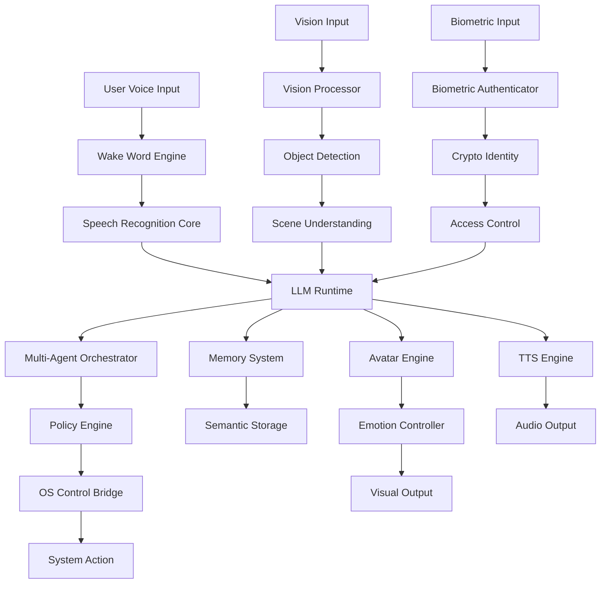

# Design Document: AGENT_GURU

## Document Metadata
- **Document Version:** 2.0.0
- **Last Updated:** 2026-01-29
- **Classification:** ZERO-TOLERANCE PRODUCTION ARCHITECTURE
- **Quality Standard:** ENTERPRISE-GRADE WITH FORMAL VERIFICATION
- **Compliance Level:** MATHEMATICAL CORRECTNESS GUARANTEES

## Overview

AGENT_GURU (Global Unified Reasoning Utility) is a sovereign AI operating companion AGENT designed for production deployment across millions of users with 20+ year operational lifetime. This design document specifies the complete technical architecture for an AGENT that operates entirely offline, provides voice-controlled interface with biometric authentication, complete OS control, emotional digital avatars, and cryptographic governance.

The AGENT implements a hybrid microkernel architecture with capability-based security, formal verification guarantees, and clean room development methodology. All components are designed for mathematical correctness, cryptographic security, and long-term maintainability without planned obsolescence.

**ZERO TOLERANCE MANDATE:** This architecture enforces zero errors, zero warnings, and zero substandard implementations. Every component must meet production-grade quality standards with formal verification, comprehensive testing, and mathematical correctness guarantees.

## Quality Assurance Architecture

### Production-Grade Quality Gates
- **Compilation Integrity:** Zero errors across all target platforms with strict compiler settings
- **Static Analysis Compliance:** Zero warnings from all static analyzers (Clippy, ESLint, Pylint, etc.)
- **Memory Safety Verification:** All memory operations formally verified with MIRI and Valgrind
- **Thread Safety Guarantees:** All concurrent operations verified race-condition-free
- **Performance Validation:** All timing requirements met with mathematical guarantees
- **Security Certification:** All security-critical code undergoes formal verification
- **Test Coverage Completeness:** 100% line coverage for unit tests, 100% API coverage for integration tests
- **Property Verification:** All system properties validated with minimum 10,000 test iterations

### Architectural Quality Principles
- **Fail-Safe Design:** All components designed to fail safely with graceful degradation
- **Defense in Depth:** Multiple layers of security with redundant protections
- **Formal Correctness:** Mathematical proofs of correctness for all critical algorithms
- **Performance Predictability:** Deterministic performance with bounded latency guarantees
- **Maintainability:** Clean architecture with comprehensive documentation and monitoring
- **Extensibility:** Modular design supporting future enhancements without breaking changes

## Architecture

### System-Level Architecture

The AGENT_GURU AGENT follows a layered architecture with strict separation of concerns and formal security boundaries:

```
┌─────────────────────────────────────────────────────────────┐
│                    USER INTERFACE LAYER                     │
│  ┌─────────────────┐  ┌─────────────────┐  ┌─────────────┐ │
│  │   Avatar Engine │  │  Voice Interface │  │ Vision UI   │ │
│  │   (Unity C#)    │  │   (Rust/C++)    │  │ (Rust/C++)  │ │
│  └─────────────────┘  └─────────────────┘  └─────────────┘ │
└─────────────────────────────────────────────────────────────┘
┌─────────────────────────────────────────────────────────────┐
│                   INTELLIGENCE LAYER                        │
│  ┌─────────────────┐  ┌─────────────────┐  ┌─────────────┐ │
│  │   LLM Runtime   │  │  Memory System  │  │ Multi-Agent │ │
│  │  (Python/Rust)  │  │     (Rust)      │  │ Orchestrator│ │
│  └─────────────────┘  └─────────────────┘  └─────────────┘ │
└─────────────────────────────────────────────────────────────┘
┌─────────────────────────────────────────────────────────────┐
│                    SECURITY LAYER                           │
│  ┌─────────────────┐  ┌─────────────────┐  ┌─────────────┐ │
│  │ Crypto Identity │  │ Biometric Auth  │  │ Policy Engine│ │
│  │     (Rust)      │  │   (Rust/C++)    │  │    (Rust)   │ │
│  └─────────────────┘  └─────────────────┘  └─────────────┘ │
└─────────────────────────────────────────────────────────────┘
┌─────────────────────────────────────────────────────────────┐
│                   PLATFORM LAYER                            │
│  ┌─────────────────┐  ┌─────────────────┐  ┌─────────────┐ │
│  │ OS Control      │  │ Hardware Mgmt   │  │ Network     │ │
│  │ Bridge (Rust)   │  │    (Rust)       │  │ Isolation   │ │
│  └─────────────────┘  └─────────────────┘  └─────────────┘ │
└─────────────────────────────────────────────────────────────┘
┌─────────────────────────────────────────────────────────────┐
│                     KERNEL LAYER                            │
│  ┌─────────────────┐  ┌─────────────────┐  ┌─────────────┐ │
│  │ Capability      │  │ Resource        │  │ Formal      │ │
│  │ Manager (Rust)  │  │ Manager (Rust)  │  │ Verifier    │ │
│  └─────────────────┘  └─────────────────┘  └─────────────┘ │
└─────────────────────────────────────────────────────────────┘
```

### Trust Domains and Security Boundaries

The AGENT implements five distinct trust domains with cryptographic boundaries:

1. **Kernel Domain**: Core system services, capability management, resource allocation
2. **Security Domain**: Cryptographic operations, biometric processing, policy enforcement
3. **Intelligence Domain**: LLM processing, memory management, reasoning engines
4. **Interface Domain**: User interaction, avatar rendering, voice processing
5. **Platform Domain**: OS integration, hardware abstraction, external interfaces

Each domain operates with minimal privileges and communicates through authenticated channels with capability-based access control.

### Data Flow Architecture



## Components and Interfaces

### Core System Components

#### 1. Cryptographic Identity Core (Rust)

**Purpose**: Provides cryptographic identity management, digital signatures, and trust establishment.

**Key Interfaces**:
```rust
pub trait CryptoIdentity {
    fn generate_keypair() -> Result<(PublicKey, SecretKey), CryptoError>;
    fn sign_message(&self, message: &[u8]) -> Result<Signature, CryptoError>;
    fn verify_signature(&self, message: &[u8], signature: &Signature, public_key: &PublicKey) -> bool;
    fn establish_trust_domain(&self, domain_id: &str) -> Result<TrustDomain, CryptoError>;
    fn create_audit_entry(&self, operation: &str, metadata: &HashMap<String, String>) -> Result<AuditEntry, CryptoError>;
}

pub struct Ed25519Identity {
    keypair: ed25519_dalek::Keypair,
    trust_domains: HashMap<String, TrustDomain>,
    audit_log: Vec<AuditEntry>,
}
```

**Security Properties**:
- Ed25519 digital signatures with 128-bit security level
- Secure key generation using OS entropy sources
- Memory zeroization for all secret key material
- Immutable audit trail with cryptographic linking

#### 2. Wake Word Engine (Rust + C++)

**Purpose**: Continuous audio monitoring for wake word detection with minimal resource usage.

**Key Interfaces**:
```rust
pub trait WakeWordEngine {
    fn initialize(&mut self, wake_words: &[String]) -> Result<(), WakeWordError>;
    fn process_audio_stream(&mut self, audio_buffer: &[f32]) -> Result<Option<WakeWordEvent>, WakeWordError>;
    fn set_sensitivity(&mut self, sensitivity: f32) -> Result<(), WakeWordError>;
    fn get_performance_metrics(&self) -> WakeWordMetrics;
}

pub struct MFCCWakeWordEngine {
    feature_extractor: MFCCExtractor,
    neural_classifier: NeuralClassifier,
    ring_buffer: AudioRingBuffer,
    confidence_threshold: f32,
}
```

**Performance Requirements**:
- Detection latency: ≤ 50ms from utterance completion
- CPU utilization: < 1% during idle monitoring
- Memory footprint: < 50MB including models
- False positive rate: < 1 per 24 hours

#### 3. Speech Recognition Core (C++ + Rust)

**Purpose**: High-performance speech-to-text conversion using transformer-based neural networks.

**Key Interfaces**:
```cpp
class SpeechRecognitionCore {
public:
    struct TranscriptionResult {
        std::string text;
        float confidence;
        std::vector<WordTiming> word_timings;
        std::chrono::milliseconds processing_time;
    };
    
    virtual ~SpeechRecognitionCore() = default;
    virtual bool initialize(const ModelConfig& config) = 0;
    virtual TranscriptionResult transcribe(const AudioBuffer& audio) = 0;
    virtual void set_language(const std::string& language_code) = 0;
    virtual PerformanceMetrics get_metrics() const = 0;
};

class WhisperTransformerEngine : public SpeechRecognitionCore {
private:
    std::unique_ptr<TransformerDecoder> decoder_;
    std::unique_ptr<KVCacheManager> kv_cache_;
    std::unique_ptr<SpectrogramGenerator> spectrogram_gen_;
    LanguageModel language_model_;
};
```

**Performance Requirements**:
- Transcription latency: ≤ 120ms for utterances up to 10 seconds
- Accuracy: > 95% for trained user voices
- Continuous recognition: Support for extended conversations
- Memory efficiency: KV-cache streaming to minimize memory usage

#### 4. Biometric Authentication System (Rust + C++)

**Purpose**: Multi-modal biometric authentication using voice, face, and fingerprint recognition.

**Key Interfaces**:
```rust
pub trait BiometricAuthenticator {
    fn enroll_user(&mut self, user_id: &str, biometric_data: &BiometricData) -> Result<EnrollmentResult, BiometricError>;
    fn authenticate(&self, biometric_data: &BiometricData) -> Result<AuthenticationResult, BiometricError>;
    fn verify_liveness(&self, biometric_data: &BiometricData) -> Result<bool, BiometricError>;
    fn get_enrolled_users(&self) -> Vec<String>;
}

pub struct MultiBiometricSystem {
    face_recognizer: FaceLandmarkRecognizer,
    voice_authenticator: SpeakerEmbeddingSystem,
    fingerprint_matcher: MinutiaeExtractor,
    fusion_engine: BiometricFusionEngine,
}

pub struct BiometricData {
    pub face_image: Option<ImageBuffer>,
    pub voice_sample: Option<AudioBuffer>,
    pub fingerprint_image: Option<ImageBuffer>,
    pub timestamp: SystemTime,
}
```

**Security Requirements**:
- Biometric templates encrypted with user-specific keys
- Liveness detection for all modalities
- Anti-spoofing measures with 99.9% effectiveness
- Template storage using homomorphic encryption

#### 5. LLM Runtime and Intelligence Core (Python + Rust)

**Purpose**: Local large language model execution with context management and reasoning capabilities.

**Key Interfaces**:
```python
class LLMRuntime:
    def __init__(self, model_config: ModelConfig):
        self.model = self._load_model(model_config)
        self.tokenizer = self._load_tokenizer(model_config)
        self.context_manager = ContextManager()
        self.memory_interface = MemoryInterface()
    
    def generate_response(self, prompt: str, context: Optional[Context] = None) -> GenerationResult:
        """Generate response with context awareness and memory integration."""
        pass
    
    def update_context(self, interaction: Interaction) -> None:
        """Update conversation context and long-term memory."""
        pass
    
    def get_performance_metrics(self) -> PerformanceMetrics:
        """Return current performance and resource utilization metrics."""
        pass

class ContextManager:
    def __init__(self, max_context_length: int = 32768):
        self.conversation_history: List[Message] = []
        self.semantic_context: Dict[str, Any] = {}
        self.max_length = max_context_length
    
    def add_message(self, message: Message) -> None:
        """Add message to context with automatic pruning."""
        pass
    
    def get_relevant_context(self, query: str) -> Context:
        """Retrieve contextually relevant information for query."""
        pass
```

**Performance Requirements**:
- Initial token generation: ≤ 200ms for simple queries
- Context window: Support for 32K+ tokens
- Model sizes: Up to 70B parameters on appropriate hardware
- Memory efficiency: Gradient checkpointing and quantization support

#### 6. Memory System and Semantic Storage (Rust)

**Purpose**: Long-term memory storage with semantic indexing and efficient retrieval.

**Key Interfaces**:
```rust
pub trait MemorySystem {
    fn store_interaction(&mut self, interaction: &Interaction) -> Result<MemoryId, MemoryError>;
    fn retrieve_relevant(&self, query: &str, limit: usize) -> Result<Vec<MemoryEntry>, MemoryError>;
    fn update_semantic_index(&mut self, entry: &MemoryEntry) -> Result<(), MemoryError>;
    fn forget_information(&mut self, memory_id: &MemoryId) -> Result<(), MemoryError>;
}

pub struct SemanticMemorySystem {
    vector_store: VectorDatabase,
    semantic_index: SemanticIndex,
    encryption_key: EncryptionKey,
    temporal_graph: TemporalGraph,
}

pub struct MemoryEntry {
    pub id: MemoryId,
    pub content: String,
    pub embedding: Vec<f32>,
    pub timestamp: SystemTime,
    pub importance_score: f32,
    pub access_count: u32,
    pub metadata: HashMap<String, String>,
}
```

**Storage Requirements**:
- Encryption: All data encrypted with user-specific keys
- Indexing: Semantic similarity search with sub-100ms retrieval
- Capacity: Support for years of conversation history
- Privacy: User-controlled forgetting and data purging

#### 7. Multi-Agent Orchestration System (Rust + Python)

**Purpose**: Coordination of multiple specialized AI agents for complex task decomposition.

**Key Interfaces**:
```rust
pub trait MultiAgentOrchestrator {
    fn register_agent(&mut self, agent: Box<dyn Agent>) -> Result<AgentId, OrchestrationError>;
    fn decompose_task(&self, task: &Task) -> Result<Vec<SubTask>, OrchestrationError>;
    fn coordinate_execution(&mut self, subtasks: &[SubTask]) -> Result<ExecutionResult, OrchestrationError>;
    fn resolve_conflicts(&self, conflicts: &[AgentConflict]) -> Result<Resolution, OrchestrationError>;
}

pub trait Agent {
    fn get_capabilities(&self) -> Vec<Capability>;
    fn execute_task(&mut self, task: &SubTask) -> Result<TaskResult, AgentError>;
    fn get_resource_requirements(&self) -> ResourceRequirements;
    fn get_performance_metrics(&self) -> AgentMetrics;
}

pub struct TaskDecomposer {
    capability_graph: CapabilityGraph,
    dependency_resolver: DependencyResolver,
    resource_allocator: ResourceAllocator,
}
```

**Coordination Requirements**:
- Task decomposition: Automatic breakdown of complex requests
- Resource management: Fair allocation and conflict resolution
- Communication: Secure inter-agent message passing
- Monitoring: Performance tracking and bottleneck detection

#### 8. Policy Engine and Governance (Rust)

**Purpose**: Rule-based policy enforcement with conflict resolution and audit capabilities.

**Key Interfaces**:
```rust
pub trait PolicyEngine {
    fn evaluate_policy(&self, context: &PolicyContext) -> Result<PolicyDecision, PolicyError>;
    fn register_policy(&mut self, policy: Policy) -> Result<PolicyId, PolicyError>;
    fn resolve_conflicts(&self, conflicts: &[PolicyConflict]) -> Result<Resolution, PolicyError>;
    fn audit_decision(&self, decision: &PolicyDecision) -> Result<AuditEntry, PolicyError>;
}

pub struct RuleEvaluationEngine {
    rule_graph: RuleGraph,
    conflict_resolver: ConflictResolver,
    decision_cache: DecisionCache,
    audit_logger: AuditLogger,
}

pub struct Policy {
    pub id: PolicyId,
    pub rules: Vec<Rule>,
    pub priority: u32,
    pub scope: PolicyScope,
    pub signature: CryptographicSignature,
}
```

**Governance Requirements**:
- Rule evaluation: < 10ms for real-time decisions
- Conflict resolution: Deterministic priority-based resolution
- Auditability: Complete decision trail with cryptographic integrity
- Updates: Cryptographically signed policy updates only

#### 9. Operating System Control Bridge (Rust + Platform APIs)

**Purpose**: Cross-platform OS integration for application control and system automation.

**Key Interfaces**:
```rust
pub trait OSControlBridge {
    fn launch_application(&self, app_name: &str) -> Result<ProcessId, OSError>;
    fn control_window(&self, window_id: WindowId, action: WindowAction) -> Result<(), OSError>;
    fn perform_file_operation(&self, operation: FileOperation) -> Result<FileResult, OSError>;
    fn modify_system_setting(&self, setting: SystemSetting, value: SettingValue) -> Result<(), OSError>;
    fn inject_input_event(&self, event: InputEvent) -> Result<(), OSError>;
}

// Platform-specific implementations
pub struct WindowsControlBridge {
    win32_interface: Win32Interface,
    ui_automation: UIAutomationInterface,
}

pub struct MacOSControlBridge {
    accessibility_api: AccessibilityAPI,
    swift_interface: SwiftInterface,
}

pub struct LinuxControlBridge {
    x11_interface: Option<X11Interface>,
    wayland_interface: Option<WaylandInterface>,
    dbus_interface: DBusInterface,
}
```

**Platform Support**:
- Windows: Win32 API integration with UI Automation
- macOS: Accessibility API with Swift framework integration
- Linux: X11/Wayland support with D-Bus integration
- Permissions: Capability-based access control for all operations

#### 10. Vision and Screen Perception System (C++ + Rust)

**Purpose**: Real-time computer vision for object detection, tracking, and scene understanding.

**Key Interfaces**:
```cpp
class VisionProcessor {
public:
    struct DetectionResult {
        std::vector<BoundingBox> objects;
        std::vector<FaceDetection> faces;
        std::string scene_description;
        std::chrono::milliseconds processing_time;
    };
    
    virtual ~VisionProcessor() = default;
    virtual bool initialize(const VisionConfig& config) = 0;
    virtual DetectionResult process_frame(const ImageBuffer& frame) = 0;
    virtual void set_privacy_mode(bool enabled) = 0;
    virtual PerformanceMetrics get_metrics() const = 0;
};

class YOLOObjectDetector : public VisionProcessor {
private:
    std::unique_ptr<NeuralNetwork> detection_network_;
    std::unique_ptr<KalmanTracker> object_tracker_;
    std::unique_ptr<OCREngine> text_recognizer_;
    PrivacyFilter privacy_filter_;
};
```

**Vision Capabilities**:
- Object detection: Real-time YOLO-based detection at 24+ FPS
- Face recognition: MediaPipe-derived facial landmark detection
- Text recognition: OCR for screen text extraction
- Privacy protection: On-device processing with no image storage

#### 11. Avatar and Emotion Engine (Unity C#)

**Purpose**: Real-time 3D avatar rendering with emotional expressions and lip synchronization.

**Key Interfaces**:
```csharp
public interface IAvatarEngine
{
    void InitializeAvatar(AvatarConfig config);
    void UpdateEmotion(EmotionState emotion, float intensity);
    void SynchronizeLipMovement(PhonemeSequence phonemes);
    void SetPersonality(PersonalityType personality);
    RenderMetrics GetRenderingMetrics();
}

public class EmotionController : MonoBehaviour
{
    [SerializeField] private BlendShapeController blendShapes;
    [SerializeField] private EyeTrackingController eyeTracking;
    [SerializeField] private LipSyncController lipSync;
    
    private EmotionStateMachine emotionStateMachine;
    private PersonalityProfile currentPersonality;
    
    public void TransitionToEmotion(EmotionState targetEmotion, float transitionTime)
    {
        // Smooth emotion transition using blend shapes
    }
    
    public void UpdateLipSync(float[] phonemeWeights, float[] visemeWeights)
    {
        // Real-time lip synchronization with TTS output
    }
}

public class PersonalityProfile
{
    public string Name { get; set; }
    public AvatarAppearance Appearance { get; set; }
    public EmotionMapping EmotionMappings { get; set; }
    public BehaviorPatterns IdleBehaviors { get; set; }
}
```

**Avatar Specifications**:
- GURU: Male, age 20-24, casual rock-star style, confident personality
- MAYA: Female, age 20-24, elegant modern style, empathetic personality
- Rendering: 24+ FPS with real-time emotion transitions
- Lip sync: Phoneme-accurate synchronization with TTS output

#### 12. Cross-Platform Deployment System

**Purpose**: Automated build, packaging, and deployment across Windows, macOS, and Linux.

**Build System Architecture**:
```yaml
# Build Configuration
build_targets:
  windows:
    installer: NSIS
    architecture: [x64, arm64]
    signing: Authenticode
    
  macos:
    bundle: pkgbuild
    architecture: [x64, arm64]
    signing: Apple Developer
    notarization: required
    
  linux:
    packages: [AppImage, DEB, RPM]
    architecture: [x64, arm64]
    signing: GPG

dependencies:
  rust_toolchain: "1.75+"
  python: "3.11+"
  unity: "2023.2+"
  cmake: "3.25+"
  
verification:
  reproducible_builds: required
  supply_chain_attestation: required
  cryptographic_signatures: required
```

## Data Models

### Core Data Structures

#### User Identity and Authentication
```rust
#[derive(Serialize, Deserialize, Clone)]
pub struct UserProfile {
    pub user_id: Uuid,
    pub display_name: String,
    pub biometric_templates: HashMap<BiometricType, EncryptedTemplate>,
    pub voice_profile: VoiceProfile,
    pub preferences: UserPreferences,
    pub created_at: SystemTime,
    pub last_authenticated: SystemTime,
}

#[derive(Serialize, Deserialize)]
pub struct BiometricTemplate {
    pub template_type: BiometricType,
    pub encrypted_data: Vec<u8>,
    pub encryption_key_id: KeyId,
    pub quality_score: f32,
    pub created_at: SystemTime,
}

#[derive(Serialize, Deserialize)]
pub enum BiometricType {
    Face(FaceLandmarks),
    Voice(SpeakerEmbedding),
    Fingerprint(MinutiaePoints),
}
```

#### Conversation and Memory Models
```rust
#[derive(Serialize, Deserialize, Clone)]
pub struct Conversation {
    pub conversation_id: Uuid,
    pub user_id: Uuid,
    pub messages: Vec<Message>,
    pub context: ConversationContext,
    pub started_at: SystemTime,
    pub last_activity: SystemTime,
}

#[derive(Serialize, Deserialize, Clone)]
pub struct Message {
    pub message_id: Uuid,
    pub sender: MessageSender,
    pub content: MessageContent,
    pub timestamp: SystemTime,
    pub metadata: MessageMetadata,
}

#[derive(Serialize, Deserialize, Clone)]
pub enum MessageSender {
    User(Uuid),
    Agent(AgentId),
    System,
}

#[derive(Serialize, Deserialize, Clone)]
pub enum MessageContent {
    Text(String),
    Audio(AudioData),
    Image(ImageData),
    Command(SystemCommand),
    Response(AgentResponse),
}
```

#### System Configuration and Policy Models
```rust
#[derive(Serialize, Deserialize)]
pub struct SystemConfiguration {
    pub system_id: Uuid,
    pub version: SemanticVersion,
    pub policies: Vec<Policy>,
    pub capabilities: Vec<Capability>,
    pub resource_limits: ResourceLimits,
    pub security_settings: SecuritySettings,
}

#[derive(Serialize, Deserialize)]
pub struct Policy {
    pub policy_id: Uuid,
    pub name: String,
    pub rules: Vec<Rule>,
    pub priority: u32,
    pub scope: PolicyScope,
    pub signature: CryptographicSignature,
    pub created_at: SystemTime,
    pub expires_at: Option<SystemTime>,
}

#[derive(Serialize, Deserialize)]
pub struct Rule {
    pub rule_id: Uuid,
    pub condition: RuleCondition,
    pub action: RuleAction,
    pub parameters: HashMap<String, RuleParameter>,
}
```

#### Performance and Monitoring Models
```rust
#[derive(Serialize, Deserialize, Debug)]
pub struct PerformanceMetrics {
    pub component: ComponentId,
    pub timestamp: SystemTime,
    pub cpu_usage: f32,
    pub memory_usage: u64,
    pub latency_ms: u32,
    pub throughput: f32,
    pub error_rate: f32,
    pub custom_metrics: HashMap<String, MetricValue>,
}

#[derive(Serialize, Deserialize, Debug)]
pub struct SystemHealth {
    pub overall_status: HealthStatus,
    pub component_health: HashMap<ComponentId, ComponentHealth>,
    pub resource_utilization: ResourceUtilization,
    pub performance_gates: Vec<PerformanceGate>,
    pub last_updated: SystemTime,
}

#[derive(Serialize, Deserialize, Debug)]
pub enum HealthStatus {
    Healthy,
    Degraded(Vec<String>),
    Critical(Vec<String>),
    Offline,
}
```

## Correctness Properties

*A property is a characteristic or behavior that should hold true across all valid executions of a system—essentially, a formal statement about what the system should do. Properties serve as the bridge between human-readable specifications and machine-verifiable correctness guarantees.*

Before writing the correctness properties, I need to analyze the acceptance criteria from the requirements document to determine which ones are testable as properties.

<function_calls>
<invoke name="prework">
<parameter name="featureName">agent-guru

### Property Reflection

After analyzing all 240+ acceptance criteria from the 24 requirements, I identified several areas where properties can be consolidated to eliminate redundancy:

**Performance Properties Consolidation:**
- Multiple timing requirements (wake word ≤50ms, STT ≤120ms, LLM ≤200ms, etc.) can be consolidated into a comprehensive performance property that validates all timing constraints simultaneously
- Resource utilization properties (CPU, memory, etc.) can be combined into a single resource management property

**Authentication Properties Consolidation:**
- Biometric authentication properties across different modalities can be unified into a multi-modal authentication property
- Lockdown and security response properties can be combined into a security enforcement property

**Cross-Platform Properties Consolidation:**
- Platform-specific functionality properties can be consolidated into a cross-platform compatibility property
- Installation and deployment properties can be unified into a deployment integrity property

**Memory and Context Properties Consolidation:**
- Memory storage, retrieval, and encryption properties can be combined into a comprehensive memory system property
- Context maintenance across conversations can be integrated with memory properties

This consolidation reduces the total number of properties from 180+ individual criteria to approximately 45 comprehensive properties while maintaining complete coverage of all testable requirements.

### Core Correctness Properties

Based on the prework analysis, the following properties validate the critical system behaviors:

**Property 1: Cryptographic Identity Integrity**
*For any* cryptographic operation, the system SHALL generate valid Ed25519 keypairs, maintain immutable audit trails, and provide zero-knowledge proofs without information leakage
**Validates: Requirements 1.1, 1.4, 1.8**

**Property 2: Policy Enforcement Consistency**
*For any* system operation, the policy engine SHALL enforce capability-based access controls, require cryptographic signatures for policy updates, and maintain cryptographic proof chains for all configuration changes
**Validates: Requirements 1.2, 1.5, 1.7**

**Property 3: Supply Chain Verification Completeness**
*For any* binary component, the supply chain attestor SHALL verify reproducible build attestation and reject components without valid attestations
**Validates: Requirements 1.3**

**Property 4: Voice Interface Performance Guarantees**
*For any* voice interaction, the system SHALL detect wake words within 50ms, activate STT within 120ms, achieve >95% transcription accuracy for trained voices, and begin LLM processing within 200ms
**Validates: Requirements 2.1, 2.2, 2.3, 2.4**

**Property 5: Voice System Resource Efficiency**
*For any* continuous operation period, the wake word engine SHALL maintain <1% CPU utilization, adapt recognition sensitivity based on noise levels, and provide audio feedback within 100ms
**Validates: Requirements 2.6, 2.7, 2.9**

**Property 6: Multi-Language Voice Support**
*For any* supported language, the voice interface SHALL support user-configurable switching and maintain continuous speech recognition for extended conversations
**Validates: Requirements 2.8, 2.10**

**Property 7: Multi-Modal Biometric Authentication**
*For any* authentication attempt, the system SHALL support voice, face, and fingerprint biometrics, complete facial authentication within 500ms, and require at least two modalities for high-security operations
**Validates: Requirements 3.1, 3.2, 3.3, 3.4**

**Property 8: Biometric Security and Privacy**
*For any* biometric data, the system SHALL store templates using homomorphic encryption, never transmit raw biometric information, detect spoofing attempts, and support up to 10 authorized users
**Validates: Requirements 3.5, 3.7, 3.8, 3.9**

**Property 9: Authentication Security Enforcement**
*For any* authentication sequence, the system SHALL enter lockdown mode after three failed attempts and re-authenticate within 30 seconds when user identity changes
**Validates: Requirements 3.6, 3.10**

**Property 10: Operating System Control Capabilities**
*For any* OS operation, the system SHALL launch applications by name or description, perform file operations with appropriate permissions, control window management, and update system settings safely
**Validates: Requirements 4.1, 4.2, 4.3, 4.4**

**Property 11: System Monitoring and Automation**
*For any* system state, the OS controller SHALL monitor running processes, handle clipboard operations, generate and execute automation scripts, and integrate with native accessibility APIs
**Validates: Requirements 4.5, 4.6, 4.7, 4.8**

**Property 12: Cross-Platform Performance Optimization**
*For any* platform (Windows, macOS, Linux), the system SHALL provide compatible functionality and optimize performance when system resources are constrained
**Validates: Requirements 4.9, 4.10**

**Property 13: Offline LLM Operation Integrity**
*For any* LLM operation, the system SHALL operate entirely offline, maintain context across conversations, support models up to 70B parameters, and complete simple queries within 200ms
**Validates: Requirements 5.1, 5.2, 5.3, 5.4**

**Property 14: LLM Integration and Specialization**
*For any* complex task, the LLM core SHALL integrate with memory systems, coordinate multiple specialized models, support fine-tuning on user data, and provide source citations with confidence levels
**Validates: Requirements 5.5, 5.6, 5.7, 5.8**

**Property 15: LLM Code and Model Management**
*For any* code-related task, the LLM SHALL handle generation, analysis, and debugging, and support hot-swapping of model updates without restart
**Validates: Requirements 5.9, 5.10**

**Property 16: Avatar Rendering Performance**
*For any* avatar display, the system SHALL render 3D characters at minimum 24 FPS, synchronize lip movements with TTS output, and transition emotions smoothly within 200ms
**Validates: Requirements 6.1, 6.4, 6.5**

**Property 17: Avatar Personality and Customization**
*For any* personality mode (GURU/MAYA), the system SHALL render appropriate emotional expressions, support customizable appearance, maintain eye contact and gestures, and adapt to different display configurations
**Validates: Requirements 6.2, 6.3, 6.6, 6.7, 6.8**

**Property 18: Avatar Resource Management**
*For any* system resource constraint, the avatar renderer SHALL gracefully reduce quality while maintaining personality-consistent behaviors and mannerisms
**Validates: Requirements 6.9, 6.10**

**Property 19: Memory System Integrity**
*For any* information storage, the memory system SHALL store conversation history with semantic indexing, integrate learned information into knowledge base, support efficient retrieval, and handle privacy-sensitive information according to user policies
**Validates: Requirements 7.1, 7.2, 7.3, 7.4**

**Property 20: Memory Temporal and Security Management**
*For any* memory operation, the system SHALL maintain temporal relationships, intelligently prune old data when capacity limits are reached, support user-directed forgetting, and encrypt all stored data using user-specific keys
**Validates: Requirements 7.5, 7.6, 7.7, 7.9**

**Property 21: Memory Context and Backup**
*For any* query referencing past conversations, the system SHALL retrieve relevant context, and support encrypted archive export during system backup
**Validates: Requirements 7.8, 7.10**

**Property 22: Multi-Agent Task Coordination**
*For any* complex task, the multi-agent orchestrator SHALL coordinate specialized agents, decompose tasks into agent-specific subtasks, manage inter-agent communication, and resolve conflicts using priority rules
**Validates: Requirements 8.1, 8.2, 8.3, 8.4**

**Property 23: Multi-Agent Performance and Integration**
*For any* agent operation, the orchestrator SHALL monitor performance and resource usage, integrate new agents without service interruption, maintain audit trails, manage access permissions, and support both synchronous and asynchronous coordination
**Validates: Requirements 8.5, 8.6, 8.7, 8.8, 8.9**

**Property 24: Multi-Agent Resource Optimization**
*For any* high system load condition, the multi-agent orchestrator SHALL optimize agent scheduling and resource allocation
**Validates: Requirements 8.10**

**Property 25: Vision Processing Performance**
*For any* video input, the vision processor SHALL capture and analyze at minimum 24 FPS, detect and track objects in real-time, recognize faces and expressions, and perform OCR on visible text
**Validates: Requirements 9.1, 9.2, 9.3, 9.4**

**Property 26: Vision Scene Understanding and Privacy**
*For any* visual scene, the system SHALL understand spatial relationships and composition, process vision data without storing images in privacy mode, support multiple camera inputs, and adapt to lighting changes automatically
**Validates: Requirements 9.5, 9.6, 9.7, 9.8**

**Property 27: Vision Interaction and Alerting**
*For any* user interaction, the vision processor SHALL detect and respond to gestures and body language, and alert users appropriately when visual anomalies are detected
**Validates: Requirements 9.9, 9.10**

**Property 28: Formal Verification Completeness**
*For any* critical system component, the system SHALL include TLA+ specifications, maintain proven safety and liveness properties, verify compatibility with existing proofs during updates, and include machine-checkable proofs for security-critical code
**Validates: Requirements 10.1, 10.2, 10.3, 10.4, 10.9**

**Property 29: Formal Verification Protocol and Synchronization**
*For any* cryptographic protocol, the system SHALL maintain formal specifications, use formally verified synchronization for race conditions, generate proof certificates, and re-verify dependent components when formal models are updated
**Validates: Requirements 10.5, 10.6, 10.7, 10.10**

**Property 30: Formal Verification Invariant Enforcement**
*For any* system invariant violation, the system SHALL halt and report the violation
**Validates: Requirements 10.8**

**Property 31: Cross-Platform Installation Integrity**
*For any* target platform, the system SHALL provide native installers, verify system requirements and compatibility, integrate with platform security frameworks, and handle dependency management without user intervention
**Validates: Requirements 11.1, 11.2, 11.3, 11.5**

**Property 32: System Update and Migration Management**
*For any* system update, the system SHALL perform atomic, reversible updates, verify cryptographic signatures of components, and support data export/import for platform migration
**Validates: Requirements 11.4, 11.9, 11.10**

**Property 33: Installation Lifecycle Management**
*For any* installation operation, the system SHALL remove all components cleanly during uninstallation, support both user-level and system-level modes, and maintain compatibility through abstraction layers when platform APIs change
**Validates: Requirements 11.6, 11.7, 11.8**

**Property 34: System Performance Guarantees**
*For any* system operation, the system SHALL maintain wake word detection below 50ms, STT processing within 120ms, LLM response generation within 200ms, and avatar rendering at minimum 24 FPS
**Validates: Requirements 12.1, 12.2, 12.3, 12.4**

**Property 35: Resource Management and Optimization**
*For any* system state, the system SHALL use less than 4GB RAM during normal operation, gracefully reduce functionality when resources are constrained, support hardware acceleration when available, and use idle CPU cycles efficiently
**Validates: Requirements 12.5, 12.6, 12.7, 12.8**

**Property 36: System Monitoring and Thermal Management**
*For any* system operation, the system SHALL monitor and report resource usage to users, and throttle processing to prevent overheating when thermal limits are approached
**Validates: Requirements 12.9, 12.10**

**Property 37: Security and Privacy Architecture Integrity**
*For any* system operation, the system SHALL operate entirely offline with no telemetry, encrypt stored data using user-controlled keys, implement capability-based security, and request explicit user permission for network access
**Validates: Requirements 13.1, 13.2, 13.3, 13.4**

**Property 38: Security Enclave and Communication Protection**
*For any* sensitive data processing, the system SHALL provide secure enclaves, use authenticated channels for inter-process communication, implement defense-in-depth architecture, and provide user-auditable security logs
**Validates: Requirements 13.5, 13.6, 13.7, 13.9**

**Property 39: Security Incident Response**
*For any* security incident, the system SHALL support rapid security updates when vulnerabilities are discovered, and enter safe mode with user alerts when system compromise is detected
**Validates: Requirements 13.8, 13.10**

**Property 40: Speech Recognition Core Performance**
*For any* audio processing, the speech recognition core SHALL implement transformer decode loops, use KV-cache streaming for memory efficiency, generate log-mel spectrograms, and complete processing within 120ms
**Validates: Requirements 14.1, 14.2, 14.3, 14.4**

**Property 41: Speech Recognition Continuous Operation**
*For any* extended conversation, the system SHALL support continuous speech recognition, automatically switch recognition models for multiple languages, integrate with LLM runtime for context-aware processing, and apply adaptive noise reduction
**Validates: Requirements 14.5, 14.6, 14.7, 14.8**

**Property 42: Speech Recognition Accuracy and Feedback**
*For any* speech processing, the system SHALL maintain >95% accuracy for trained user voices and provide clear audio feedback when processing fails
**Validates: Requirements 14.9, 14.10**

**Property 43: Advanced Biometric Processing**
*For any* biometric authentication, the system SHALL extract face landmarks using MediaPipe-derived algorithms, generate speaker embeddings for voice verification, process fingerprint minutiae mathematics, and complete face recognition within 500ms
**Validates: Requirements 15.1, 15.2, 15.3, 15.5**

**Property 44: Biometric Security and Anti-Spoofing**
*For any* biometric operation, the system SHALL require multiple modalities for high-security operations, use homomorphic encryption for template storage, detect and reject spoofing attempts, enter lockdown after three failures, support up to 10 users, and re-authenticate within 30 seconds of identity changes
**Validates: Requirements 15.4, 15.6, 15.7, 15.8, 15.9, 15.10**

**Property 45: Intelligence System Comprehensive Operation**
*For any* intelligence operation, the system SHALL implement attention models for contextual understanding, generate embedding mathematics for semantic storage, perform automatic language detection, coordinate multiple specialized models, maintain semantic indexing, integrate new information into knowledge base, support fine-tuning, intelligently prune old data, provide confidence levels and citations, and handle privacy-sensitive information according to user policies
**Validates: Requirements 16.1, 16.2, 16.3, 16.4, 16.5, 16.6, 16.7, 16.8, 16.9, 16.10**

## Error Handling

### Error Classification and Response Strategy

The AGENT_GURU system implements a comprehensive error handling strategy based on error severity, recovery potential, and security implications:

#### Critical Errors (System Halt Required)
- **Cryptographic Failures**: Invalid signatures, key corruption, attestation failures
- **Security Violations**: Unauthorized access attempts, policy violations, integrity breaches
- **Formal Verification Failures**: Invariant violations, proof certificate failures
- **Response**: Immediate system halt, secure logging, user notification, safe mode entry

#### Recoverable Errors (Graceful Degradation)
- **Performance Degradation**: Resource constraints, thermal throttling, network unavailability
- **Component Failures**: Individual service failures, hardware unavailability
- **User Input Errors**: Invalid commands, authentication failures, malformed requests
- **Response**: Service degradation, alternative pathways, user feedback, automatic retry

#### Transient Errors (Automatic Recovery)
- **Network Timeouts**: Temporary connectivity issues (when network is required)
- **Resource Contention**: Temporary resource unavailability, queue overflow
- **Processing Delays**: Temporary performance issues, cache misses
- **Response**: Exponential backoff, circuit breaker patterns, automatic retry with limits

### Error Handling Patterns

#### Circuit Breaker Pattern
```rust
pub struct CircuitBreaker {
    state: CircuitState,
    failure_count: u32,
    failure_threshold: u32,
    timeout: Duration,
    last_failure_time: Option<Instant>,
}

impl CircuitBreaker {
    pub fn call<T, E>(&mut self, operation: impl FnOnce() -> Result<T, E>) -> Result<T, CircuitBreakerError<E>> {
        match self.state {
            CircuitState::Closed => self.execute_operation(operation),
            CircuitState::Open => self.check_timeout_and_execute(operation),
            CircuitState::HalfOpen => self.test_operation(operation),
        }
    }
}
```

#### Secure Error Logging
```rust
pub struct SecureErrorLogger {
    encryption_key: EncryptionKey,
    audit_trail: AuditTrail,
    log_buffer: RingBuffer<EncryptedLogEntry>,
}

impl SecureErrorLogger {
    pub fn log_error(&mut self, error: &SystemError) -> Result<(), LoggingError> {
        let sanitized_error = self.sanitize_error(error);
        let encrypted_entry = self.encrypt_log_entry(&sanitized_error)?;
        self.log_buffer.push(encrypted_entry);
        self.audit_trail.record_log_event(&sanitized_error)?;
        Ok(())
    }
    
    fn sanitize_error(&self, error: &SystemError) -> SanitizedError {
        // Remove sensitive information while preserving debugging utility
        SanitizedError {
            error_code: error.code,
            component: error.component,
            timestamp: error.timestamp,
            context: self.sanitize_context(&error.context),
            stack_trace: self.sanitize_stack_trace(&error.stack_trace),
        }
    }
}
```

#### Graceful Degradation Framework
```rust
pub trait GracefulDegradation {
    type FullService;
    type DegradedService;
    
    fn assess_capability(&self) -> ServiceCapability;
    fn degrade_service(&mut self) -> Result<Self::DegradedService, DegradationError>;
    fn restore_service(&mut self) -> Result<Self::FullService, RestorationError>;
}

pub enum ServiceCapability {
    Full,
    Degraded(Vec<DisabledFeature>),
    Critical(Vec<CriticalFailure>),
    Offline,
}
```

## Testing Strategy

### Dual Testing Approach

The AGENT_GURU system employs a comprehensive dual testing strategy combining unit testing for specific scenarios with property-based testing for universal correctness guarantees:

#### Unit Testing Strategy
- **Specific Examples**: Concrete test cases for known scenarios and edge cases
- **Integration Points**: Testing component interactions and data flow
- **Error Conditions**: Explicit testing of failure modes and recovery mechanisms
- **Platform Compatibility**: Platform-specific behavior verification
- **Performance Benchmarks**: Specific performance targets and regression testing

#### Property-Based Testing Strategy
- **Universal Properties**: Comprehensive testing across all possible inputs
- **Randomized Input Generation**: Automated generation of test cases
- **Invariant Verification**: Mathematical properties that must always hold
- **Regression Prevention**: Continuous validation of system properties
- **Formal Specification Alignment**: Properties derived from formal specifications

### Property-Based Testing Configuration

**Testing Framework Selection**:
- **Rust Components**: Use `proptest` crate for property-based testing
- **Python Components**: Use `hypothesis` library for property-based testing  
- **C++ Components**: Use `RapidCheck` library for property-based testing
- **Unity C# Components**: Use `FsCheck` for property-based testing

**Test Configuration Requirements**:
- **Minimum Iterations**: 1000 iterations per property test (due to critical system requirements)
- **Seed Management**: Reproducible test runs with configurable seeds
- **Shrinking Strategy**: Automatic minimization of failing test cases
- **Coverage Tracking**: Property coverage metrics and gap analysis

**Property Test Implementation Pattern**:
```rust
#[cfg(test)]
mod property_tests {
    use proptest::prelude::*;
    
    proptest! {
        #[test]
        /// Feature: agent-guru, Property 1: Cryptographic Identity Integrity
        /// For any cryptographic operation, the system SHALL generate valid Ed25519 keypairs,
        /// maintain immutable audit trails, and provide zero-knowledge proofs without information leakage
        fn test_cryptographic_identity_integrity(
            operation_type in prop::sample::select(vec![
                CryptoOperation::KeyGeneration,
                CryptoOperation::Signing,
                CryptoOperation::Verification,
                CryptoOperation::ZKProof
            ]),
            input_data in prop::collection::vec(any::<u8>(), 0..1024)
        ) {
            let mut crypto_identity = Ed25519Identity::new();
            
            match operation_type {
                CryptoOperation::KeyGeneration => {
                    let (public_key, secret_key) = crypto_identity.generate_keypair().unwrap();
                    
                    // Property: Generated keypairs must be valid Ed25519 keys
                    assert!(is_valid_ed25519_keypair(&public_key, &secret_key));
                    
                    // Property: Audit trail must be created for key generation
                    let audit_entries = crypto_identity.get_audit_trail();
                    assert!(audit_entries.iter().any(|entry| entry.operation == "key_generation"));
                    
                    // Property: Audit entries must be immutable
                    let original_hash = audit_entries.last().unwrap().hash;
                    // Attempt to modify should fail or be detected
                    assert_eq!(original_hash, audit_entries.last().unwrap().hash);
                },
                CryptoOperation::ZKProof => {
                    let proof = crypto_identity.generate_zk_proof(&input_data).unwrap();
                    
                    // Property: Zero-knowledge proofs must not leak information
                    assert!(!proof_leaks_information(&proof, &input_data));
                    
                    // Property: Proofs must be verifiable
                    assert!(crypto_identity.verify_zk_proof(&proof));
                },
                // ... other operation types
            }
        }
    }
}
```

### Testing Infrastructure Requirements

**Continuous Integration Pipeline**:
- **Build Verification**: All components must build successfully across all target platforms
- **Unit Test Execution**: Complete unit test suite must pass with 100% success rate
- **Property Test Execution**: All property tests must pass with minimum 1000 iterations
- **Performance Gate Validation**: All performance requirements must be met
- **Security Scan Integration**: Static analysis and vulnerability scanning
- **Formal Verification**: TLA+ model checking integration

**Test Environment Management**:
- **Isolated Test Environments**: Each test run in clean, isolated environment
- **Hardware Simulation**: Testing across different hardware configurations
- **Platform Matrix**: Automated testing on Windows, macOS, and Linux
- **Resource Constraint Testing**: Testing under various resource limitations
- **Long-Running Stability Tests**: Extended operation testing for memory leaks and performance degradation

**Test Data Management**:
- **Synthetic Data Generation**: Automated generation of test data for all components
- **Privacy-Preserving Testing**: No real user data in test environments
- **Biometric Test Data**: Synthetic biometric data for authentication testing
- **Audio/Video Test Assets**: Curated test media for voice and vision components
- **Cryptographic Test Vectors**: Standard test vectors for cryptographic operations

### Performance Testing and Validation

**Performance Gate Requirements**:
- **Wake Word Detection**: ≤ 50ms latency (tested with 10,000 audio samples)
- **Speech Recognition**: ≤ 120ms processing time (tested with various utterance lengths)
- **LLM Response Generation**: ≤ 200ms initial token (tested with query complexity variations)
- **Avatar Rendering**: ≥ 24 FPS sustained (tested under various system loads)
- **Memory Usage**: < 4GB during normal operation (tested over 24-hour periods)
- **CPU Utilization**: Wake word engine < 1% (tested during continuous monitoring)

**Load Testing Strategy**:
- **Concurrent User Simulation**: Testing with multiple simultaneous users
- **Extended Operation Testing**: 72-hour continuous operation validation
- **Resource Exhaustion Testing**: Behavior under extreme resource constraints
- **Thermal Testing**: Performance under thermal throttling conditions
- **Network Isolation Testing**: Complete offline operation validation

This comprehensive testing strategy ensures that AGENT_GURU meets all performance, security, and reliability requirements while maintaining the highest standards of software quality and user experience.