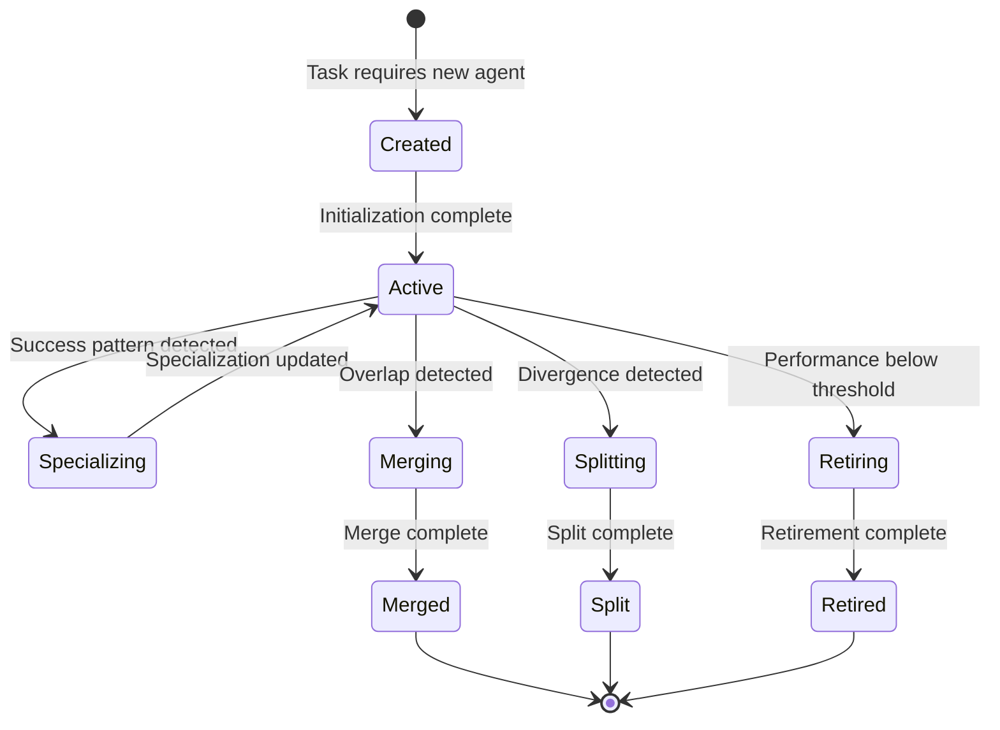
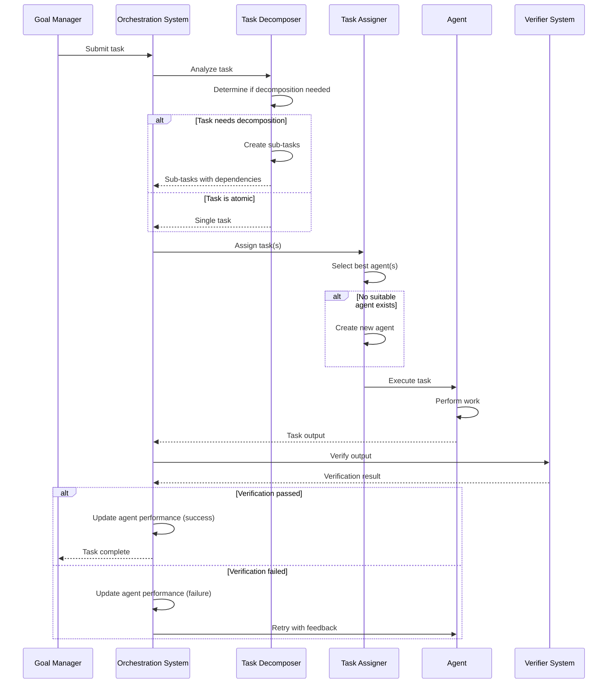

# Design Document: Agent Orchestration System

## Overview

The Agent Orchestration System is the core innovation of Agent_Guru that enables emergent multi-agent behavior through dynamic agent creation, specialization, merging, and evolution. Unlike traditional agent frameworks with static roles (researcher, coder, planner), this system creates agents on-demand based on task requirements and allows them to specialize, merge, split, and evolve based on performance patterns.

**Core Innovation**: Agents are NOT pre-defined roles but dynamically created entities that emerge from task patterns. The system demonstrates measurable improvement in task assignment over time through self-organization and optimization of the agent population.

**Key Capabilities**:
- **Dynamic Agent Creation**: Create agents on-demand based on task requirements
- **Emergent Specialization**: Agents automatically specialize based on task success patterns
- **Agent Merging**: Merge agents with overlapping specializations to reduce redundancy
- **Agent Splitting**: Split agents when they develop distinct sub-specializations
- **Optimal Task Assignment**: Assign tasks to most appropriate agents based on specialization
- **Performance Tracking**: Track success rate, completion time, and resource usage per agent
- **Agent Communication**: Agents can request information and delegate sub-tasks
- **Loop Prevention**: Detect and prevent infinite delegation loops
- **Population Optimization**: Maintain optimal agent population size
- **Evolution Tracking**: Record all agent evolution events to GitHub

**Architecture Principles**:
1. **Emergence Over Design**: Agents emerge from task patterns, not pre-defined roles
2. **Measurable Improvement**: System demonstrates increasing task success rates over time
3. **Self-Organization**: Agent population self-organizes and optimizes
4. **Performance-Driven**: All decisions based on measured performance data
5. **Fail-Safe**: Graceful degradation when external systems unavailable
6. **Observable**: Complete audit trail via GitHub commits

**Technology Stack**:
- Python with asyncio for concurrent agent execution
- SQLite for agent state and performance history
- NetworkX for delegation graph analysis
- NumPy for statistical analysis and scoring
- GitPython for version control integration
- Pydantic for data validation


## Integration Points

### Dependencies

**Upstream Dependencies** (systems this component depends on):
- **Goal Manager** (goal-manager): Receives tasks for orchestration
- **Model Router** (model-router): Selects appropriate LLMs for agent operations
- **Verifier System** (verifier-system): Validates agent outputs before marking tasks complete
- **Memory System** (guru-memory-system): Stores agent knowledge and performance history

**Downstream Dependencies** (systems that depend on this component):
- **Self-Improvement Engine** (self-improvement-engine): Receives performance metrics and evolution events for system-wide learning

### API Contracts

**Goal Manager Integration:**
```python
class OrchestrationSystem:
    async def receive_task(
        self,
        task: Task
    ) -> TaskResult:
        """
        Receive task from Goal Manager for orchestration.
        
        Returns:
            TaskResult with success/failure and output
        """
        pass
```

**Model Router Integration:**
```python
class OrchestrationSystem:
    async def request_model_selection(
        self,
        agent_id: str,
        task_type: str,
        specialization: Dict[str, float]
    ) -> ModelSelection:
        """
        Request model selection for agent operation.
        
        Returns:
            ModelSelection with model ID and configuration
        """
        pass
```

**Verifier System Integration:**
```python
class OrchestrationSystem:
    async def verify_agent_output(
        self,
        agent_id: str,
        task_id: str,
        output: Any
    ) -> VerificationResult:
        """
        Verify agent output before marking task complete.
        
        Returns:
            VerificationResult with pass/fail and feedback
        """
        pass
```

**Memory System Integration:**
```python
class OrchestrationSystem:
    async def store_agent_knowledge(
        self,
        agent_id: str,
        knowledge: Dict[str, Any]
    ) -> None:
        """
        Store agent knowledge in Memory System.
        """
        pass
    
    async def retrieve_agent_context(
        self,
        agent_id: str,
        task_type: str
    ) -> AgentContext:
        """
        Retrieve relevant context for agent from Memory System.
        
        Returns:
            AgentContext with relevant experiences and knowledge
        """
        pass
```

**Self-Improvement Engine Integration:**
```python
class OrchestrationSystem:
    async def report_performance_metrics(
        self,
        metrics: PerformanceMetrics
    ) -> None:
        """
        Report performance metrics to Self-Improvement Engine.
        """
        pass
    
    async def report_evolution_event(
        self,
        event: EvolutionEvent
    ) -> None:
        """
        Report agent evolution event to Self-Improvement Engine.
        """
        pass
```


## Architecture

### High-Level Architecture

```
┌─────────────────────────────────────────────────────────────────────┐
│                   Agent Orchestration System                         │
├─────────────────────────────────────────────────────────────────────┤
│                                                                       │
│  ┌──────────────────┐  ┌──────────────────┐  ┌──────────────────┐  │
│  │  Agent Lifecycle │  │  Task Decomposer │  │  Task Assigner   │  │
│  │     Manager      │  │                  │  │                  │  │
│  └──────────────────┘  └──────────────────┘  └──────────────────┘  │
│           │                     │                     │              │
│           └─────────────────────┴─────────────────────┘              │
│                              │                                       │
│                    ┌─────────▼─────────┐                            │
│                    │  Agent Population │                            │
│                    │     Manager       │                            │
│                    └─────────┬─────────┘                            │
│                              │                                       │
│           ┌──────────────────┼──────────────────┐                   │
│           │                  │                  │                   │
│  ┌────────▼────────┐  ┌──────▼──────┐  ┌───────▼────────┐         │
│  │ Specialization  │  │   Agent     │  │   Duplicate    │         │
│  │    Tracker      │  │   Merger    │  │   Detector     │         │
│  └─────────────────┘  └─────────────┘  └────────────────┘         │
│                                                                       │
│  ┌──────────────────┐  ┌──────────────────┐  ┌──────────────────┐  │
│  │  Communication   │  │   Delegation     │  │   Performance    │  │
│  │     Manager      │  │     Manager      │  │     Tracker      │  │
│  └──────────────────┘  └──────────────────┘  └──────────────────┘  │
│                                                                       │
│  ┌──────────────────┐  ┌──────────────────┐  ┌──────────────────┐  │
│  │  Loop Detector   │  │  Resource        │  │   Evolution      │  │
│  │                  │  │  Monitor         │  │   Recorder       │  │
│  └──────────────────┘  └──────────────────┘  └──────────────────┘  │
│                                                                       │
└─────────────────────────────────────────────────────────────────────┘
         │              │              │              │
         ▼              ▼              ▼              ▼
    ┌────────┐    ┌─────────┐    ┌──────────┐   ┌────────┐
    │  Goal  │    │  Model  │    │ Verifier │   │ Memory │
    │Manager │    │ Router  │    │  System  │   │ System │
    └────────┘    └─────────┘    └──────────┘   └────────┘
```

### Agent Lifecycle



### Task Assignment Flow




## Components and Interfaces

### 1. Agent Lifecycle Manager (`agent_lifecycle.py`)

Manages agent creation, retirement, and lifecycle transitions.

```python
from typing import Dict, Any, Optional, List
from dataclasses import dataclass
from datetime import datetime
from enum import Enum
import uuid

class AgentStatus(Enum):
    """Agent lifecycle status."""
    CREATED = "created"
    ACTIVE = "active"
    SPECIALIZING = "specializing"
    MERGING = "merging"
    SPLITTING = "splitting"
    RETIRING = "retiring"
    RETIRED = "retired"

@dataclass
class Agent:
    """An agent with capabilities and performance history."""
    id: str
    status: AgentStatus
    capabilities: Dict[str, float]  # capability_name -> proficiency (0.0-1.0)
    specializations: Dict[str, float]  # task_type -> specialization_score
    performance_history: List['PerformanceRecord']
    created_at: datetime
    last_active: datetime
    total_tasks: int
    successful_tasks: int
    metadata: Dict[str, Any]

class AgentLifecycleManager:
    """
    Manages agent creation, retirement, and lifecycle transitions.
    
    Enforces constraints:
    - No pre-defined role names
    - Unique agent identifiers
    - Performance-based retirement
    """
    
    def __init__(self, storage: 'AgentStorage'):
        """Initialize with storage backend."""
        self.storage = storage
        self.forbidden_role_names = {
            "researcher", "coder", "planner", "writer", "analyst",
            "reviewer", "tester", "designer", "architect"
        }
    
    async def create_agent(
        self,
        task_requirements: Dict[str, Any],
        initial_capabilities: Dict[str, float]
    ) -> Agent:
        """
        Create new agent based on task requirements.
        
        Args:
            task_requirements: Requirements that triggered creation
            initial_capabilities: Initial capability set
            
        Returns:
            Created agent
            
        Raises:
            ValueError: If capabilities contain forbidden role names
        """
        # Validate no forbidden role names
        for capability in initial_capabilities.keys():
            if capability.lower() in self.forbidden_role_names:
                raise ValueError(
                    f"Forbidden role name '{capability}' in capabilities. "
                    f"Use task-specific capability names instead."
                )
        
        # Create agent
        agent = Agent(
            id=str(uuid.uuid4()),
            status=AgentStatus.CREATED,
            capabilities=initial_capabilities,
            specializations={},
            performance_history=[],
            created_at=datetime.now(),
            last_active=datetime.now(),
            total_tasks=0,
            successful_tasks=0,
            metadata={
                "created_for_task": task_requirements,
                "creation_reason": "no_suitable_agent"
            }
        )
        
        # Store agent
        await self.storage.store_agent(agent)
        
        # Record creation event
        await self._record_evolution_event(
            event_type="creation",
            agent_ids=[agent.id],
            reason="task_requirements",
            details=task_requirements
        )
        
        # Transition to active
        agent.status = AgentStatus.ACTIVE
        await self.storage.update_agent(agent)
        
        return agent
    
    async def retire_agent(
        self,
        agent_id: str,
        reason: str
    ) -> None:
        """
        Retire agent due to underperformance or redundancy.
        
        Args:
            agent_id: Agent to retire
            reason: Retirement reason
        """
        agent = await self.storage.get_agent(agent_id)
        if not agent:
            return
        
        # Transition to retiring
        agent.status = AgentStatus.RETIRING
        await self.storage.update_agent(agent)
        
        # Record retirement event
        await self._record_evolution_event(
            event_type="retirement",
            agent_ids=[agent_id],
            reason=reason,
            details={
                "total_tasks": agent.total_tasks,
                "success_rate": agent.successful_tasks / agent.total_tasks if agent.total_tasks > 0 else 0.0,
                "final_specializations": agent.specializations
            }
        )
        
        # Transition to retired
        agent.status = AgentStatus.RETIRED
        await self.storage.update_agent(agent)
    
    async def get_active_agents(self) -> List[Agent]:
        """Get all active agents."""
        return await self.storage.query_agents(status=AgentStatus.ACTIVE)
    
    async def _record_evolution_event(
        self,
        event_type: str,
        agent_ids: List[str],
        reason: str,
        details: Dict[str, Any]
    ) -> None:
        """Record evolution event for GitHub sync."""
        event = {
            "event_type": event_type,
            "agent_ids": agent_ids,
            "reason": reason,
            "details": details,
            "timestamp": datetime.now().isoformat()
        }
        await self.storage.store_evolution_event(event)
```


### 2. Specialization Tracker (`specialization_tracker.py`)

Tracks agent specialization based on task success patterns.

```python
from typing import Dict, List
from dataclasses import dataclass

@dataclass
class PerformanceRecord:
    """Record of agent performance on a task."""
    task_id: str
    task_type: str
    success: bool
    completion_time_ms: float
    resource_usage: Dict[str, float]
    timestamp: datetime

class SpecializationTracker:
    """
    Tracks and updates agent specialization based on performance.
    
    Uses exponential moving average for specialization scores.
    """
    
    def __init__(
        self,
        storage: 'AgentStorage',
        learning_rate: float = 0.1,
        min_specialization_threshold: float = 0.3,
        high_specialization_threshold: float = 0.8
    ):
        """
        Initialize specialization tracker.
        
        Args:
            storage: Agent storage backend
            learning_rate: Learning rate for score updates (0.0-1.0)
            min_specialization_threshold: Minimum score to maintain specialization
            high_specialization_threshold: Score for high specialization
        """
        self.storage = storage
        self.learning_rate = learning_rate
        self.min_threshold = min_specialization_threshold
        self.high_threshold = high_specialization_threshold
    
    async def update_specialization(
        self,
        agent_id: str,
        task_type: str,
        success: bool
    ) -> Dict[str, float]:
        """
        Update agent specialization based on task outcome.
        
        Args:
            agent_id: Agent identifier
            task_type: Type of task completed
            success: Whether task succeeded
            
        Returns:
            Updated specialization scores
        """
        agent = await self.storage.get_agent(agent_id)
        if not agent:
            return {}
        
        # Get current specialization score (default 0.5 for new task types)
        current_score = agent.specializations.get(task_type, 0.5)
        
        # Calculate reward
        reward = 1.0 if success else 0.0
        
        # Update score using exponential moving average
        new_score = (1 - self.learning_rate) * current_score + self.learning_rate * reward
        
        # Update or remove specialization
        if new_score >= self.min_threshold:
            agent.specializations[task_type] = new_score
        else:
            # Remove specialization if below threshold
            if task_type in agent.specializations:
                del agent.specializations[task_type]
        
        # Store updated agent
        await self.storage.update_agent(agent)
        
        return agent.specializations
    
    async def get_specialization_score(
        self,
        agent_id: str,
        task_type: str
    ) -> float:
        """Get agent's specialization score for task type."""
        agent = await self.storage.get_agent(agent_id)
        if not agent:
            return 0.0
        return agent.specializations.get(task_type, 0.0)
    
    async def is_highly_specialized(
        self,
        agent_id: str,
        task_type: str
    ) -> bool:
        """Check if agent is highly specialized in task type."""
        score = await self.get_specialization_score(agent_id, task_type)
        return score >= self.high_threshold
    
    async def get_top_specialists(
        self,
        task_type: str,
        limit: int = 5
    ) -> List[Agent]:
        """Get top specialist agents for task type."""
        all_agents = await self.storage.get_active_agents()
        
        # Filter and sort by specialization score
        specialists = [
            (agent, agent.specializations.get(task_type, 0.0))
            for agent in all_agents
            if task_type in agent.specializations
        ]
        specialists.sort(key=lambda x: x[1], reverse=True)
        
        return [agent for agent, score in specialists[:limit]]
```


### 3. Agent Merger (`agent_merger.py`)

Merges agents with overlapping specializations.

```python
from typing import List, Tuple
import numpy as np

class AgentMerger:
    """
    Merges agents with overlapping specializations.
    
    Uses cosine similarity to detect overlap.
    """
    
    def __init__(
        self,
        storage: 'AgentStorage',
        lifecycle_manager: AgentLifecycleManager,
        similarity_threshold: float = 0.85
    ):
        """
        Initialize agent merger.
        
        Args:
            storage: Agent storage backend
            lifecycle_manager: Lifecycle manager for creating merged agents
            similarity_threshold: Minimum similarity for merge (0.0-1.0)
        """
        self.storage = storage
        self.lifecycle_manager = lifecycle_manager
        self.similarity_threshold = similarity_threshold
    
    async def detect_merge_candidates(self) -> List[Tuple[str, str, float]]:
        """
        Detect pairs of agents with overlapping specializations.
        
        Returns:
            List of (agent_id_1, agent_id_2, similarity_score) tuples
        """
        agents = await self.storage.get_active_agents()
        candidates = []
        
        # Compare all pairs
        for i, agent1 in enumerate(agents):
            for agent2 in agents[i+1:]:
                similarity = self._calculate_similarity(
                    agent1.specializations,
                    agent2.specializations
                )
                
                if similarity >= self.similarity_threshold:
                    candidates.append((agent1.id, agent2.id, similarity))
        
        # Sort by similarity descending
        candidates.sort(key=lambda x: x[2], reverse=True)
        
        return candidates
    
    async def merge_agents(
        self,
        agent_id_1: str,
        agent_id_2: str
    ) -> Agent:
        """
        Merge two agents into one.
        
        Args:
            agent_id_1: First agent to merge
            agent_id_2: Second agent to merge
            
        Returns:
            Merged agent
        """
        agent1 = await self.storage.get_agent(agent_id_1)
        agent2 = await self.storage.get_agent(agent_id_2)
        
        if not agent1 or not agent2:
            raise ValueError("One or both agents not found")
        
        # Combine specializations (take maximum score for each task type)
        merged_specializations = {}
        all_task_types = set(agent1.specializations.keys()) | set(agent2.specializations.keys())
        
        for task_type in all_task_types:
            score1 = agent1.specializations.get(task_type, 0.0)
            score2 = agent2.specializations.get(task_type, 0.0)
            merged_specializations[task_type] = max(score1, score2)
        
        # Combine capabilities (weighted average by task count)
        total_tasks = agent1.total_tasks + agent2.total_tasks
        weight1 = agent1.total_tasks / total_tasks if total_tasks > 0 else 0.5
        weight2 = agent2.total_tasks / total_tasks if total_tasks > 0 else 0.5
        
        merged_capabilities = {}
        all_capabilities = set(agent1.capabilities.keys()) | set(agent2.capabilities.keys())
        
        for capability in all_capabilities:
            cap1 = agent1.capabilities.get(capability, 0.0)
            cap2 = agent2.capabilities.get(capability, 0.0)
            merged_capabilities[capability] = weight1 * cap1 + weight2 * cap2
        
        # Combine performance histories
        merged_history = agent1.performance_history + agent2.performance_history
        merged_history.sort(key=lambda x: x.timestamp)
        
        # Create merged agent
        merged_agent = Agent(
            id=str(uuid.uuid4()),
            status=AgentStatus.ACTIVE,
            capabilities=merged_capabilities,
            specializations=merged_specializations,
            performance_history=merged_history,
            created_at=datetime.now(),
            last_active=datetime.now(),
            total_tasks=agent1.total_tasks + agent2.total_tasks,
            successful_tasks=agent1.successful_tasks + agent2.successful_tasks,
            metadata={
                "merged_from": [agent_id_1, agent_id_2],
                "merge_reason": "overlapping_specializations"
            }
        )
        
        # Store merged agent
        await self.storage.store_agent(merged_agent)
        
        # Retire source agents
        await self.lifecycle_manager.retire_agent(agent_id_1, "merged")
        await self.lifecycle_manager.retire_agent(agent_id_2, "merged")
        
        # Record merge event
        await self.lifecycle_manager._record_evolution_event(
            event_type="merge",
            agent_ids=[agent_id_1, agent_id_2, merged_agent.id],
            reason="overlapping_specializations",
            details={
                "source_agents": [agent_id_1, agent_id_2],
                "merged_agent": merged_agent.id,
                "merged_specializations": merged_specializations
            }
        )
        
        return merged_agent
    
    def _calculate_similarity(
        self,
        spec1: Dict[str, float],
        spec2: Dict[str, float]
    ) -> float:
        """
        Calculate cosine similarity between specialization vectors.
        
        Args:
            spec1: First specialization dict
            spec2: Second specialization dict
            
        Returns:
            Similarity score (0.0-1.0)
        """
        if not spec1 or not spec2:
            return 0.0
        
        # Get all task types
        all_types = set(spec1.keys()) | set(spec2.keys())
        
        # Create vectors
        vec1 = np.array([spec1.get(t, 0.0) for t in all_types])
        vec2 = np.array([spec2.get(t, 0.0) for t in all_types])
        
        # Calculate cosine similarity
        dot_product = np.dot(vec1, vec2)
        norm1 = np.linalg.norm(vec1)
        norm2 = np.linalg.norm(vec2)
        
        if norm1 == 0 or norm2 == 0:
            return 0.0
        
        return dot_product / (norm1 * norm2)
```


### 4. Task Decomposer (`task_decomposer.py`)

Decomposes complex tasks into sub-tasks with dependencies.

```python
from typing import List, Set
from dataclasses import dataclass

@dataclass
class Task:
    """A task to be executed by an agent."""
    id: str
    description: str
    task_type: str
    requirements: Dict[str, Any]
    success_criteria: List[str]
    priority: int
    dependencies: List[str]  # Task IDs this task depends on
    parent_task_id: Optional[str]
    metadata: Dict[str, Any]

@dataclass
class SubTask:
    """A sub-task created from decomposition."""
    description: str
    task_type: str
    requirements: Dict[str, Any]
    dependencies: List[int]  # Indices of other sub-tasks
    can_parallelize: bool

class TaskDecomposer:
    """
    Decomposes complex tasks into sub-tasks.
    
    Analyzes task complexity and creates sub-tasks with dependencies.
    """
    
    def __init__(
        self,
        max_decomposition_depth: int = 3,
        min_subtask_count: int = 2,
        max_subtask_count: int = 7
    ):
        """
        Initialize task decomposer.
        
        Args:
            max_decomposition_depth: Maximum recursion depth
            min_subtask_count: Minimum sub-tasks to create
            max_subtask_count: Maximum sub-tasks to create
        """
        self.max_depth = max_decomposition_depth
        self.min_subtasks = min_subtask_count
        self.max_subtasks = max_subtask_count
    
    async def should_decompose(self, task: Task) -> bool:
        """
        Determine if task should be decomposed.
        
        Args:
            task: Task to analyze
            
        Returns:
            True if task should be decomposed
        """
        # Check complexity indicators
        complexity_score = self._calculate_complexity(task)
        
        # Decompose if complexity above threshold
        return complexity_score > 0.6
    
    async def decompose(
        self,
        task: Task,
        current_depth: int = 0
    ) -> List[Task]:
        """
        Decompose task into sub-tasks.
        
        Args:
            task: Task to decompose
            current_depth: Current recursion depth
            
        Returns:
            List of sub-tasks with dependencies
        """
        if current_depth >= self.max_depth:
            return [task]
        
        if not await self.should_decompose(task):
            return [task]
        
        # Analyze task to identify sub-tasks
        subtasks = await self._identify_subtasks(task)
        
        if len(subtasks) < self.min_subtasks:
            return [task]
        
        # Create Task objects for sub-tasks
        task_objects = []
        for i, subtask in enumerate(subtasks):
            task_obj = Task(
                id=f"{task.id}_sub_{i}",
                description=subtask.description,
                task_type=subtask.task_type,
                requirements=subtask.requirements,
                success_criteria=[],
                priority=task.priority,
                dependencies=[
                    f"{task.id}_sub_{dep_idx}"
                    for dep_idx in subtask.dependencies
                ],
                parent_task_id=task.id,
                metadata={
                    "parent_task": task.id,
                    "can_parallelize": subtask.can_parallelize
                }
            )
            task_objects.append(task_obj)
        
        return task_objects
    
    def _calculate_complexity(self, task: Task) -> float:
        """
        Calculate task complexity score.
        
        Returns:
            Complexity score (0.0-1.0)
        """
        score = 0.0
        
        # Factor 1: Description length
        desc_length = len(task.description.split())
        if desc_length > 50:
            score += 0.3
        elif desc_length > 20:
            score += 0.2
        
        # Factor 2: Number of requirements
        req_count = len(task.requirements)
        if req_count > 5:
            score += 0.3
        elif req_count > 3:
            score += 0.2
        
        # Factor 3: Number of success criteria
        criteria_count = len(task.success_criteria)
        if criteria_count > 5:
            score += 0.2
        elif criteria_count > 3:
            score += 0.1
        
        # Factor 4: Task type complexity
        complex_types = {"system_design", "architecture", "integration"}
        if task.task_type in complex_types:
            score += 0.2
        
        return min(score, 1.0)
    
    async def _identify_subtasks(self, task: Task) -> List[SubTask]:
        """
        Identify sub-tasks from task description.
        
        This is a simplified version. In production, would use LLM
        for intelligent task decomposition.
        """
        # Simplified: split by logical sections
        # In production: use LLM to analyze and decompose
        
        subtasks = []
        
        # Example decomposition based on task type
        if task.task_type == "implementation":
            subtasks = [
                SubTask(
                    description=f"Design {task.description}",
                    task_type="design",
                    requirements=task.requirements,
                    dependencies=[],
                    can_parallelize=False
                ),
                SubTask(
                    description=f"Implement {task.description}",
                    task_type="coding",
                    requirements=task.requirements,
                    dependencies=[0],  # Depends on design
                    can_parallelize=False
                ),
                SubTask(
                    description=f"Test {task.description}",
                    task_type="testing",
                    requirements=task.requirements,
                    dependencies=[1],  # Depends on implementation
                    can_parallelize=False
                )
            ]
        
        return subtasks
```


### 5. Task Assigner (`task_assigner.py`)

Assigns tasks to optimal agents based on specialization.

```python
from typing import Optional, List, Tuple

class TaskAssigner:
    """
    Assigns tasks to optimal agents based on specialization.
    
    Implements specialization-based assignment with workload balancing.
    """
    
    def __init__(
        self,
        storage: 'AgentStorage',
        specialization_tracker: SpecializationTracker,
        lifecycle_manager: AgentLifecycleManager,
        max_workload_per_agent: int = 5
    ):
        """
        Initialize task assigner.
        
        Args:
            storage: Agent storage backend
            specialization_tracker: Specialization tracker
            lifecycle_manager: Lifecycle manager for creating agents
            max_workload_per_agent: Maximum concurrent tasks per agent
        """
        self.storage = storage
        self.specialization_tracker = specialization_tracker
        self.lifecycle_manager = lifecycle_manager
        self.max_workload = max_workload_per_agent
        self.agent_workloads: Dict[str, int] = {}
    
    async def assign_task(self, task: Task) -> str:
        """
        Assign task to optimal agent.
        
        Args:
            task: Task to assign
            
        Returns:
            Agent ID assigned to task
        """
        # Get all active agents
        agents = await self.storage.get_active_agents()
        
        # Score agents for this task
        agent_scores = []
        for agent in agents:
            score = await self._score_agent_for_task(agent, task)
            agent_scores.append((agent.id, score))
        
        # Sort by score descending
        agent_scores.sort(key=lambda x: x[1], reverse=True)
        
        # Select agent with highest score and available capacity
        selected_agent_id = None
        for agent_id, score in agent_scores:
            if self._has_capacity(agent_id):
                selected_agent_id = agent_id
                break
        
        # If no suitable agent, create new one
        if selected_agent_id is None:
            agent = await self.lifecycle_manager.create_agent(
                task_requirements=task.requirements,
                initial_capabilities={task.task_type: 0.5}
            )
            selected_agent_id = agent.id
        
        # Update workload
        self.agent_workloads[selected_agent_id] = \
            self.agent_workloads.get(selected_agent_id, 0) + 1
        
        # Record assignment
        await self.storage.record_task_assignment(
            task_id=task.id,
            agent_id=selected_agent_id,
            timestamp=datetime.now()
        )
        
        return selected_agent_id
    
    async def _score_agent_for_task(
        self,
        agent: Agent,
        task: Task
    ) -> float:
        """
        Score agent for task assignment.
        
        Combines specialization score and workload balance.
        
        Returns:
            Score (0.0-1.0)
        """
        # Get specialization score
        spec_score = agent.specializations.get(task.task_type, 0.0)
        
        # Get workload factor (lower workload = higher score)
        current_workload = self.agent_workloads.get(agent.id, 0)
        workload_factor = 1.0 - (current_workload / self.max_workload)
        workload_factor = max(0.0, workload_factor)
        
        # Combine scores (70% specialization, 30% workload)
        total_score = 0.7 * spec_score + 0.3 * workload_factor
        
        return total_score
    
    def _has_capacity(self, agent_id: str) -> bool:
        """Check if agent has capacity for more tasks."""
        current_workload = self.agent_workloads.get(agent_id, 0)
        return current_workload < self.max_workload
    
    async def task_completed(self, agent_id: str) -> None:
        """Update workload when task completes."""
        if agent_id in self.agent_workloads:
            self.agent_workloads[agent_id] = max(
                0,
                self.agent_workloads[agent_id] - 1
            )
```


### 6. Delegation Manager (`delegation_manager.py`)

Manages agent-to-agent delegation with loop prevention.

```python
from typing import List, Optional
import networkx as nx

@dataclass
class DelegationRequest:
    """Request from one agent to delegate to another."""
    requesting_agent_id: str
    subtask: Task
    timestamp: datetime

class DelegationManager:
    """
    Manages agent delegation with loop prevention.
    
    Uses directed graph to track delegation chains.
    """
    
    def __init__(
        self,
        task_assigner: TaskAssigner,
        max_delegation_depth: int = 3
    ):
        """
        Initialize delegation manager.
        
        Args:
            task_assigner: Task assigner for delegation
            max_delegation_depth: Maximum delegation chain length
        """
        self.task_assigner = task_assigner
        self.max_depth = max_delegation_depth
        self.delegation_graph = nx.DiGraph()
        self.delegation_chains: Dict[str, List[str]] = {}
    
    async def delegate_task(
        self,
        request: DelegationRequest
    ) -> Optional[str]:
        """
        Delegate task to another agent.
        
        Args:
            request: Delegation request
            
        Returns:
            Assigned agent ID, or None if delegation rejected
        """
        # Check for self-delegation
        if request.subtask.id in self.delegation_chains:
            chain = self.delegation_chains[request.subtask.id]
            if request.requesting_agent_id in chain:
                # Would create cycle
                return None
        
        # Check delegation depth
        chain_length = len(self.delegation_chains.get(request.subtask.id, []))
        if chain_length >= self.max_depth:
            return None
        
        # Assign to best agent
        assigned_agent_id = await self.task_assigner.assign_task(request.subtask)
        
        # Update delegation graph
        self.delegation_graph.add_edge(
            request.requesting_agent_id,
            assigned_agent_id,
            task_id=request.subtask.id
        )
        
        # Update delegation chain
        if request.subtask.id not in self.delegation_chains:
            self.delegation_chains[request.subtask.id] = []
        self.delegation_chains[request.subtask.id].append(assigned_agent_id)
        
        return assigned_agent_id
    
    def would_create_cycle(
        self,
        from_agent: str,
        to_agent: str
    ) -> bool:
        """Check if delegation would create cycle."""
        # Add temporary edge
        self.delegation_graph.add_edge(from_agent, to_agent)
        
        # Check for cycles
        try:
            cycles = list(nx.simple_cycles(self.delegation_graph))
            has_cycle = len(cycles) > 0
        except:
            has_cycle = False
        
        # Remove temporary edge
        self.delegation_graph.remove_edge(from_agent, to_agent)
        
        return has_cycle
    
    def get_delegation_chain(self, task_id: str) -> List[str]:
        """Get delegation chain for task."""
        return self.delegation_chains.get(task_id, [])


### 7. Loop Detector (`loop_detector.py`)

Detects infinite loops in agent reasoning and delegation.

```python
from collections import defaultdict

class LoopDetector:
    """
    Detects infinite loops in agent behavior.
    
    Tracks action patterns and delegation patterns.
    """
    
    def __init__(
        self,
        pattern_window: int = 10,
        repetition_threshold: int = 3
    ):
        """
        Initialize loop detector.
        
        Args:
            pattern_window: Window size for pattern detection
            repetition_threshold: Repetitions to trigger loop detection
        """
        self.pattern_window = pattern_window
        self.repetition_threshold = repetition_threshold
        self.agent_action_history: Dict[str, List[str]] = defaultdict(list)
        self.delegation_history: Dict[str, List[Tuple[str, str]]] = defaultdict(list)
    
    def record_action(self, agent_id: str, action: str) -> None:
        """Record agent action."""
        history = self.agent_action_history[agent_id]
        history.append(action)
        
        # Keep only recent history
        if len(history) > self.pattern_window:
            history.pop(0)
    
    def detect_action_loop(self, agent_id: str) -> bool:
        """
        Detect if agent is in action loop.
        
        Returns:
            True if loop detected
        """
        history = self.agent_action_history.get(agent_id, [])
        
        if len(history) < self.repetition_threshold:
            return False
        
        # Check for repeated patterns
        recent_actions = history[-self.repetition_threshold:]
        
        # Check if all recent actions are identical
        if len(set(recent_actions)) == 1:
            return True
        
        # Check for alternating pattern (A-B-A-B-A-B)
        if len(recent_actions) >= 4:
            pattern = recent_actions[:2]
            if all(
                recent_actions[i] == pattern[i % 2]
                for i in range(len(recent_actions))
            ):
                return True
        
        return False
    
    def record_delegation(
        self,
        from_agent: str,
        to_agent: str,
        task_type: str
    ) -> None:
        """Record delegation event."""
        self.delegation_history[task_type].append((from_agent, to_agent))
    
    def detect_delegation_loop(self, task_type: str) -> bool:
        """
        Detect if task type has delegation loop.
        
        Returns:
            True if loop detected
        """
        history = self.delegation_history.get(task_type, [])
        
        if len(history) < self.repetition_threshold:
            return False
        
        # Check for repeated delegation patterns
        recent = history[-self.repetition_threshold:]
        
        # Check if same delegation repeated
        if len(set(recent)) == 1:
            return True
        
        return False
```


### 8. Performance Tracker (`performance_tracker.py`)

Tracks agent performance metrics for learning and optimization.

```python
from typing import Dict, List
from dataclasses import dataclass
import statistics

@dataclass
class PerformanceMetrics:
    """Aggregated performance metrics for an agent."""
    agent_id: str
    task_type: str
    success_rate: float
    average_completion_time_ms: float
    average_resource_usage: Dict[str, float]
    sample_size: int
    last_updated: datetime

class PerformanceTracker:
    """
    Tracks agent performance metrics.
    
    Uses sliding window for recent performance emphasis.
    """
    
    def __init__(
        self,
        storage: 'AgentStorage',
        window_size: int = 100
    ):
        """
        Initialize performance tracker.
        
        Args:
            storage: Agent storage backend
            window_size: Number of recent tasks to consider
        """
        self.storage = storage
        self.window_size = window_size
    
    async def record_performance(
        self,
        agent_id: str,
        task_id: str,
        task_type: str,
        success: bool,
        completion_time_ms: float,
        resource_usage: Dict[str, float]
    ) -> None:
        """
        Record agent performance on task.
        
        Args:
            agent_id: Agent identifier
            task_id: Task identifier
            task_type: Type of task
            success: Whether task succeeded
            completion_time_ms: Task completion time
            resource_usage: Resource usage metrics
        """
        record = PerformanceRecord(
            task_id=task_id,
            task_type=task_type,
            success=success,
            completion_time_ms=completion_time_ms,
            resource_usage=resource_usage,
            timestamp=datetime.now()
        )
        
        # Store record
        await self.storage.store_performance_record(agent_id, record)
        
        # Update agent statistics
        agent = await self.storage.get_agent(agent_id)
        if agent:
            agent.total_tasks += 1
            if success:
                agent.successful_tasks += 1
            agent.last_active = datetime.now()
            await self.storage.update_agent(agent)
    
    async def get_metrics(
        self,
        agent_id: str,
        task_type: str
    ) -> PerformanceMetrics:
        """
        Get performance metrics for agent on task type.
        
        Args:
            agent_id: Agent identifier
            task_type: Task type
            
        Returns:
            Performance metrics
        """
        # Get recent performance records
        records = await self.storage.get_performance_records(
            agent_id=agent_id,
            task_type=task_type,
            limit=self.window_size
        )
        
        if not records:
            return PerformanceMetrics(
                agent_id=agent_id,
                task_type=task_type,
                success_rate=0.0,
                average_completion_time_ms=0.0,
                average_resource_usage={},
                sample_size=0,
                last_updated=datetime.now()
            )
        
        # Calculate metrics
        successes = sum(1 for r in records if r.success)
        success_rate = successes / len(records)
        
        completion_times = [r.completion_time_ms for r in records]
        avg_completion_time = statistics.mean(completion_times)
        
        # Average resource usage
        avg_resource_usage = {}
        if records[0].resource_usage:
            for key in records[0].resource_usage.keys():
                values = [r.resource_usage.get(key, 0.0) for r in records]
                avg_resource_usage[key] = statistics.mean(values)
        
        return PerformanceMetrics(
            agent_id=agent_id,
            task_type=task_type,
            success_rate=success_rate,
            average_completion_time_ms=avg_completion_time,
            average_resource_usage=avg_resource_usage,
            sample_size=len(records),
            last_updated=datetime.now()
        )
    
    async def compare_agents(
        self,
        agent_ids: List[str],
        task_type: str
    ) -> List[PerformanceMetrics]:
        """
        Compare performance of multiple agents on task type.
        
        Returns:
            List of metrics sorted by success rate descending
        """
        metrics = []
        for agent_id in agent_ids:
            metric = await self.get_metrics(agent_id, task_type)
            metrics.append(metric)
        
        # Sort by success rate descending
        metrics.sort(key=lambda m: m.success_rate, reverse=True)
        
        return metrics
    
    async def detect_performance_degradation(
        self,
        agent_id: str,
        task_type: str,
        threshold: float = 0.2
    ) -> bool:
        """
        Detect if agent performance has degraded.
        
        Args:
            agent_id: Agent identifier
            task_type: Task type
            threshold: Degradation threshold (0.0-1.0)
            
        Returns:
            True if performance degraded significantly
        """
        # Get all records
        all_records = await self.storage.get_performance_records(
            agent_id=agent_id,
            task_type=task_type,
            limit=self.window_size * 2
        )
        
        if len(all_records) < self.window_size:
            return False
        
        # Split into old and recent
        mid_point = len(all_records) // 2
        old_records = all_records[:mid_point]
        recent_records = all_records[mid_point:]
        
        # Calculate success rates
        old_success_rate = sum(1 for r in old_records if r.success) / len(old_records)
        recent_success_rate = sum(1 for r in recent_records if r.success) / len(recent_records)
        
        # Check if degraded
        degradation = old_success_rate - recent_success_rate
        return degradation >= threshold
```


## Data Models

### Core Entities

**Agent**:
- Unique identifier (UUID)
- Status (created, active, specializing, merging, splitting, retiring, retired)
- Capabilities (capability_name -> proficiency 0.0-1.0)
- Specializations (task_type -> specialization_score 0.0-1.0)
- Performance history (list of PerformanceRecord)
- Temporal metadata (created_at, last_active)
- Task statistics (total_tasks, successful_tasks)
- Metadata (creation reason, merge/split history)

**Task**:
- Unique identifier
- Description and task type
- Requirements and success criteria
- Priority level
- Dependencies (list of task IDs)
- Parent task (for sub-tasks)
- Metadata

**PerformanceRecord**:
- Task identifier and type
- Success/failure boolean
- Completion time (milliseconds)
- Resource usage (CPU, memory, API calls)
- Timestamp

**EvolutionEvent**:
- Event type (creation, merge, split, retirement)
- Agent identifiers involved
- Reason for evolution
- Details (specializations, performance metrics)
- Timestamp

### Relationships

- Agent (1) → (N) PerformanceRecords
- Agent (1) → (N) TaskAssignments
- Task (1) → (N) SubTasks (parent-child)
- Task (N) → (N) Dependencies (task-task)
- Agent (N) → (N) DelegationEdges (agent-agent)

### Storage Schema

**SQLite Tables**:

```sql
CREATE TABLE agents (
    id TEXT PRIMARY KEY,
    status TEXT NOT NULL,
    capabilities TEXT NOT NULL,  -- JSON
    specializations TEXT NOT NULL,  -- JSON
    created_at TIMESTAMP NOT NULL,
    last_active TIMESTAMP NOT NULL,
    total_tasks INTEGER NOT NULL,
    successful_tasks INTEGER NOT NULL,
    metadata TEXT NOT NULL  -- JSON
);

CREATE TABLE performance_records (
    id TEXT PRIMARY KEY,
    agent_id TEXT NOT NULL,
    task_id TEXT NOT NULL,
    task_type TEXT NOT NULL,
    success BOOLEAN NOT NULL,
    completion_time_ms REAL NOT NULL,
    resource_usage TEXT NOT NULL,  -- JSON
    timestamp TIMESTAMP NOT NULL,
    FOREIGN KEY (agent_id) REFERENCES agents(id)
);

CREATE TABLE task_assignments (
    task_id TEXT PRIMARY KEY,
    agent_id TEXT NOT NULL,
    assigned_at TIMESTAMP NOT NULL,
    completed_at TIMESTAMP,
    FOREIGN KEY (agent_id) REFERENCES agents(id)
);

CREATE TABLE evolution_events (
    id TEXT PRIMARY KEY,
    event_type TEXT NOT NULL,
    agent_ids TEXT NOT NULL,  -- JSON array
    reason TEXT NOT NULL,
    details TEXT NOT NULL,  -- JSON
    timestamp TIMESTAMP NOT NULL
);

CREATE INDEX idx_agent_status ON agents(status);
CREATE INDEX idx_performance_agent_type ON performance_records(agent_id, task_type);
CREATE INDEX idx_performance_timestamp ON performance_records(timestamp);
CREATE INDEX idx_evolution_timestamp ON evolution_events(timestamp);
```


## Correctness Properties

*A property is a characteristic or behavior that should hold true across all valid executions of a system—essentially, a formal statement about what the system should do. Properties serve as the bridge between human-readable specifications and machine-verifiable correctness guarantees.*

### Agent Creation Properties

Property 1: Agent Creation Completeness
*For any* task requiring a new agent, when no existing agent has sufficient specialization, the created agent SHALL have a unique identifier, initial capabilities matching task requirements, and empty performance history.
**Validates: Requirements 1.1, 1.2**

Property 2: Forbidden Role Name Rejection
*For any* agent creation request with capability names, if any capability name matches forbidden role names (researcher, coder, planner, writer, analyst, reviewer, tester, designer, architect), the creation SHALL be rejected.
**Validates: Requirements 1.3**

Property 3: Creation Event Logging
*For any* agent creation, a corresponding evolution event SHALL be recorded with timestamp, triggering task type, and creation reason.
**Validates: Requirements 1.4**

Property 4: Duplicate Agent Prevention
*For any* new agent creation request, if an existing active agent has identical capabilities, the creation SHALL be prevented.
**Validates: Requirements 1.5**

### Specialization Properties

Property 5: Specialization Score Updates
*For any* agent completing a task, the agent's specialization score for that task type SHALL increase on success and decrease on failure, using exponential moving average.
**Validates: Requirements 2.1, 2.2**

Property 6: Specialization Removal at Threshold
*For any* agent with a specialization score below the minimum threshold for a task type, that specialization SHALL be removed from the agent's specialization set.
**Validates: Requirements 2.3**

Property 7: High Specialization Marking
*For any* agent with a specialization score above the high threshold for a task type, the agent SHALL be marked as highly specialized in that domain.
**Validates: Requirements 2.4**

Property 8: Multi-Type Specialization Tracking
*For any* agent, specialization scores SHALL be tracked independently for each task type the agent has attempted.
**Validates: Requirements 2.5**

### Agent Merging Properties

Property 9: Automatic Merge on Similarity
*For any* pair of active agents with specialization similarity above the threshold, the system SHALL automatically merge them into a single agent.
**Validates: Requirements 3.1, 14.2, 14.3**

Property 10: Merge Performance History Combination
*For any* agent merge operation, the merged agent's performance history SHALL be the union of source agents' histories, weighted by task count when computing aggregate metrics.
**Validates: Requirements 3.2**

Property 11: Merge Specialization Maximum Preservation
*For any* agent merge operation and any task type, the merged agent's specialization score SHALL equal the maximum of the source agents' scores for that task type.
**Validates: Requirements 3.3**

Property 12: Merge Source Retirement
*For any* agent merge operation, both source agents SHALL transition to retired status and the merged agent SHALL have a unique identifier distinct from source agents.
**Validates: Requirements 3.4**

Property 13: Merge Event Recording
*For any* agent merge operation, an evolution event SHALL be recorded containing source agent IDs, merged agent ID, and merged specializations.
**Validates: Requirements 3.5**

### Agent Splitting Properties

Property 14: Split on Divergence
*For any* agent with specializations in multiple distinct domains where divergence exceeds the threshold, the system SHALL split it into multiple agents with non-overlapping specializations.
**Validates: Requirements 4.1, 4.3**

Property 15: Split History Partitioning
*For any* agent split operation, the performance history SHALL be partitioned among resulting agents based on task type clusters.
**Validates: Requirements 4.2**

Property 16: Split Source Retirement and Event Recording
*For any* agent split operation, the source agent SHALL be retired and a split event SHALL be recorded with source and resulting agent IDs.
**Validates: Requirements 4.4**

Property 17: Minimum Task Count for Split
*For any* agent with fewer than the minimum task count, split operations SHALL be prevented regardless of specialization divergence.
**Validates: Requirements 4.5**

### Agent Retirement Properties

Property 18: Retirement on Low Success Rate
*For any* agent whose overall success rate across all task types falls below the minimum threshold, the agent SHALL be retired.
**Validates: Requirements 5.1**

Property 19: Retirement on No Specializations
*For any* agent with zero remaining specializations after performance-based removal, the agent SHALL be retired.
**Validates: Requirements 5.2**

Property 20: Retirement Event Recording and History Preservation
*For any* agent retirement, an evolution event SHALL be recorded with reason and final metrics, and the agent's performance history SHALL remain in the Memory_System.
**Validates: Requirements 5.3, 5.4**

Property 21: Minimum Sample Size for Retirement
*For any* agent with task count below the minimum sample size, retirement SHALL be prevented regardless of success rate.
**Validates: Requirements 5.5**

### Task Decomposition Properties

Property 22: Decomposition Analysis
*For any* received task, the system SHALL analyze complexity to determine if decomposition is beneficial before proceeding with assignment.
**Validates: Requirements 6.1**

Property 23: Sub-Task Completeness
*For any* task decomposition, all created sub-tasks SHALL have clear requirements, success criteria, and identified dependencies.
**Validates: Requirements 6.2, 6.3**

Property 24: Parallel Execution Marking
*For any* task decomposition, sub-tasks with no dependencies SHALL be marked as eligible for parallel execution.
**Validates: Requirements 6.4**

Property 25: Decomposition Depth Limit
*For any* recursive task decomposition, the depth SHALL not exceed the maximum configured limit.
**Validates: Requirements 6.5**

### Task Assignment Properties

Property 26: Optimal Agent Selection
*For any* task assignment, the system SHALL select the agent with the highest specialization score for that task type, or create a new agent if no agent has specialization.
**Validates: Requirements 7.1, 7.2, 10.1**

Property 27: Workload-Based Tie Breaking
*For any* task assignment where multiple agents have equal specialization scores, the agent with the lowest current workload SHALL be selected.
**Validates: Requirements 7.3**

Property 28: Assignment Recording
*For any* task assignment, a record SHALL be created containing agent ID, task ID, and assignment timestamp.
**Validates: Requirements 7.4**

Property 29: Retired Agent Exclusion
*For any* task assignment, retired agents SHALL be excluded from consideration.
**Validates: Requirements 7.5**

### Parallel Execution Properties

Property 30: Independent Task Concurrency
*For any* set of sub-tasks with no dependencies, the system SHALL execute them concurrently across available agents.
**Validates: Requirements 8.1**

Property 31: Dependency Order Enforcement
*For any* set of sub-tasks with dependencies, execution order SHALL respect the dependency graph topology.
**Validates: Requirements 8.2**

Property 32: Failure Propagation
*For any* sub-task failure, all dependent sub-tasks that cannot proceed SHALL be cancelled.
**Validates: Requirements 8.3**

Property 33: Result Aggregation
*For any* parent task with sub-tasks, when all sub-tasks complete successfully, the parent result SHALL contain aggregated outputs from all sub-tasks.
**Validates: Requirements 8.4**

Property 34: Resource-Based Concurrency Limit
*For any* concurrent execution, the number of simultaneously executing tasks SHALL not exceed the limit based on available system resources.
**Validates: Requirements 8.5**

### Communication Properties

Property 35: Information Request Routing
*For any* agent information request, the request SHALL be routed to the agent with the highest specialization in the relevant domain.
**Validates: Requirements 9.1**

Property 36: Communication Context Provision
*For any* information request received by an agent, the requesting agent's context and requirements SHALL be provided.
**Validates: Requirements 9.2**

Property 37: Response Delivery
*For any* information request response, the response SHALL be delivered to the original requesting agent.
**Validates: Requirements 9.3**

Property 38: Bidirectional Communication Logging
*For any* agent communication, the communication SHALL be recorded in both the requesting and responding agents' histories.
**Validates: Requirements 9.4**

Property 39: Communication Chain Length Limit
*For any* communication chain, the length SHALL not exceed the maximum configured limit.
**Validates: Requirements 9.5**

### Delegation Properties

Property 40: Delegation Cycle Prevention
*For any* delegation request, if the delegation would create a cycle in the delegation graph, the delegation SHALL be rejected.
**Validates: Requirements 10.2, 11.2**

Property 41: Delegation Depth Limit
*For any* delegation chain, when the depth exceeds the maximum limit, further delegation SHALL be rejected with an error.
**Validates: Requirements 10.3**

Property 42: Delegation Result Routing
*For any* delegated sub-task completion, the result SHALL be returned to the delegating agent.
**Validates: Requirements 10.4**

Property 43: Delegation Failure Notification
*For any* delegated sub-task failure, the delegating agent SHALL be notified with failure details.
**Validates: Requirements 10.5**

### Loop Detection Properties

Property 44: Self-Delegation Rejection
*For any* delegation request where the requesting agent and target agent are the same, the delegation SHALL be rejected.
**Validates: Requirements 11.1**

Property 45: Repeated Delegation Intervention
*For any* agent repeatedly delegating the same task type without progress beyond the threshold, the system SHALL intervene and reassign the task.
**Validates: Requirements 11.3**

Property 46: Loop Detection Logging
*For any* detected potential infinite loop, a detection event SHALL be logged with involved agent IDs and pattern details.
**Validates: Requirements 11.4**

Property 47: Excessive Delegation Tracking
*For any* agent, delegation patterns SHALL be tracked to identify excessive delegation behavior.
**Validates: Requirements 11.5**

### Performance Tracking Properties

Property 48: Complete Performance Recording
*For any* task completion, a performance record SHALL be created containing success/failure, completion time, resource usage, and SHALL be persisted to the Memory_System.
**Validates: Requirements 12.1, 12.5**

Property 49: Per-Type Metric Separation
*For any* agent, performance metrics SHALL be maintained separately for each task type.
**Validates: Requirements 12.2**

Property 50: Sliding Window Success Rate
*For any* success rate calculation, recent performance SHALL be emphasized using a sliding window of the most recent N tasks.
**Validates: Requirements 12.3**

Property 51: Performance Change Triggers Re-Evaluation
*For any* agent with significant performance change, a specialization re-evaluation SHALL be triggered.
**Validates: Requirements 12.4**

### Population Optimization Properties

Property 52: Population Size Control
*For any* agent population exceeding the maximum threshold, aggressive merging SHALL be triggered, and for populations below minimum threshold, retirement SHALL be more conservative.
**Validates: Requirements 13.1, 13.2**

Property 53: Population Evaluation Factors
*For any* population size evaluation, task diversity and workload volume SHALL be considered.
**Validates: Requirements 13.3**

Property 54: Suboptimal Population Logging
*For any* suboptimal population state, recommendations for adjustment SHALL be logged.
**Validates: Requirements 13.4**

Property 55: Population Trend Reporting
*For any* time period, population size trends SHALL be tracked and reported to the Self_Improvement_Engine.
**Validates: Requirements 13.5**

### Duplicate Detection Properties

Property 56: Pairwise Similarity Computation
*For any* agent population evaluation, similarity scores SHALL be computed between all agent pairs based on specialization overlap.
**Validates: Requirements 14.1**

Property 57: Pre-Creation Duplicate Check
*For any* new agent creation, the system SHALL check for duplicates with similarity above threshold before finalizing creation.
**Validates: Requirements 14.4**

Property 58: Duplicate Detection Logging
*For any* duplicate detection, an event SHALL be logged with similarity scores and involved agent IDs.
**Validates: Requirements 14.5**

### Convergence Properties

Property 59: Success Rate Improvement Over Time
*For any* recurring task type, task success rates SHALL demonstrate an increasing trend over time as specializations converge.
**Validates: Requirements 21.1**

Property 60: Specialization Variance Tracking
*For any* convergence measurement, variance in specialization scores across agents SHALL be tracked.
**Validates: Requirements 21.2**

Property 61: Reassignment Frequency Reduction
*For any* converged specialization state, task reassignment frequency SHALL be lower than in non-converged states.
**Validates: Requirements 21.3**

Property 62: Population Stability at Convergence
*For any* converged system state, agent population size SHALL remain stable with minimal creation and retirement events.
**Validates: Requirements 21.4**

### Adversarial Handling Properties

Property 63: Invalid Output Quarantine
*For any* agent consistently producing invalid outputs beyond the threshold, the agent SHALL be quarantined and prevented from receiving further task assignments.
**Validates: Requirements 22.1**

Property 64: Resource Exhaustion Termination
*For any* detected resource exhaustion attempt, the offending agent SHALL be terminated and an incident SHALL be logged.
**Validates: Requirements 22.2**

Property 65: Excessive Delegation Limiting
*For any* agent attempting excessive delegation beyond the threshold, delegation privileges SHALL be limited.
**Validates: Requirements 22.3**

Property 66: Coordinated Malicious Behavior Retirement
*For any* detected coordinated malicious behavior across multiple agents, all involved agents SHALL be retired.
**Validates: Requirements 22.4**

### Assignment Optimality Properties

Property 67: Expected Success Probability Computation
*For any* task assignment, the system SHALL compute expected success probability based on agent specialization scores.
**Validates: Requirements 24.1**

Property 68: Outcome Comparison
*For any* completed task, actual outcome SHALL be compared to expected outcome based on pre-assignment probability.
**Validates: Requirements 24.2**

Property 69: Quality Degradation Triggers Re-Evaluation
*For any* assignment quality degradation beyond threshold, specialization scoring algorithm re-evaluation SHALL be triggered.
**Validates: Requirements 24.3**

Property 70: Baseline Comparison Maintenance
*For any* time period, the system SHALL maintain a running comparison of specialization-based assignment success rates versus random assignment baseline.
**Validates: Requirements 24.4, 24.5**


## Error Handling

### Error Categories

1. **Validation Errors**:
   - Invalid agent creation (forbidden role names, duplicate capabilities)
   - Invalid task specifications (missing requirements, circular dependencies)
   - Invalid delegation requests (self-delegation, would create cycle)
   - Action: Reject operation, return descriptive error, maintain system state

2. **Resource Errors**:
   - External system unavailable (Goal Manager, Model Router, Verifier, Memory)
   - Agent capacity exceeded (too many concurrent tasks)
   - System resource exhaustion (CPU, memory limits)
   - Action: Queue operation for retry, use fallback strategies, log error

3. **Performance Errors**:
   - Agent performance below threshold (trigger retirement)
   - Task assignment quality degradation (trigger re-evaluation)
   - Convergence failure (population not optimizing)
   - Action: Trigger corrective actions, log metrics, report to Self-Improvement Engine

4. **Loop Detection Errors**:
   - Infinite delegation loop detected
   - Repeated action pattern detected
   - Excessive delegation detected
   - Action: Intervene immediately, reassign task, quarantine agent if needed

5. **System Errors**:
   - Internal logic errors (null pointer, assertion failure)
   - Data corruption (inconsistent agent state)
   - Storage failures (database unavailable)
   - Action: Log error with stack trace, fail fast, alert monitoring

### Error Recovery Strategies

**Graceful Degradation**:
- If Model Router unavailable: use default model selection
- If Verifier System unavailable: proceed with agent self-verification, mark as lower confidence
- If Memory System unavailable: maintain in-memory state, queue writes for later
- If Goal Manager unavailable: queue task results for later delivery

**Retry Logic**:
- External system calls: exponential backoff (100ms, 200ms, 400ms, 800ms, 1600ms)
- Maximum 5 retries before failing
- Persistent queue for failed operations

**Circuit Breaker**:
- Track failure rate per external system
- If failure rate > 50% over 10 requests: open circuit (skip calls)
- After 60 seconds: half-open (try one request)
- If success: close circuit (resume normal operation)

**Rollback Capabilities**:
- Agent merge rollback: restore source agents if merged agent performs worse
- Agent split rollback: re-merge if split agents show coordination overhead
- Specialization rollback: revert to previous scores if performance degrades
- Population changes: maintain history for rollback analysis

### Error Messages

All errors include:
- Error code (for programmatic handling)
- Human-readable message
- Context (agent IDs, task IDs, timestamps)
- Suggested action (retry, adjust parameters, contact support)
- Stack trace (for system errors)


## Testing Strategy

### Dual Testing Approach

The Agent Orchestration System requires both unit tests and property-based tests for comprehensive coverage:

**Unit Tests**: Focus on specific examples, edge cases, and integration points
- Specific agent creation scenarios (valid capabilities, forbidden names)
- Edge cases (empty agent population, single agent, maximum population)
- Integration with external systems (Goal Manager, Model Router, Verifier, Memory)
- Error conditions (system unavailable, invalid input, resource exhaustion)
- Specific delegation patterns (self-delegation, simple cycles)

**Property-Based Tests**: Verify universal properties across all inputs
- Generate random agent populations, tasks, and performance histories
- Verify properties hold for all generated inputs
- Minimum 100 iterations per property test
- Each property test references its design document property

### Property-Based Testing Configuration

**Testing Library**: Use `hypothesis` (Python) for property-based testing.

**Test Configuration**:
- Minimum 100 iterations per property test
- Seed randomization for reproducibility
- Shrinking enabled to find minimal failing cases
- Timeout: 60 seconds per property test (some properties involve simulation)

**Test Tagging**: Each property test must include a comment tag:
```python
# Feature: agent-orchestration, Property 1: Agent Creation Completeness
# For any task requiring a new agent, when no existing agent has sufficient
# specialization, the created agent SHALL have a unique identifier, initial
# capabilities matching task requirements, and empty performance history.
```

**Generator Strategy**:

*Agent Generators*:
- Agent IDs: random UUIDs
- Capabilities: random dict with 1-5 capabilities, scores 0.0-1.0
- Specializations: random dict with 0-10 task types, scores 0.0-1.0
- Performance histories: random lists of 0-100 records
- Status: random from enum (weighted toward ACTIVE)

*Task Generators*:
- Task IDs: random UUIDs
- Task types: random from predefined set (coding, design, testing, analysis, etc.)
- Requirements: random dict with 1-10 key-value pairs
- Dependencies: random list of 0-5 task IDs
- Priority: random integer 1-10

*Performance Record Generators*:
- Success: random boolean (weighted 70% true for realistic scenarios)
- Completion time: random float 100-10000 ms
- Resource usage: random dict with CPU (0.0-1.0), memory (0-1000 MB), API calls (0-100)

*Edge Cases*:
- Empty agent populations
- Single agent populations
- Maximum population size
- Agents with identical specializations
- Tasks with circular dependencies
- Deep delegation chains
- Agents with zero specializations
- Agents with all specializations

### Critical Properties to Test

**Highest Priority** (must implement):
1. Property 1: Agent Creation Completeness
2. Property 2: Forbidden Role Name Rejection
3. Property 5: Specialization Score Updates
4. Property 9: Automatic Merge on Similarity
5. Property 26: Optimal Agent Selection
6. Property 40: Delegation Cycle Prevention
7. Property 48: Complete Performance Recording
8. Property 59: Success Rate Improvement Over Time
9. Property 63: Invalid Output Quarantine
10. Property 70: Baseline Comparison Maintenance

**High Priority** (should implement):
11. Property 11: Merge Specialization Maximum Preservation
12. Property 14: Split on Divergence
13. Property 18: Retirement on Low Success Rate
14. Property 23: Sub-Task Completeness
15. Property 31: Dependency Order Enforcement
16. Property 44: Self-Delegation Rejection
17. Property 52: Population Size Control
18. Property 61: Reassignment Frequency Reduction

**Medium Priority** (nice to have):
- All remaining properties

### Unit Test Coverage

**Agent Lifecycle Manager**:
- Create agent with valid capabilities → success
- Create agent with forbidden role name → validation error
- Create agent when duplicate exists → prevention
- Retire agent with low success rate → retirement event recorded

**Specialization Tracker**:
- Update specialization on success → score increases
- Update specialization on failure → score decreases
- Score falls below threshold → specialization removed
- Score exceeds high threshold → marked as highly specialized

**Agent Merger**:
- Detect merge candidates → returns pairs above threshold
- Merge two agents → merged agent has max scores
- Merge agents → source agents retired
- Merge agents → event recorded

**Task Decomposer**:
- Analyze simple task → no decomposition
- Analyze complex task → decomposition with sub-tasks
- Decompose task → sub-tasks have dependencies
- Recursive decomposition → depth limit enforced

**Task Assigner**:
- Assign task with specialist → selects highest scoring agent
- Assign task without specialist → creates new agent
- Assign task with equal scores → selects by workload
- Assign task to retired agent → rejected

**Delegation Manager**:
- Delegate to different agent → success
- Delegate to self → rejected
- Delegate creating cycle → rejected
- Delegation chain exceeds depth → rejected

**Loop Detector**:
- Agent repeats same action → loop detected
- Agent alternates two actions → loop detected
- Agent varies actions → no loop detected
- Delegation pattern repeats → loop detected

**Performance Tracker**:
- Record performance → stored correctly
- Get metrics → calculates success rate correctly
- Compare agents → sorted by success rate
- Detect degradation → returns true when degraded

### Integration Test Scenarios

**End-to-End Task Execution**:
1. Goal Manager submits task
2. Orchestration System analyzes and decomposes
3. Assigns sub-tasks to agents
4. Agents execute with Model Router
5. Verifier validates outputs
6. Results aggregated and returned
7. Performance recorded to Memory System
8. Metrics reported to Self-Improvement Engine

**Agent Evolution Scenario**:
1. Create initial agent population
2. Execute tasks over time
3. Verify specializations emerge
4. Verify similar agents merge
5. Verify divergent agents split
6. Verify underperforming agents retire
7. Verify population converges to optimal size
8. Verify success rates improve over time

**Adversarial Scenario**:
1. Inject malicious agent producing invalid outputs
2. Verify quarantine after threshold violations
3. Inject agent attempting resource exhaustion
4. Verify termination and logging
5. Inject agents attempting delegation loops
6. Verify loop detection and intervention

**Failure Recovery Scenario**:
1. External system becomes unavailable
2. Verify graceful degradation
3. Verify operations queued for retry
4. External system recovers
5. Verify queued operations execute
6. Verify system returns to normal operation

### Performance Benchmarks

**Latency Targets**:
- Agent creation: < 10ms
- Task assignment: < 50ms
- Specialization update: < 5ms
- Merge detection: < 100ms (for population of 100 agents)
- Delegation cycle check: < 20ms

**Throughput Targets**:
- Task assignments: > 100/second
- Performance record writes: > 500/second
- Agent population evaluations: > 10/second

**Scalability Targets**:
- Support 1000+ active agents
- Support 10,000+ tasks/day
- Support 100,000+ performance records

### Test Data Management

**Fixtures**:
- Predefined agent populations (small, medium, large)
- Predefined task sets (simple, complex, with dependencies)
- Predefined performance histories (high success, low success, mixed)

**Factories**:
- Agent factory with configurable parameters
- Task factory with configurable complexity
- Performance record factory with configurable outcomes

**Cleanup**:
- Reset database between tests
- Clear in-memory caches
- Reset delegation graphs
- Clear loop detection history

