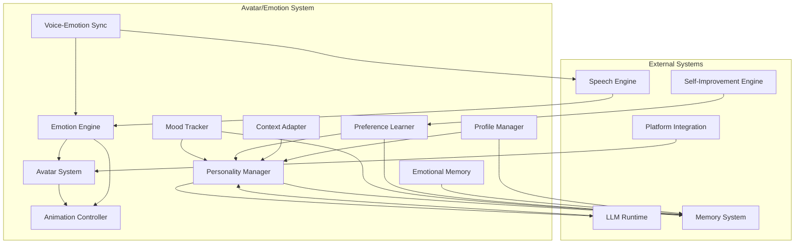

# Design Document: Avatar/Emotion System

## Overview

The Avatar/Emotion System provides Agent_Guru with adaptive personality and emotional intelligence through a multi-layered architecture consisting of visual avatar rendering, real-time emotion detection and visualization, personality trait management with learning capabilities, long-term mood tracking, and context-aware behavior adaptation. This system transforms Agent_Guru from a static assistant into a living entity with personality that learns and evolves based on user interactions.

### Key Design Principles

1. **Modularity**: Each component (Avatar, Emotion, Personality, Mood) operates independently with well-defined interfaces
2. **Performance**: Avatar rendering at 60 FPS, emotion detection within 50ms, personality loading within 200ms
3. **Learning**: Gradual personality evolution through reinforcement learning and pattern analysis
4. **Privacy**: All personality data encrypted and stored locally with user control
5. **Resilience**: Graceful degradation when components fail, fallback to default behaviors
6. **Cross-Platform**: Support for desktop and mobile with adaptive resource usage

## Architecture

### High-Level Component Diagram



### Data Flow

1. **Emotion Detection Flow**: Text/Voice Input → Emotion Engine → Emotion State → Animation Controller → Avatar System → Visual Display
2. **Personality Evolution Flow**: User Interaction → Preference Learner → Personality Traits Update → Personality Manager → Memory System
3. **Response Generation Flow**: User Query → Context Adapter → Personality Manager → Personality Context → LLM Runtime → Response
4. **Mood Tracking Flow**: Emotion States → Mood Tracker → Mood Averages → Emotional Memory → Memory System

## Components and Interfaces

### 1. Avatar System

**Responsibility**: Render visual avatars for Guru and Maya personalities with real-time emotion visualization.

**Interface**:
```typescript
interface AvatarSystem {
  // Initialize avatar system with platform-specific renderer
  initialize(platform: Platform, config: AvatarConfig): Promise<void>
  
  // Render avatar with current emotion state
  render(personality: 'guru' | 'maya', emotion: EmotionState): void
  
  // Update avatar customization
  updateCustomization(settings: CustomizationSettings): void
  
  // Show/hide avatar
  setVisibility(visible: boolean): void
  
  // Get current rendering performance metrics
  getPerformanceMetrics(): PerformanceMetrics
}

interface AvatarConfig {
  targetFPS: number  // Default: 60
  maxMemoryMB: number  // Default: 100
  style: 'realistic' | 'cartoon' | 'minimalist' | 'abstract'
  colorScheme: string
}

interface CustomizationSettings {
  style?: 'realistic' | 'cartoon' | 'minimalist' | 'abstract'
  colorScheme?: string
  visible?: boolean
}

interface PerformanceMetrics {
  currentFPS: number
  averageFPS: number
  memoryUsageMB: number
  frameDrops: number
}
```

**Implementation Details**:
- Use Canvas API for web platforms, native graphics APIs for desktop/mobile
- Implement avatar as SVG-based vector graphics for scalability and performance
- Pre-render emotion states as sprite sheets for fast switching
- Use WebGL/Metal/Vulkan for hardware-accelerated rendering when available
- Implement level-of-detail (LOD) system: reduce complexity on low-end devices
- Cache rendered frames to minimize redundant rendering

**Avatar Design**:
- **Guru (Male)**: Geometric shapes, cool color palette (blues, grays), angular features
- **Maya (Female)**: Organic shapes, warm color palette (oranges, purples), curved features
- Both avatars share same facial feature positions for consistent emotion mapping

### 2. Emotion Engine

**Responsibility**: Detect emotions from text and voice input, manage emotion states, and trigger avatar updates.

**Interface**:
```typescript
interface EmotionEngine {
  // Detect emotion from text input
  detectFromText(text: string): EmotionState
  
  // Detect emotion from voice prosody
  detectFromVoice(audioFeatures: AudioFeatures): EmotionState
  
  // Get current emotion state
  getCurrentEmotion(): EmotionState
  
  // Set emotion state explicitly
  setEmotion(emotion: EmotionState, duration?: number): void
  
  // Subscribe to emotion changes
  onEmotionChange(callback: (emotion: EmotionState) => void): Subscription
}

interface EmotionState {
  primary: EmotionType
  intensity: number  // 0-100
  secondary?: EmotionType
  timestamp: number
}

type EmotionType = 'happy' | 'sad' | 'angry' | 'neutral' | 'surprised' | 'fearful' | 'disgusted'

interface AudioFeatures {
  pitch: number
  tempo: number
  volume: number
  energy: number
}
```

**Implementation Details**:
- **Text-based emotion detection**: Use sentiment analysis with emotion classification
  - Implement lexicon-based approach with emotion word dictionaries
  - Use pre-trained emotion classification model (e.g., DistilBERT fine-tuned on emotion datasets)
  - Combine lexicon scores with model predictions for robustness
- **Voice-based emotion detection**: Analyze prosodic features
  - Extract pitch, tempo, volume, energy from audio
  - Map prosodic patterns to emotions: high pitch + fast tempo = excited/happy
  - Use rule-based system for real-time performance
- **Emotion state management**: 
  - Maintain emotion state with 30-second timeout (revert to neutral)
  - When multiple emotions detected, select highest intensity
  - Smooth emotion transitions to prevent jarring changes

**Emotion Detection Rules**:
```
Happy: positive sentiment + exclamation marks + high energy words
Sad: negative sentiment + loss/grief keywords + low energy
Angry: negative sentiment + conflict keywords + high intensity
Surprised: question marks + sudden topic changes + high pitch
Fearful: negative sentiment + threat keywords + uncertainty
Disgusted: negative sentiment + rejection keywords
Neutral: low sentiment score + factual language
```

### 3. Personality Manager

**Responsibility**: Manage personality traits, provide personality context to LLM, and coordinate personality evolution.

**Interface**:
```typescript
interface PersonalityManager {
  // Initialize with profile
  initialize(profileId: string): Promise<void>
  
  // Get current personality traits
  getTraits(): PersonalityTraits
  
  // Update personality traits
  updateTraits(updates: Partial<PersonalityTraits>): void
  
  // Get personality context for LLM
  getPersonalityContext(): PersonalityContext
  
  // Apply temporary context-based adjustments
  applyContextAdjustment(context: TaskContext): void
  
  // Revert temporary adjustments
  revertContextAdjustment(): void
  
  // Persist current state
  persist(): Promise<void>
}

interface PersonalityTraits {
  formality: number  // 0-100
  humor: number  // 0-100
  empathy: number  // 0-100
  assertiveness: number  // 0-100
  creativity: number  // 0-100
}

interface PersonalityContext {
  traits: PersonalityTraits
  preferences: UserPreferences
  mood: MoodClassification
  personality: 'guru' | 'maya'
}

interface UserPreferences {
  responseLength: 'concise' | 'moderate' | 'detailed'
  technicalDepth: 'basic' | 'intermediate' | 'advanced'
  humorFrequency: 'rare' | 'occasional' | 'frequent'
  formalityLevel: 'casual' | 'professional' | 'formal'
  emojiUsage: 'none' | 'minimal' | 'moderate' | 'frequent'
}

interface TaskContext {
  taskType: 'coding' | 'planning' | 'casual_conversation' | 'problem_solving' | 'learning' | 'creative_work'
  emotionalContext: 'user_frustrated' | 'user_excited' | 'user_confused' | 'user_satisfied' | 'neutral'
}
```

**Implementation Details**:
- Store personality traits as normalized scores (0-100)
- Default traits: formality=50, humor=50, empathy=70, assertiveness=50, creativity=60
- Separate trait profiles for Guru and Maya personalities
- Validate trait bounds on every update
- Generate LLM prompt context from traits:
  ```
  Personality: {personality_name}
  Traits: formality={formality}, humor={humor}, empathy={empathy}, assertiveness={assertiveness}, creativity={creativity}
  Preferences: {preferences}
  Current Mood: {mood}
  
  Adjust your response style to match these personality characteristics.
  ```
- Context adjustments are temporary and not persisted
- Persist traits to Memory System after each interaction

### 4. Preference Learner

**Responsibility**: Learn user preferences from interactions and feedback, evolve personality traits over time.

**Interface**:
```typescript
interface PreferenceLearner {
  // Process user feedback
  processFeedback(feedback: UserFeedback): void
  
  // Analyze interaction patterns
  analyzeInteraction(interaction: Interaction): void
  
  // Get learned preferences with confidence scores
  getPreferences(): LearnedPreferences
  
  // Get trait adjustment recommendations
  getTraitAdjustments(): TraitAdjustments
  
  // Apply learning updates
  applyLearning(): void
}

interface UserFeedback {
  type: 'positive' | 'negative' | 'neutral'
  aspect?: 'tone' | 'length' | 'technical_level' | 'humor' | 'formality'
  intensity: number  // 0-100
  timestamp: number
}

interface Interaction {
  userMessage: string
  agentResponse: string
  responseTime: number
  userEngagement: number  // 0-100, inferred from follow-up behavior
  timestamp: number
}

interface LearnedPreferences {
  preferences: UserPreferences
  confidence: Record<keyof UserPreferences, number>  // 0-100
}

interface TraitAdjustments {
  formality: number  // -20 to +20
  humor: number
  empathy: number
  assertiveness: number
  creativity: number
  confidence: number  // 0-100
}
```

**Implementation Details**:
- **Feedback-based learning**:
  - Positive feedback: increase relevant traits by 1-5 points
  - Negative feedback: decrease relevant traits by 1-5 points
  - Map feedback aspects to traits: tone→empathy, humor→humor, formality→formality
- **Pattern-based learning**:
  - Track user message length → infer responseLength preference
  - Track technical question frequency → infer technicalDepth preference
  - Track user emoji usage → infer emojiUsage preference
  - Track user formality in messages → infer formalityLevel preference
- **Learning algorithm**:
  - Use exponential moving average for preference scores
  - Confidence increases with consistent patterns (max 100)
  - Require minimum 10 interactions before applying adjustments
  - Limit trait changes to 20 points per day for consistency
  - When confidence > 80, apply stronger adjustments (up to 10 points)
- **Reinforcement learning approach**:
  - Reward: user engagement score (follow-up questions, positive feedback)
  - State: current personality traits
  - Action: trait adjustment
  - Policy: gradient-based adjustment toward higher engagement

### 5. Mood Tracker

**Responsibility**: Track long-term emotional patterns, calculate mood averages, classify overall mood state.

**Interface**:
```typescript
interface MoodTracker {
  // Record emotion state
  recordEmotion(emotion: EmotionState): void
  
  // Get mood averages
  getMoodAverages(): MoodAverages
  
  // Get current mood classification
  getCurrentMood(): MoodClassification
  
  // Get mood history
  getMoodHistory(timeRange: TimeRange): MoodHistory
  
  // Check for mood alerts
  checkMoodAlerts(): MoodAlert[]
}

interface MoodAverages {
  oneHour: number  // -100 to +100
  twentyFourHours: number
  sevenDays: number
}

type MoodClassification = 'very_positive' | 'positive' | 'neutral' | 'negative' | 'very_negative'

interface MoodHistory {
  entries: MoodEntry[]
  aggregatedDays: DailyMoodSummary[]
}

interface MoodEntry {
  emotion: EmotionType
  intensity: number
  timestamp: number
}

interface DailyMoodSummary {
  date: string
  averageMood: number
  dominantEmotion: EmotionType
  emotionCounts: Record<EmotionType, number>
}

interface MoodAlert {
  type: 'declining_mood' | 'sustained_negative' | 'mood_swing'
  severity: 'low' | 'medium' | 'high'
  recommendation: string
}

interface TimeRange {
  start: number
  end: number
}
```

**Implementation Details**:
- **Emotion scoring**: Map emotions to valence scores
  - happy: +80, surprised: +40, neutral: 0, sad: -60, angry: -70, fearful: -50, disgusted: -65
- **Mood calculation**:
  - Rolling average with exponential decay
  - Recent emotions weighted more heavily
  - Formula: `mood = Σ(emotion_score * intensity * decay_factor) / Σ(intensity * decay_factor)`
  - Decay factor: `e^(-time_diff / half_life)` where half_life = 2 hours
- **Mood classification**:
  - very_positive: mood > 60
  - positive: mood > 20
  - neutral: -20 ≤ mood ≤ 20
  - negative: mood < -20
  - very_negative: mood < -60
- **Mood alerts**:
  - declining_mood: 24-hour average drops by >30 points
  - sustained_negative: mood < -40 for >6 hours
  - mood_swing: mood changes by >50 points within 1 hour
- **Storage optimization**:
  - Keep detailed entries for last 1000 interactions
  - Aggregate older entries into daily summaries
  - Persist to Memory System with compression

### 6. Animation Controller

**Responsibility**: Manage smooth transitions between emotion states, coordinate avatar animations, maintain target FPS.

**Interface**:
```typescript
interface AnimationController {
  // Start animation loop
  start(): void
  
  // Stop animation loop
  stop(): void
  
  // Transition to new emotion
  transitionToEmotion(emotion: EmotionState, duration: number): void
  
  // Play idle animation
  playIdleAnimation(): void
  
  // Get animation state
  getAnimationState(): AnimationState
  
  // Set target FPS
  setTargetFPS(fps: number): void
}

interface AnimationState {
  currentEmotion: EmotionState
  targetEmotion: EmotionState
  progress: number  // 0-1
  isTransitioning: boolean
  currentFPS: number
}
```

**Implementation Details**:
- **Animation loop**: Use requestAnimationFrame for smooth 60 FPS
- **Easing functions**: 
  - Use cubic-bezier easing for natural motion
  - Formula: `easeInOutCubic(t) = t < 0.5 ? 4*t³ : 1 - (-2*t + 2)³ / 2`
- **Emotion transitions**:
  - Duration: 200-500ms depending on emotion distance
  - Interpolate facial features: eyebrows, eyes, mouth, cheeks
  - Use linear interpolation for position, easing for curves
- **Idle animations**:
  - Subtle breathing motion (1-2 second cycle)
  - Occasional blinks (every 3-5 seconds)
  - Micro-expressions (every 10-15 seconds)
- **Performance optimization**:
  - Pre-calculate interpolation keyframes
  - Use sprite sheets for common emotions
  - Reduce animation complexity on frame drops
  - Target 60 FPS, fallback to 30 FPS if needed
- **Frame timing**:
  - Track frame delta time
  - Adjust animation speed to maintain consistent timing
  - Skip frames if behind schedule (don't stutter)

### 7. Profile Manager

**Responsibility**: Manage multiple personality profiles, handle profile switching, ensure profile isolation.

**Interface**:
```typescript
interface ProfileManager {
  // Create new profile
  createProfile(userId: string, contextId?: string): Promise<ProfileId>
  
  // Load profile
  loadProfile(profileId: ProfileId): Promise<PersonalityProfile>
  
  // Switch active profile
  switchProfile(profileId: ProfileId): Promise<void>
  
  // Delete profile
  deleteProfile(profileId: ProfileId): Promise<void>
  
  // Export profile for backup
  exportProfile(profileId: ProfileId): Promise<ProfileData>
  
  // Import profile from backup
  importProfile(data: ProfileData): Promise<ProfileId>
  
  // List all profiles for user
  listProfiles(userId: string): Promise<ProfileMetadata[]>
}

type ProfileId = string

interface PersonalityProfile {
  profileId: ProfileId
  userId: string
  contextId?: string
  traits: PersonalityTraits
  preferences: LearnedPreferences
  emotionalMemory: EmotionalMemoryData
  customization: CustomizationSettings
  createdAt: number
  updatedAt: number
}

interface ProfileData {
  version: string
  profile: PersonalityProfile
  checksum: string
}

interface ProfileMetadata {
  profileId: ProfileId
  userId: string
  contextId?: string
  createdAt: number
  updatedAt: number
  interactionCount: number
}
```

**Implementation Details**:
- **Profile storage**: Store in Memory System with encryption
- **Profile isolation**: Validate userId/contextId on every access
- **Profile switching**: Load new profile within 200ms
  - Unload current profile state
  - Load new profile from Memory System
  - Initialize Personality Manager with new traits
  - Update Avatar System with new customization
- **Default profile**: Create on first use with default traits
- **Profile export/import**:
  - Export as encrypted JSON with schema version
  - Calculate checksum for integrity validation
  - Validate schema compatibility on import
- **Conflict resolution**: Use timestamp-based last-write-wins for sync

### 8. Emotional Memory

**Responsibility**: Store and retrieve emotional context from past interactions, associate with conversation memory.

**Interface**:
```typescript
interface EmotionalMemory {
  // Store emotional context for interaction
  storeContext(interactionId: string, context: EmotionalContext): Promise<void>
  
  // Retrieve emotional context
  getContext(interactionId: string): Promise<EmotionalContext | null>
  
  // Query interactions by emotion
  queryByEmotion(emotion: EmotionType, limit: number): Promise<EmotionalContext[]>
  
  // Query interactions by mood
  queryByMood(mood: MoodClassification, limit: number): Promise<EmotionalContext[]>
  
  // Get significant emotional events
  getSignificantEvents(timeRange: TimeRange): Promise<EmotionalContext[]>
  
  // Prune old entries
  pruneOldEntries(maxEntries: number): Promise<void>
}

interface EmotionalContext {
  interactionId: string
  emotionState: EmotionState
  moodClassification: MoodClassification
  personalityTraits: PersonalityTraits
  userFeedback?: UserFeedback
  significance: number  // 0-100
  timestamp: number
}
```

**Implementation Details**:
- **Storage**: Store in Memory System linked to conversation entries
- **Significance scoring**: 
  - High intensity emotions: +30
  - User feedback present: +20
  - Mood alerts triggered: +30
  - Personality trait changes: +20
- **Pruning strategy**:
  - Keep maximum 500 entries per profile
  - Always preserve significant events (significance > 70)
  - Remove oldest low-significance entries first
- **Querying**: Index by emotion type and mood classification for fast retrieval
- **Integration**: Link to conversation memory via interactionId

### 9. Voice-Emotion Sync

**Responsibility**: Synchronize avatar emotions with voice synthesis output, analyze voice prosody for emotion detection.

**Interface**:
```typescript
interface VoiceEmotionSync {
  // Analyze text for emotional content before speech
  analyzeTextForSpeech(text: string): EmotionState
  
  // Synchronize emotion with voice output
  syncWithVoice(text: string, audioFeatures: AudioFeatures): void
  
  // Handle voice output start
  onVoiceStart(emotion: EmotionState): void
  
  // Handle voice output end
  onVoiceEnd(): void
  
  // Get current sync state
  getSyncState(): SyncState
}

interface SyncState {
  isVoiceActive: boolean
  currentEmotion: EmotionState
  syncOffset: number  // milliseconds
}
```

**Implementation Details**:
- **Text analysis**: Use Emotion Engine to detect emotion from text
- **Prosody analysis**: Extract pitch, tempo, volume from audio
  - High pitch + fast tempo → excited/happy
  - Low pitch + slow tempo → sad/serious
  - High volume + fast tempo → angry/assertive
- **Synchronization**:
  - Update avatar emotion 50ms before voice starts (anticipation)
  - Maintain emotion during voice output
  - Transition to neutral 500ms after voice ends
- **Timing coordination**: Use event callbacks from Speech Engine
- **Fallback**: If voice disabled, use text-based emotion only

### 10. Context Adapter

**Responsibility**: Adapt personality based on task type and emotional context, apply temporary trait adjustments.

**Interface**:
```typescript
interface ContextAdapter {
  // Detect task type from user input
  detectTaskType(input: string): TaskType
  
  // Detect emotional context
  detectEmotionalContext(moodHistory: MoodHistory, currentEmotion: EmotionState): EmotionalContext
  
  // Calculate context-based trait adjustments
  calculateAdjustments(context: TaskContext): TraitAdjustments
  
  // Apply adjustments to personality
  applyAdjustments(adjustments: TraitAdjustments): void
  
  // Revert adjustments
  revertAdjustments(): void
}

type TaskType = 'coding' | 'planning' | 'casual_conversation' | 'problem_solving' | 'learning' | 'creative_work'

type EmotionalContext = 'user_frustrated' | 'user_excited' | 'user_confused' | 'user_satisfied' | 'neutral'
```

**Implementation Details**:
- **Task type detection**: Use keyword matching and pattern recognition
  - coding: code keywords, syntax, technical terms
  - planning: future tense, goal keywords, organization terms
  - casual_conversation: greetings, personal topics, informal language
  - problem_solving: problem keywords, debugging terms, error messages
  - learning: question words, explanation requests, "how to" phrases
  - creative_work: creative keywords, brainstorming, ideation terms
- **Emotional context detection**:
  - user_frustrated: declining mood + negative emotions + repeated questions
  - user_excited: positive emotions + high intensity + exclamation marks
  - user_confused: question marks + uncertainty keywords + repeated clarifications
  - user_satisfied: positive feedback + completion keywords
- **Trait adjustments by task type**:
  - coding: formality +15, humor -10
  - casual_conversation: formality -15, humor +15
  - problem_solving: assertiveness +15, creativity -10
  - learning: empathy +10, formality +5
  - creative_work: creativity +20, assertiveness -10
- **Trait adjustments by emotional context**:
  - user_frustrated: empathy +20, assertiveness -10
  - user_excited: humor +10, energy +15
  - user_confused: empathy +15, formality -10 (be clearer)
- **Adjustment lifecycle**:
  - Store original traits before adjustment
  - Apply temporary adjustments
  - Revert when context changes (new task type detected)
  - Never persist temporary adjustments

## Data Models

### Personality Profile Schema

```typescript
interface PersonalityProfileSchema {
  version: '1.0'
  profileId: string
  userId: string
  contextId?: string
  
  traits: {
    formality: number  // 0-100
    humor: number
    empathy: number
    assertiveness: number
    creativity: number
  }
  
  preferences: {
    responseLength: 'concise' | 'moderate' | 'detailed'
    technicalDepth: 'basic' | 'intermediate' | 'advanced'
    humorFrequency: 'rare' | 'occasional' | 'frequent'
    formalityLevel: 'casual' | 'professional' | 'formal'
    emojiUsage: 'none' | 'minimal' | 'moderate' | 'frequent'
    confidence: Record<string, number>  // 0-100 per preference
  }
  
  learning: {
    interactionCount: number
    lastLearningUpdate: number
    traitChangeHistory: TraitChange[]
    dailyChangeLimit: number  // Remaining changes today
  }
  
  customization: {
    style: 'realistic' | 'cartoon' | 'minimalist' | 'abstract'
    colorScheme: string
    visible: boolean
  }
  
  metadata: {
    createdAt: number
    updatedAt: number
    lastInteraction: number
  }
}

interface TraitChange {
  trait: keyof PersonalityTraits
  oldValue: number
  newValue: number
  reason: string
  timestamp: number
}
```

### Emotional Memory Schema

```typescript
interface EmotionalMemorySchema {
  version: '1.0'
  profileId: string
  
  entries: EmotionalMemoryEntry[]
  
  aggregatedDays: {
    date: string
    averageMood: number
    dominantEmotion: EmotionType
    emotionCounts: Record<EmotionType, number>
    significantEvents: string[]  // interactionIds
  }[]
  
  metadata: {
    totalEntries: number
    oldestEntry: number
    newestEntry: number
  }
}

interface EmotionalMemoryEntry {
  interactionId: string
  emotionState: {
    primary: EmotionType
    intensity: number
    secondary?: EmotionType
  }
  moodClassification: MoodClassification
  personalityTraits: PersonalityTraits
  userFeedback?: {
    type: 'positive' | 'negative' | 'neutral'
    aspect?: string
    intensity: number
  }
  significance: number
  timestamp: number
}
```

### Avatar Configuration Schema

```typescript
interface AvatarConfigSchema {
  version: '1.0'
  
  avatars: {
    guru: AvatarDefinition
    maya: AvatarDefinition
  }
  
  emotions: Record<EmotionType, EmotionDefinition>
  
  animations: {
    transitionDuration: number  // milliseconds
    easingFunction: string
    idleAnimations: IdleAnimation[]
  }
  
  performance: {
    targetFPS: number
    maxMemoryMB: number
    lodLevels: LODLevel[]
  }
}

interface AvatarDefinition {
  baseShape: string  // SVG path data
  colorPalette: string[]
  facialFeatures: {
    eyes: FeatureDefinition
    eyebrows: FeatureDefinition
    mouth: FeatureDefinition
    cheeks: FeatureDefinition
  }
}

interface EmotionDefinition {
  eyePosition: [number, number]
  eyebrowAngle: number
  mouthCurve: number
  cheekIntensity: number
}

interface FeatureDefinition {
  path: string  // SVG path
  position: [number, number]
  scale: number
}

interface IdleAnimation {
  name: string
  duration: number
  keyframes: Keyframe[]
  frequency: number  // seconds between plays
}

interface LODLevel {
  minFPS: number
  complexity: 'high' | 'medium' | 'low'
  features: string[]  // enabled features
}
```


## Correctness Properties

*A property is a characteristic or behavior that should hold true across all valid executions of a system—essentially, a formal statement about what the system should do. Properties serve as the bridge between human-readable specifications and machine-verifiable correctness guarantees.*

### Avatar Rendering Properties

**Property 1: Avatar personality distinction**
*For any* rendering call, the Guru avatar SHALL have visually distinct characteristics (color scheme, shape) from the Maya avatar.
**Validates: Requirements 1.4**

**Property 2: Avatar switching performance**
*For any* sequence of personality switches, each switch SHALL complete within 100ms.
**Validates: Requirements 1.3**

**Property 3: Avatar rendering performance**
*For any* avatar rendering session on supported platforms, the average FPS SHALL be at least 60 FPS.
**Validates: Requirements 1.5**

**Property 4: Avatar facial features completeness**
*For any* rendered avatar, the output SHALL contain all required facial feature elements (eyes, eyebrows, mouth, cheeks).
**Validates: Requirements 1.7**

### Emotion Detection and Visualization Properties

**Property 5: Emotion update performance**
*For any* emotion detection event, the avatar facial expression SHALL update within 60ms.
**Validates: Requirements 2.1**

**Property 6: Emotion transition timing**
*For any* emotion transition, the Animation_Controller SHALL complete the interpolation within 200-500ms.
**Validates: Requirements 2.3**

**Property 7: Dominant emotion selection**
*For any* set of simultaneously detected emotions, the Emotion_Engine SHALL display the emotion with the highest intensity score.
**Validates: Requirements 2.6**

**Property 8: Emotion state persistence**
*For any* detected emotion, the state SHALL persist until a new emotion is detected or 30 seconds elapse, whichever comes first.
**Validates: Requirements 2.7**

**Property 9: Text emotion detection**
*For any* text input, the Emotion_Engine SHALL produce a valid EmotionState with one of the seven supported emotion types.
**Validates: Requirements 2.4**

**Property 10: Voice emotion detection**
*For any* audio features input, the Emotion_Engine SHALL produce a valid EmotionState with one of the seven supported emotion types.
**Validates: Requirements 2.5**

### Personality Trait Management Properties

**Property 11: Trait bounds invariant**
*For any* personality trait update, all trait scores SHALL remain within the 0-100 range.
**Validates: Requirements 3.7**

**Property 12: Personality persistence round-trip**
*For any* personality profile, persisting then loading SHALL produce equivalent trait scores (within 0.1 tolerance).
**Validates: Requirements 3.3, 3.4**

**Property 13: Personality context completeness**
*For any* request for personality context, the returned context SHALL include all trait scores, preferences, mood classification, and personality type.
**Validates: Requirements 3.5, 7.1, 7.2, 7.3**

**Property 14: Profile isolation**
*For any* two distinct personality profiles, changes to one profile SHALL NOT affect the trait scores or preferences of the other profile.
**Validates: Requirements 3.6, 9.6**

### Personality Learning Properties

**Property 15: Positive feedback learning**
*For any* positive feedback event, the relevant personality trait SHALL increase by 1-5 points (respecting bounds).
**Validates: Requirements 4.1**

**Property 16: Negative feedback learning**
*For any* negative feedback event, the relevant personality trait SHALL decrease by 1-5 points (respecting bounds).
**Validates: Requirements 4.2**

**Property 17: Gradual learning convergence**
*For any* sequence of fewer than 10 interactions, personality trait changes SHALL be minimal (less than 10 points total).
**Validates: Requirements 4.4**

**Property 18: Confidence-based adjustment scaling**
*For any* learned preference with confidence > 80, trait adjustments SHALL be larger (up to 10 points) than adjustments for confidence ≤ 80 (up to 5 points).
**Validates: Requirements 4.6**

**Property 19: Daily change rate limiting**
*For any* 24-hour period, no single personality trait SHALL change by more than 20 points.
**Validates: Requirements 4.8**

**Property 20: Learning persistence**
*For any* preference learning update, the learned preferences and confidence scores SHALL be persisted and retrievable from the Memory_System.
**Validates: Requirements 4.7, 6.7**

### Mood Tracking Properties

**Property 21: Emotion recording completeness**
*For any* interaction with an emotion state, the Mood_Tracker SHALL record the emotion with a timestamp.
**Validates: Requirements 5.1**

**Property 22: Mood average calculation correctness**
*For any* sequence of recorded emotions, the calculated mood averages (1 hour, 24 hours, 7 days) SHALL match the expected weighted average based on emotion valence scores and decay factors.
**Validates: Requirements 5.2**

**Property 23: Mood classification consistency**
*For any* mood score, the classification SHALL be: very_positive (>60), positive (>20), neutral (-20 to 20), negative (<-20), or very_negative (<-60).
**Validates: Requirements 5.3**

**Property 24: Declining mood alert detection**
*For any* mood history where the 24-hour average drops by more than 30 points, the Mood_Tracker SHALL flag for empathetic response mode.
**Validates: Requirements 5.4**

**Property 25: Mood history size limit**
*For any* user profile, the mood history SHALL contain at most 1000 detailed entries.
**Validates: Requirements 5.5**

**Property 26: Mood history aggregation**
*For any* mood history exceeding 1000 entries, the oldest entries SHALL be aggregated into daily summaries.
**Validates: Requirements 5.6**

### Preference Learning Properties

**Property 27: Short response pattern inference**
*For any* sequence of user messages where the average length is below a threshold, the Preference_Learner SHALL infer a preference for concise communication.
**Validates: Requirements 6.2**

**Property 28: Technical question pattern inference**
*For any* sequence of user messages with high technical keyword frequency, the Preference_Learner SHALL infer a preference for detailed technical responses.
**Validates: Requirements 6.3**

**Property 29: Confidence threshold application**
*For any* learned preference with confidence > 70, the preference SHALL be applied to response generation.
**Validates: Requirements 6.5**

**Property 30: Preference conflict resolution**
*For any* set of conflicting preferences, the Preference_Learner SHALL prioritize based on recency and confidence scores.
**Validates: Requirements 6.6**

### Adaptive Response Properties

**Property 31: Trait-based prompt injection**
*For any* response generation request, the personality context SHALL include trait scores in the LLM prompt.
**Validates: Requirements 7.1**

**Property 32: Low formality language request**
*For any* personality state where formality < 30, the generated prompt SHALL request casual language.
**Validates: Requirements 7.5**

**Property 33: High humor element request**
*For any* personality state where humor > 70, the generated prompt SHALL request humorous elements.
**Validates: Requirements 7.6**

**Property 34: Empathetic tone request**
*For any* personality state where empathy > 70 AND mood is negative, the generated prompt SHALL request empathetic tone.
**Validates: Requirements 7.7**

### Emotional Memory Properties

**Property 35: Emotional context storage completeness**
*For any* interaction, the stored emotional context SHALL include emotion_state, mood_classification, personality_traits, and timestamp.
**Validates: Requirements 8.1**

**Property 36: Emotional context association**
*For any* stored emotional context, it SHALL be associated with the corresponding conversation memory entry via interactionId.
**Validates: Requirements 8.2**

**Property 37: Emotional context retrieval completeness**
*For any* conversation history retrieval, each entry SHALL include its associated emotional context.
**Validates: Requirements 8.3**

**Property 38: Emotion query correctness**
*For any* emotion-based query, all returned results SHALL have the specified emotion type.
**Validates: Requirements 8.4**

**Property 39: Mood query correctness**
*For any* mood-based query, all returned results SHALL have the specified mood classification.
**Validates: Requirements 8.5**

**Property 40: Emotional memory size limit**
*For any* user profile, the emotional memory SHALL contain at most 500 entries.
**Validates: Requirements 8.6**

**Property 41: Emotional memory pruning with preservation**
*For any* emotional memory exceeding 500 entries, pruning SHALL remove oldest low-significance entries while preserving entries with significance > 70.
**Validates: Requirements 8.7**

### Profile Management Properties

**Property 42: Multiple profile creation**
*For any* user, the Profile_Manager SHALL support creating multiple distinct profiles, each with a unique profileId.
**Validates: Requirements 9.1**

**Property 43: Profile association**
*For any* created profile, it SHALL be associated with a userId or contextId.
**Validates: Requirements 9.2**

**Property 44: Profile switching performance**
*For any* profile switch operation, the new profile SHALL be loaded within 200ms.
**Validates: Requirements 9.3**

**Property 45: Profile persistence independence**
*For any* profile update, the changes SHALL be persisted independently without affecting other profiles.
**Validates: Requirements 9.4**

**Property 46: Profile deletion completeness**
*For any* profile deletion, all associated personality data (traits, preferences, emotional memory, customization) SHALL be removed from the Memory_System.
**Validates: Requirements 9.7**

### Avatar Customization Properties

**Property 47: Customization visibility toggle**
*For any* avatar visibility toggle operation, the avatar SHALL be shown or hidden according to the setting.
**Validates: Requirements 10.3**

**Property 48: Customization persistence round-trip**
*For any* customization settings, persisting then loading SHALL produce equivalent settings.
**Validates: Requirements 10.4**

**Property 49: Customization application performance**
*For any* customization change, the new settings SHALL be applied within 100ms.
**Validates: Requirements 10.5**

**Property 50: Customization validation**
*For any* invalid customization settings, the Avatar_System SHALL reject the settings and return an error.
**Validates: Requirements 10.6**

**Property 51: Customization fallback**
*For any* customization load failure, the Avatar_System SHALL revert to default settings.
**Validates: Requirements 10.7**

### Animation Properties

**Property 52: Animation frame rate maintenance**
*For any* animation sequence, the Animation_Controller SHALL maintain at least 60 FPS on supported platforms.
**Validates: Requirements 11.1**

**Property 53: Easing function application**
*For any* emotion transition, the Animation_Controller SHALL use cubic-bezier or ease-in-out easing functions.
**Validates: Requirements 11.2**

**Property 54: Facial feature interpolation**
*For any* emotion transition, all facial features (eyes, eyebrows, mouth, cheeks) SHALL be smoothly interpolated.
**Validates: Requirements 11.3**

**Property 55: Idle animation playback**
*For any* period without emotion changes exceeding 5 seconds, the Animation_Controller SHALL play idle animations.
**Validates: Requirements 11.4**

**Property 56: Adaptive performance degradation**
*For any* constrained resource scenario, the Animation_Controller SHALL reduce animation complexity while maintaining at least 30 FPS.
**Validates: Requirements 11.6**

### Voice-Emotion Synchronization Properties

**Property 57: Voice text emotion analysis**
*For any* voice output generation, the Voice_Emotion_Sync SHALL analyze the text for emotional content.
**Validates: Requirements 12.1**

**Property 58: Voice prosody emotion detection**
*For any* available audio features, the Voice_Emotion_Sync SHALL detect emotions from prosody (pitch, tempo, volume).
**Validates: Requirements 12.2**

**Property 59: Voice-avatar synchronization timing**
*For any* voice output with emotion, the avatar emotion change SHALL be synchronized within 50ms of voice timing.
**Validates: Requirements 12.3**

**Property 60: Emotional marker response**
*For any* voice output containing emotional markers, the Voice_Emotion_Sync SHALL update the avatar emotion accordingly.
**Validates: Requirements 12.4**

**Property 61: Voice duration emotion persistence**
*For any* active voice output, the avatar emotion SHALL persist for the duration of the output.
**Validates: Requirements 12.5**

**Property 62: Voice completion emotion transition**
*For any* completed voice output, the avatar SHALL transition to neutral or context-appropriate emotion.
**Validates: Requirements 12.6**

**Property 63: Voice disabled fallback**
*For any* scenario where voice synthesis is disabled, the Voice_Emotion_Sync SHALL use text-based emotion detection only.
**Validates: Requirements 12.7**

### Context Adaptation Properties

**Property 64: Task type detection**
*For any* user input, the Context_Adapter SHALL detect one of the six task types (coding, planning, casual_conversation, problem_solving, learning, creative_work).
**Validates: Requirements 13.1**

**Property 65: Coding context adjustment**
*For any* detected coding task, the Context_Adapter SHALL temporarily increase formality by 10-20 points and decrease humor by 10-20 points.
**Validates: Requirements 13.2**

**Property 66: Casual conversation context adjustment**
*For any* detected casual_conversation task, the Context_Adapter SHALL temporarily increase humor by 10-20 points and decrease formality by 10-20 points.
**Validates: Requirements 13.3**

**Property 67: Problem-solving context adjustment**
*For any* detected problem_solving task, the Context_Adapter SHALL temporarily increase assertiveness by 10-20 points and decrease creativity by 10-20 points.
**Validates: Requirements 13.4**

**Property 68: Emotional context detection**
*For any* mood history and current emotion, the Context_Adapter SHALL detect one of the five emotional contexts (user_frustrated, user_excited, user_confused, user_satisfied, neutral).
**Validates: Requirements 13.5**

**Property 69: Frustration empathy adjustment**
*For any* detected user_frustrated context, the Context_Adapter SHALL temporarily increase empathy by 20 points.
**Validates: Requirements 13.6**

**Property 70: Context adjustment reversion**
*For any* context change, the Context_Adapter SHALL revert previous temporary trait adjustments.
**Validates: Requirements 13.7**

**Property 71: Temporary adjustment non-persistence**
*For any* temporary context-based adjustment, the adjustment SHALL NOT be persisted to the long-term personality profile.
**Validates: Requirements 13.8**

### Error Handling Properties

**Property 72: Avatar rendering failure fallback**
*For any* avatar rendering failure, the Avatar_System SHALL fall back to text-only mode and continue operation.
**Validates: Requirements 14.1**

**Property 73: Emotion detection failure default**
*For any* emotion detection failure, the Emotion_Engine SHALL default to neutral emotion state.
**Validates: Requirements 14.2**

**Property 74: Personality load failure default**
*For any* personality data load failure, the Personality_Manager SHALL use default personality traits.
**Validates: Requirements 14.3**

**Property 75: Frame drop timing preservation**
*For any* animation frame drop, the Animation_Controller SHALL skip frames to maintain timing rather than stuttering.
**Validates: Requirements 14.4**

**Property 76: Memory system unavailability resilience**
*For any* Memory_System unavailability, the Personality_Manager SHALL operate with in-memory state and retry persistence.
**Validates: Requirements 14.5**

**Property 77: Profile switch failure preservation**
*For any* profile switching failure, the Profile_Manager SHALL maintain the current profile and log the error.
**Validates: Requirements 14.6**

**Property 78: Input validation rejection**
*For any* invalid input data, the Avatar_System SHALL reject the input and return a descriptive error message.
**Validates: Requirements 14.7**

### Performance Properties

**Property 79: Frame rendering performance**
*For any* avatar frame rendering on supported platforms, the rendering SHALL complete within 16ms (60 FPS).
**Validates: Requirements 15.1**

**Property 80: Emotion detection performance**
*For any* emotion detection operation, the processing SHALL complete within 50ms.
**Validates: Requirements 15.2**

**Property 81: Profile loading performance**
*For any* personality profile load operation, the loading SHALL complete within 200ms.
**Validates: Requirements 15.3**

**Property 82: Memory usage limit**
*For any* avatar rendering session, the memory usage SHALL not exceed 100MB.
**Validates: Requirements 15.4**

**Property 83: Learning update performance**
*For any* preference learning update, the processing SHALL complete within 100ms.
**Validates: Requirements 15.5**

**Property 84: Mood calculation performance**
*For any* mood average calculation, the processing SHALL complete within 50ms.
**Validates: Requirements 15.6**

**Property 85: Mobile platform adaptation**
*For any* mobile platform execution, the Avatar_System SHALL reduce animation complexity to maintain performance.
**Validates: Requirements 15.7**

**Property 86: Resource release on hide**
*For any* avatar hide operation, the Avatar_System SHALL release rendering resources.
**Validates: Requirements 15.8**

### Data Persistence Properties

**Property 87: Interaction persistence**
*For any* interaction, the Personality_Manager SHALL persist personality data to the Memory_System.
**Validates: Requirements 16.1**

**Property 88: Structured data format**
*For any* persisted personality data, the data SHALL include a schema version and be in valid JSON format.
**Validates: Requirements 16.2**

**Property 89: Profile export capability**
*For any* personality profile, the Profile_Manager SHALL support exporting the profile to a portable format.
**Validates: Requirements 16.3**

**Property 90: Profile import capability**
*For any* valid exported profile data, the Profile_Manager SHALL support importing the profile.
**Validates: Requirements 16.4**

**Property 91: Import validation**
*For any* profile import attempt, the Profile_Manager SHALL validate data integrity and schema compatibility before importing.
**Validates: Requirements 16.5**

**Property 92: Emotional context persistence association**
*For any* persisted emotional context, it SHALL be associated with the corresponding conversation memory entry.
**Validates: Requirements 16.6**

**Property 93: Customization persistence per profile**
*For any* profile, customization settings SHALL be persisted and loaded independently from other profiles.
**Validates: Requirements 16.7**

**Property 94: Sync conflict resolution**
*For any* personality data conflict during synchronization, the Personality_Manager SHALL resolve using timestamp-based last-write-wins.
**Validates: Requirements 16.8**

### Security and Privacy Properties

**Property 95: Personality data encryption**
*For any* personality data persistence operation, the data SHALL be encrypted before storage.
**Validates: Requirements 17.1**

**Property 96: Emotional data encryption**
*For any* emotional context persistence operation, the data SHALL be encrypted before storage.
**Validates: Requirements 17.2**

**Property 97: Profile access authentication**
*For any* profile access attempt, the Profile_Manager SHALL require valid authentication.
**Validates: Requirements 17.3**

**Property 98: Profile access isolation**
*For any* profile access attempt, the Profile_Manager SHALL prevent access to profiles not owned by the authenticated user.
**Validates: Requirements 17.4**

**Property 99: External transmission consent**
*For any* personality data, the Avatar_System SHALL NOT transmit to external services without explicit user consent.
**Validates: Requirements 17.5**

**Property 100: Learning data anonymization**
*For any* learning data used for system improvement, the Preference_Learner SHALL anonymize the data.
**Validates: Requirements 17.6**

**Property 101: Data deletion timeliness**
*For any* user data deletion request, the Profile_Manager SHALL remove all personality data within 24 hours.
**Validates: Requirements 17.7**

### Integration Properties

**Property 102: LLM Runtime API integration**
*For any* personality context provision, the Personality_Manager SHALL use the standardized LLM_Runtime API.
**Validates: Requirements 18.1**

**Property 103: Speech Engine event integration**
*For any* emotion signal from Speech_Engine, the Emotion_Engine SHALL receive it through registered event callbacks.
**Validates: Requirements 18.2**

**Property 104: Memory System API integration**
*For any* emotional memory storage operation, the Emotional_Memory SHALL use the standard Memory_System API.
**Validates: Requirements 18.3**

**Property 105: Platform Integration rendering commands**
*For any* rendering command from Platform_Integration, the Avatar_System SHALL receive and process it.
**Validates: Requirements 18.4**

**Property 106: Self-Improvement Engine feedback integration**
*For any* feedback signal from Self_Improvement_Engine, the Preference_Learner SHALL receive and process it.
**Validates: Requirements 18.5**

**Property 107: Mood change event publishing**
*For any* mood classification change, the Mood_Tracker SHALL publish a mood change event.
**Validates: Requirements 18.6**

**Property 108: Speech Engine synchronization protocol**
*For any* voice-emotion synchronization, the Voice_Emotion_Sync SHALL follow the Speech_Engine synchronization protocol.
**Validates: Requirements 18.7**

**Property 109: Component failure resilience**
*For any* external component integration failure, the Avatar_System SHALL continue operating with reduced functionality.
**Validates: Requirements 18.8**

## Error Handling

### Error Categories

1. **Rendering Errors**: Avatar rendering failures, animation errors, resource allocation failures
2. **Detection Errors**: Emotion detection failures, task type detection failures, context detection failures
3. **Persistence Errors**: Memory System unavailability, data corruption, encryption failures
4. **Performance Errors**: Frame rate drops, timeout violations, memory limit exceeded
5. **Integration Errors**: External component failures, API call failures, event delivery failures
6. **Validation Errors**: Invalid input data, schema incompatibility, authentication failures

### Error Handling Strategies

**Graceful Degradation**:
- Avatar rendering failure → Fall back to text-only mode
- Emotion detection failure → Default to neutral emotion
- Personality load failure → Use default traits
- Memory System unavailable → Operate with in-memory state

**Performance Adaptation**:
- Frame rate drops → Reduce animation complexity
- Memory pressure → Release unused resources
- Timeout violations → Skip non-critical operations

**Data Integrity**:
- Validate all input data before processing
- Encrypt sensitive data before persistence
- Verify checksums on import/export
- Use schema versioning for compatibility

**User Communication**:
- Log all errors with descriptive messages
- Provide user-friendly error notifications for critical failures
- Never expose internal error details to users
- Offer recovery suggestions when appropriate

### Error Recovery

**Automatic Recovery**:
- Retry persistence operations with exponential backoff
- Reload profiles on corruption detection
- Reset to default state on unrecoverable errors
- Restart animation loop on frame timing issues

**Manual Recovery**:
- Allow users to reset personality profiles
- Provide profile export before risky operations
- Support profile import for backup restoration
- Enable manual resource cleanup

## Testing Strategy

### Dual Testing Approach

The Avatar/Emotion System requires both unit testing and property-based testing for comprehensive coverage:

**Unit Tests**: Focus on specific examples, edge cases, and integration points
- Specific emotion detection examples (happy text, sad text, etc.)
- Edge cases (empty input, malformed data, boundary values)
- Integration points (LLM Runtime, Speech Engine, Memory System)
- Error conditions (failures, timeouts, invalid data)

**Property-Based Tests**: Verify universal properties across all inputs
- Universal properties that hold for all inputs
- Comprehensive input coverage through randomization
- Minimum 100 iterations per property test
- Each property test references its design document property

### Property-Based Testing Configuration

**Testing Library**: Use fast-check (JavaScript/TypeScript) or Hypothesis (Python) for property-based testing

**Test Configuration**:
- Minimum 100 iterations per property test
- Seed-based reproducibility for failed tests
- Shrinking enabled to find minimal failing examples
- Timeout: 30 seconds per property test

**Test Tagging**: Each property test MUST include a comment tag:
```typescript
// Feature: avatar-emotion-system, Property 11: Trait bounds invariant
test('personality trait updates maintain 0-100 bounds', () => {
  fc.assert(fc.property(
    fc.record({
      formality: fc.integer(0, 100),
      humor: fc.integer(0, 100),
      // ... other traits
    }),
    fc.integer(-50, 50), // adjustment
    (traits, adjustment) => {
      const updated = applyAdjustment(traits, 'formality', adjustment)
      return updated.formality >= 0 && updated.formality <= 100
    }
  ), { numRuns: 100 })
})
```

### Test Coverage Requirements

**Component Coverage**:
- Avatar System: 90%+ code coverage
- Emotion Engine: 95%+ code coverage (critical for UX)
- Personality Manager: 95%+ code coverage (critical for learning)
- Mood Tracker: 90%+ code coverage
- Animation Controller: 85%+ code coverage (visual quality)
- Profile Manager: 95%+ code coverage (data integrity)
- Preference Learner: 95%+ code coverage (learning correctness)
- Emotional Memory: 90%+ code coverage
- Voice-Emotion Sync: 85%+ code coverage
- Context Adapter: 90%+ code coverage

**Property Coverage**:
- Each correctness property MUST have a corresponding property-based test
- Each property test MUST reference its property number
- Property tests MUST cover all acceptance criteria marked as testable

**Integration Testing**:
- Test integration with LLM Runtime (personality context injection)
- Test integration with Speech Engine (emotion detection, voice sync)
- Test integration with Memory System (persistence, retrieval)
- Test integration with Platform Integration (rendering commands)
- Test integration with Self-Improvement Engine (feedback signals)

### Performance Testing

**Benchmarks**:
- Avatar rendering: < 16ms per frame (60 FPS)
- Emotion detection: < 50ms per operation
- Profile loading: < 200ms
- Personality persistence: < 100ms
- Mood calculation: < 50ms
- Profile switching: < 200ms

**Load Testing**:
- Sustained 60 FPS rendering for 1 hour
- 1000+ emotion detections without memory leaks
- 100+ profile switches without performance degradation
- 10,000+ mood entries without calculation slowdown

**Resource Testing**:
- Memory usage < 100MB during rendering
- CPU usage < 30% on supported platforms
- Battery impact < 5% per hour on mobile
- Network usage: zero (all local processing)

### Test Data Generation

**Generators for Property Tests**:
```typescript
// Emotion state generator
const emotionStateGen = fc.record({
  primary: fc.constantFrom('happy', 'sad', 'angry', 'neutral', 'surprised', 'fearful', 'disgusted'),
  intensity: fc.integer(0, 100),
  secondary: fc.option(fc.constantFrom('happy', 'sad', 'angry', 'neutral', 'surprised', 'fearful', 'disgusted')),
  timestamp: fc.integer(0, Date.now())
})

// Personality traits generator
const personalityTraitsGen = fc.record({
  formality: fc.integer(0, 100),
  humor: fc.integer(0, 100),
  empathy: fc.integer(0, 100),
  assertiveness: fc.integer(0, 100),
  creativity: fc.integer(0, 100)
})

// User feedback generator
const userFeedbackGen = fc.record({
  type: fc.constantFrom('positive', 'negative', 'neutral'),
  aspect: fc.option(fc.constantFrom('tone', 'length', 'technical_level', 'humor', 'formality')),
  intensity: fc.integer(0, 100),
  timestamp: fc.integer(0, Date.now())
})

// Interaction sequence generator
const interactionSequenceGen = fc.array(
  fc.record({
    userMessage: fc.string({ minLength: 1, maxLength: 500 }),
    agentResponse: fc.string({ minLength: 1, maxLength: 1000 }),
    emotion: emotionStateGen,
    feedback: fc.option(userFeedbackGen)
  }),
  { minLength: 1, maxLength: 100 }
)
```

### Continuous Testing

**Pre-commit Hooks**:
- Run unit tests for changed components
- Run property tests for affected properties
- Verify code coverage thresholds
- Check for linting and formatting issues

**CI/CD Pipeline**:
- Run full test suite on every commit
- Run performance benchmarks on main branch
- Generate coverage reports
- Fail build on test failures or coverage drops

**Regression Testing**:
- Maintain test suite for all fixed bugs
- Run regression tests before releases
- Track test execution time trends
- Monitor flaky tests and fix root causes
