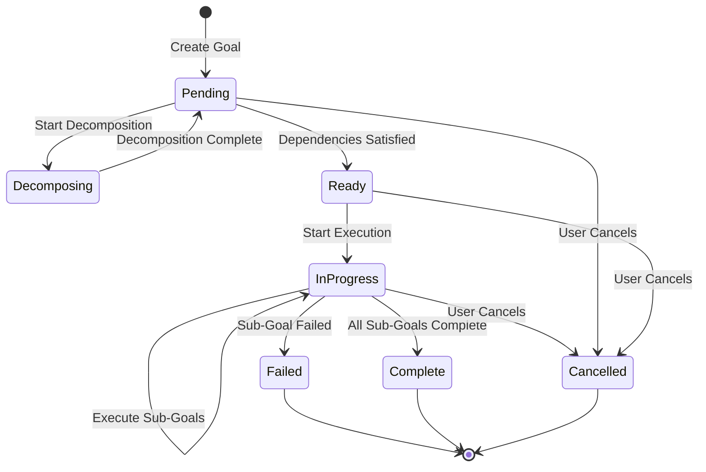

# Design Document: Goal Manager

## Overview

The Goal Manager is a critical autonomous component of Agent_Guru that enables persistent, self-managing goal execution across multiple sessions.

**Core Innovation**: Persistent autonomous goals that survive system restarts and continue execution without human intervention.

**Key Capabilities**:
- Persistent storage across restarts
- Automatic LLM-powered goal decomposition
- Real-time progress tracking
- Intelligent priority management
- Dependency resolution with cycle detection
- Session recovery and resumption
- GitHub integration for audit trail
- Error resilience with retry logic

**Technology Stack**:
- Python with asyncio for concurrency
- SQLite for structured storage
- JSON for serialization
- GitPython for version control
- Pydantic for validation

## Integration Points

### Dependencies

**Upstream Dependencies**:
- LLM Runtime: Goal decomposition
- Agent Orchestration: Task execution
- Memory System: Context storage
- Self-Improvement Engine: Metrics reporting

**Downstream Dependencies**: None

### API Contracts

The Goal Manager exposes a clean API for goal lifecycle management.


## Architecture

### High-Level Architecture

```
┌─────────────────────────────────────────────────────────────┐
│                      Goal Manager                            │
│  ┌────────────────────────────────────────────────────────┐ │
│  │              Goal Manager API                          │ │
│  │  - Create, query, update, cancel goals                │ │
│  │  - Coordinate all components                          │ │
│  └────────────────────────────────────────────────────────┘ │
│  ┌────────────────────────────────────────────────────────┐ │
│  │           Goal Decomposer                              │ │
│  │  - LLM-powered decomposition                          │ │
│  │  - Recursive sub-goal generation                      │ │
│  │  - Actionability validation                           │ │
│  └────────────────────────────────────────────────────────┘ │
│  ┌────────────────────────────────────────────────────────┐ │
│  │           Progress Tracker                             │ │
│  │  - Completion percentage calculation                  │ │
│  │  - Status propagation                                 │ │
│  │  - Timestamp management                               │ │
│  └────────────────────────────────────────────────────────┘ │
│  ┌────────────────────────────────────────────────────────┐ │
│  │           Priority Manager                             │ │
│  │  - Priority assignment and updates                    │ │
│  │  - Selection logic (priority + age)                  │ │
│  │  - Manual override support                            │ │
│  └────────────────────────────────────────────────────────┘ │
│  ┌────────────────────────────────────────────────────────┐ │
│  │           Goal Executor                                │ │
│  │  - Task creation for Agent Orchestration              │ │
│  │  - Execution coordination                             │ │
│  │  - GitHub commit integration                          │ │
│  └────────────────────────────────────────────────────────┘ │
│  ┌────────────────────────────────────────────────────────┐ │
│  │           Dependency Resolver                          │ │
│  │  - Dependency graph management                        │ │
│  │  - Cycle detection                                    │ │
│  │  - Execution readiness determination                  │ │
│  └────────────────────────────────────────────────────────┘ │
│  ┌────────────────────────────────────────────────────────┐ │
│  │           Session Manager                              │ │
│  │  - Startup: Load all goals                           │ │
│  │  - Shutdown: Persist all state                       │ │
│  │  - Resume interrupted goals                           │ │
│  └────────────────────────────────────────────────────────┘ │
│  ┌────────────────────────────────────────────────────────┐ │
│  │           Goal Storage                                 │ │
│  │  - SQLite persistence                                 │ │
│  │  - JSON serialization                                 │ │
│  │  - Schema validation                                  │ │
│  │  - Corruption recovery                                │ │
│  └────────────────────────────────────────────────────────┘ │
└─────────────────────────────────────────────────────────────┘
         │                    │                    │
         ▼                    ▼                    ▼
    ┌────────┐          ┌────────┐          ┌────────┐
    │  LLM   │          │ Agent  │          │ Memory │
    │Runtime │          │ Orch.  │          │ System │
    └────────┘          └────────┘          └────────┘
```

### Design Principles

1. **Persistence-First**: Every state change immediately persisted to disk
2. **Hierarchical Structure**: Goals form trees with parent-child relationships
3. **Autonomous Operation**: Minimal human intervention after goal creation
4. **Fail-Safe**: Graceful degradation and recovery from failures
5. **Observable**: Complete audit trail via GitHub commits
6. **Type-Safe**: Pydantic models for all data structures

### Goal Lifecycle




## Components and Interfaces

### 1. Goal Manager API (`goal_manager.py`)

The main interface for all goal operations.

```python
from typing import List, Dict, Optional, Any
from datetime import datetime
from dataclasses import dataclass
from enum import Enum
import uuid

class GoalStatus(Enum):
    """Goal execution status."""
    PENDING = "pending"
    DECOMPOSING = "decomposing"
    READY = "ready"
    IN_PROGRESS = "in_progress"
    COMPLETE = "complete"
    FAILED = "failed"
    CANCELLED = "cancelled"
    BLOCKED = "blocked"

class Priority(Enum):
    """Goal priority levels."""
    CRITICAL = "critical"
    HIGH = "high"
    MEDIUM = "medium"
    LOW = "low"

@dataclass
class Goal:
    """A goal with hierarchical structure."""
    id: str
    description: str
    status: GoalStatus
    priority: Priority
    progress: float  # 0.0 to 1.0
    created_at: datetime
    started_at: Optional[datetime]
    completed_at: Optional[datetime]
    parent_id: Optional[str]
    sub_goal_ids: List[str]
    dependency_ids: List[str]
    metadata: Dict[str, Any]
    error_message: Optional[str]

class GoalManager:
    """
    Main interface for goal lifecycle management.
    
    Coordinates all components and provides unified API.
    """
    
    def __init__(
        self,
        storage_path: str,
        git_repo_path: str,
        llm_runtime: 'LLMRuntime',
        agent_orchestration: 'AgentOrchestration',
        memory_system: 'MemorySystem',
        self_improvement_engine: 'SelfImprovementEngine'
    ):
        """Initialize Goal Manager with dependencies."""
        self.storage = GoalStorage(storage_path)
        self.decomposer = GoalDecomposer(llm_runtime, memory_system)
        self.progress_tracker = ProgressTracker(self.storage)
        self.priority_manager = PriorityManager(self.storage)
        self.executor = GoalExecutor(
            agent_orchestration,
            self.storage,
            git_repo_path,
            self_improvement_engine
        )
        self.dependency_resolver = DependencyResolver(self.storage)
        self.session_manager = SessionManager(self.storage)
    
    async def create_goal(
        self,
        description: str,
        priority: Priority = Priority.MEDIUM,
        dependencies: Optional[List[str]] = None,
        metadata: Optional[Dict[str, Any]] = None
    ) -> Goal:
        """
        Create a new goal.
        
        Args:
            description: High-level goal description
            priority: Goal priority (default: MEDIUM)
            dependencies: Optional list of dependency goal IDs
            metadata: Optional metadata
            
        Returns:
            Created goal with unique ID
            
        Raises:
            ValidationError: If dependencies contain cycles
            StorageError: If persistence fails
        """
        # Create goal object
        goal = Goal(
            id=str(uuid.uuid4()),
            description=description,
            status=GoalStatus.PENDING,
            priority=priority,
            progress=0.0,
            created_at=datetime.now(),
            started_at=None,
            completed_at=None,
            parent_id=None,
            sub_goal_ids=[],
            dependency_ids=dependencies or [],
            metadata=metadata or {},
            error_message=None
        )
        
        # Validate dependencies
        if dependencies:
            self.dependency_resolver.validate_dependencies(goal)
        
        # Persist immediately
        await self.storage.store_goal(goal)
        
        # Start decomposition asynchronously
        asyncio.create_task(self._decompose_goal(goal.id))
        
        return goal
    
    async def get_goal(self, goal_id: str) -> Optional[Goal]:
        """Get goal by ID with complete hierarchy."""
        return await self.storage.get_goal(goal_id)
    
    async def query_goals(
        self,
        status: Optional[GoalStatus] = None,
        priority: Optional[Priority] = None
    ) -> List[Goal]:
        """Query goals with optional filters."""
        return await self.storage.query_goals(status=status, priority=priority)
    
    async def update_priority(self, goal_id: str, priority: Priority) -> None:
        """Update goal priority."""
        await self.priority_manager.update_priority(goal_id, priority)
    
    async def cancel_goal(self, goal_id: str) -> None:
        """Cancel goal and all sub-goals."""
        goal = await self.storage.get_goal(goal_id)
        if not goal:
            raise ValueError(f"Goal {goal_id} not found")
        
        # Cancel all sub-goals recursively
        for sub_goal_id in goal.sub_goal_ids:
            await self.cancel_goal(sub_goal_id)
        
        # Stop execution if in progress
        if goal.status == GoalStatus.IN_PROGRESS:
            await self.executor.stop_execution(goal_id)
        
        # Mark as cancelled
        goal.status = GoalStatus.CANCELLED
        await self.storage.update_goal(goal)
    
    async def get_summary(self) -> Dict[str, Any]:
        """Get summary of all goals."""
        all_goals = await self.storage.query_goals()
        
        total = len(all_goals)
        completed = sum(1 for g in all_goals if g.status == GoalStatus.COMPLETE)
        in_progress = sum(1 for g in all_goals if g.status == GoalStatus.IN_PROGRESS)
        failed = sum(1 for g in all_goals if g.status == GoalStatus.FAILED)
        
        overall_progress = (
            sum(g.progress for g in all_goals) / total if total > 0 else 0.0
        )
        
        return {
            "total_goals": total,
            "completed": completed,
            "in_progress": in_progress,
            "failed": failed,
            "overall_progress": overall_progress
        }
    
    async def start(self) -> None:
        """Start Goal Manager (load goals from storage)."""
        await self.session_manager.load_goals()
        
        # Resume interrupted goals
        in_progress_goals = await self.storage.query_goals(
            status=GoalStatus.IN_PROGRESS
        )
        for goal in in_progress_goals:
            await self.executor.resume_goal(goal.id)
    
    async def shutdown(self) -> None:
        """Shutdown Goal Manager (persist all state)."""
        await self.session_manager.persist_all()
    
    async def _decompose_goal(self, goal_id: str) -> None:
        """Decompose goal into sub-goals."""
        goal = await self.storage.get_goal(goal_id)
        if not goal:
            return
        
        goal.status = GoalStatus.DECOMPOSING
        await self.storage.update_goal(goal)
        
        try:
            sub_goals = await self.decomposer.decompose(goal)
            
            # Store sub-goals
            for sub_goal in sub_goals:
                sub_goal.parent_id = goal.id
                await self.storage.store_goal(sub_goal)
                goal.sub_goal_ids.append(sub_goal.id)
            
            # Update parent
            goal.status = GoalStatus.PENDING
            await self.storage.update_goal(goal)
            
            # Check if ready for execution
            if self.dependency_resolver.is_ready(goal):
                goal.status = GoalStatus.READY
                await self.storage.update_goal(goal)
                await self.executor.execute_goal(goal.id)
        
        except Exception as e:
            goal.status = GoalStatus.FAILED
            goal.error_message = str(e)
            await self.storage.update_goal(goal)
```


### 2. Goal Storage (`goal_storage.py`)

Handles persistent storage with SQLite and JSON serialization.

```python
import sqlite3
import json
from typing import List, Optional
from datetime import datetime

class GoalStorage:
    """
    Persistent storage for goals using SQLite.
    
    Provides ACID transactions and immediate persistence.
    """
    
    def __init__(self, db_path: str):
        """Initialize storage with database path."""
        self.db_path = db_path
        self._init_schema()
    
    def _init_schema(self) -> None:
        """Initialize database schema."""
        conn = sqlite3.connect(self.db_path)
        cursor = conn.cursor()
        
        cursor.execute("""
            CREATE TABLE IF NOT EXISTS goals (
                id TEXT PRIMARY KEY,
                description TEXT NOT NULL,
                status TEXT NOT NULL,
                priority TEXT NOT NULL,
                progress REAL NOT NULL,
                created_at TEXT NOT NULL,
                started_at TEXT,
                completed_at TEXT,
                parent_id TEXT,
                sub_goal_ids TEXT NOT NULL,
                dependency_ids TEXT NOT NULL,
                metadata TEXT NOT NULL,
                error_message TEXT,
                FOREIGN KEY (parent_id) REFERENCES goals(id)
            )
        """)
        
        cursor.execute("""
            CREATE INDEX IF NOT EXISTS idx_status ON goals(status)
        """)
        
        cursor.execute("""
            CREATE INDEX IF NOT EXISTS idx_priority ON goals(priority)
        """)
        
        cursor.execute("""
            CREATE INDEX IF NOT EXISTS idx_parent ON goals(parent_id)
        """)
        
        conn.commit()
        conn.close()
    
    async def store_goal(self, goal: Goal) -> None:
        """Store goal with immediate persistence."""
        conn = sqlite3.connect(self.db_path)
        cursor = conn.cursor()
        
        try:
            cursor.execute("""
                INSERT INTO goals (
                    id, description, status, priority, progress,
                    created_at, started_at, completed_at, parent_id,
                    sub_goal_ids, dependency_ids, metadata, error_message
                ) VALUES (?, ?, ?, ?, ?, ?, ?, ?, ?, ?, ?, ?, ?)
            """, (
                goal.id,
                goal.description,
                goal.status.value,
                goal.priority.value,
                goal.progress,
                goal.created_at.isoformat(),
                goal.started_at.isoformat() if goal.started_at else None,
                goal.completed_at.isoformat() if goal.completed_at else None,
                goal.parent_id,
                json.dumps(goal.sub_goal_ids),
                json.dumps(goal.dependency_ids),
                json.dumps(goal.metadata),
                goal.error_message
            ))
            
            conn.commit()
        except Exception as e:
            conn.rollback()
            raise StorageError(f"Failed to store goal: {e}")
        finally:
            conn.close()
    
    async def update_goal(self, goal: Goal) -> None:
        """Update goal with immediate persistence."""
        conn = sqlite3.connect(self.db_path)
        cursor = conn.cursor()
        
        try:
            cursor.execute("""
                UPDATE goals SET
                    description = ?,
                    status = ?,
                    priority = ?,
                    progress = ?,
                    started_at = ?,
                    completed_at = ?,
                    sub_goal_ids = ?,
                    dependency_ids = ?,
                    metadata = ?,
                    error_message = ?
                WHERE id = ?
            """, (
                goal.description,
                goal.status.value,
                goal.priority.value,
                goal.progress,
                goal.started_at.isoformat() if goal.started_at else None,
                goal.completed_at.isoformat() if goal.completed_at else None,
                json.dumps(goal.sub_goal_ids),
                json.dumps(goal.dependency_ids),
                json.dumps(goal.metadata),
                goal.error_message,
                goal.id
            ))
            
            conn.commit()
        except Exception as e:
            conn.rollback()
            raise StorageError(f"Failed to update goal: {e}")
        finally:
            conn.close()
    
    async def get_goal(self, goal_id: str) -> Optional[Goal]:
        """Retrieve goal by ID."""
        conn = sqlite3.connect(self.db_path)
        cursor = conn.cursor()
        
        cursor.execute("""
            SELECT id, description, status, priority, progress,
                   created_at, started_at, completed_at, parent_id,
                   sub_goal_ids, dependency_ids, metadata, error_message
            FROM goals WHERE id = ?
        """, (goal_id,))
        
        row = cursor.fetchone()
        conn.close()
        
        if not row:
            return None
        
        return self._row_to_goal(row)
    
    async def query_goals(
        self,
        status: Optional[GoalStatus] = None,
        priority: Optional[Priority] = None
    ) -> List[Goal]:
        """Query goals with optional filters."""
        conn = sqlite3.connect(self.db_path)
        cursor = conn.cursor()
        
        query = "SELECT * FROM goals WHERE 1=1"
        params = []
        
        if status:
            query += " AND status = ?"
            params.append(status.value)
        
        if priority:
            query += " AND priority = ?"
            params.append(priority.value)
        
        cursor.execute(query, params)
        rows = cursor.fetchall()
        conn.close()
        
        return [self._row_to_goal(row) for row in rows]
    
    def _row_to_goal(self, row: tuple) -> Goal:
        """Convert database row to Goal object."""
        return Goal(
            id=row[0],
            description=row[1],
            status=GoalStatus(row[2]),
            priority=Priority(row[3]),
            progress=row[4],
            created_at=datetime.fromisoformat(row[5]),
            started_at=datetime.fromisoformat(row[6]) if row[6] else None,
            completed_at=datetime.fromisoformat(row[7]) if row[7] else None,
            parent_id=row[8],
            sub_goal_ids=json.loads(row[9]),
            dependency_ids=json.loads(row[10]),
            metadata=json.loads(row[11]),
            error_message=row[12]
        )
    
    async def export_to_json(self, output_path: str) -> None:
        """Export all goals to JSON file."""
        goals = await self.query_goals()
        
        with open(output_path, 'w') as f:
            json.dump(
                [self._goal_to_dict(g) for g in goals],
                f,
                indent=2
            )
    
    async def import_from_json(self, input_path: str) -> int:
        """Import goals from JSON file. Returns count imported."""
        with open(input_path, 'r') as f:
            goals_data = json.load(f)
        
        count = 0
        for goal_dict in goals_data:
            goal = self._dict_to_goal(goal_dict)
            try:
                await self.store_goal(goal)
                count += 1
            except Exception:
                # Skip duplicates
                pass
        
        return count
    
    def _goal_to_dict(self, goal: Goal) -> Dict[str, Any]:
        """Convert Goal to dictionary for JSON serialization."""
        return {
            "id": goal.id,
            "description": goal.description,
            "status": goal.status.value,
            "priority": goal.priority.value,
            "progress": goal.progress,
            "created_at": goal.created_at.isoformat(),
            "started_at": goal.started_at.isoformat() if goal.started_at else None,
            "completed_at": goal.completed_at.isoformat() if goal.completed_at else None,
            "parent_id": goal.parent_id,
            "sub_goal_ids": goal.sub_goal_ids,
            "dependency_ids": goal.dependency_ids,
            "metadata": goal.metadata,
            "error_message": goal.error_message
        }
    
    def _dict_to_goal(self, data: Dict[str, Any]) -> Goal:
        """Convert dictionary to Goal object."""
        return Goal(
            id=data["id"],
            description=data["description"],
            status=GoalStatus(data["status"]),
            priority=Priority(data["priority"]),
            progress=data["progress"],
            created_at=datetime.fromisoformat(data["created_at"]),
            started_at=datetime.fromisoformat(data["started_at"]) if data["started_at"] else None,
            completed_at=datetime.fromisoformat(data["completed_at"]) if data["completed_at"] else None,
            parent_id=data["parent_id"],
            sub_goal_ids=data["sub_goal_ids"],
            dependency_ids=data["dependency_ids"],
            metadata=data["metadata"],
            error_message=data["error_message"]
        )

class StorageError(Exception):
    """Raised when storage operations fail."""
    pass
```


### 3. Goal Decomposer (`goal_decomposer.py`)

Decomposes high-level goals using LLM Runtime.

```python
from typing import List, Dict, Optional, Any

class GoalDecomposer:
    """
    Decomposes high-level goals into actionable sub-goals using LLM.
    
    Uses LLM Runtime to analyze goals and generate sub-goals.
    """
    
    def __init__(self, llm_runtime: 'LLMRuntime', memory_system: 'MemorySystem'):
        """Initialize with LLM Runtime and Memory System."""
        self.llm_runtime = llm_runtime
        self.memory_system = memory_system
    
    async def decompose(self, goal: Goal) -> List[Goal]:
        """
        Decompose goal into sub-goals.
        
        Args:
            goal: Goal to decompose
            
        Returns:
            List of sub-goals
            
        Raises:
            DecompositionError: If LLM fails or returns invalid response
        """
        # Get relevant context from memory
        context = await self._get_context(goal)
        
        # Build decomposition prompt
        prompt = self._build_prompt(goal, context)
        
        # Call LLM with retry logic
        response = await self._call_llm_with_retry(prompt)
        
        # Parse response into sub-goals
        sub_goals = self._parse_response(response, goal)
        
        # Validate sub-goals
        self._validate_subgoals(sub_goals)
        
        return sub_goals
    
    async def _get_context(self, goal: Goal) -> Dict[str, Any]:
        """Get relevant context from Memory System."""
        # Query memory for similar past goals
        similar_goals = await self.memory_system.query_similar(
            query=goal.description,
            limit=5,
            metadata_filter={"type": "goal"}
        )
        
        return {
            "similar_goals": [g.content for g in similar_goals],
            "metadata": goal.metadata
        }
    
    def _build_prompt(self, goal: Goal, context: Dict[str, Any]) -> str:
        """Build decomposition prompt for LLM."""
        prompt = f"""You are an expert at breaking down high-level goals into actionable sub-goals.

Goal: {goal.description}

Context:
{json.dumps(context, indent=2)}

Please decompose this goal into 3-7 specific, actionable sub-goals. Each sub-goal should:
1. Be more specific than the parent goal
2. Be independently executable
3. Contribute to achieving the parent goal
4. Be testable (clear success criteria)

Return your response as a JSON array of objects with this structure:
[
  {{
    "description": "Sub-goal description",
    "rationale": "Why this sub-goal is needed",
    "estimated_complexity": "low|medium|high"
  }}
]

Sub-goals:"""
        
        return prompt
    
    async def _call_llm_with_retry(
        self,
        prompt: str,
        max_retries: int = 3
    ) -> str:
        """Call LLM with exponential backoff retry."""
        for attempt in range(max_retries):
            try:
                response = await self.llm_runtime.generate(
                    prompt=prompt,
                    max_tokens=2000,
                    temperature=0.7
                )
                return response
            except Exception as e:
                if attempt == max_retries - 1:
                    raise DecompositionError(f"LLM failed after {max_retries} attempts: {e}")
                
                # Exponential backoff
                await asyncio.sleep(2 ** attempt)
    
    def _parse_response(self, response: str, parent_goal: Goal) -> List[Goal]:
        """Parse LLM response into Goal objects."""
        try:
            # Extract JSON from response
            json_start = response.find('[')
            json_end = response.rfind(']') + 1
            json_str = response[json_start:json_end]
            
            sub_goals_data = json.loads(json_str)
            
            # Create Goal objects
            sub_goals = []
            for data in sub_goals_data:
                sub_goal = Goal(
                    id=str(uuid.uuid4()),
                    description=data["description"],
                    status=GoalStatus.PENDING,
                    priority=parent_goal.priority,
                    progress=0.0,
                    created_at=datetime.now(),
                    started_at=None,
                    completed_at=None,
                    parent_id=parent_goal.id,
                    sub_goal_ids=[],
                    dependency_ids=[],
                    metadata={
                        "rationale": data.get("rationale", ""),
                        "estimated_complexity": data.get("estimated_complexity", "medium"),
                        "generated_by": "llm_decomposer"
                    },
                    error_message=None
                )
                sub_goals.append(sub_goal)
            
            return sub_goals
        
        except Exception as e:
            raise DecompositionError(f"Failed to parse LLM response: {e}")
    
    def _validate_subgoals(self, sub_goals: List[Goal]) -> None:
        """Validate sub-goals meet quality criteria."""
        if not sub_goals:
            raise DecompositionError("No sub-goals generated")
        
        if len(sub_goals) > 10:
            raise DecompositionError("Too many sub-goals (max 10)")
        
        for sub_goal in sub_goals:
            if len(sub_goal.description) < 10:
                raise DecompositionError(f"Sub-goal description too short: {sub_goal.description}")

class DecompositionError(Exception):
    """Raised when goal decomposition fails."""
    pass
```

### 4. Progress Tracker (`progress_tracker.py`)

Tracks goal progress and propagates status changes.

```python
from typing import Optional

class ProgressTracker:
    """
    Tracks goal progress and propagates status changes.
    
    Calculates completion percentages and updates parent goals.
    """
    
    def __init__(self, storage: GoalStorage):
        """Initialize with storage."""
        self.storage = storage
    
    async def mark_complete(self, goal_id: str) -> None:
        """Mark goal as complete and update parent."""
        goal = await self.storage.get_goal(goal_id)
        if not goal:
            return
        
        # Update goal
        goal.status = GoalStatus.COMPLETE
        goal.progress = 1.0
        goal.completed_at = datetime.now()
        await self.storage.update_goal(goal)
        
        # Update parent if exists
        if goal.parent_id:
            await self._update_parent_progress(goal.parent_id)
    
    async def mark_failed(self, goal_id: str, error_message: str) -> None:
        """Mark goal as failed."""
        goal = await self.storage.get_goal(goal_id)
        if not goal:
            return
        
        goal.status = GoalStatus.FAILED
        goal.error_message = error_message
        goal.completed_at = datetime.now()
        await self.storage.update_goal(goal)
        
        # Update parent
        if goal.parent_id:
            await self._update_parent_progress(goal.parent_id)
    
    async def mark_in_progress(self, goal_id: str) -> None:
        """Mark goal as in progress."""
        goal = await self.storage.get_goal(goal_id)
        if not goal:
            return
        
        goal.status = GoalStatus.IN_PROGRESS
        if not goal.started_at:
            goal.started_at = datetime.now()
        await self.storage.update_goal(goal)
    
    async def _update_parent_progress(self, parent_id: str) -> None:
        """Update parent goal's progress based on sub-goals."""
        parent = await self.storage.get_goal(parent_id)
        if not parent:
            return
        
        # Get all sub-goals
        sub_goals = []
        for sub_goal_id in parent.sub_goal_ids:
            sub_goal = await self.storage.get_goal(sub_goal_id)
            if sub_goal:
                sub_goals.append(sub_goal)
        
        if not sub_goals:
            return
        
        # Calculate progress
        total_progress = sum(g.progress for g in sub_goals)
        parent.progress = total_progress / len(sub_goals)
        
        # Check if all complete
        all_complete = all(g.status == GoalStatus.COMPLETE for g in sub_goals)
        if all_complete:
            parent.status = GoalStatus.COMPLETE
            parent.completed_at = datetime.now()
        
        await self.storage.update_goal(parent)
        
        # Recursively update grandparent
        if parent.parent_id:
            await self._update_parent_progress(parent.parent_id)
```


### 5. Priority Manager (`priority_manager.py`)

Manages goal priorities and selection logic.

```python
from typing import List, Optional

class PriorityManager:
    """
    Manages goal priorities and selection logic.
    
    Handles priority assignment, updates, and selection.
    """
    
    def __init__(self, storage: GoalStorage):
        """Initialize with storage."""
        self.storage = storage
    
    async def update_priority(self, goal_id: str, priority: Priority) -> None:
        """Update goal priority with immediate persistence."""
        goal = await self.storage.get_goal(goal_id)
        if not goal:
            raise ValueError(f"Goal {goal_id} not found")
        
        goal.priority = priority
        await self.storage.update_goal(goal)
    
    async def select_next_goal(self) -> Optional[Goal]:
        """
        Select next goal for execution.
        
        Selection criteria:
        1. Status must be READY
        2. Highest priority first
        3. Oldest goal for tie-breaking
        
        Returns:
            Next goal to execute, or None if no ready goals
        """
        ready_goals = await self.storage.query_goals(status=GoalStatus.READY)
        
        if not ready_goals:
            return None
        
        # Sort by priority (descending) then by created_at (ascending)
        priority_order = {
            Priority.CRITICAL: 0,
            Priority.HIGH: 1,
            Priority.MEDIUM: 2,
            Priority.LOW: 3
        }
        
        sorted_goals = sorted(
            ready_goals,
            key=lambda g: (priority_order[g.priority], g.created_at)
        )
        
        return sorted_goals[0]

### 6. Dependency Resolver (`dependency_resolver.py`)

Manages goal dependencies and cycle detection.

```python
from typing import Set, List

class DependencyResolver:
    """
    Manages goal dependencies and execution readiness.
    
    Detects cycles and determines when goals are ready.
    """
    
    def __init__(self, storage: GoalStorage):
        """Initialize with storage."""
        self.storage = storage
    
    def validate_dependencies(self, goal: Goal) -> None:
        """
        Validate goal dependencies.
        
        Raises:
            ValidationError: If circular dependencies detected
        """
        if self._has_cycle(goal):
            raise ValidationError(f"Circular dependency detected for goal {goal.id}")
    
    def _has_cycle(self, goal: Goal) -> bool:
        """Check if goal has circular dependencies using DFS."""
        visited = set()
        rec_stack = set()
        
        return self._has_cycle_util(goal.id, visited, rec_stack)
    
    async def _has_cycle_util(
        self,
        goal_id: str,
        visited: Set[str],
        rec_stack: Set[str]
    ) -> bool:
        """DFS utility for cycle detection."""
        visited.add(goal_id)
        rec_stack.add(goal_id)
        
        goal = await self.storage.get_goal(goal_id)
        if not goal:
            return False
        
        for dep_id in goal.dependency_ids:
            if dep_id not in visited:
                if await self._has_cycle_util(dep_id, visited, rec_stack):
                    return True
            elif dep_id in rec_stack:
                return True
        
        rec_stack.remove(goal_id)
        return False
    
    async def is_ready(self, goal: Goal) -> bool:
        """
        Check if goal is ready for execution.
        
        A goal is ready if all its dependencies are complete.
        """
        if not goal.dependency_ids:
            return True
        
        for dep_id in goal.dependency_ids:
            dep = await self.storage.get_goal(dep_id)
            if not dep or dep.status != GoalStatus.COMPLETE:
                return False
        
        return True
    
    async def mark_blocked(self, goal_id: str) -> None:
        """Mark goal as blocked due to failed dependency."""
        goal = await self.storage.get_goal(goal_id)
        if not goal:
            return
        
        goal.status = GoalStatus.BLOCKED
        await self.storage.update_goal(goal)
        
        # Recursively block dependent goals
        all_goals = await self.storage.query_goals()
        for g in all_goals:
            if goal_id in g.dependency_ids:
                await self.mark_blocked(g.id)

class ValidationError(Exception):
    """Raised when validation fails."""
    pass
```


### 7. Goal Executor (`goal_executor.py`)

Coordinates goal execution with Agent Orchestration and GitHub.

```python
from git import Repo
from typing import Optional

class GoalExecutor:
    """
    Coordinates goal execution with Agent Orchestration.
    
    Creates tasks, tracks execution, and commits to GitHub.
    """
    
    def __init__(
        self,
        agent_orchestration: 'AgentOrchestration',
        storage: GoalStorage,
        git_repo_path: str,
        self_improvement_engine: 'SelfImprovementEngine'
    ):
        """Initialize with dependencies."""
        self.agent_orchestration = agent_orchestration
        self.storage = storage
        self.git_repo = Repo(git_repo_path)
        self.self_improvement_engine = self_improvement_engine
        self.active_executions = {}  # goal_id -> task_id
    
    async def execute_goal(self, goal_id: str) -> None:
        """
        Execute goal by processing sub-goals sequentially.
        
        Args:
            goal_id: Goal to execute
        """
        goal = await self.storage.get_goal(goal_id)
        if not goal:
            return
        
        # Mark as in progress
        goal.status = GoalStatus.IN_PROGRESS
        goal.started_at = datetime.now()
        await self.storage.update_goal(goal)
        
        # Execute sub-goals sequentially
        for sub_goal_id in goal.sub_goal_ids:
            sub_goal = await self.storage.get_goal(sub_goal_id)
            if not sub_goal:
                continue
            
            # Check if sub-goal has its own sub-goals
            if sub_goal.sub_goal_ids:
                # Recursively execute
                await self.execute_goal(sub_goal_id)
            else:
                # Execute as task
                await self._execute_sub_goal(sub_goal)
            
            # Check if failed
            sub_goal = await self.storage.get_goal(sub_goal_id)
            if sub_goal and sub_goal.status == GoalStatus.FAILED:
                # Mark parent as failed
                goal.status = GoalStatus.FAILED
                goal.error_message = f"Sub-goal {sub_goal_id} failed"
                await self.storage.update_goal(goal)
                return
        
        # All sub-goals complete
        goal.status = GoalStatus.COMPLETE
        goal.progress = 1.0
        goal.completed_at = datetime.now()
        await self.storage.update_goal(goal)
        
        # Report to Self-Improvement Engine
        await self._report_completion(goal)
    
    async def _execute_sub_goal(self, sub_goal: Goal) -> None:
        """Execute a single sub-goal as a task."""
        # Mark as in progress
        sub_goal.status = GoalStatus.IN_PROGRESS
        sub_goal.started_at = datetime.now()
        await self.storage.update_goal(sub_goal)
        
        try:
            # Create task for Agent Orchestration
            task = await self.agent_orchestration.create_task(
                name=f"Goal: {sub_goal.description}",
                description=sub_goal.description,
                task_type="goal_execution",
                metadata={"goal_id": sub_goal.id}
            )
            
            self.active_executions[sub_goal.id] = task.task_id
            
            # Wait for task completion
            result = await self.agent_orchestration.wait_for_task(task.task_id)
            
            if result.success:
                # Mark complete
                sub_goal.status = GoalStatus.COMPLETE
                sub_goal.progress = 1.0
                sub_goal.completed_at = datetime.now()
                await self.storage.update_goal(sub_goal)
                
                # Commit to GitHub
                await self._commit_to_github(sub_goal)
            else:
                # Mark failed
                sub_goal.status = GoalStatus.FAILED
                sub_goal.error_message = result.error_message
                sub_goal.completed_at = datetime.now()
                await self.storage.update_goal(sub_goal)
        
        except Exception as e:
            sub_goal.status = GoalStatus.FAILED
            sub_goal.error_message = str(e)
            sub_goal.completed_at = datetime.now()
            await self.storage.update_goal(sub_goal)
        
        finally:
            if sub_goal.id in self.active_executions:
                del self.active_executions[sub_goal.id]
    
    async def _commit_to_github(self, goal: Goal) -> None:
        """Commit goal completion to GitHub."""
        try:
            # Stage all changes
            self.git_repo.git.add(A=True)
            
            # Create commit
            commit_message = f"Goal completed: {goal.description}\n\nGoal ID: {goal.id}"
            self.git_repo.index.commit(commit_message)
            
            # Push to remote
            origin = self.git_repo.remote(name='origin')
            origin.push()
        
        except Exception as e:
            # Log error but don't fail goal
            print(f"Failed to commit to GitHub: {e}")
    
    async def _report_completion(self, goal: Goal) -> None:
        """Report goal completion to Self-Improvement Engine."""
        try:
            await self.self_improvement_engine.record_task_execution(
                task_id=goal.id,
                task_type="goal",
                strategy_used="goal_manager",
                success=goal.status == GoalStatus.COMPLETE,
                execution_time_ms=(
                    (goal.completed_at - goal.started_at).total_seconds() * 1000
                    if goal.completed_at and goal.started_at else 0
                ),
                error_details={"error": goal.error_message} if goal.error_message else None
            )
        except Exception as e:
            print(f"Failed to report to Self-Improvement Engine: {e}")
    
    async def stop_execution(self, goal_id: str) -> None:
        """Stop execution of a goal."""
        if goal_id in self.active_executions:
            task_id = self.active_executions[goal_id]
            await self.agent_orchestration.cancel_task(task_id)
            del self.active_executions[goal_id]
    
    async def resume_goal(self, goal_id: str) -> None:
        """Resume execution of an interrupted goal."""
        goal = await self.storage.get_goal(goal_id)
        if not goal:
            return
        
        # Find last completed sub-goal
        last_completed_idx = -1
        for i, sub_goal_id in enumerate(goal.sub_goal_ids):
            sub_goal = await self.storage.get_goal(sub_goal_id)
            if sub_goal and sub_goal.status == GoalStatus.COMPLETE:
                last_completed_idx = i
        
        # Resume from next sub-goal
        for i in range(last_completed_idx + 1, len(goal.sub_goal_ids)):
            sub_goal_id = goal.sub_goal_ids[i]
            sub_goal = await self.storage.get_goal(sub_goal_id)
            if sub_goal:
                await self._execute_sub_goal(sub_goal)

### 8. Session Manager (`session_manager.py`)

Handles system startup and shutdown.

```python
class SessionManager:
    """
    Manages goal persistence across sessions.
    
    Handles startup, shutdown, and recovery.
    """
    
    def __init__(self, storage: GoalStorage):
        """Initialize with storage."""
        self.storage = storage
    
    async def load_goals(self) -> None:
        """Load all goals from storage on startup."""
        # Goals are already in database, just verify integrity
        all_goals = await self.storage.query_goals()
        
        corrupted_goals = []
        for goal in all_goals:
            if not self._validate_goal_integrity(goal):
                corrupted_goals.append(goal.id)
        
        if corrupted_goals:
            print(f"Warning: {len(corrupted_goals)} corrupted goals detected")
            # Attempt recovery or mark as failed
            for goal_id in corrupted_goals:
                await self._attempt_recovery(goal_id)
    
    def _validate_goal_integrity(self, goal: Goal) -> bool:
        """Validate goal data integrity."""
        # Check required fields
        if not goal.id or not goal.description:
            return False
        
        # Check timestamps are in order
        if goal.started_at and goal.started_at < goal.created_at:
            return False
        
        if goal.completed_at and goal.started_at and goal.completed_at < goal.started_at:
            return False
        
        # Check progress is valid
        if not (0.0 <= goal.progress <= 1.0):
            return False
        
        return True
    
    async def _attempt_recovery(self, goal_id: str) -> None:
        """Attempt to recover corrupted goal."""
        goal = await self.storage.get_goal(goal_id)
        if not goal:
            return
        
        # Mark as failed with error message
        goal.status = GoalStatus.FAILED
        goal.error_message = "Data corruption detected during recovery"
        await self.storage.update_goal(goal)
    
    async def persist_all(self) -> None:
        """Persist all goal state before shutdown."""
        # All updates are already persisted immediately
        # This is a no-op but kept for API consistency
        pass
```


## Data Models

### Goal Schema

```python
{
    "id": "uuid-string",
    "description": "High-level goal description",
    "status": "pending|decomposing|ready|in_progress|complete|failed|cancelled|blocked",
    "priority": "critical|high|medium|low",
    "progress": 0.75,  # 0.0 to 1.0
    "created_at": "2024-01-15T10:30:00Z",
    "started_at": "2024-01-15T10:35:00Z",
    "completed_at": null,
    "parent_id": "parent-uuid-string",  # null for root goals
    "sub_goal_ids": ["sub-goal-1-uuid", "sub-goal-2-uuid"],
    "dependency_ids": ["dep-goal-1-uuid", "dep-goal-2-uuid"],
    "metadata": {
        "rationale": "Why this goal exists",
        "estimated_complexity": "low|medium|high",
        "generated_by": "user|llm_decomposer",
        "tags": ["tag1", "tag2"]
    },
    "error_message": null  # Error message if failed
}
```

### SQLite Schema

```sql
CREATE TABLE goals (
    id TEXT PRIMARY KEY,
    description TEXT NOT NULL,
    status TEXT NOT NULL,
    priority TEXT NOT NULL,
    progress REAL NOT NULL,
    created_at TEXT NOT NULL,
    started_at TEXT,
    completed_at TEXT,
    parent_id TEXT,
    sub_goal_ids TEXT NOT NULL,  -- JSON array
    dependency_ids TEXT NOT NULL,  -- JSON array
    metadata TEXT NOT NULL,  -- JSON object
    error_message TEXT,
    FOREIGN KEY (parent_id) REFERENCES goals(id)
);

CREATE INDEX idx_status ON goals(status);
CREATE INDEX idx_priority ON goals(priority);
CREATE INDEX idx_parent ON goals(parent_id);
CREATE INDEX idx_created_at ON goals(created_at);
```

### Goal Hierarchy Example

```
Root Goal: "Build Agent_Guru MVP"
├── Sub-Goal 1: "Implement Goal Manager"
│   ├── Sub-Goal 1.1: "Design Goal Manager architecture"
│   ├── Sub-Goal 1.2: "Implement Goal Storage"
│   └── Sub-Goal 1.3: "Implement Goal Decomposer"
├── Sub-Goal 2: "Implement Agent Orchestration"
│   ├── Sub-Goal 2.1: "Design orchestration patterns"
│   └── Sub-Goal 2.2: "Implement task execution"
└── Sub-Goal 3: "Integration Testing"
    └── Sub-Goal 3.1: "Test end-to-end goal execution"
```

## Correctness Properties

A property is a characteristic or behavior that should hold true across all valid executions of a system—essentially, a formal statement about what the system should do. Properties serve as the bridge between human-readable specifications and machine-verifiable correctness guarantees.

### Property 1: Goal Creation Initialization

*For any* goal creation request with a description, the created goal should have a unique ID, status "pending", priority "medium" (if not specified), progress 0.0, empty sub-goal list, and a valid creation timestamp.

**Validates: Requirements 1.1, 1.4, 1.5**

### Property 2: Immediate Persistence

*For any* goal state change (status, priority, progress, or any field), the change should be persisted to disk before the operation returns, and reading from disk should reflect the change.

**Validates: Requirements 1.2, 3.4, 4.6**

### Property 3: Session Persistence Round-Trip

*For any* set of goals stored in the system, shutting down and restarting the system should restore all goals with identical state (all fields preserved including status, progress, priority, timestamps, sub-goals, and dependencies).

**Validates: Requirements 1.3, 6.1, 6.2, 6.5**

### Property 4: Unique Identifier Invariant

*For any* set of goals in the system, all goal IDs should be unique, and no two goals should share the same ID.

**Validates: Requirements 1.4**

### Property 5: Hierarchical Tree Structure

*For any* goal hierarchy, the structure should form a valid tree (no cycles through parent-child relationships, each goal has at most one parent, and following parent links eventually reaches a root goal with no parent).

**Validates: Requirements 2.6**

### Property 6: Parent-Child Reference Consistency

*For any* goal with sub-goals, each sub-goal should reference the parent goal in its parent_id field, and the parent should list the sub-goal in its sub_goal_ids list.

**Validates: Requirements 2.3**

### Property 7: Progress Calculation Correctness

*For any* goal with sub-goals, the goal's progress should equal the average progress of its sub-goals (sum of sub-goal progress divided by number of sub-goals).

**Validates: Requirements 3.2**

### Property 8: Completion Propagation

*For any* goal where all sub-goals have status "complete", the parent goal should have status "complete" and progress 1.0.

**Validates: Requirements 3.3**

### Property 9: Timestamp Chronological Order

*For any* goal, if timestamps are present, they should be in chronological order: created_at ≤ started_at ≤ completed_at.

**Validates: Requirements 3.5**

### Property 10: Priority Selection Correctness

*For any* set of ready goals, selecting the next goal for execution should return the goal with the highest priority, and among goals with equal priority, the oldest goal (earliest created_at).

**Validates: Requirements 4.3, 4.4**

### Property 11: Priority Validity

*For any* goal, the priority field should be one of the four valid values: "critical", "high", "medium", or "low".

**Validates: Requirements 4.2**

### Property 12: Sequential Sub-Goal Execution

*For any* goal being executed, at most one sub-goal should be in "in_progress" status at any time (sub-goals execute sequentially, not concurrently).

**Validates: Requirements 5.6**

### Property 13: Task Creation for Execution

*For any* ready goal with no sub-goals (leaf goal), executing the goal should create exactly one task in Agent_Orchestration.

**Validates: Requirements 5.1, 10.2**

### Property 14: GitHub Commit on Completion

*For any* sub-goal that completes successfully, a commit should be created in the Git repository with a message containing the goal description and ID.

**Validates: Requirements 5.5**

### Property 15: Dependency Blocking

*For any* goal with incomplete dependencies, the goal should not have status "ready" or "in_progress" (dependencies must be satisfied before execution).

**Validates: Requirements 7.2**

### Property 16: Circular Dependency Detection

*For any* goal with dependencies that form a cycle (A depends on B, B depends on C, C depends on A), creating or updating the goal should raise a validation error.

**Validates: Requirements 7.4**

### Property 17: Dependency Satisfaction

*For any* goal where all dependency goals have status "complete", the goal should be marked as "ready" for execution (assuming no other blocking conditions).

**Validates: Requirements 7.5**

### Property 18: Cancellation Propagation

*For any* goal that is cancelled, all sub-goals in the goal's subtree should also be marked as "cancelled".

**Validates: Requirements 9.1**

### Property 19: Query Filtering Correctness

*For any* query with status or priority filters, all returned goals should match the filter criteria, and no goals matching the criteria should be excluded.

**Validates: Requirements 8.2, 8.3**

### Property 20: Hierarchical Retrieval Completeness

*For any* goal ID, retrieving the goal should return the goal and all its descendants (sub-goals, sub-sub-goals, etc.) in the hierarchy.

**Validates: Requirements 8.4**

### Property 21: Serialization Round-Trip

*For any* valid goal object, serializing to JSON then deserializing should produce an equivalent goal with all fields preserved exactly.

**Validates: Requirements 12.1, 12.2**

### Property 22: Schema Validation

*For any* deserialized goal data, if the data is invalid (missing required fields, invalid enum values, invalid types), the deserialization should raise a validation error.

**Validates: Requirements 12.3, 12.5**

### Property 23: Retry with Exponential Backoff

*For any* external service failure (LLM Runtime, Agent Orchestration), the system should retry the operation with exponentially increasing delays (e.g., 1s, 2s, 4s) up to a maximum number of attempts.

**Validates: Requirements 11.1, 11.4, 11.5**

### Property 24: Error Logging Completeness

*For any* error that occurs in the Goal Manager, an error log entry should be created containing the error type, message, timestamp, and relevant context (goal ID, operation type).

**Validates: Requirements 11.2, 11.6**

### Property 25: Corruption Recovery

*For any* goal with corrupted data detected during loading, the system should either successfully recover the goal or mark it as failed with an appropriate error message (no crashes or data loss).

**Validates: Requirements 6.4, 11.3**


## Error Handling

### Error Types

The Goal Manager defines the following exception hierarchy:

```python
class GoalManagerError(Exception):
    """Base exception for all Goal Manager errors."""
    pass

class StorageError(GoalManagerError):
    """Raised when storage operations fail."""
    pass

class DecompositionError(GoalManagerError):
    """Raised when goal decomposition fails."""
    pass

class ValidationError(GoalManagerError):
    """Raised when validation fails (e.g., circular dependencies)."""
    pass

class ExecutionError(GoalManagerError):
    """Raised when goal execution fails."""
    pass
```

### Error Handling Strategies

1. **Storage Failures**:
   - Retry write operations up to 3 times with exponential backoff
   - Log error with full context (goal ID, operation type, error message)
   - Notify user if persistence fails after retries
   - Never lose in-memory state

2. **LLM Runtime Failures**:
   - Retry with exponential backoff (1s, 2s, 4s)
   - After 3 failures, mark goal as failed with error message
   - Log LLM request and response for debugging
   - Allow manual retry by user

3. **Agent Orchestration Failures**:
   - Queue tasks if Agent Orchestration unavailable
   - Retry task creation with exponential backoff
   - Mark sub-goal as failed if task fails
   - Propagate failure to parent goal

4. **Validation Failures**:
   - Fail fast with descriptive error message
   - Do not modify system state
   - Log validation failure details
   - Return error to user immediately

5. **Corrupted Data**:
   - Detect corruption during loading (schema validation)
   - Attempt recovery by filling missing fields with defaults
   - If recovery fails, mark goal as failed
   - Log corruption details for investigation

6. **Circular Dependencies**:
   - Detect using depth-first search
   - Reject goal creation/update with clear error
   - Suggest which goals form the cycle
   - Do not persist invalid state

### Retry Logic

All external service calls use exponential backoff:

```python
async def retry_with_backoff(
    operation: Callable,
    max_retries: int = 3,
    base_delay: float = 1.0
) -> Any:
    """Retry operation with exponential backoff."""
    for attempt in range(max_retries):
        try:
            return await operation()
        except Exception as e:
            if attempt == max_retries - 1:
                raise
            
            delay = base_delay * (2 ** attempt)
            await asyncio.sleep(delay)
```

## Testing Strategy

### Dual Testing Approach

The Goal Manager uses both unit tests and property-based tests for comprehensive coverage:

- **Unit Tests**: Verify specific examples, edge cases, and error conditions
- **Property Tests**: Verify universal properties across all inputs
- Both are complementary and necessary for comprehensive coverage

### Unit Testing

Unit tests focus on:
- Specific examples that demonstrate correct behavior
- Edge cases (empty goals, single sub-goal, deep hierarchies)
- Error conditions (storage failures, LLM failures, corrupted data)
- Integration points with external systems
- GitHub commit functionality
- Session recovery scenarios

Example unit tests:
```python
def test_create_goal_with_defaults():
    """Test goal creation with default values."""
    goal = goal_manager.create_goal("Test goal")
    assert goal.status == GoalStatus.PENDING
    assert goal.priority == Priority.MEDIUM
    assert goal.progress == 0.0
    assert len(goal.sub_goal_ids) == 0

def test_circular_dependency_detection():
    """Test that circular dependencies are rejected."""
    goal_a = goal_manager.create_goal("Goal A")
    goal_b = goal_manager.create_goal("Goal B", dependencies=[goal_a.id])
    
    with pytest.raises(ValidationError):
        goal_manager.update_goal(goal_a.id, dependencies=[goal_b.id])
```

### Property-Based Testing

Property tests verify universal correctness properties using a property-based testing library (Hypothesis for Python).

**Configuration**:
- Minimum 100 iterations per property test
- Each test tagged with feature name and property number
- Tag format: `# Feature: goal-manager, Property N: [property text]`

**Test Generators**:
```python
from hypothesis import given, strategies as st

@st.composite
def goal_strategy(draw):
    """Generate random valid goals."""
    return Goal(
        id=str(uuid.uuid4()),
        description=draw(st.text(min_size=10, max_size=200)),
        status=draw(st.sampled_from(list(GoalStatus))),
        priority=draw(st.sampled_from(list(Priority))),
        progress=draw(st.floats(min_value=0.0, max_value=1.0)),
        created_at=draw(st.datetimes()),
        started_at=None,
        completed_at=None,
        parent_id=None,
        sub_goal_ids=[],
        dependency_ids=[],
        metadata={},
        error_message=None
    )
```

**Example Property Tests**:
```python
# Feature: goal-manager, Property 1: Goal Creation Initialization
@given(description=st.text(min_size=1, max_size=500))
@settings(max_examples=100)
def test_property_goal_creation_initialization(description):
    """For any goal description, created goal has correct initial state."""
    goal = goal_manager.create_goal(description)
    
    assert goal.id is not None and len(goal.id) > 0
    assert goal.status == GoalStatus.PENDING
    assert goal.priority == Priority.MEDIUM
    assert goal.progress == 0.0
    assert len(goal.sub_goal_ids) == 0
    assert goal.created_at is not None

# Feature: goal-manager, Property 3: Session Persistence Round-Trip
@given(goals=st.lists(goal_strategy(), min_size=1, max_size=20))
@settings(max_examples=100)
def test_property_session_persistence_round_trip(goals):
    """For any set of goals, shutdown and restart preserves all state."""
    # Store all goals
    for goal in goals:
        goal_manager.storage.store_goal(goal)
    
    # Simulate shutdown and restart
    goal_manager.shutdown()
    goal_manager_new = GoalManager(storage_path=goal_manager.storage_path, ...)
    goal_manager_new.start()
    
    # Verify all goals restored
    for original_goal in goals:
        restored_goal = goal_manager_new.get_goal(original_goal.id)
        assert restored_goal is not None
        assert restored_goal == original_goal

# Feature: goal-manager, Property 7: Progress Calculation Correctness
@given(
    parent_goal=goal_strategy(),
    sub_goals=st.lists(goal_strategy(), min_size=1, max_size=10)
)
@settings(max_examples=100)
def test_property_progress_calculation_correctness(parent_goal, sub_goals):
    """For any goal with sub-goals, progress equals average of sub-goal progress."""
    # Set up parent-child relationships
    parent_goal.sub_goal_ids = [g.id for g in sub_goals]
    for sub_goal in sub_goals:
        sub_goal.parent_id = parent_goal.id
        goal_manager.storage.store_goal(sub_goal)
    
    # Update parent progress
    progress_tracker.update_parent_progress(parent_goal.id)
    
    # Verify calculation
    expected_progress = sum(g.progress for g in sub_goals) / len(sub_goals)
    updated_parent = goal_manager.get_goal(parent_goal.id)
    assert abs(updated_parent.progress - expected_progress) < 0.001

# Feature: goal-manager, Property 16: Circular Dependency Detection
@given(
    goal_a=goal_strategy(),
    goal_b=goal_strategy(),
    goal_c=goal_strategy()
)
@settings(max_examples=100)
def test_property_circular_dependency_detection(goal_a, goal_b, goal_c):
    """For any circular dependency, validation should raise error."""
    # Create cycle: A -> B -> C -> A
    goal_a.dependency_ids = [goal_c.id]
    goal_b.dependency_ids = [goal_a.id]
    goal_c.dependency_ids = [goal_b.id]
    
    # Should detect cycle
    with pytest.raises(ValidationError):
        dependency_resolver.validate_dependencies(goal_a)

# Feature: goal-manager, Property 21: Serialization Round-Trip
@given(goal=goal_strategy())
@settings(max_examples=100)
def test_property_serialization_round_trip(goal):
    """For any goal, serializing then deserializing preserves all fields."""
    # Serialize to JSON
    goal_dict = goal_storage._goal_to_dict(goal)
    json_str = json.dumps(goal_dict)
    
    # Deserialize
    restored_dict = json.loads(json_str)
    restored_goal = goal_storage._dict_to_goal(restored_dict)
    
    # Verify equality
    assert restored_goal == goal
```

### Integration Testing

Integration tests verify:
- End-to-end goal execution flow
- Integration with LLM Runtime for decomposition
- Integration with Agent Orchestration for task execution
- Integration with Memory System for context retrieval
- Integration with Self-Improvement Engine for metrics reporting
- GitHub commit functionality
- Session recovery after simulated crashes

### Performance Testing

Performance tests verify:
- Goal creation latency < 100ms
- Goal query latency < 50ms
- Storage persistence latency < 10ms
- Decomposition latency < 5s (depends on LLM)
- System can handle 1000+ goals without degradation

### Adversarial Testing

Adversarial tests verify resilience:
- Corrupted database files
- Missing required fields in JSON
- Invalid enum values
- Extremely deep goal hierarchies (100+ levels)
- Large numbers of sub-goals (100+ per goal)
- Concurrent modifications to same goal
- Simulated LLM failures
- Simulated Agent Orchestration failures
- Simulated storage failures
