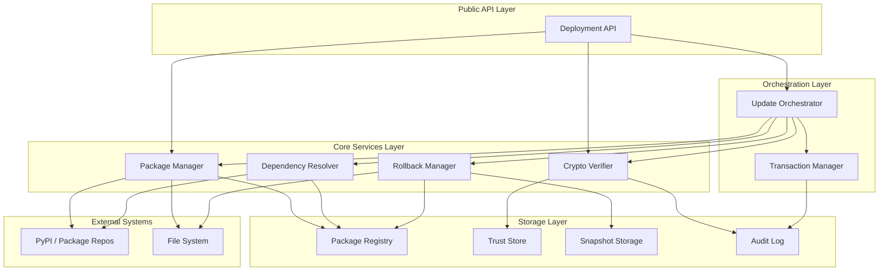
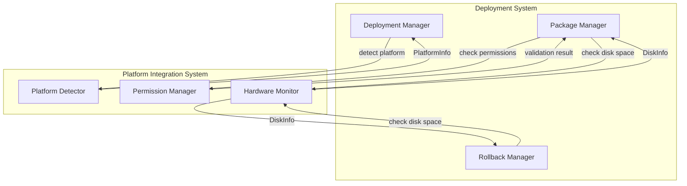

# Design Document: Guru Deployment System

## Overview

The Guru Deployment System provides professional installation, comprehensive onboarding, and automatic updates for AGENT_GURU. This system transforms AGENT_GURU from a development project into a production-ready application that users can install and configure with a polished, professional experience.

**Core Capabilities**:
1. **Professional Installers**: Native installers for Windows (MSI) and macOS (DMG) with proper code signing and system integration
2. **Comprehensive Onboarding**: Multi-step onboarding flow that configures the complete AGENT_GURU system
3. **Automatic Updates**: Background update checking and safe update application with rollback
4. **Dependency Management**: Automatic installation of all required dependencies
5. **Uninstallation**: Clean removal of all AGENT_GURU components

**Onboarding Flow**:
The onboarding system guides users through complete AGENT_GURU setup:

1. **Welcome Screen**: Introduction to Guru and Maya personalities
2. **Profile Setup**: 
   - Gender selection
   - Age input
   - Date of birth
   - Name input
3. **Biometric Enrollment** (via guru-security-cryptography):
   - Fingerprint enrollment (if hardware available)
   - Face enrollment (via webcam)
   - Voice enrollment (via microphone)
   - Passphrase setup
4. **LLM Configuration** (via guru-llm-runtime):
   - Option 1: Local Ollama (recommended for privacy)
     - Check Ollama installation
     - Download recommended models
   - Option 2: Cloud APIs (OpenAI, Gemini, DeepSeek, Anthropic)
     - API key input
     - Secure storage in OS keychain
     - API key validation
5. **Permission Granting**:
   - Microphone access
   - Camera access
   - Accessibility permissions (for system control)
   - Automation permissions
6. **Completion**: Launch AGENT_GURU with "Hey Guru" or "Hey Maya"

The system leverages industry-standard tools and libraries:
- **WiX Toolset** for Windows MSI installers
- **macOS Installer** for DMG creation
- **PyQt5** or **Tkinter** for onboarding UI
- **cryptography** library for update verification
- **requests** for update checking

## Architecture

### Component Diagram



### Data Flow

1. **Package Installation Flow**:
   - User requests package installation via API
   - Update Orchestrator creates transaction
   - Dependency Resolver builds dependency graph
   - Crypto Verifier validates all packages
   - Rollback Manager creates snapshot
   - Package Manager installs packages in order
   - Transaction commits or rolls back

2. **Rollback Flow**:
   - Installation failure detected
   - Transaction Manager triggers rollback
   - Rollback Manager restores snapshot
   - Package Registry reverted to previous state
   - Audit log records rollback event

## Mobile Deployment Architecture

### Android App Building

The Android deployment pipeline uses buildozer or python-for-android to create APK/AAB packages:

```
Python Source Code
        ↓
buildozer/python-for-android
        ↓
Compile Python to Bytecode
        ↓
Package with Kivy/Chaquopy Runtime
        ↓
Add Android Native Code (Java/Kotlin)
        ↓
Create APK (for sideloading)
        ↓
Create AAB (for Play Store)
        ↓
Sign with Release Keystore
        ↓
Upload to Play Store / Distribute APK
```

**Key Components**:
- buildozer.spec: Configuration file for Android build
- AndroidManifest.xml: App permissions and metadata
- build.gradle: Android build configuration
- ProGuard rules: Code obfuscation configuration
- Firebase Crashlytics: Crash reporting integration

### iOS App Building

The iOS deployment pipeline uses Kivy-iOS or BeeWare to create IPA packages:

```
Python Source Code
        ↓
Kivy-iOS/BeeWare
        ↓
Compile Python to Bytecode
        ↓
Package with Python Runtime
        ↓
Add iOS Native Code (Swift/Objective-C)
        ↓
Create Xcode Project
        ↓
Build IPA with Xcode
        ↓
Sign with Apple Developer Certificate
        ↓
Upload to TestFlight / App Store
```

**Key Components**:
- Info.plist: App metadata and permissions
- Entitlements: App capabilities (background modes, etc.)
- Provisioning Profile: Code signing configuration
- Firebase Crashlytics: Crash reporting integration

### Onboarding Flow Integration

The onboarding system is launched automatically on first app run:

```
App Launch
    ↓
Check Onboarding Status
    ↓
If Not Completed → Launch Onboarding
    ↓
Step 1: Welcome Screen
    ↓
Step 2: Profile Setup
    ↓
Step 3: Biometric Enrollment (guru-security-cryptography)
    ↓
Step 4: LLM Configuration (guru-llm-runtime)
    ↓
Step 5: Permission Granting
    ↓
Step 6: Completion
    ↓
Save Onboarding Status
    ↓
Launch Main App
```

## Components and Interfaces

### 0. Mobile App Builder (NEW)

**Responsibility**: Build Android APK/AAB and iOS IPA packages from Python source.

**Interface**:
```python
class MobileAppBuilder:
    def build_android_apk(self, config: AndroidBuildConfig) -> Path:
        """
        Build Android APK for sideloading.
        
        Args:
            config: Android build configuration
            
        Returns:
            Path to generated APK file
            
        Raises:
            BuildError: If build fails
        """
        pass
    
    def build_android_aab(self, config: AndroidBuildConfig) -> Path:
        """
        Build Android App Bundle for Play Store.
        
        Args:
            config: Android build configuration
            
        Returns:
            Path to generated AAB file
            
        Raises:
            BuildError: If build fails
        """
        pass
    
    def build_ios_ipa(self, config: IOSBuildConfig) -> Path:
        """
        Build iOS IPA for TestFlight/App Store.
        
        Args:
            config: iOS build configuration
            
        Returns:
            Path to generated IPA file
            
        Raises:
            BuildError: If build fails
        """
        pass
    
    def sign_android_package(self, package_path: Path, 
                            keystore: Path, keystore_password: str) -> None:
        """Sign Android package with release keystore."""
        pass
    
    def sign_ios_package(self, package_path: Path,
                        certificate: Path, provisioning_profile: Path) -> None:
        """Sign iOS package with Apple Developer certificate."""
        pass
    
    def upload_to_play_store(self, aab_path: Path, 
                            track: str = "internal") -> None:
        """
        Upload AAB to Google Play Store.
        
        Args:
            aab_path: Path to AAB file
            track: Release track (internal, alpha, beta, production)
        """
        pass
    
    def upload_to_app_store(self, ipa_path: Path) -> None:
        """Upload IPA to Apple App Store Connect."""
        pass

@dataclass
class AndroidBuildConfig:
    app_name: str
    package_name: str  # e.g., "com.agent.guru"
    version_code: int
    version_name: str
    min_sdk_version: int = 24
    target_sdk_version: int = 34
    permissions: List[str]
    icon_path: Path
    splash_screen_path: Path
    buildozer_spec_path: Path
    enable_crashlytics: bool = True
    enable_proguard: bool = True

@dataclass
class IOSBuildConfig:
    app_name: str
    bundle_identifier: str  # e.g., "com.agent.guru"
    version: str
    build_number: int
    min_ios_version: str = "14.0"
    permissions: Dict[str, str]  # Permission key -> usage description
    icon_path: Path
    launch_screen_path: Path
    enable_crashlytics: bool = True
    team_id: str
    provisioning_profile_name: str
```

### 1. Package Manager

**Responsibility**: Download, install, update, and remove Python packages.

**Interface**:
```python
class PackageManager:
    def download_package(self, package_name: str, version: str, repo_url: str) -> Path:
        """Download package from repository to cache directory.
        
        Args:
            package_name: Name of the package
            version: Specific version to download
            repo_url: Repository URL
            
        Returns:
            Path to downloaded package file
            
        Raises:
            NetworkError: If download fails after retries
            PackageNotFoundError: If package doesn't exist
        """
        
    def install_package(self, package_path: Path, target_env: Path) -> None:
        """Install package to target environment.
        
        Args:
            package_path: Path to package file (wheel or sdist)
            target_env: Target Python environment path
            
        Raises:
            InstallationError: If installation fails
        """
        
    def remove_package(self, package_name: str, target_env: Path) -> None:
        """Remove package from target environment.
        
        Args:
            package_name: Name of package to remove
            target_env: Target Python environment path
            
        Raises:
            PackageNotFoundError: If package not installed
        """
        
    def get_installed_packages(self, target_env: Path) -> List[PackageInfo]:
        """Get list of installed packages in environment.
        
        Args:
            target_env: Target Python environment path
            
        Returns:
            List of installed package information
        """
        
    def verify_checksum(self, package_path: Path, expected_hash: str) -> bool:
        """Verify package file integrity using SHA-256.
        
        Args:
            package_path: Path to package file
            expected_hash: Expected SHA-256 hash
            
        Returns:
            True if checksum matches, False otherwise
        """
```

**Implementation Notes**:
- Uses `pip` subprocess calls for actual installation
- Implements retry logic with exponential backoff for network operations
- Streams large files to disk to avoid memory issues
- Maintains download cache to avoid redundant downloads

### 2. Crypto Verifier

**Responsibility**: Verify cryptographic signatures of packages using Ed25519.

**Interface**:
```python
class CryptoVerifier:
    def verify_package_signature(self, package_path: Path, signature: bytes, 
                                 public_key: bytes) -> bool:
        """Verify package signature using Ed25519.
        
        Args:
            package_path: Path to package file
            signature: Package signature bytes
            public_key: Publisher's Ed25519 public key
            
        Returns:
            True if signature is valid, False otherwise
        """
        
    def add_trusted_key(self, key_id: str, public_key: bytes, 
                       metadata: Dict[str, str]) -> None:
        """Add public key to trust store.
        
        Args:
            key_id: Unique identifier for the key
            public_key: Ed25519 public key bytes
            metadata: Key metadata (owner, expiry, etc.)
            
        Raises:
            InvalidKeyError: If key format is invalid
        """
        
    def remove_trusted_key(self, key_id: str) -> None:
        """Remove public key from trust store.
        
        Args:
            key_id: Key identifier to remove
            
        Raises:
            KeyNotFoundError: If key doesn't exist
        """
        
    def get_trusted_keys(self) -> List[TrustedKey]:
        """Get all trusted public keys.
        
        Returns:
            List of trusted key information
        """
        
    def compute_package_hash(self, package_path: Path) -> bytes:
        """Compute SHA-256 hash of package file.
        
        Args:
            package_path: Path to package file
            
        Returns:
            SHA-256 hash bytes
        """
```

**Implementation Notes**:
- Uses `cryptography` library's Ed25519 implementation
- Streams file content for hashing to handle large packages
- Trust store persisted in SQLite database
- All verification failures logged to audit log

### 3. Dependency Resolver

**Responsibility**: Resolve package dependencies and detect conflicts.

**Interface**:
```python
class DependencyResolver:
    def resolve_dependencies(self, package_name: str, version: str,
                           installed_packages: List[PackageInfo]) -> DependencyGraph:
        """Resolve all dependencies for a package.
        
        Args:
            package_name: Name of package to resolve
            version: Package version
            installed_packages: Currently installed packages
            
        Returns:
            Dependency graph with installation order
            
        Raises:
            DependencyConflictError: If version conflict detected
            CircularDependencyError: If circular dependency detected
        """
        
    def check_conflicts(self, packages: List[Tuple[str, str]],
                       installed_packages: List[PackageInfo]) -> List[Conflict]:
        """Check for version conflicts in package list.
        
        Args:
            packages: List of (package_name, version) tuples
            installed_packages: Currently installed packages
            
        Returns:
            List of detected conflicts
        """
        
    def get_installation_order(self, dependency_graph: DependencyGraph) -> List[str]:
        """Compute topological sort of dependency graph.
        
        Args:
            dependency_graph: Resolved dependency graph
            
        Returns:
            List of package names in installation order
            
        Raises:
            CircularDependencyError: If cycle detected
        """
        
    def find_dependents(self, package_name: str,
                       installed_packages: List[PackageInfo]) -> List[str]:
        """Find packages that depend on given package.
        
        Args:
            package_name: Package to find dependents for
            installed_packages: Currently installed packages
            
        Returns:
            List of dependent package names
        """
```

**Implementation Notes**:
- Uses `pip-tools` for dependency resolution
- Implements topological sort for installation ordering
- Caches resolution results to improve performance
- Uses `packaging` library for version comparison

### 4. Rollback Manager

**Responsibility**: Create snapshots and restore system state on failure.

**Interface**:
```python
class RollbackManager:
    def create_snapshot(self, snapshot_id: str, target_env: Path) -> Snapshot:
        """Create snapshot of current system state.
        
        Args:
            snapshot_id: Unique identifier for snapshot
            target_env: Environment to snapshot
            
        Returns:
            Snapshot metadata
            
        Raises:
            InsufficientSpaceError: If not enough disk space
        """
        
    def restore_snapshot(self, snapshot_id: str, target_env: Path) -> None:
        """Restore system to previous snapshot.
        
        Args:
            snapshot_id: Snapshot to restore
            target_env: Environment to restore to
            
        Raises:
            SnapshotNotFoundError: If snapshot doesn't exist
            RestoreError: If restore operation fails
        """
        
    def delete_snapshot(self, snapshot_id: str) -> None:
        """Delete a snapshot.
        
        Args:
            snapshot_id: Snapshot to delete
        """
        
    def list_snapshots(self) -> List[Snapshot]:
        """List all available snapshots.
        
        Returns:
            List of snapshot metadata
        """
        
    def prune_snapshots(self, retention_policy: RetentionPolicy) -> int:
        """Prune old snapshots according to policy.
        
        Args:
            retention_policy: Policy defining which snapshots to keep
            
        Returns:
            Number of snapshots deleted
        """
        
    def verify_snapshot(self, snapshot_id: str) -> bool:
        """Verify snapshot integrity.
        
        Args:
            snapshot_id: Snapshot to verify
            
        Returns:
            True if snapshot is valid, False otherwise
        """
```

**Implementation Notes**:
- Uses hard links when possible to save disk space
- Stores package registry state in snapshot
- Implements copy-on-write for modified files
- Snapshots stored in `.guru/snapshots/` directory

### 5. Update Orchestrator

**Responsibility**: Coordinate multi-package updates with transactional semantics.

**Interface**:
```python
class UpdateOrchestrator:
    def begin_update(self, packages: List[Tuple[str, str]]) -> Transaction:
        """Begin a new update transaction.
        
        Args:
            packages: List of (package_name, version) tuples to install
            
        Returns:
            Transaction object
            
        Raises:
            TransactionInProgressError: If another transaction is active
        """
        
    def execute_transaction(self, transaction: Transaction) -> TransactionResult:
        """Execute update transaction.
        
        Args:
            transaction: Transaction to execute
            
        Returns:
            Transaction result (success or failure)
        """
        
    def rollback_transaction(self, transaction: Transaction) -> None:
        """Rollback failed transaction.
        
        Args:
            transaction: Transaction to rollback
        """
        
    def commit_transaction(self, transaction: Transaction) -> None:
        """Commit successful transaction.
        
        Args:
            transaction: Transaction to commit
        """
```

**Implementation Notes**:
- Implements two-phase commit protocol
- Uses file locks to prevent concurrent transactions
- Coordinates all subsystems (resolver, verifier, installer, rollback)
- Maintains transaction log for recovery

## Data Models

### PackageInfo
```python
@dataclass
class PackageInfo:
    name: str
    version: str
    install_path: Path
    dependencies: List[str]
    metadata: Dict[str, Any]
    install_timestamp: datetime
    checksum: str
```

### DependencyGraph
```python
@dataclass
class DependencyGraph:
    nodes: Dict[str, PackageNode]  # package_name -> node
    edges: List[Tuple[str, str]]   # (from_package, to_package)
    
    def topological_sort(self) -> List[str]:
        """Return packages in installation order."""
        
    def has_cycle(self) -> bool:
        """Check if graph contains cycles."""
```

### PackageNode
```python
@dataclass
class PackageNode:
    name: str
    version: str
    dependencies: List[str]
    metadata: Dict[str, Any]
```

### Snapshot
```python
@dataclass
class Snapshot:
    snapshot_id: str
    timestamp: datetime
    packages: List[PackageInfo]
    registry_state: bytes  # Serialized registry
    storage_path: Path
    size_bytes: int
```

### Transaction
```python
@dataclass
class Transaction:
    transaction_id: str
    packages: List[Tuple[str, str]]  # (name, version)
    snapshot_id: str
    state: TransactionState  # PENDING, EXECUTING, COMMITTED, ROLLED_BACK
    start_time: datetime
    end_time: Optional[datetime]
```

### TrustedKey
```python
@dataclass
class TrustedKey:
    key_id: str
    public_key: bytes
    owner: str
    added_timestamp: datetime
    expiry: Optional[datetime]
    metadata: Dict[str, str]
```

### Conflict
```python
@dataclass
class Conflict:
    package_name: str
    required_versions: List[str]  # Conflicting version requirements
    required_by: List[str]  # Packages requiring each version
```

### AuditLogEntry
```python
@dataclass
class AuditLogEntry:
    timestamp: datetime
    operation: str  # INSTALL, REMOVE, UPDATE, VERIFY, ROLLBACK
    package_name: Optional[str]
    version: Optional[str]
    result: str  # SUCCESS, FAILURE
    details: Dict[str, Any]
    user: str
```

### Configuration
```python
@dataclass
class Configuration:
    repositories: List[RepositoryConfig]
    verification_policy: VerificationPolicy
    rollback_retention: RetentionPolicy
    network_timeout: int
    max_retries: int
    cache_dir: Path
    log_level: str
```

### RepositoryConfig
```python
@dataclass
class RepositoryConfig:
    name: str
    url: str
    priority: int
    verify_ssl: bool
    credentials: Optional[Tuple[str, str]]
```

## Correctness Properties

A property is a characteristic or behavior that should hold true across all valid executions of a system—essentially, a formal statement about what the system should do. Properties serve as the bridge between human-readable specifications and machine-verifiable correctness guarantees.

### Property 1: Package Installation Round Trip

*For any* valid package with correct checksum and signature, when the package is downloaded, verified, and installed, then the package SHALL appear in the package registry with correct metadata, and querying the registry SHALL return the installed package information.

**Validates: Requirements 1.1, 1.2, 1.3, 1.4**

### Property 2: Package Removal Cleanup

*For any* installed package, when the package is removed, then all package files SHALL be deleted from the filesystem and the package SHALL no longer appear in the package registry.

**Validates: Requirements 1.5**

### Property 3: Package Update Version Replacement

*For any* installed package and newer version, when an update is requested, then the new version SHALL replace the old version in both the filesystem and registry, and the old version SHALL no longer be present.

**Validates: Requirements 1.6**

### Property 4: Independent Package Installation

*For any* set of packages being installed independently (not in a transaction), when one package installation fails, then other package installations SHALL continue and complete successfully.

**Validates: Requirements 1.7**

### Property 5: Signature Verification Correctness

*For any* package with a signature, when the signature is verified using the correct public key, then packages with valid signatures SHALL be marked as trusted and packages with invalid signatures SHALL be rejected.

**Validates: Requirements 2.1, 2.2, 2.3**

### Property 6: Trust Store Key Validation

*For any* key data, when adding a key to the trust store, then only valid Ed25519 or RSA-4096 keys SHALL be accepted, and invalid key formats SHALL be rejected with an error.

**Validates: Requirements 2.4**

### Property 7: Unsigned Package Rejection

*For any* package without a signature, when verification is attempted, then the package SHALL be rejected unless the configuration explicitly allows unsigned packages.

**Validates: Requirements 2.5**

### Property 8: Trust Store Persistence

*For any* trusted key added to the trust store, when the system is restarted, then the key SHALL still be present in the trust store.

**Validates: Requirements 2.7**

### Property 9: Complete Dependency Resolution

*For any* package, when dependency resolution is performed, then all direct and transitive dependencies SHALL be identified and included in the dependency graph.

**Validates: Requirements 3.1, 3.2**

### Property 10: Version Conflict Resolution

*For any* set of packages with version constraints, when conflicts exist but compatible versions are available, then the resolver SHALL select versions that satisfy all constraints according to semantic versioning rules.

**Validates: Requirements 3.3**

### Property 11: Unresolvable Conflict Detection

*For any* set of packages with incompatible version requirements, when dependency resolution is attempted, then the resolver SHALL detect the conflict, report all conflicting packages and versions, and prevent installation.

**Validates: Requirements 3.4, 7.6**

### Property 12: Circular Dependency Detection

*For any* dependency graph, when circular dependencies exist, then the resolver SHALL detect the cycle, report the packages involved, and prevent installation.

**Validates: Requirements 3.5, 3.6**

### Property 13: Topological Installation Order

*For any* resolved dependency graph without cycles, when computing installation order, then the resulting order SHALL ensure that every package is installed after all its dependencies.

**Validates: Requirements 3.7**

### Property 14: Dependent Package Identification

*For any* installed package, when checking for dependents, then all packages that directly or transitively depend on it SHALL be identified and reported.

**Validates: Requirements 3.8**

### Property 15: Snapshot Completeness

*For any* system state, when a snapshot is created, then the snapshot SHALL record all installed packages with their versions, and SHALL store copies of all package files that will be modified or removed.

**Validates: Requirements 4.1, 4.2, 4.3**

### Property 16: Rollback Round Trip

*For any* system state, when a snapshot is created, modifications are made, and then the snapshot is restored, then the system state SHALL match the original state before modifications (packages, versions, files, and registry entries).

**Validates: Requirements 4.4, 4.5, 4.6**

### Property 17: Multi-Snapshot Rollback

*For any* set of snapshots, when a rollback to a specific snapshot is requested, then the system SHALL restore to that exact snapshot regardless of how many snapshots were created after it.

**Validates: Requirements 4.7**

### Property 18: Snapshot Pruning Policy

*For any* retention policy and set of snapshots, when pruning is performed, then snapshots SHALL be deleted according to the policy rules (e.g., keep last N, keep by age), and snapshots within the retention window SHALL be preserved.

**Validates: Requirements 4.8**

### Property 19: Transaction Execution Flow

*For any* update transaction, when executed, then the orchestrator SHALL perform operations in this order: resolve dependencies → verify signatures → create snapshot → install packages in dependency order, and any failure SHALL trigger rollback.

**Validates: Requirements 5.1, 5.2, 5.3, 5.4, 5.5**

### Property 20: Transaction Atomicity

*For any* update transaction, when any package installation fails, then the entire transaction SHALL be rolled back and the system SHALL return to the pre-transaction state.

**Validates: Requirements 5.6**

### Property 21: Transaction Commit Cleanup

*For any* successful update transaction, when the transaction commits, then the rollback snapshot SHALL be deleted to free disk space.

**Validates: Requirements 5.7**

### Property 22: Transaction Mutual Exclusion

*For any* two concurrent update transaction requests, when both are initiated, then only one SHALL execute while the other is blocked or rejected until the first completes.

**Validates: Requirements 5.8**

### Property 23: Repository Priority and Failover

*For any* package search across multiple repositories, when repositories are configured with priorities, then repositories SHALL be queried in priority order, and if a repository is unreachable, the next repository SHALL be tried.

**Validates: Requirements 6.3, 6.4, 6.5**

### Property 24: Repository Validation

*For any* repository URL, when adding the repository to configuration, then the system SHALL validate the URL format and attempt to connect to verify accessibility.

**Validates: Requirements 6.2**

### Property 25: Descriptive Error Messages

*For any* operation failure, when the error is reported, then the error message SHALL include the operation type, failure reason, and context information sufficient to diagnose the problem.

**Validates: Requirements 7.1**

### Property 26: Network Retry with Exponential Backoff

*For any* network operation that fails, when retries are configured, then the system SHALL retry with exponentially increasing delays between attempts until max retries is reached.

**Validates: Requirements 7.2, 7.3**

### Property 27: Installation Failure Cleanup

*For any* package installation that fails, when the failure is detected, then all partial installation artifacts (temporary files, incomplete package files) SHALL be removed from the filesystem.

**Validates: Requirements 7.4**

### Property 28: Security Event Audit Logging

*For any* cryptographic verification failure or untrusted package detection, when the security event occurs, then the event SHALL be logged to the audit log with high priority including all relevant details (package, signature, timestamp).

**Validates: Requirements 7.5, 8.3, 8.5**

### Property 29: Complete Operation Audit Logging

*For any* package operation (install, remove, update), when the operation begins and completes, then audit log entries SHALL be created recording the operation type, package name, timestamp, result, and duration.

**Validates: Requirements 8.1, 8.2**

### Property 30: Rollback Audit Logging

*For any* rollback operation, when the rollback is performed, then the audit log SHALL record the snapshot ID being restored, the reason for rollback, and the timestamp.

**Validates: Requirements 8.4**

### Property 31: Audit Log Tamper Evidence

*For any* audit log entry, when the entry is written, then the log SHALL use a tamper-evident format (e.g., cryptographic hashing, append-only structure) such that modifications can be detected.

**Validates: Requirements 8.6**

### Property 32: Audit Log Retention

*For any* configured retention policy, when audit logs exceed the retention period, then old logs SHALL be pruned according to the policy while preserving logs within the retention window.

**Validates: Requirements 8.7**

### Property 33: Configuration Validation

*For any* configuration file, when the configuration is loaded, then all values SHALL be validated against expected types and ranges, and invalid values SHALL be rejected with descriptive errors.

**Validates: Requirements 9.2, 9.3**

### Property 34: Streaming Large Package Downloads

*For any* package larger than a threshold (e.g., 10 MB), when downloading, then the package data SHALL be streamed directly to disk without loading the entire package into memory.

**Validates: Requirements 10.1**

### Property 35: Streaming Cryptographic Verification

*For any* package being verified, when computing checksums or verifying signatures, then the verification SHALL process the file in chunks to maintain bounded memory usage regardless of package size.

**Validates: Requirements 10.2**

### Property 36: Dependency Resolution Caching

*For any* package dependency resolution, when the same package and version are resolved multiple times, then cached results SHALL be used for subsequent resolutions to improve performance.

**Validates: Requirements 10.3**

### Property 37: Snapshot Storage Efficiency

*For any* snapshot creation, when files are unchanged between snapshots, then the system SHALL use hard links or copy-on-write to avoid duplicating file data on disk.

**Validates: Requirements 10.4**

### Property 38: Parallel Independent Installations

*For any* set of packages with no dependency relationships, when installed in a transaction, then the installations SHALL be performed in parallel to reduce total installation time.

**Validates: Requirements 10.5**

### Property 39: Installation Performance Bounds

*For any* package of known size, when installed, then the installation time SHALL not exceed 5 seconds per megabyte of package size (excluding network download time).

**Validates: Requirements 10.6**

## Integration Points

### Overview

The Guru Deployment System integrates with the Platform Integration System for all OS-specific operations and hardware validation. This ensures platform-agnostic package management while leveraging platform-specific capabilities when needed.

### External Dependencies

1. **Platform Integration System** (guru-platform-integration)
   - Platform detection for environment validation
   - Permission validation for installation operations
   - Disk space validation before package downloads
   - Hardware monitoring for resource availability

### API Contracts

#### Platform Detection Integration

```python
from guru.platform import PlatformDetector, UnsupportedPlatformError

class DeploymentManager:
    def __init__(self):
        # Validate platform support at initialization
        try:
            self.platform_info = PlatformDetector.detect()
        except UnsupportedPlatformError as e:
            raise DeploymentError(f"Deployment not supported on this platform: {e}")
        
        # Log platform information
        logger.info(f"Deployment system initialized on {self.platform_info.os_name} "
                   f"{self.platform_info.os_version} ({self.platform_info.architecture})")
```

#### Permission Validation Integration

```python
from guru.platform import PermissionManager, PermissionError

class PackageManager:
    def __init__(self):
        self.permission_manager = PermissionManager()
    
    def install_package(self, package_path: Path, target_env: Path, 
                       requires_elevated: bool = False) -> None:
        """Install package with permission validation."""
        # Check permissions before installation
        if requires_elevated:
            try:
                self.permission_manager.require_elevated()
            except PermissionError:
                raise InstallationError(
                    f"Package installation requires elevated privileges. "
                    f"Please run as administrator/root."
                )
        
        # Check write access to target environment
        if not self.permission_manager.can_access_path(str(target_env), mode="w"):
            raise InstallationError(
                f"Insufficient permissions to write to {target_env}"
            )
        
        # Proceed with installation
        self._do_install(package_path, target_env)
```

#### Disk Space Validation Integration

```python
from guru.platform import HardwareMonitor, InsufficientSpaceError

class PackageManager:
    def __init__(self):
        self.hardware_monitor = HardwareMonitor()
    
    def download_package(self, package_name: str, version: str, 
                        repo_url: str) -> Path:
        """Download package with disk space validation."""
        # Get package size from repository metadata
        package_size = self._get_package_size(package_name, version, repo_url)
        
        # Check available disk space
        cache_dir = self._get_cache_dir()
        disk_info = self.hardware_monitor.get_disk_usage(str(cache_dir))
        
        # Require 2x package size for safety (download + extraction)
        required_space = package_size * 2
        if disk_info.free < required_space:
            raise InsufficientSpaceError(
                f"Insufficient disk space for package download. "
                f"Required: {required_space / (1024**3):.2f} GB, "
                f"Available: {disk_info.free / (1024**3):.2f} GB"
            )
        
        # Proceed with download
        return self._do_download(package_name, version, repo_url)
```

#### Snapshot Space Validation Integration

```python
from guru.platform import HardwareMonitor

class RollbackManager:
    def __init__(self):
        self.hardware_monitor = HardwareMonitor()
    
    def create_snapshot(self, snapshot_id: str, target_env: Path) -> Snapshot:
        """Create snapshot with disk space validation."""
        # Estimate snapshot size (sum of all package files)
        estimated_size = self._estimate_snapshot_size(target_env)
        
        # Check available disk space
        snapshot_dir = self._get_snapshot_dir()
        disk_info = self.hardware_monitor.get_disk_usage(str(snapshot_dir))
        
        if disk_info.free < estimated_size:
            raise InsufficientSpaceError(
                f"Insufficient disk space for snapshot creation. "
                f"Required: {estimated_size / (1024**3):.2f} GB, "
                f"Available: {disk_info.free / (1024**3):.2f} GB"
            )
        
        # Proceed with snapshot creation
        return self._do_create_snapshot(snapshot_id, target_env)
```

### Data Flow



### Integration Rules

1. **Platform Detection**: MUST call `PlatformDetector.detect()` at initialization to validate platform support.

2. **Permission Validation**: MUST call `PermissionManager.require_elevated()` before any operation requiring elevated privileges (system-wide package installation, service modification).

3. **Disk Space Validation**: MUST call `HardwareMonitor.get_disk_usage()` before:
   - Downloading packages
   - Creating snapshots
   - Installing large packages

4. **Error Handling**: MUST catch and handle platform integration exceptions:
   - `UnsupportedPlatformError`: Abort deployment with clear error message
   - `PermissionError`: Prompt user to run with elevated privileges
   - `InsufficientSpaceError`: Suggest cleanup or alternative installation location

### Configuration

The deployment system configuration includes platform integration settings:

```python
@dataclass
class Configuration:
    # ... existing fields ...
    
    # Platform integration settings
    require_platform_validation: bool = True  # Validate platform at startup
    require_permission_checks: bool = True    # Check permissions before operations
    require_space_checks: bool = True         # Check disk space before operations
    min_free_space_gb: float = 1.0           # Minimum free space required
```

## Error Handling

### Error Categories

1. **Network Errors**:
   - Connection failures, timeouts, DNS resolution failures
   - Handled with exponential backoff retry (max 3 retries)
   - Fallback to alternative repositories when available

2. **Cryptographic Errors**:
   - Invalid signatures, untrusted keys, corrupted packages
   - No retry - immediate failure with security audit log
   - Clear error messages indicating security implications

3. **Dependency Errors**:
   - Version conflicts, circular dependencies, missing packages
   - No retry - immediate failure with detailed conflict report
   - Suggest resolution strategies in error message

4. **Storage Errors**:
   - Insufficient disk space, permission denied, I/O errors
   - No retry for space issues - report required vs available space
   - Retry for transient I/O errors

5. **Transaction Errors**:
   - Installation failures, verification failures during transaction
   - Automatic rollback to pre-transaction state
   - Detailed error log with failure point

### Error Recovery Strategies

**Automatic Recovery**:
- Network errors: Retry with backoff, try alternative repositories
- Transient I/O errors: Retry with short delay
- Transaction failures: Automatic rollback to snapshot

**Manual Recovery Required**:
- Cryptographic verification failures: User must resolve trust issues
- Dependency conflicts: User must adjust package versions
- Insufficient disk space: User must free space or adjust retention policy

**Error Propagation**:
- All errors include context chain showing operation stack
- Errors logged to audit log before propagation
- User-facing errors include suggested actions

## Testing Strategy

### Dual Testing Approach

The Guru Deployment System requires both unit tests and property-based tests for comprehensive coverage:

**Unit Tests**: Focus on specific examples, edge cases, and integration points:
- Specific package installation scenarios (valid package, invalid checksum, etc.)
- Edge cases: empty packages, 1 GB packages, packages with no dependencies
- Error conditions: network failures, disk full, permission denied
- Integration between components: orchestrator coordinating resolver and installer

**Property-Based Tests**: Verify universal properties across all inputs:
- All 39 correctness properties defined above
- Each property test runs minimum 100 iterations with randomized inputs
- Properties cover the general behavior that must hold for all valid inputs

### Property-Based Testing Configuration

**Framework**: Use `hypothesis` library for Python property-based testing

**Test Configuration**:
- Minimum 100 iterations per property test (configured via `@settings(max_examples=100)`)
- Each test tagged with comment referencing design property
- Tag format: `# Feature: guru-deployment-system, Property N: [property title]`

**Example Property Test Structure**:
```python
from hypothesis import given, settings
from hypothesis.strategies import text, integers, lists

@settings(max_examples=100)
@given(package_name=text(min_size=1), version=text(min_size=1))
def test_property_1_package_installation_round_trip(package_name, version):
    # Feature: guru-deployment-system, Property 1: Package Installation Round Trip
    # Test that installed packages appear in registry with correct metadata
    ...
```

### Test Coverage Requirements

- Unit test coverage: Minimum 90% code coverage
- Property test coverage: All 39 correctness properties implemented
- Integration test coverage: All component interactions tested
- Performance test coverage: Properties 34-39 verified with timing assertions

### Testing Tools

- **pytest**: Test runner and framework
- **hypothesis**: Property-based testing
- **pytest-cov**: Coverage measurement
- **pytest-benchmark**: Performance testing
- **pytest-mock**: Mocking for external dependencies (network, filesystem)
- **freezegun**: Time mocking for timestamp testing

### Test Organization

```
tests/
├── unit/
│   ├── test_package_manager.py
│   ├── test_crypto_verifier.py
│   ├── test_dependency_resolver.py
│   ├── test_rollback_manager.py
│   └── test_update_orchestrator.py
├── property/
│   ├── test_properties_package_management.py  # Properties 1-4
│   ├── test_properties_cryptography.py        # Properties 5-8
│   ├── test_properties_dependencies.py        # Properties 9-14
│   ├── test_properties_rollback.py            # Properties 15-18
│   ├── test_properties_transactions.py        # Properties 19-22
│   ├── test_properties_repositories.py        # Properties 23-24
│   ├── test_properties_errors.py              # Properties 25-28
│   ├── test_properties_audit.py               # Properties 29-32
│   ├── test_properties_config.py              # Property 33
│   └── test_properties_performance.py         # Properties 34-39
├── integration/
│   ├── test_end_to_end_installation.py
│   ├── test_transaction_rollback.py
│   └── test_multi_repository.py
└── conftest.py  # Shared fixtures and configuration
```

### Mock and Fixture Strategy

**Mocked External Dependencies**:
- Network requests (use `responses` or `pytest-mock`)
- Filesystem operations (use `pyfakefs` for filesystem mocking)
- Time (use `freezegun` for deterministic timestamps)
- Subprocess calls to pip (mock for unit tests, real for integration tests)

**Test Fixtures**:
- Sample packages with valid/invalid signatures
- Mock package repositories with various configurations
- Pre-configured trust stores with test keys
- Sample dependency graphs (simple, complex, circular)
- Mock snapshots for rollback testing

### Continuous Integration

- All tests run on every commit
- Property tests run with increased iterations (1000) in CI
- Performance tests run with baseline comparison
- Coverage reports generated and tracked over time
- Test failures block merges to main branch
