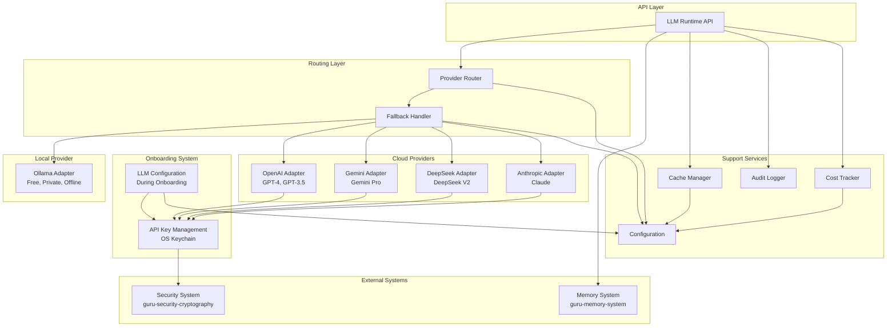

# Design Document: LLM Runtime & Provider Management

## Overview

The LLM Runtime & Provider Management system provides a unified, high-performance interface for interacting with multiple Large Language Model providers. The system supports AGENT_GURU's dual AI personalities (Guru and Maya) with flexible LLM configuration during onboarding - users can choose between local Ollama models or cloud API providers (OpenAI, Gemini, DeepSeek, Anthropic).

The architecture follows a layered approach with clear separation of concerns:

- **API Layer**: Unified interface for LLM interactions
- **Routing Layer**: Intelligent provider selection and fallback
- **Provider Layer**: Adapter pattern for multiple LLM providers (local + cloud)
- **Caching Layer**: Response caching for performance optimization
- **Audit Layer**: Comprehensive logging and monitoring
- **Onboarding Integration**: LLM configuration during user setup

**IMPORTANT**: This system does NOT manage conversation history. All conversation context is managed by the guru-memory-system. This system retrieves context from memory system and passes it to LLM providers.

**Onboarding LLM Configuration**:
During AGENT_GURU onboarding, users choose their LLM provider:
1. **Local Ollama**: Free, private, offline-capable (default for privacy-conscious users)
2. **Cloud APIs**: OpenAI, Gemini, DeepSeek, Anthropic (for advanced capabilities)
   - Users securely provide API keys
   - Keys stored in OS keychain (macOS Keychain, Windows Credential Manager)
   - Cost tracking and usage monitoring enabled

The system is built using Python with async/await patterns throughout, leveraging LangChain for provider abstractions, Pydantic for configuration management, and Redis for caching.

## Architecture



### Key Architectural Decisions

1. **Adapter Pattern for Providers**: Each provider has a dedicated adapter implementing a common interface, allowing easy addition of new providers
2. **Async-First Design**: All I/O operations use async/await to maximize concurrency
3. **Layered Caching**: Cache checks occur before routing to minimize provider calls
4. **Structured Logging**: All audit logs use structured formats for easy parsing and analysis
5. **Configuration as Code**: Pydantic models provide type-safe, validated configuration
6. **Memory System Integration**: All conversation context managed by guru-memory-system (no local context storage)
7. **Onboarding LLM Selection**: Users choose local Ollama or cloud APIs during onboarding
8. **Secure API Key Storage**: Cloud API keys stored in OS keychain via guru-security-cryptography
9. **Cost Tracking**: Cloud API usage tracked and reported to users
10. **Local-First Default**: Ollama recommended for privacy and offline capability

## Integration Points

This system provides LLM provider management and routing for AGENT_GURU, with conversation context managed by guru-memory-system.

### Dependencies

**Upstream Dependencies** (systems this component depends on):
- **Memory System** (guru-memory-system): Provides conversation context storage and retrieval
- **Security System** (guru-security-cryptography): Secure API key storage in OS keychain

**Downstream Dependencies** (systems that depend on this component):
- **Agent Orchestration** (guru-agent-orchestration): Uses LLM Runtime for agent reasoning
- **Deployment System** (guru-deployment-system): Integrates onboarding LLM configuration
- **All other systems**: Use LLM Runtime for LLM interactions

### API Contracts

**Memory System Integration:**
```python
class LLMRuntime:
    """LLM Runtime with memory system integration."""
    
    def __init__(self, memory_system: MemorySystem):
        """Initialize with memory system for conversation context."""
        self.memory_system = memory_system
    
    async def generate(
        self,
        prompt: str,
        conversation_id: Optional[str] = None,
        **kwargs
    ) -> LLMResponse:
        """
        Generate LLM response with conversation context.
        
        Retrieves context from memory system, sends to LLM provider,
        stores response back to memory system.
        """
        # Get conversation context from memory system
        if conversation_id:
            context = await self.memory_system.get_conversation_context(
                conversation_id,
                max_tokens=4096
            )
        
        # Generate response with context
        response = await self._generate_with_provider(prompt, context)
        
        # Store response in memory system
        if conversation_id:
            await self.memory_system.store_conversation_message(
                conversation_id,
                role="assistant",
                content=response.content
            )
        
        return response
```

### Data Flow

1. **Onboarding LLM Configuration Flow:**
   - User completes profile setup (gender, age, name)
   - User completes biometric enrollment (fingerprint, face, voice)
   - Onboarding presents LLM configuration options:
     - Option 1: Local Ollama (recommended for privacy)
     - Option 2: Cloud APIs (OpenAI, Gemini, DeepSeek, Anthropic)
   - If cloud API selected:
     - User provides API key
     - LLMRuntime validates API key with provider
     - SecuritySystem stores API key in OS keychain
     - LLMRuntime creates provider configuration
   - If Ollama selected:
     - LLMRuntime checks Ollama installation
     - Downloads recommended models if needed
     - Creates local provider configuration
   - Configuration saved to user profile

2. **LLM Generation with Context Flow:**
   - Agent calls LLMRuntime.generate() with conversation_id
   - LLMRuntime retrieves context from MemorySystem
   - LLMRuntime routes to appropriate provider (Ollama or cloud)
   - Provider generates response
   - LLMRuntime stores response in MemorySystem
   - If cloud provider: CostTracker records usage
   - Response returned to agent

3. **Provider Fallback Flow:**
   - Primary provider fails
   - FallbackHandler selects next provider
   - Request retried with fallback provider
   - Success/failure logged to AuditLogger

4. **API Key Retrieval Flow:**
   - Cloud provider adapter needs API key
   - Adapter requests key from SecuritySystem
   - SecuritySystem retrieves key from OS keychain
   - Key provided to adapter (never logged or cached)
   - Adapter authenticates with cloud provider

## Mobile Platform Considerations

### Desktop vs Mobile LLM Configuration

**Desktop Platforms (Windows, macOS, Linux)**:
- **Option 1**: Local Ollama (recommended for privacy)
  - Free, private, offline-capable
  - Models run locally on user's hardware
  - No API costs
  - Requires sufficient RAM (8GB+ recommended)
- **Option 2**: Cloud APIs (OpenAI, Gemini, DeepSeek, Anthropic)
  - User provides their own API keys
  - Pay-per-use pricing
  - Advanced capabilities (GPT-4, Claude, etc.)

**Mobile Platforms (Android, iOS)**:
- **API ONLY**: No local LLM support on mobile
  - Mobile devices lack sufficient resources for local LLM inference
  - Battery and thermal constraints prohibit local models
  - Users MUST provide cloud API keys during onboarding
  - Supported providers: OpenAI, Gemini, DeepSeek, Anthropic
  - Cost tracking and budget limits enforced
  - Offline mode: Use cached responses or graceful degradation

### API Key Management

**Security Requirements**:
- API keys NEVER bundled in application
- Users provide their own API keys during onboarding
- Keys stored securely in OS-specific keychain:
  - macOS: Keychain Services
  - Windows: Credential Manager
  - Linux: Secret Service API (libsecret)
  - Android: Android Keystore
  - iOS: iOS Keychain

**Onboarding Flow**:
```
Desktop Onboarding:
1. Choose LLM Provider:
   - [ ] Local Ollama (Free, Private)
   - [ ] Cloud API (Advanced Features)
2. If Cloud API selected:
   - Enter API key
   - Validate key
   - Store in OS keychain
   - Set budget limit (optional)

Mobile Onboarding:
1. Choose Cloud API Provider:
   - [ ] OpenAI (GPT-4, GPT-3.5)
   - [ ] Google Gemini (Gemini Pro)
   - [ ] DeepSeek (DeepSeek V2)
   - [ ] Anthropic (Claude)
2. Enter API key
3. Validate key
4. Store in OS keychain
5. Set budget limit (recommended)
```

### Cost Tracking and Budget Management

**Cost Tracking**:
- Track API usage per provider
- Calculate costs based on token usage
- Display daily/weekly/monthly costs
- Alert user when approaching budget limit

**Budget Limits**:
- User sets monthly budget during onboarding
- System enforces budget limits
- Graceful degradation when budget exceeded:
  - Switch to cached responses
  - Reduce context window
  - Disable non-essential features
  - Notify user

**Implementation**:
```python
@dataclass
class CostTracker:
    provider: str
    tokens_used: int
    estimated_cost_usd: float
    budget_limit_usd: float
    period_start: datetime
    period_end: datetime
    
    def is_over_budget(self) -> bool:
        return self.estimated_cost_usd >= self.budget_limit_usd
    
    def remaining_budget(self) -> float:
        return max(0, self.budget_limit_usd - self.estimated_cost_usd)
```

## Components and Interfaces

### 1. LLM Runtime API

The main entry point for all LLM interactions. Integrates with guru-memory-system for conversation context.

```python
class LLMRuntime:
    """Main interface for LLM interactions."""
    
    def __init__(self, memory_system: 'MemorySystem'):
        """
        Initialize LLM Runtime with memory system integration.
        
        Args:
            memory_system: Memory system for conversation context
        """
        self.memory_system = memory_system
    
    async def generate(
        self,
        prompt: str,
        conversation_id: Optional[str] = None,
        model: Optional[str] = None,
        stream: bool = False,
        cache: bool = True,
        **kwargs
    ) -> Union[LLMResponse, AsyncIterator[str]]:
        """
        Generate a response from an LLM.
        
        Retrieves conversation context from memory system if conversation_id provided.
        Stores response back to memory system after generation.
        
        Args:
            prompt: The input prompt
            conversation_id: Optional conversation context ID (from memory system)
            model: Optional specific model to use
            stream: Whether to stream the response
            cache: Whether to use caching
            **kwargs: Additional provider-specific parameters
            
        Returns:
            LLMResponse for non-streaming, AsyncIterator[str] for streaming
        """
        pass
    
    async def invalidate_cache(
        self,
        pattern: Optional[str] = None,
        conversation_id: Optional[str] = None
    ) -> int:
        """Invalidate cached responses. Returns number of entries invalidated."""
        pass
```

### 2. Provider Router

Selects the appropriate provider based on routing rules.

```python
class ProviderRouter:
    """Routes requests to appropriate LLM providers."""
    
    def __init__(self, config: RouterConfig):
        self.config = config
        self.providers: Dict[str, ProviderAdapter] = {}
    
    async def route(
        self,
        request: LLMRequest
    ) -> Tuple[ProviderAdapter, str]:
        """
        Select provider and model for request.
        
        Args:
            request: The LLM request
            
        Returns:
            Tuple of (provider_adapter, model_name)
        """
        pass
    
    def _match_capabilities(
        self,
        required: ModelCapabilities,
        available: List[ProviderInfo]
    ) -> Optional[Tuple[ProviderAdapter, str]]:
        """Match request capabilities to available providers."""
        pass
    
    def _apply_load_balancing(
        self,
        candidates: List[Tuple[ProviderAdapter, str]]
    ) -> Tuple[ProviderAdapter, str]:
        """Apply load balancing strategy to select from candidates."""
        pass
```

### 3. Provider Adapter Interface

Common interface implemented by all provider adapters.

```python
class ProviderAdapter(ABC):
    """Abstract base class for LLM provider adapters."""
    
    @abstractmethod
    async def generate(
        self,
        messages: List[Message],
        model: str,
        stream: bool = False,
        **kwargs
    ) -> Union[str, AsyncIterator[str]]:
        """Generate a response from the provider."""
        pass
    
    @abstractmethod
    async def get_available_models(self) -> List[ModelInfo]:
        """Get list of available models from provider."""
        pass
    
    @abstractmethod
    async def health_check(self) -> bool:
        """Check if provider is available."""
        pass
    
    @property
    @abstractmethod
    def provider_name(self) -> str:
        """Return the provider name."""
        pass
```

### 4. Fallback Handler

Manages provider fallback logic.

```python
class FallbackHandler:
    """Handles provider fallback on failures."""
    
    def __init__(self, config: FallbackConfig):
        self.config = config
        self.retry_counts: Dict[str, int] = {}
    
    async def execute_with_fallback(
        self,
        primary_provider: ProviderAdapter,
        fallback_chain: List[ProviderAdapter],
        request: LLMRequest
    ) -> LLMResponse:
        """
        Execute request with fallback support.
        
        Args:
            primary_provider: Primary provider to try first
            fallback_chain: Ordered list of fallback providers
            request: The LLM request
            
        Returns:
            LLMResponse from successful provider
            
        Raises:
            AllProvidersFailedError: When all providers fail
        """
        pass
    
    def _is_retryable(self, error: Exception) -> bool:
        """Determine if an error is retryable."""
        pass
    
    def _should_retry(self, provider_name: str) -> bool:
        """Check if provider has retry attempts remaining."""
        pass
```

### 5. Cache Manager

Manages response caching using Redis.

```python
class CacheManager:
    """Manages LLM response caching."""
    
    def __init__(self, config: CacheConfig):
        self.config = config
        self.redis_client: Optional[Redis] = None
    
    async def get(self, request: LLMRequest) -> Optional[LLMResponse]:
        """Get cached response for request."""
        pass
    
    async def set(
        self,
        request: LLMRequest,
        response: LLMResponse,
        ttl: Optional[int] = None
    ) -> None:
        """Cache response for request."""
        pass
    
    async def invalidate(
        self,
        pattern: Optional[str] = None,
        conversation_id: Optional[str] = None
    ) -> int:
        """Invalidate cached entries. Returns count of invalidated entries."""
        pass
    
    def _generate_cache_key(self, request: LLMRequest) -> str:
        """Generate cache key from request."""
        pass
    
    def _should_cache(self, request: LLMRequest) -> bool:
        """Determine if request should be cached."""
        pass
```

### 6. Audit Logger

Comprehensive logging for all LLM interactions.

```python
class AuditLogger:
    """Logs all LLM interactions for audit and debugging."""
    
    def __init__(self, config: AuditConfig):
        self.config = config
        self.logger = structlog.get_logger()
    
    async def log_request(
        self,
        request_id: str,
        request: LLMRequest,
        user_id: Optional[str] = None
    ) -> None:
        """Log incoming request."""
        pass
    
    async def log_response(
        self,
        request_id: str,
        response: LLMResponse,
        provider: str,
        model: str,
        duration_ms: float
    ) -> None:
        """Log successful response."""
        pass
    
    async def log_error(
        self,
        request_id: str,
        error: Exception,
        provider: Optional[str] = None
    ) -> None:
        """Log error during processing."""
        pass
    
    async def log_fallback(
        self,
        request_id: str,
        from_provider: str,
        to_provider: str,
        reason: str
    ) -> None:
        """Log provider fallback event."""
        pass
    
    async def log_cache_hit(
        self,
        request_id: str,
        cache_key: str
    ) -> None:
        """Log cache hit."""
        pass
```

## Data Models

### Core Request/Response Models

```python
class Message(BaseModel):
    """A single message in a conversation."""
    role: Literal["system", "user", "assistant"]
    content: str
    timestamp: datetime = Field(default_factory=datetime.utcnow)
    metadata: Dict[str, Any] = Field(default_factory=dict)

class LLMRequest(BaseModel):
    """Request to LLM Runtime."""
    request_id: str = Field(default_factory=lambda: str(uuid.uuid4()))
    prompt: str
    conversation_id: Optional[str] = None
    model: Optional[str] = None
    stream: bool = False
    cache: bool = True
    max_tokens: Optional[int] = None
    temperature: Optional[float] = None
    user_id: Optional[str] = None
    metadata: Dict[str, Any] = Field(default_factory=dict)

class LLMResponse(BaseModel):
    """Response from LLM Runtime."""
    request_id: str
    content: str
    provider: str
    model: str
    conversation_id: Optional[str] = None
    usage: TokenUsage
    cached: bool = False
    duration_ms: float
    timestamp: datetime = Field(default_factory=datetime.utcnow)
    metadata: Dict[str, Any] = Field(default_factory=dict)

class TokenUsage(BaseModel):
    """Token usage information."""
    prompt_tokens: int
    completion_tokens: int
    total_tokens: int
    estimated_cost: Optional[float] = None
```

### Configuration Models

```python
class ProviderConfig(BaseModel):
    """Configuration for a single provider."""
    name: str
    enabled: bool = True
    api_key: Optional[str] = None
    api_base: Optional[str] = None
    default_model: str
    available_models: List[str]
    timeout_seconds: int = 30
    max_retries: int = 3
    priority: int = 0  # Lower number = higher priority

class RouterConfig(BaseModel):
    """Configuration for provider routing."""
    strategy: Literal["priority", "round_robin", "least_loaded", "cost_optimized"]
    enable_load_balancing: bool = True
    enable_cost_optimization: bool = False

class FallbackConfig(BaseModel):
    """Configuration for fallback behavior."""
    enabled: bool = True
    max_retries_per_provider: int = 2
    retry_delay_seconds: float = 1.0
    exponential_backoff: bool = True

class CacheConfig(BaseModel):
    """Configuration for caching."""
    enabled: bool = True
    redis_url: str = "redis://localhost:6379"
    default_ttl_seconds: int = 3600
    max_cache_size_mb: int = 1024

class AuditConfig(BaseModel):
    """Configuration for audit logging."""
    enabled: bool = True
    log_level: str = "INFO"
    log_requests: bool = True
    log_responses: bool = True
    log_errors: bool = True
    storage_backend: Literal["file", "database", "cloud"]
    storage_path: Optional[str] = None

class LLMRuntimeConfig(BaseModel):
    """Main configuration for LLM Runtime."""
    providers: List[ProviderConfig]
    router: RouterConfig
    fallback: FallbackConfig
    cache: CacheConfig
    audit: AuditConfig
    
    @validator("providers")
    def validate_providers(cls, v):
        if not v:
            raise ValueError("At least one provider must be configured")
        enabled = [p for p in v if p.enabled]
        if not enabled:
            raise ValueError("At least one provider must be enabled")
        return v
```

### Provider-Specific Models

```python
class ModelInfo(BaseModel):
    """Information about an available model."""
    name: str
    provider: str
    capabilities: ModelCapabilities
    context_window: int
    cost_per_1k_tokens: Optional[float] = None

class ModelCapabilities(BaseModel):
    """Capabilities of a model."""
    supports_streaming: bool = True
    supports_function_calling: bool = False
    supports_vision: bool = False
    max_tokens: int = 4096
    languages: List[str] = Field(default_factory=lambda: ["en"])

class Conversation(BaseModel):
    """A conversation context."""
    conversation_id: str
    messages: List[Message] = Field(default_factory=list)
    created_at: datetime = Field(default_factory=datetime.utcnow)
    updated_at: datetime = Field(default_factory=datetime.utcnow)
    metadata: Dict[str, Any] = Field(default_factory=dict)
```

### Error Models

```python
class LLMError(Exception):
    """Base exception for LLM Runtime errors."""
    def __init__(self, message: str, provider: Optional[str] = None):
        self.message = message
        self.provider = provider
        super().__init__(message)

class ProviderError(LLMError):
    """Error from a specific provider."""
    pass

class TimeoutError(LLMError):
    """Request timeout error."""
    pass

class AuthenticationError(LLMError):
    """Authentication failure."""
    pass

class RateLimitError(LLMError):
    """Rate limit exceeded."""
    def __init__(self, message: str, retry_after: Optional[int] = None, provider: Optional[str] = None):
        super().__init__(message, provider)
        self.retry_after = retry_after

class AllProvidersFailedError(LLMError):
    """All providers failed to handle request."""
    def __init__(self, failures: Dict[str, Exception]):
        self.failures = failures
        message = f"All providers failed: {', '.join(failures.keys())}"
        super().__init__(message)
```


## Correctness Properties

*A property is a characteristic or behavior that should hold true across all valid executions of a system—essentially, a formal statement about what the system should do. Properties serve as the bridge between human-readable specifications and machine-verifiable correctness guarantees.*

### Property 1: Unified Interface Consistency

*For any* LLM request and any configured provider, the request structure and response structure SHALL remain identical regardless of which provider handles the request.

**Validates: Requirements 1.5**

### Property 2: Routing Rule Compliance

*For any* request and routing configuration, the selected provider SHALL satisfy all routing rules including priority, capabilities, cost optimization, and load balancing constraints.

**Validates: Requirements 2.1, 2.5**

### Property 3: Capability Matching

*For any* request specifying model capabilities, the Router SHALL only select providers whose models meet or exceed the requested capabilities.

**Validates: Requirements 2.2, 10.2**

### Property 4: Cost Optimization

*For any* request with cost optimization enabled and multiple capable providers, the Router SHALL prefer the provider with the lowest cost per token while meeting quality requirements.

**Validates: Requirements 2.3**

### Property 5: Load Distribution

*For any* sequence of requests with load balancing enabled, the distribution of requests across providers SHALL follow the configured load balancing strategy (round-robin, least-loaded, etc.).

**Validates: Requirements 2.4**

### Property 6: Fallback on Failure

*For any* provider failure (error or timeout) with fallback enabled, the Fallback_Handler SHALL attempt the request with the next provider in the fallback chain.

**Validates: Requirements 3.1, 3.2**

### Property 7: Fallback Logging

*For any* fallback event, the Audit_Logger SHALL record both the original provider failure and the fallback provider used.

**Validates: Requirements 3.4**

### Property 8: Retry Limit Enforcement

*For any* provider with configured retry limits, the Fallback_Handler SHALL not exceed the maximum retry count for that provider.

**Validates: Requirements 3.5**

### Property 9: Streaming Token Delivery

*For any* streaming request, the LLM_Runtime SHALL return an async iterator that yields tokens incrementally as they are received from the provider.

**Validates: Requirements 4.1, 4.2**

### Property 10: Streaming Mode Support

*For any* configured provider, the LLM_Runtime SHALL successfully handle both streaming and non-strea