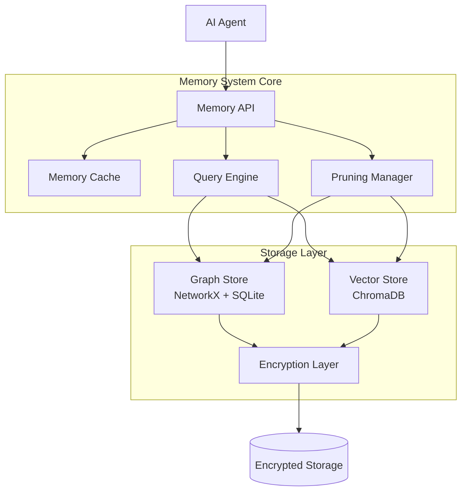

# Design Document: Guru Memory System

## Overview

The Guru Memory System is a hybrid storage architecture that provides intelligent, context-aware memory management for AGENT_GURU's dual AI personalities (Guru and Maya). The system maintains separate memory contexts for each personality while providing unified storage and retrieval capabilities.

**IMPORTANT**: This system is the ONLY conversation history and memory storage system in AGENT_GURU. All other components (LLM Runtime, Agent Orchestration) must use this system for conversation context management.

**Dual Personality Memory**:
- **Separate Contexts**: Guru and Maya maintain independent conversation histories and memories
- **Personality Profiles**: Each personality has distinct preferences, learned patterns, and interaction styles
- **Context Isolation**: Memories from one personality don't leak into the other's context
- **Unified Storage**: Both personalities use the same underlying storage infrastructure
- **Seamless Switching**: Users can switch between personalities without losing context

**Memory Types**:
1. **Conversation History**: Complete message history per personality
2. **User Profiles**: User preferences, demographics, interaction patterns
3. **Semantic Memory**: Facts, knowledge, and learned information
4. **Episodic Memory**: Specific events and interactions
5. **Personality Preferences**: Each personality's learned user preferences

The system uses a dual-storage approach:
- **SQLite** for structured data (conversations, profiles, metadata)
- **ChromaDB** for semantic vector search (similarity-based retrieval)
- **AES-256-GCM encryption** for all data at rest

The architecture prioritizes:
- **Fast retrieval**: Sub-100ms semantic queries through HNSW indexing
- **Privacy**: End-to-end encryption with no plaintext on disk
- **Personality Isolation**: Clean separation between Guru and Maya contexts
- **Scalability**: Efficient pruning strategies to manage growth
- **Reliability**: ACID transactions and graceful degradation
- **Central Storage**: Single source of truth for all conversation and memory data

## Integration Points

This system is the CENTRAL MEMORY AND CONVERSATION STORAGE for AGENT_GURU. All conversation history and memory operations must go through this system.

### Dependencies

**Upstream Dependencies** (systems this component depends on):
- None (standalone storage system)

**Downstream Dependencies** (systems that depend on this component):
- **LLM Runtime** (guru-llm-runtime): Uses MemorySystem for conversation context management
- **Agent Orchestration** (guru-agent-orchestration): Uses MemorySystem for agent memory
- **All other systems**: Use MemorySystem for persistent storage needs

### API Contracts

**LLM Runtime Integration:**
```python
class MemorySystem:
    """Central memory and conversation storage."""
    
    def store_conversation_message(
        self,
        conversation_id: str,
        role: str,
        content: str,
        metadata: Optional[Dict] = None
    ) -> Memory:
        """
        Store a conversation message.
        
        Used by LLM Runtime to persist conversation history.
        """
        pass
    
    def get_conversation_context(
        self,
        conversation_id: str,
        max_tokens: Optional[int] = None
    ) -> List[Memory]:
        """
        Retrieve conversation context within token limits.
        
        Returns messages in chronological order, truncated to fit max_tokens.
        """
        pass
```

**Agent Orchestration Integration:**
```python
# Agent stores and retrieves memories
memory = memory_system.store_memory(
    content="User prefers dark mode",
    metadata={"type": "preference", "user_id": "user123"}
)

# Agent queries relevant memories
relevant = memory_system.query_similar(
    query="What are the user's UI preferences?",
    limit=5
)
```

### Data Flow

1. **Conversation Storage Flow:**
   - LLM Runtime receives user message
   - LLM Runtime calls MemorySystem.store_conversation_message()
   - MemorySystem encrypts and stores in graph + vector stores
   - LLM Runtime retrieves context via get_conversation_context()
   - LLM Runtime sends context + new message to LLM provider

2. **Memory Retrieval Flow:**
   - Agent needs relevant context
   - Agent queries MemorySystem with semantic query
   - MemorySystem performs vector search
   - Results decrypted and returned to agent
   - Agent uses memories to inform decisions

## Architecture

### Component Diagram



### Data Flow

**Write Path**:
1. Agent calls `store_memory(content, metadata)`
2. Memory API generates unique ID and timestamp
3. Embedding model converts content to vector
4. Graph Store creates node with encrypted content
5. Vector Store indexes embedding with metadata
6. Both operations wrapped in transaction
7. Cache updated with new memory

**Read Path (Semantic Query)**:
1. Agent calls `query_similar(query_text, limit=10)`
2. Query Engine checks cache for recent queries
3. Embedding model converts query to vector
4. Vector Store performs ANN search
5. Results decrypted and returned
6. Cache updated with results

**Read Path (Temporal Query)**:
1. Agent calls `query_temporal(start_time, end_time)`
2. Graph Store queries nodes by timestamp range
3. Graph traversal finds connected memories
4. Results decrypted and returned

## Components and Interfaces

### 1. Memory API (`memory_api.py`)

The main interface for all memory operations.

```python
from typing import List, Dict, Optional, Any
from datetime import datetime
from dataclasses import dataclass

@dataclass
class Memory:
    """A single memory node with content and metadata."""
    id: str
    content: str
    timestamp: datetime
    metadata: Dict[str, Any]
    embedding: Optional[List[float]] = None
    importance: float = 1.0

class MemorySystem:
    """Main interface for memory storage and retrieval."""
    
    def __init__(
        self,
        storage_path: str,
        encryption_key: bytes,
        embedding_model: str = "all-MiniLM-L6-v2"
    ):
        """Initialize memory system with storage path and encryption key."""
        pass
    
    def store_memory(
        self,
        content: str,
        metadata: Optional[Dict[str, Any]] = None,
        parent_id: Optional[str] = None
    ) -> Memory:
        """
        Store a new memory with optional parent relationship.
        
        Args:
            content: The memory content (text)
            metadata: Optional metadata (tags, source, etc.)
            parent_id: Optional parent memory for temporal edges
            
        Returns:
            The created Memory object
            
        Raises:
            EncryptionError: If encryption fails
            StorageError: If persistence fails
        """
        pass
    
    def query_similar(
        self,
        query: str,
        limit: int = 10,
        threshold: float = 0.7,
        metadata_filter: Optional[Dict[str, Any]] = None
    ) -> List[Memory]:
        """
        Query semantically similar memories.
        
        Args:
            query: Query text
            limit: Maximum number of results
            threshold: Minimum similarity score (0-1)
            metadata_filter: Optional metadata filters
            
        Returns:
            List of similar memories ranked by similarity
        """
        pass
    
    def query_temporal(
        self,
        start_time: Optional[datetime] = None,
        end_time: Optional[datetime] = None,
        root_id: Optional[str] = None,
        max_depth: int = 5
    ) -> List[Memory]:
        """
        Query memories by temporal range or graph traversal.
        
        Args:
            start_time: Start of time range
            end_time: End of time range
            root_id: Root node for graph traversal
            max_depth: Maximum traversal depth
            
        Returns:
            List of memories in temporal order
        """
        pass
    
    def update_metadata(self, memory_id: str, metadata: Dict[str, Any]) -> None:
        """Update metadata for an existing memory."""
        pass
    
    def delete_memory(self, memory_id: str) -> None:
        """Delete a memory and its edges."""
        pass
    
    def prune(self, strategy: str = "importance", target_size: Optional[int] = None) -> int:
        """
        Prune low-importance memories.
        
        Args:
            strategy: Pruning strategy ("importance", "age", "capacity")
            target_size: Target number of memories to retain
            
        Returns:
            Number of memories pruned
        """
        pass
    
    def export_memories(self, output_path: str) -> None:
        """Export all memories to JSON file."""
        pass
    
    def import_memories(self, input_path: str) -> int:
        """Import memories from JSON file. Returns count imported."""
        pass
    
    def close(self) -> None:
        """Flush pending writes and close connections."""
        pass
```

### 2. Graph Store (`graph_store.py`)

Manages temporal graph storage using NetworkX with SQLite persistence.

```python
import networkx as nx
from typing import List, Optional, Tuple
from datetime import datetime

class GraphStore:
    """Temporal graph storage with SQLite persistence."""
    
    def __init__(self, db_path: str, encryption_layer: 'EncryptionLayer'):
        """Initialize graph store with database path."""
        self.graph = nx.DiGraph()
        self.db_path = db_path
        self.encryption = encryption_layer
    
    def add_node(
        self,
        node_id: str,
        content: str,
        timestamp: datetime,
        metadata: dict
    ) -> None:
        """Add a node to the graph with encrypted content."""
        pass
    
    def add_edge(self, source_id: str, target_id: str, edge_type: str = "temporal") -> None:
        """Add a directed edge between two nodes."""
        pass
    
    def get_node(self, node_id: str) -> Optional[dict]:
        """Retrieve a node by ID with decrypted content."""
        pass
    
    def query_by_time_range(
        self,
        start_time: Optional[datetime],
        end_time: Optional[datetime]
    ) -> List[dict]:
        """Query nodes within a time range."""
        pass
    
    def traverse_from_node(
        self,
        root_id: str,
        max_depth: int = 5,
        direction: str = "forward"
    ) -> List[dict]:
        """Traverse graph from a root node."""
        pass
    
    def remove_node(self, node_id: str) -> None:
        """Remove a node and its edges."""
        pass
    
    def persist(self) -> None:
        """Persist graph to SQLite database."""
        pass
    
    def load(self) -> None:
        """Load graph from SQLite database."""
        pass
    
    def get_node_importance(self, node_id: str) -> float:
        """Calculate node importance using PageRank and degree centrality."""
        pass
```

### 3. Vector Store (`vector_store.py`)

Manages semantic indexing using ChromaDB.

```python
import chromadb
from typing import List, Dict, Optional, Any

class VectorStore:
    """Semantic vector storage using ChromaDB."""
    
    def __init__(
        self,
        persist_directory: str,
        collection_name: str = "memories",
        embedding_function: Optional[Any] = None
    ):
        """Initialize ChromaDB client and collection."""
        pass
    
    def add_memory(
        self,
        memory_id: str,
        embedding: List[float],
        metadata: Dict[str, Any]
    ) -> None:
        """Add a memory embedding to the collection."""
        pass
    
    def query(
        self,
        query_embedding: List[float],
        limit: int = 10,
        metadata_filter: Optional[Dict[str, Any]] = None
    ) -> List[Tuple[str, float]]:
        """
        Query similar memories by embedding.
        
        Returns:
            List of (memory_id, similarity_score) tuples
        """
        pass
    
    def update_metadata(self, memory_id: str, metadata: Dict[str, Any]) -> None:
        """Update metadata for a memory."""
        pass
    
    def delete(self, memory_id: str) -> None:
        """Delete a memory from the collection."""
        pass
    
    def get_collection_size(self) -> int:
        """Get the number of memories in the collection."""
        pass
```

### 4. Encryption Layer (`encryption.py`)

Handles encryption/decryption of memory content.

```python
from cryptography.hazmat.primitives.ciphers.aead import AESGCM
from cryptography.hazmat.primitives.kdf.hkdf import HKDF
from cryptography.hazmat.primitives import hashes
import os

class EncryptionLayer:
    """Encryption layer for memory content using AES-256-GCM."""
    
    def __init__(self, master_key: bytes):
        """
        Initialize encryption layer with master key.
        
        Args:
            master_key: 32-byte master key for key derivation
        """
        if len(master_key) != 32:
            raise ValueError("Master key must be 32 bytes")
        self.master_key = master_key
    
    def derive_key(self, context: bytes) -> bytes:
        """Derive a context-specific key using HKDF."""
        hkdf = HKDF(
            algorithm=hashes.SHA256(),
            length=32,
            salt=None,
            info=context
        )
        return hkdf.derive(self.master_key)
    
    def encrypt(self, plaintext: str, context: str = "memory") -> bytes:
        """
        Encrypt plaintext using AES-256-GCM.
        
        Returns:
            nonce (12 bytes) + ciphertext + tag (16 bytes)
        """
        key = self.derive_key(context.encode())
        aesgcm = AESGCM(key)
        nonce = os.urandom(12)
        ciphertext = aesgcm.encrypt(nonce, plaintext.encode(), None)
        return nonce + ciphertext
    
    def decrypt(self, ciphertext: bytes, context: str = "memory") -> str:
        """
        Decrypt ciphertext using AES-256-GCM.
        
        Args:
            ciphertext: nonce + encrypted_data + tag
            
        Returns:
            Decrypted plaintext string
            
        Raises:
            DecryptionError: If decryption fails (wrong key or corrupted data)
        """
        key = self.derive_key(context.encode())
        aesgcm = AESGCM(key)
        nonce = ciphertext[:12]
        encrypted_data = ciphertext[12:]
        plaintext = aesgcm.decrypt(nonce, encrypted_data, None)
        return plaintext.decode()
```

### 5. Embedding Model (`embedding_model.py`)

Wrapper for sentence-transformers models.

```python
from sentence_transformers import SentenceTransformer
from typing import List, Union
import numpy as np

class EmbeddingModel:
    """Wrapper for sentence-transformers embedding models."""
    
    def __init__(self, model_name: str = "all-MiniLM-L6-v2"):
        """Load the embedding model."""
        self.model = SentenceTransformer(model_name)
        self.dimension = self.model.get_sentence_embedding_dimension()
    
    def encode(self, text: Union[str, List[str]]) -> np.ndarray:
        """
        Encode text to embedding vector(s).
        
        Args:
            text: Single string or list of strings
            
        Returns:
            Embedding vector(s) as numpy array
        """
        return self.model.encode(text, convert_to_numpy=True)
    
    def encode_batch(self, texts: List[str], batch_size: int = 32) -> np.ndarray:
        """Encode multiple texts in batches for efficiency."""
        return self.model.encode(texts, batch_size=batch_size, convert_to_numpy=True)
```

### 6. Pruning Manager (`pruning.py`)

Implements memory pruning strategies.

```python
from typing import List, Callable
from datetime import datetime, timedelta

class PruningManager:
    """Manages memory pruning strategies."""
    
    def __init__(self, graph_store: 'GraphStore', vector_store: 'VectorStore'):
        self.graph_store = graph_store
        self.vector_store = vector_store
    
    def prune_by_importance(self, target_size: int) -> List[str]:
        """
        Prune lowest-importance memories to reach target size.
        
        Returns:
            List of pruned memory IDs
        """
        pass
    
    def prune_by_age(self, max_age_days: int) -> List[str]:
        """
        Prune memories older than max_age_days.
        
        Returns:
            List of pruned memory IDs
        """
        pass
    
    def prune_by_capacity(self, max_memories: int) -> List[str]:
        """
        Prune oldest memories when capacity exceeded.
        
        Returns:
            List of pruned memory IDs
        """
        pass
    
    def calculate_importance(self, memory_id: str) -> float:
        """
        Calculate memory importance score.
        
        Factors:
        - Recency (exponential decay)
        - Access frequency
        - Graph centrality (PageRank)
        - Semantic centrality (distance to cluster centers)
        """
        pass
```

### 7. Query Engine (`query_engine.py`)

Optimizes and executes memory queries.

```python
from typing import List, Optional, Dict, Any
from datetime import datetime

class QueryEngine:
    """Optimizes and executes memory queries."""
    
    def __init__(
        self,
        graph_store: 'GraphStore',
        vector_store: 'VectorStore',
        embedding_model: 'EmbeddingModel',
        cache_size: int = 1000
    ):
        self.graph_store = graph_store
        self.vector_store = vector_store
        self.embedding_model = embedding_model
        self.cache = {}  # Simple LRU cache
    
    def semantic_query(
        self,
        query: str,
        limit: int = 10,
        threshold: float = 0.7,
        metadata_filter: Optional[Dict[str, Any]] = None
    ) -> List['Memory']:
        """Execute semantic similarity query with caching."""
        pass
    
    def temporal_query(
        self,
        start_time: Optional[datetime] = None,
        end_time: Optional[datetime] = None,
        root_id: Optional[str] = None,
        max_depth: int = 5
    ) -> List['Memory']:
        """Execute temporal graph query."""
        pass
    
    def hybrid_query(
        self,
        query: str,
        start_time: Optional[datetime] = None,
        end_time: Optional[datetime] = None,
        limit: int = 10
    ) -> List['Memory']:
        """
        Execute hybrid query combining semantic and temporal constraints.
        
        Optimization: Filter by time first (cheaper), then semantic search.
        """
        pass
    
    def _cache_get(self, key: str) -> Optional[Any]:
        """Get from cache with LRU eviction."""
        pass
    
    def _cache_put(self, key: str, value: Any) -> None:
        """Put in cache with LRU eviction."""
        pass
```

## Data Models

### Memory Node Schema

```python
{
    "id": "uuid-string",
    "content": "encrypted-bytes",  # Encrypted with AES-256-GCM
    "timestamp": "iso-8601-datetime",
    "metadata": {
        "tags": ["conversation", "important"],
        "source": "user-input",
        "importance": 0.85,
        "access_count": 5,
        "last_accessed": "iso-8601-datetime"
    },
    "embedding": [0.123, -0.456, ...],  # 384-dim vector for all-MiniLM-L6-v2
    "edges": [
        {"target": "uuid-string", "type": "temporal", "weight": 1.0}
    ]
}
```

### SQLite Schema (Graph Persistence)

```sql
CREATE TABLE nodes (
    id TEXT PRIMARY KEY,
    content BLOB NOT NULL,  -- Encrypted content
    timestamp TEXT NOT NULL,
    metadata TEXT NOT NULL,  -- JSON
    importance REAL DEFAULT 1.0,
    access_count INTEGER DEFAULT 0,
    last_accessed TEXT
);

CREATE TABLE edges (
    source_id TEXT NOT NULL,
    target_id TEXT NOT NULL,
    edge_type TEXT NOT NULL,
    weight REAL DEFAULT 1.0,
    PRIMARY KEY (source_id, target_id),
    FOREIGN KEY (source_id) REFERENCES nodes(id) ON DELETE CASCADE,
    FOREIGN KEY (target_id) REFERENCES nodes(id) ON DELETE CASCADE
);

CREATE INDEX idx_timestamp ON nodes(timestamp);
CREATE INDEX idx_importance ON nodes(importance);
CREATE INDEX idx_source ON edges(source_id);
CREATE INDEX idx_target ON edges(target_id);
```

### ChromaDB Collection Schema

```python
{
    "ids": ["uuid-string"],
    "embeddings": [[0.123, -0.456, ...]],
    "metadatas": [{
        "timestamp": "iso-8601-datetime",
        "tags": "conversation,important",  # Comma-separated for filtering
        "source": "user-input",
        "importance": 0.85
    }],
    "documents": ["original-content"]  # Stored for reference, not encrypted in ChromaDB
}
```

Note: ChromaDB stores documents in plaintext for search. Sensitive content should be stored only in the encrypted graph store, with ChromaDB holding only embeddings and non-sensitive metadata.


## Correctness Properties

A property is a characteristic or behavior that should hold true across all valid executions of a system—essentially, a formal statement about what the system should do. Properties serve as the bridge between human-readable specifications and machine-verifiable correctness guarantees.

### Property 1: Memory Creation Completeness

*For any* valid memory content and metadata, when stored in the Memory_System, the created Memory_Node should have a unique ID, the correct timestamp, all metadata fields preserved, and an embedding vector of the correct dimension.

**Validates: Requirements 1.1, 1.4, 2.1**

### Property 2: Temporal Graph Traversal Completeness

*For any* memory with parent relationships, when querying temporal relationships from a root node, the traversal should return all memories reachable through directed edges up to the specified depth.

**Validates: Requirements 1.2, 1.3**

### Property 3: Semantic Query Result Ordering

*For any* semantic query, all returned results should be ordered by descending cosine similarity score, and all scores should meet or exceed the specified threshold.

**Validates: Requirements 2.2, 2.3, 2.4**

### Property 4: Encryption Round-Trip Preservation

*For any* memory content string, encrypting then decrypting with the same key and context should produce the original plaintext exactly.

**Validates: Requirements 3.2**

### Property 5: Key Derivation Determinism

*For any* master key and context string, deriving a key multiple times should produce the same derived key, and different contexts should produce different derived keys.

**Validates: Requirements 3.3**

### Property 6: No Plaintext on Disk

*For any* memory stored in the system, reading the raw database files should never reveal the plaintext content of the memory.

**Validates: Requirements 3.5**

### Property 7: Pruning Preserves Important Memories

*For any* memory set with varying importance scores, when pruning to a target size, all retained memories should have importance scores greater than or equal to any pruned memory.

**Validates: Requirements 4.2, 4.3**

### Property 8: Pruning Removes Orphaned Edges

*For any* memory that is pruned, after the pruning operation completes, no edges in the Temporal_Graph should reference the pruned memory's ID.

**Validates: Requirements 4.5**

### Property 9: Cache Consistency

*For any* memory query, executing the same query twice in succession should return identical results, with the second query served from cache.

**Validates: Requirements 5.3**

### Property 10: Batch Query Correctness

*For any* list of queries, executing them as a batch should return the same results as executing each query individually in the same order.

**Validates: Requirements 5.5**

### Property 11: Persistence Across Sessions

*For any* memory stored in the system, after shutting down and reinitializing the Memory_System, the memory should be retrievable with all fields intact.

**Validates: Requirements 6.1, 6.5**

### Property 12: Atomic Dual-Store Persistence

*For any* memory stored in the system, the memory should appear in both the Graph_Store and Vector_Store, or in neither (no partial persistence).

**Validates: Requirements 6.2**

### Property 13: Backup Completeness

*For any* set of memories in the system, exporting to a backup file then importing into a fresh system should result in all memories being present with identical content and metadata.

**Validates: Requirements 6.4, 7.3**

### Property 14: Serialization Round-Trip Preservation

*For any* valid Memory_Node object, serializing to JSON then deserializing should produce an equivalent Memory_Node with all fields preserved.

**Validates: Requirements 7.1, 7.5**

### Property 15: Import Duplicate Prevention

*For any* memory, importing it multiple times should result in only one instance of that memory in the system (duplicates prevented by ID).

**Validates: Requirements 7.4**

### Property 16: Concurrent Access Safety

*For any* set of concurrent read and write operations on different memories, all operations should complete successfully without data corruption or race conditions.

**Validates: Requirements 8.1, 8.2**

### Property 17: Transaction Isolation

*For any* multi-memory transaction, concurrent readers should never observe partial updates (either all changes visible or none).

**Validates: Requirements 8.5**

### Property 18: Metadata Preservation

*For any* memory with metadata, storing and retrieving the memory should preserve all metadata fields exactly.

**Validates: Requirements 9.1, 9.5**

### Property 19: Metadata Filtering Correctness

*For any* metadata filter, all returned memories should match the filter criteria, and no matching memories should be excluded.

**Validates: Requirements 9.2**

### Property 20: Metadata Update Immutability

*For any* memory, updating its metadata should not change the memory's content, timestamp, or ID.

**Validates: Requirements 9.4**

### Property 21: Degraded Mode Write Queueing

*For any* write operation performed while in degraded mode, the operation should be queued and successfully applied when the system recovers.

**Validates: Requirements 10.3, 10.4**

### Property 22: Error Logging Completeness

*For any* error that occurs in the Memory_System, a log entry should be created containing the error type, message, timestamp, and relevant context.

**Validates: Requirements 10.5**

## Error Handling

### Error Types

The Memory_System defines the following exception hierarchy:

```python
class MemorySystemError(Exception):
    """Base exception for all memory system errors."""
    pass

class EncryptionError(MemorySystemError):
    """Raised when encryption or decryption fails."""
    pass

class StorageError(MemorySystemError):
    """Raised when database operations fail."""
    pass

class ValidationError(MemorySystemError):
    """Raised when input validation fails."""
    pass

class QueryError(MemorySystemError):
    """Raised when query execution fails."""
    pass

class DegradedModeError(MemorySystemError):
    """Raised when operations are attempted in degraded mode that require full functionality."""
    pass
```

### Error Handling Strategies

1. **Encryption Failures**: 
   - Fail fast and raise `EncryptionError`
   - Never persist unencrypted data
   - Log error with context (key ID, operation type)

2. **Database Connection Failures**:
   - Retry with exponential backoff (100ms, 200ms, 400ms)
   - After 3 failures, enter degraded mode
   - Queue writes, serve reads from cache
   - Periodically attempt reconnection

3. **Validation Failures**:
   - Raise `ValidationError` with descriptive message
   - Do not modify system state
   - Log validation failure details

4. **Query Failures**:
   - Retry once for transient errors
   - Raise `QueryError` for persistent failures
   - Return empty results rather than crashing

5. **Concurrent Access Conflicts**:
   - Use database-level locking
   - Retry transactions on deadlock (up to 3 times)
   - Raise `StorageError` if deadlock persists

### Degraded Mode Behavior

When the Memory_System enters degraded mode due to database failures:

- **Reads**: Served from in-memory cache (limited to cached items)
- **Writes**: Queued in memory (bounded queue, oldest dropped if full)
- **Queries**: Limited to cached memories only
- **Recovery**: Automatic reconnection attempts every 30 seconds
- **Flush**: Queued writes applied in order when connection restored

## Testing Strategy

### Dual Testing Approach

The Memory_System requires both unit tests and property-based tests for comprehensive coverage:

**Unit Tests** focus on:
- Specific examples of memory operations
- Edge cases (empty content, special characters, large memories)
- Error conditions (invalid keys, corrupted data, connection failures)
- Integration between components (API → stores → encryption)
- Degraded mode transitions and recovery

**Property-Based Tests** focus on:
- Universal properties that hold for all inputs
- Round-trip properties (encryption, serialization)
- Invariants (graph connectivity, data consistency)
- Concurrent access safety
- Comprehensive input coverage through randomization

### Property-Based Testing Configuration

**Framework**: `hypothesis` for Python property-based testing

**Configuration**:
- Minimum 100 iterations per property test
- Deadline: 500ms per test case (some operations are I/O bound)
- Database: Use temporary SQLite databases for isolation
- Cleanup: Each test creates and destroys its own Memory_System instance

**Test Tagging**: Each property test must include a comment referencing the design property:

```python
@given(memory_content=st.text(min_size=1), metadata=st.dictionaries(st.text(), st.text()))
@settings(max_examples=100)
def test_memory_creation_completeness(memory_content, metadata):
    """
    Feature: guru-memory-system, Property 1: Memory Creation Completeness
    
    For any valid memory content and metadata, when stored in the Memory_System,
    the created Memory_Node should have a unique ID, correct timestamp, all
    metadata fields preserved, and an embedding vector of correct dimension.
    """
    # Test implementation
```

### Unit Test Coverage

Unit tests should cover:

1. **Memory API**:
   - Store memory with various content types
   - Query similar memories with different thresholds
   - Query temporal ranges and graph traversal
   - Update and delete operations
   - Export/import functionality

2. **Graph Store**:
   - Node and edge operations
   - SQLite persistence and loading
   - Time range queries
   - Graph traversal algorithms
   - Importance calculation

3. **Vector Store**:
   - ChromaDB collection management
   - Embedding storage and retrieval
   - Metadata filtering
   - Similarity search accuracy

4. **Encryption Layer**:
   - AES-256-GCM encryption/decryption
   - HKDF key derivation
   - Error handling for invalid keys
   - Nonce uniqueness

5. **Pruning Manager**:
   - Importance-based pruning
   - Age-based pruning
   - Capacity-based pruning
   - Graph cleanup after pruning

6. **Query Engine**:
   - Semantic queries
   - Temporal queries
   - Hybrid queries
   - Cache behavior
   - Query optimization

7. **Error Handling**:
   - Connection failure and retry
   - Degraded mode transitions
   - Write queue management
   - Recovery and flush

### Integration Tests

Integration tests should verify:
- End-to-end memory storage and retrieval
- Concurrent access from multiple threads
- System restart and persistence
- Backup and restore workflows
- Performance under load (benchmarking)

### Performance Benchmarks

Use `pytest-benchmark` to track:
- Memory storage latency (target: <10ms)
- Semantic query latency (target: <100ms for 100k memories)
- Graph traversal latency (target: <50ms for depth 5)
- Encryption/decryption throughput
- Pruning operation duration

### Test Data Generation

Use `hypothesis` strategies for generating:
- Random memory content (text, various lengths)
- Random metadata (dictionaries with various types)
- Random graph structures (trees, DAGs, cycles)
- Random timestamps (past, present, future)
- Random embeddings (valid dimension vectors)

### Continuous Integration

All tests must pass before merging:
- Unit tests: 90%+ coverage
- Property tests: All properties verified
- Integration tests: All scenarios passing
- Linting: `black`, `flake8`, `mypy` all passing
- Performance: No regressions in benchmarks
