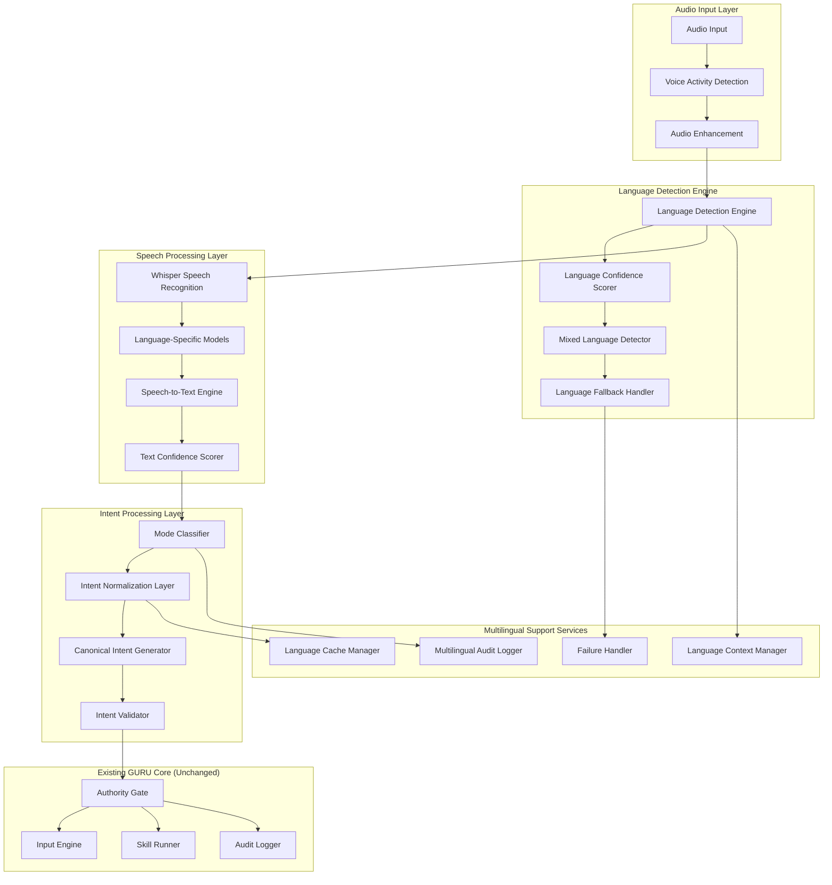
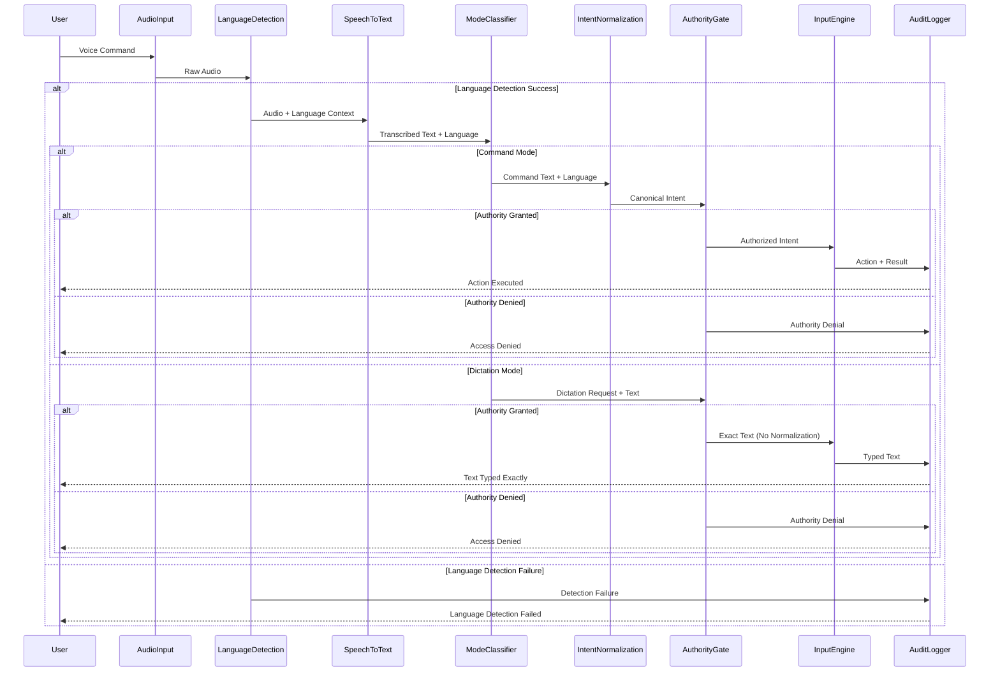

# Design Document: GURU Multilingual Understanding

## Core Philosophy

**"Multilingual understanding augments GURU's capabilities without weakening any security, authority, or privacy invariant."**

This principle anchors all multilingual design decisions: when multilingual convenience conflicts with security, security wins. When language processing conflicts with authority verification, authority wins. When multilingual features conflict with audit logging, logging wins.

## Root of Trust (Unchanged)

**The AuthorityStateMachine remains the root of trust for all execution decisions.**

All multilingual processing, intent normalization, and language-aware automation derive their legitimacy from the existing AuthorityStateMachine. No multilingual component may bypass or override authority decisions.

## No Silent Downgrade Rule (Extended)

**Any failure in multilingual processing MUST result in Safe Halt or explicit fallback, never degraded operation.**

GURU never operates in "best effort" multilingual mode when language processing is compromised. Language detection failures trigger explicit fallback with user notification, not silent degradation.

## LLM Trust Boundary (Reinforced)

**LLMs remain advisory only, never authoritative, regardless of language**

- LLMs produce structured intent in any supported language
- Intent must pass: Language Detection → Intent Normalization → AuthorityState check → Execution
- LLMs cannot directly execute any system functions in any language
- All multilingual LLM outputs are validated and sanitized before processing
- LLM isolation breach triggers immediate authority revocation regardless of language

## Overview

GURU Multilingual Understanding extends the existing production-grade personal assistant system to support natural interaction in 15 languages while maintaining strict security boundaries and user control. The system implements a deterministic Language Detection Engine and Language-Neutral Intent Processing pipeline that integrates seamlessly with GURU's existing Authority State Machine.

The multilingual architecture consists of a Local Language Detection Engine providing deterministic language identification, an Intent Normalization Layer converting language-specific commands to canonical intents, enhanced Voice Processing with language-aware speech recognition, and comprehensive Multilingual Audit Logging. All components operate under the principle of local-first processing with no cloud dependency for core language detection.

## Architecture

### High-Level Multilingual System Architecture



### Multilingual Processing Pipeline

The multilingual processing follows a strict pipeline that integrates with existing GURU architecture:



## Components and Interfaces

### Language Detection Engine

**Technology Stack:**
- FastText for primary language detection (80x faster than conventional methods)
- Whisper language identification as secondary validation
- Custom confidence scoring algorithms
- Local model storage with no external dependencies

**Core Responsibilities:**
- Deterministic language identification with confidence scores
- Mixed-language utterance detection and segmentation
- Language context caching per session
- Explicit fallback handling with user notification

**API Interface:**
```python
class LanguageDetectionEngine:
    def __init__(self):
        self.fasttext_model = self.load_fasttext_model()
        self.whisper_lang_detector = self.load_whisper_detector()
        self.confidence_threshold = 0.85
        self.session_cache = LanguageSessionCache()
        
    def detect_language(self, audio: bytes) -> LanguageDetectionResult:
        """
        Detect language with deterministic confidence scoring.
        
        Returns:
            LanguageDetectionResult with language, confidence, and segments
        """
        # Primary detection using FastText
        primary_result = self.fasttext_model.detect_language(audio)
        
        # Secondary validation using Whisper
        secondary_result = self.whisper_lang_detector.identify(audio)
        
        # Confidence scoring and validation
        final_result = self.validate_and_score(primary_result, secondary_result)
        
        # Cache stable language context
        if final_result.confidence >= self.confidence_threshold:
            self.session_cache.update_context(final_result.language)
            
        return final_result
        
    def detect_mixed_language(self, audio: bytes) -> MixedLanguageResult:
        """
        Detect and segment mixed-language utterances.
        
        Returns:
            MixedLanguageResult with language segments and boundaries
        """
        segments = self.segment_audio(audio)
        language_segments = []
        
        for segment in segments:
            lang_result = self.detect_language(segment.audio)
            language_segments.append(LanguageSegment(
                start_time=segment.start_time,
                end_time=segment.end_time,
                language=lang_result.language,
                confidence=lang_result.confidence,
                audio=segment.audio
            ))
            
        return MixedLanguageResult(segments=language_segments)
```

**Supported Languages Configuration:**
```python
SUPPORTED_LANGUAGES = {
    # Global Languages
    'en': LanguageConfig('English', 'en-US', whisper_model='en'),
    'de': LanguageConfig('German', 'de-DE', whisper_model='de'),
    'fr': LanguageConfig('French', 'fr-FR', whisper_model='fr'),
    'zh': LanguageConfig('Chinese', 'zh-CN', whisper_model='zh'),
    'ja': LanguageConfig('Japanese', 'ja-JP', whisper_model='ja'),
    
    # Indian Languages
    'hi': LanguageConfig('Hindi', 'hi-IN', whisper_model='hi'),
    'ta': LanguageConfig('Tamil', 'ta-IN', whisper_model='ta'),
    'te': LanguageConfig('Telugu', 'te-IN', whisper_model='te'),
    'bn': LanguageConfig('Bengali', 'bn-IN', whisper_model='bn'),
    'mr': LanguageConfig('Marathi', 'mr-IN', whisper_model='mr'),
    'gu': LanguageConfig('Gujarati', 'gu-IN', whisper_model='gu'),
    'kn': LanguageConfig('Kannada', 'kn-IN', whisper_model='kn'),
    'ml': LanguageConfig('Malayalam', 'ml-IN', whisper_model='ml'),
    'pa': LanguageConfig('Punjabi', 'pa-IN', whisper_model='pa'),
    'bho': LanguageConfig('Bhojpuri', 'bho-IN', whisper_model='bho')
}
```

### Intent Normalization Layer

**Architecture:** Language-neutral intent mapping with deterministic canonicalization

```python
class IntentNormalizationLayer:
    def __init__(self):
        self.intent_mappings = self.load_intent_mappings()
        self.canonical_intents = CanonicalIntentRegistry()
        self.normalization_cache = NormalizationCache()
        
    def normalize_intent(self, text: str, language: str, mode: str) -> CanonicalIntent:
        """
        Convert language-specific command to canonical intent.
        
        Args:
            text: Transcribed command text
            language: Detected language code
            mode: 'command' or 'dictation'
            
        Returns:
            CanonicalIntent with normalized action and parameters
        """
        if mode == 'dictation':
            # Dictation mode: no normalization, exact text preservation
            return CanonicalIntent(
                action='TYPE_TEXT',
                parameters={'text': text, 'preserve_exact': True},
                language=language,
                mode='dictation'
            )
            
        # Command mode: normalize to canonical intent
        cache_key = f"{language}:{text}"
        if cache_key in self.normalization_cache:
            return self.normalization_cache[cache_key]
            
        # Language-specific intent mapping
        language_mappings = self.intent_mappings.get(language, {})
        
        # Pattern matching for command recognition
        for pattern, canonical_action in language_mappings.items():
            if self.matches_pattern(text, pattern):
                canonical_intent = self.create_canonical_intent(
                    text, pattern, canonical_action, language
                )
                
                # Cache successful normalization
                self.normalization_cache[cache_key] = canonical_intent
                return canonical_intent
                
        # No matching pattern found
        raise IntentNormalizationError(
            f"No canonical intent found for '{text}' in language '{language}'"
        )
        
    def create_canonical_intent(self, text: str, pattern: str, 
                              action: str, language: str) -> CanonicalIntent:
        """Create canonical intent with extracted parameters."""
        parameters = self.extract_parameters(text, pattern)
        
        return CanonicalIntent(
            action=action,
            parameters=parameters,
            language=language,
            mode='command',
            confidence=1.0,  # Deterministic mapping
            original_text=text
        )
```

**Intent Mapping Examples:**
```python
INTENT_MAPPINGS = {
    'en': {
        r'type (.+)': 'TYPE_TEXT',
        r'click (.+)': 'CLICK_ELEMENT',
        r'open (.+)': 'OPEN_APPLICATION',
        r'send message (.+)': 'SEND_MESSAGE',
        r'call (.+)': 'MAKE_CALL'
    },
    'hi': {
        r'(.+) टाइप करो': 'TYPE_TEXT',
        r'(.+) पर क्लिक करो': 'CLICK_ELEMENT', 
        r'(.+) खोलो': 'OPEN_APPLICATION',
        r'(.+) को संदेश भेजो': 'SEND_MESSAGE',
        r'(.+) को कॉल करो': 'MAKE_CALL'
    },
    'ta': {
        r'(.+) டைப் பண்ணு': 'TYPE_TEXT',
        r'(.+) கிளிக் பண்ணு': 'CLICK_ELEMENT',
        r'(.+) ஓபன் பண்ணு': 'OPEN_APPLICATION',
        r'(.+) கு மெசேஜ் அனுப்பு': 'SEND_MESSAGE',
        r'(.+) கு கால் பண்ணு': 'MAKE_CALL'
    },
    'de': {
        r'schreibe (.+)': 'TYPE_TEXT',
        r'klicke (.+)': 'CLICK_ELEMENT',
        r'öffne (.+)': 'OPEN_APPLICATION',
        r'sende nachricht (.+)': 'SEND_MESSAGE',
        r'rufe (.+) an': 'MAKE_CALL'
    },
    'fr': {
        r'écris (.+)': 'TYPE_TEXT',
        r'clique (.+)': 'CLICK_ELEMENT',
        r'ouvre (.+)': 'OPEN_APPLICATION',
        r'envoie message (.+)': 'SEND_MESSAGE',
        r'appelle (.+)': 'MAKE_CALL'
    }
}
```

### Enhanced Voice Processing

**Whisper Integration with Language Context:**
```python
class MultilingualVoiceProcessor:
    def __init__(self):
        self.whisper_models = self.load_whisper_models()
        self.language_detector = LanguageDetectionEngine()
        self.speaker_verifier = SpeakerVerificationEngine()
        
    def process_voice_command(self, audio: bytes) -> VoiceProcessingResult:
        """
        Process voice command with language detection and speaker verification.
        
        Returns:
            VoiceProcessingResult with transcription, language, and speaker info
        """
        # Step 1: Language Detection (≤150ms p95)
        lang_result = self.language_detector.detect_language(audio)
        
        if lang_result.confidence < 0.85:
            return VoiceProcessingResult(
                success=False,
                error="Language detection confidence too low",
                confidence=lang_result.confidence
            )
            
        # Step 2: Language-Aware Speech Recognition
        whisper_model = self.whisper_models[lang_result.language]
        transcription = whisper_model.transcribe(
            audio, 
            language=lang_result.language,
            task='transcribe'  # Never translate
        )
        
        # Step 3: Language-Independent Speaker Verification
        speaker_result = self.speaker_verifier.verify_speaker(
            audio, 
            expected_speaker_id=self.get_authorized_speaker()
        )
        
        return VoiceProcessingResult(
            success=True,
            transcription=transcription.text,
            language=lang_result.language,
            language_confidence=lang_result.confidence,
            speaker_verified=speaker_result.verified,
            speaker_confidence=speaker_result.confidence,
            processing_time_ms=self.get_processing_time()
        )
```

### Language-Independent Speaker Verification

**Speaker Verification Engine:**
```python
class SpeakerVerificationEngine:
    def __init__(self):
        self.speaker_embeddings = SpeakerEmbeddingExtractor()
        self.verification_threshold = 0.75
        self.authorized_speakers = AuthorizedSpeakerRegistry()
        
    def verify_speaker(self, audio: bytes, expected_speaker_id: str) -> SpeakerVerificationResult:
        """
        Verify speaker identity independent of language spoken.
        
        Uses language-independent acoustic features for verification.
        """
        # Extract language-independent speaker embedding
        embedding = self.speaker_embeddings.extract_embedding(audio)
        
        # Get authorized speaker template
        authorized_embedding = self.authorized_speakers.get_embedding(expected_speaker_id)
        
        # Calculate similarity score
        similarity = self.calculate_cosine_similarity(embedding, authorized_embedding)
        
        # Verification decision
        verified = similarity >= self.verification_threshold
        
        return SpeakerVerificationResult(
            verified=verified,
            confidence=similarity,
            speaker_id=expected_speaker_id if verified else None,
            language_independent=True
        )
        
    def enroll_speaker(self, audio_samples: List[bytes], 
                      speaker_id: str, languages: List[str]) -> EnrollmentResult:
        """
        Enroll speaker with samples from multiple languages for robustness.
        """
        embeddings = []
        
        for audio in audio_samples:
            embedding = self.speaker_embeddings.extract_embedding(audio)
            embeddings.append(embedding)
            
        # Create robust speaker template from multiple samples
        speaker_template = self.create_speaker_template(embeddings)
        
        # Store in authorized speakers registry
        self.authorized_speakers.register_speaker(speaker_id, speaker_template)
        
        return EnrollmentResult(
            success=True,
            speaker_id=speaker_id,
            template_quality=self.assess_template_quality(speaker_template),
            languages_covered=languages
        )
```

### Mode Classification and Switching

**Multilingual Mode Classifier:**
```python
class MultilingualModeClassifier:
    def __init__(self):
        self.mode_patterns = self.load_mode_patterns()
        self.current_mode = 'command'  # Default mode
        self.mode_history = ModeHistory()
        
    def classify_mode(self, text: str, language: str) -> ModeClassificationResult:
        """
        Classify whether input is command or dictation based on language-specific patterns.
        """
        # Check for explicit mode switching commands
        mode_switch = self.check_mode_switch_command(text, language)
        if mode_switch:
            self.current_mode = mode_switch.new_mode
            self.mode_history.record_switch(mode_switch)
            
            return ModeClassificationResult(
                mode=self.current_mode,
                confidence=1.0,
                mode_switched=True,
                switch_command=mode_switch.command
            )
            
        # Use current mode if no explicit switch
        return ModeClassificationResult(
            mode=self.current_mode,
            confidence=0.9,
            mode_switched=False
        )
        
    def check_mode_switch_command(self, text: str, language: str) -> Optional[ModeSwitchCommand]:
        """Check for language-specific mode switching commands."""
        patterns = self.mode_patterns.get(language, {})
        
        # Command mode patterns
        for pattern in patterns.get('command_mode', []):
            if re.match(pattern, text.lower()):
                return ModeSwitchCommand(
                    new_mode='command',
                    command=text,
                    language=language
                )
                
        # Dictation mode patterns  
        for pattern in patterns.get('dictation_mode', []):
            if re.match(pattern, text.lower()):
                return ModeSwitchCommand(
                    new_mode='dictation', 
                    command=text,
                    language=language
                )
                
        return None
```

**Mode Switching Patterns:**
```python
MODE_PATTERNS = {
    'en': {
        'command_mode': [
            r'command mode',
            r'switch to commands',
            r'enable commands'
        ],
        'dictation_mode': [
            r'dictation mode',
            r'start dictating',
            r'type mode'
        ]
    },
    'hi': {
        'command_mode': [
            r'कमांड मोड',
            r'आदेश मोड',
            r'कमांड चालू करो'
        ],
        'dictation_mode': [
            r'डिक्टेशन मोड',
            r'लिखना शुरू करो',
            r'टाइप मोड'
        ]
    },
    'ta': {
        'command_mode': [
            r'கமாண்ட் மோட்',
            r'கட்டளை முறை',
            r'கமாண்ட் ஆன் பண்ணு'
        ],
        'dictation_mode': [
            r'டிக்டேஷன் மோட்',
            r'எழுத ஆரம்பி',
            r'டைப் மோட்'
        ]
    }
}
```

### Multilingual Audit Logging

**Enhanced Audit Logger:**
```python
class MultilingualAuditLogger:
    def __init__(self):
        self.base_logger = AuditLogger()  # Existing GURU audit logger
        self.language_context = LanguageContextManager()
        self.crypto_signer = CryptographicSigner()
        
    def log_multilingual_event(self, event: MultilingualEvent) -> LogEntry:
        """
        Log multilingual processing events with language context.
        
        Never logs sensitive content, only processing metadata.
        """
        # Create multilingual audit entry
        entry = MultilingualAuditEntry(
            timestamp=datetime.utcnow(),
            event_type=event.type,
            detected_language=event.language,
            language_confidence=event.language_confidence,
            processing_time_ms=event.processing_time,
            mode=event.mode,
            intent_normalized=event.intent_normalized,
            normalization_path=event.normalization_path,
            speaker_verified=event.speaker_verified,
            authority_granted=event.authority_granted,
            # Never log actual content
            content_length=len(event.content) if event.content else 0,
            session_id=event.session_id
        )
        
        # Sign entry for integrity
        entry.signature = self.crypto_signer.sign_entry(entry)
        
        # Store using existing audit infrastructure
        return self.base_logger.store_entry(entry)
        
    def log_language_detection_failure(self, audio_length: int, 
                                     confidence: float, reason: str) -> LogEntry:
        """Log language detection failures for debugging."""
        return self.log_multilingual_event(MultilingualEvent(
            type='LANGUAGE_DETECTION_FAILURE',
            language='unknown',
            language_confidence=confidence,
            processing_time=0,
            mode='unknown',
            failure_reason=reason,
            audio_length_ms=audio_length
        ))
        
    def log_intent_normalization(self, original_text: str, language: str,
                                canonical_intent: CanonicalIntent) -> LogEntry:
        """Log intent normalization for audit trail."""
        return self.log_multilingual_event(MultilingualEvent(
            type='INTENT_NORMALIZATION',
            language=language,
            language_confidence=1.0,
            mode='command',
            intent_normalized=True,
            normalization_path=f"{language} -> {canonical_intent.action}",
            # Log structure, not content
            original_length=len(original_text),
            canonical_action=canonical_intent.action,
            parameter_count=len(canonical_intent.parameters)
        ))
```

## Data Models

### Language Detection Result

```python
@dataclass
class LanguageDetectionResult:
    language: str
    confidence: float
    detection_time_ms: int
    method: str  # 'fasttext', 'whisper', 'hybrid'
    fallback_used: bool
    session_cached: bool
    
@dataclass 
class MixedLanguageResult:
    segments: List[LanguageSegment]
    primary_language: str
    confidence_scores: Dict[str, float]
    
@dataclass
class LanguageSegment:
    start_time: float
    end_time: float
    language: str
    confidence: float
    audio: bytes
```

### Canonical Intent

```python
@dataclass
class CanonicalIntent:
    action: str  # TYPE_TEXT, CLICK_ELEMENT, OPEN_APPLICATION, etc.
    parameters: Dict[str, Any]
    language: str  # Original language
    mode: str  # 'command' or 'dictation'
    confidence: float
    original_text: str
    normalization_path: str
    timestamp: datetime
    
    def to_guru_command(self) -> GuruCommand:
        """Convert to existing GURU command format."""
        return GuruCommand(
            action=self.action,
            parameters=self.parameters,
            metadata={
                'original_language': self.language,
                'original_text': self.original_text,
                'normalization_path': self.normalization_path,
                'multilingual': True
            }
        )
```

### Voice Processing Result

```python
@dataclass
class VoiceProcessingResult:
    success: bool
    transcription: Optional[str]
    language: Optional[str]
    language_confidence: Optional[float]
    speaker_verified: bool
    speaker_confidence: Optional[float]
    processing_time_ms: int
    error: Optional[str]
    mixed_language: bool = False
    language_segments: Optional[List[LanguageSegment]] = None
```

### Multilingual Configuration

```python
@dataclass
class MultilingualConfig:
    enabled_languages: List[str]
    primary_language: str
    detection_threshold: float = 0.85
    speaker_verification_threshold: float = 0.75
    cache_language_context: bool = True
    fallback_language: str = 'en'
    mixed_language_support: bool = True
    
    # Performance settings
    max_detection_time_ms: int = 150  # Hardware accelerated
    max_detection_time_fallback_ms: int = 300  # Software only
    
    # Security settings
    require_speaker_verification: bool = True
    log_language_detection: bool = True
    log_intent_normalization: bool = True
```

## Correctness Properties

*A property is a characteristic or behavior that should hold true across all valid executions of a system—essentially, a formal statement about what the system should do. Properties serve as the bridge between human-readable specifications and machine-verifiable correctness guarantees.*

Now I'll use the prework tool to analyze the acceptance criteria before writing the correctness properties:

### Property Reflection

After analyzing all acceptance criteria, several properties can be consolidated to eliminate redundancy:

- **Language detection properties** combine deterministic behavior, performance bounds, and mixed-language support
- **Intent normalization properties** focus on language-neutral canonical intent generation
- **Dictation preservation properties** ensure exact text reproduction across all languages and scripts
- **Security consistency properties** verify identical security enforcement regardless of language
- **Pipeline integration properties** ensure proper integration without security bypasses
- **Mode classification properties** verify consistent behavior across languages
- **Audit logging properties** ensure comprehensive logging without privacy violations
- **Performance properties** verify consistent performance and graceful degradation

### Core Correctness Properties

**Property 1: Deterministic Language Detection with Performance Bounds**
*For any* audio input, language detection should produce identical results on repeated calls, complete within ≤150ms p95 with hardware acceleration (≤300ms p95 without), and provide confidence scores for mixed-language segments.
**Validates: Requirements 1.2, 1.3, 1.4, 1.5, 1.6**

**Property 2: Comprehensive Language Support with Consistent Behavior**
*For any* supported language (English, German, French, Chinese, Japanese, Hindi, Tamil, Telugu, Bengali, Marathi, Gujarati, Kannada, Malayalam, Punjabi, Bhojpuri), the system should provide identical command behavior, authority enforcement, and voice recognition capabilities.
**Validates: Requirements 2.1, 2.2, 2.4, 2.5, 2.6**

**Property 3: Language-Neutral Intent Normalization**
*For any* semantically equivalent command across different languages, the intent normalization layer should produce identical canonical intents that are deterministic, auditable, and never execute actions directly.
**Validates: Requirements 3.1, 3.2, 3.3, 3.4, 3.6**

**Property 4: Cross-Language Command Equivalence**
*For any* command with identical semantics expressed in different languages (e.g., "Type hello world", "Écris bonjour le monde", "हैलो वर्ल्ड टाइप करो"), the system should produce identical canonical intents.
**Validates: Requirements 3.5**

**Property 5: Exact Dictation Preservation**
*For any* text spoken in dictation mode, the system should type exactly what was spoken without translation, normalization, or paraphrasing, preserving original language and script with proper rendering.
**Validates: Requirements 4.1, 4.2, 4.3, 4.5, 4.6**

**Property 6: Language-Independent Security Enforcement**
*For any* security operation (voice authority, biometric verification, secret phrase recognition), the system should maintain identical security thresholds, confidence requirements, and policy enforcement regardless of detected language.
**Validates: Requirements 5.1, 5.2, 5.3, 5.4, 5.5, 5.6**

**Property 7: Secure Pipeline Integration**
*For any* multilingual processing request, the system should follow the exact pipeline order (Audio → Language Detection → Speech-to-Text → Mode Classification → Intent Normalization → Authority Gate → Execution) without bypassing security gates or creating parallel pipelines.
**Validates: Requirements 6.1, 6.2, 6.3, 6.4, 6.5, 6.6, 6.7**

**Property 8: Consistent Mode Classification**
*For any* supported language, mode classification should work identically with explicit voice-based switching, clear feedback, and proper separation between command interpretation and dictation typing.
**Validates: Requirements 7.1, 7.2, 7.3, 7.4, 7.5, 7.6**

**Property 9: Comprehensive Multilingual Audit Logging**
*For any* multilingual processing event, the system should log language detection, normalization decisions, and mode transitions with cryptographic integrity while never logging raw voice data, sensitive content, or biometric information.
**Validates: Requirements 8.1, 8.2, 8.3, 8.4, 8.5, 8.6**

**Property 10: Performance and Reliability Consistency**
*For any* supported language, the system should maintain deterministic performance characteristics, cache language context for improved performance, never block authority verification, and provide graceful degradation when language detection is unavailable.
**Validates: Requirements 9.1, 9.2, 9.3, 9.4, 9.5, 9.6**

## Error Handling

### Language Detection Failures

**Low Confidence Detection:**
```python
class LanguageDetectionFailureHandler:
    def handle_low_confidence(self, confidence: float, audio: bytes) -> FailureResponse:
        if confidence < 0.85:
            # Log failure with context
            self.audit_logger.log_language_detection_failure(
                audio_length=len(audio),
                confidence=confidence,
                reason="Confidence below threshold"
            )
            
            # Request user clarification
            return FailureResponse(
                action='REQUEST_CLARIFICATION',
                message=f"Language detection confidence too low ({confidence:.2f}). Please repeat your command clearly.",
                fallback_language=self.config.fallback_language,
                retry_allowed=True
            )
```

**Mixed Language Complexity:**
```python
def handle_mixed_language_complexity(self, segments: List[LanguageSegment]) -> ProcessingDecision:
    if len(segments) > 3:  # Too many language switches
        return ProcessingDecision(
            action='REJECT',
            reason="Too many language switches in single utterance",
            recommendation="Please use one language per command"
        )
        
    # Process each segment separately
    return ProcessingDecision(
        action='PROCESS_SEGMENTS',
        segments=segments,
        primary_language=self.determine_primary_language(segments)
    )
```

### Intent Normalization Failures

**Unknown Command Pattern:**
```python
def handle_unknown_command(self, text: str, language: str) -> NormalizationResult:
    # Log unknown pattern for future improvement
    self.audit_logger.log_unknown_command_pattern(text, language)
    
    # Attempt fuzzy matching with existing patterns
    fuzzy_matches = self.find_fuzzy_matches(text, language)
    
    if fuzzy_matches:
        return NormalizationResult(
            action='SUGGEST_ALTERNATIVES',
            suggestions=fuzzy_matches,
            original_text=text
        )
    else:
        return NormalizationResult(
            action='REJECT',
            reason=f"No matching command pattern for '{text}' in {language}",
            fallback_to_dictation=True
        )
```

### Security Integration Failures

**Authority Verification Failure:**
```python
def handle_multilingual_authority_failure(self, language: str, reason: str) -> SecurityResponse:
    # Immediately revoke authority
    self.authority_gate.force_lock()
    
    # Log security event with language context
    self.security_logger.log_authority_failure(
        language=language,
        reason=reason,
        severity='HIGH',
        action_taken='FORCE_LOCK'
    )
    
    # Require re-authentication
    return SecurityResponse(
        action='REQUIRE_REAUTH',
        message="Authority verification failed. Please re-authenticate.",
        language_context=language
    )
```

## Testing Strategy

### Dual Testing Approach

GURU Multilingual Understanding employs both unit testing and property-based testing for comprehensive coverage:

**Unit Tests:**
- Language-specific command examples and edge cases
- Script rendering and input method integration
- Mixed-language utterance handling
- Mode switching in each supported language
- Error conditions and failure scenarios

**Property-Based Tests:**
- Universal properties across all supported languages
- Intent normalization correctness across language pairs
- Security enforcement consistency regardless of language
- Performance characteristics across all languages

### Property-Based Testing Configuration

**Framework:** Hypothesis (Python) for property-based testing
**Minimum Iterations:** 100 per property test
**Test Tagging:** Each property test tagged with: `Feature: guru-multilingual-understanding, Property {number}: {property_text}`

**Example Property Test:**
```python
@given(
    commands=multilingual_command_strategy(),
    languages=sampled_from(SUPPORTED_LANGUAGES)
)
def test_cross_language_intent_equivalence(commands, languages):
    """
    Feature: guru-multilingual-understanding, Property 4: Cross-Language Command Equivalence
    For any command with identical semantics expressed in different languages,
    the system should produce identical canonical intents.
    """
    # Get semantically equivalent commands in different languages
    base_command = commands['type_hello_world']
    
    canonical_intents = {}
    for lang in languages:
        if lang in base_command:
            # Process command in each language
            result = multilingual_processor.process_command(
                text=base_command[lang],
                language=lang,
                mode='command'
            )
            
            canonical_intents[lang] = result.canonical_intent
    
    # Verify all canonical intents are identical
    if len(canonical_intents) > 1:
        intent_values = list(canonical_intents.values())
        first_intent = intent_values[0]
        
        for intent in intent_values[1:]:
            assert intent.action == first_intent.action
            assert intent.parameters == first_intent.parameters
            # Language metadata may differ, but core intent must be identical
```

**Multilingual Test Strategies:**
```python
@composite
def multilingual_command_strategy(draw):
    """Generate semantically equivalent commands across languages."""
    command_type = draw(sampled_from(['type_text', 'click_element', 'open_app']))
    
    if command_type == 'type_text':
        text_content = draw(text(min_size=1, max_size=50))
        return {
            'en': f"type {text_content}",
            'hi': f"{text_content} टाइप करो",
            'ta': f"{text_content} டைப் பண்ணு",
            'de': f"schreibe {text_content}",
            'fr': f"écris {text_content}"
        }
    # ... other command types

@composite
def mixed_language_audio_strategy(draw):
    """Generate mixed-language audio scenarios."""
    num_segments = draw(integers(min_value=2, max_value=4))
    languages = draw(lists(
        sampled_from(SUPPORTED_LANGUAGES), 
        min_size=num_segments, 
        max_size=num_segments
    ))
    
    segments = []
    for i, lang in enumerate(languages):
        segment_text = draw(text_in_language(lang))
        segments.append(LanguageSegment(
            start_time=i * 2.0,
            end_time=(i + 1) * 2.0,
            language=lang,
            text=segment_text
        ))
    
    return MixedLanguageAudio(segments=segments)
```

### Security Testing

**Multilingual Security Scenarios:**
- Attempt to bypass authority using different languages
- Test speaker verification consistency across languages
- Validate secret phrase recognition in multiple languages
- Verify no language-based security downgrades

**Adversarial Testing:**
- Code-switching attacks (rapid language switching)
- Accent variation attacks
- Background noise with multiple languages
- Synthetic voice attacks in different languages

### Performance Testing

**Latency Testing:**
- Language detection performance across all supported languages
- Intent normalization speed for complex multilingual commands
- Mixed-language processing overhead
- Cache effectiveness for language context

**Load Testing:**
- Concurrent multilingual processing requests
- Large-scale language model loading
- Memory usage with multiple language models
- Sustained multilingual operation

### Integration Testing

**GURU Core Integration:**
- Verify multilingual processing integrates with existing Authority State Machine
- Test multilingual audit logging with existing audit infrastructure
- Validate multilingual commands work with existing skill system
- Ensure multilingual processing doesn't break existing voice pipeline

**Cross-Platform Testing:**
- Windows Desktop Agent with multilingual voice processing
- Android Phone Agent with multilingual command transmission
- Cross-device multilingual command consistency
- Network resilience with multilingual commands

## Deployment and Migration

### Backward Compatibility

**Existing GURU Installations:**
```python
class MultilingualMigrationManager:
    def migrate_existing_installation(self) -> MigrationResult:
        """Migrate existing GURU installation to support multilingual processing."""
        
        # Preserve existing configuration
        existing_config = self.load_existing_config()
        
        # Add multilingual configuration with safe defaults
        multilingual_config = MultilingualConfig(
            enabled_languages=['en'],  # Start with English only
            primary_language=existing_config.get('language', 'en'),
            detection_threshold=0.85,
            fallback_language='en'
        )
        
        # Preserve existing voice profiles and authority settings
        self.preserve_voice_profiles()
        self.preserve_authority_configuration()
        
        # Install language models incrementally
        self.install_language_models(['en'])  # Start minimal
        
        return MigrationResult(
            success=True,
            preserved_settings=existing_config,
            new_capabilities=['multilingual_detection', 'intent_normalization'],
            rollback_available=True
        )
```

### Gradual Language Enablement

**Language Rollout Strategy:**
1. **Phase 1:** English + user's primary language
2. **Phase 2:** Add major European languages (German, French)
3. **Phase 3:** Add Asian languages (Chinese, Japanese)
4. **Phase 4:** Add Indian languages based on user preference
5. **Phase 5:** Enable mixed-language support

### Rollback Capabilities

**Safe Rollback Mechanism:**
```python
class MultilingualRollbackManager:
    def rollback_to_monolingual(self) -> RollbackResult:
        """Safely rollback to monolingual GURU operation."""
        
        # Disable multilingual processing
        self.disable_multilingual_pipeline()
        
        # Restore original voice pipeline
        self.restore_original_voice_pipeline()
        
        # Preserve user data and settings
        self.preserve_user_data()
        
        # Remove multilingual models to free space
        self.cleanup_language_models()
        
        return RollbackResult(
            success=True,
            restored_functionality=['original_voice_pipeline'],
            preserved_data=['user_settings', 'audit_logs', 'voice_profiles']
        )
```

## Future Extensibility

### Language Addition Framework

**New Language Integration:**
```python
class LanguageExtensionFramework:
    def add_new_language(self, language_code: str, config: LanguageConfig) -> IntegrationResult:
        """Add support for a new language without system refactor."""
        
        # Install language-specific models
        self.install_language_models(language_code, config)
        
        # Add intent mapping patterns
        self.register_intent_patterns(language_code, config.intent_patterns)
        
        # Configure voice recognition
        self.configure_voice_recognition(language_code, config.whisper_model)
        
        # Update mode classification patterns
        self.update_mode_patterns(language_code, config.mode_patterns)
        
        # Test language integration
        integration_test = self.test_language_integration(language_code)
        
        if integration_test.success:
            self.activate_language(language_code)
            return IntegrationResult(success=True, language=language_code)
        else:
            self.rollback_language_addition(language_code)
            return IntegrationResult(success=False, error=integration_test.error)
```

### Advanced Features Roadmap

**Phase 2 Enhancements:**
- Dialect and accent adaptation
- Context-aware language switching
- Multilingual conversation memory
- Cross-language skill parameter translation

**Phase 3 Enhancements:**
- Real-time language learning and adaptation
- Multilingual voice synthesis
- Advanced mixed-language processing
- Cultural context awareness

## Conclusion

GURU Multilingual Understanding extends the existing production-grade personal assistant system to support natural interaction in 15 languages while maintaining all existing security, privacy, and authority invariants. The system implements deterministic local language detection, language-neutral intent processing, and comprehensive multilingual audit logging.

The architecture integrates seamlessly with existing GURU components without creating security bypasses or parallel systems. All multilingual processing occurs locally first, with no cloud dependency for core language detection, ensuring user privacy and system security.

The design maintains GURU's core philosophy that "authority is sacred and convenience is optional" while enabling natural multilingual interaction for global users. The system is designed for production deployment with comprehensive testing, performance guarantees, and safe migration paths for existing installations.