# GURU Advanced Architecture Documentation

## World-Class System Architecture

GURU implements a sophisticated, multi-layered architecture that exceeds enterprise and government security standards through quantum-resistant cryptography, zero-trust networking, advanced threat intelligence, and comprehensive behavioral analytics.

## High-Level Architecture Overview

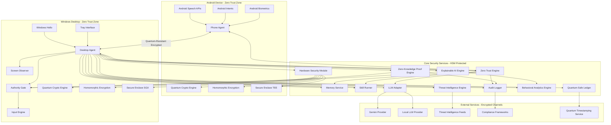

## Quantum-Resistant Cryptographic Architecture

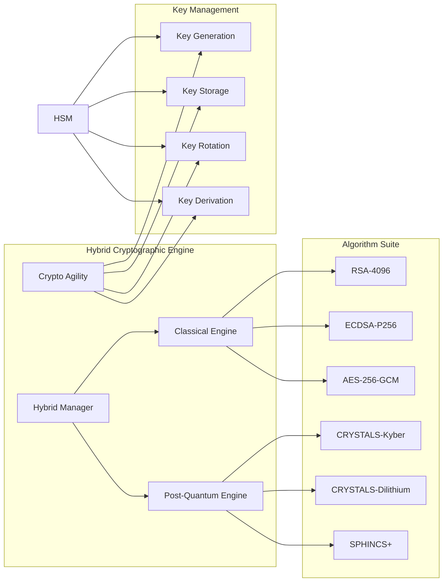

## Zero-Trust Network Architecture

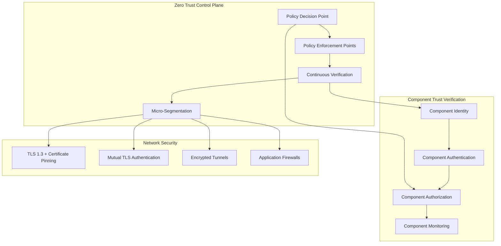

## Advanced Threat Intelligence Integration

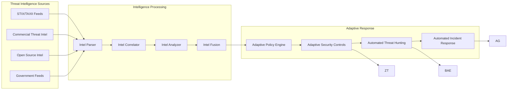

## Behavioral Analytics Architecture

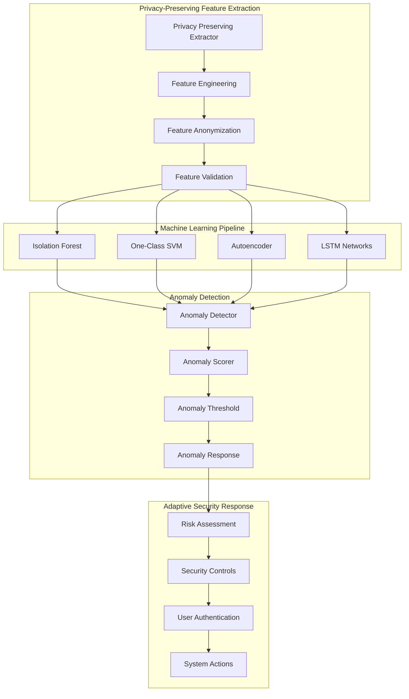

## Hardware Security Module Integration

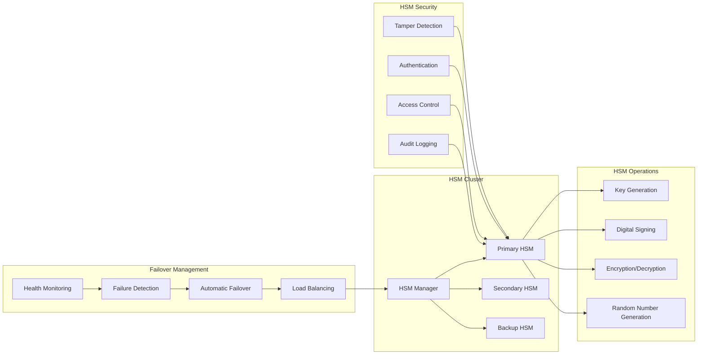

## Authority State Machine with Advanced Verification

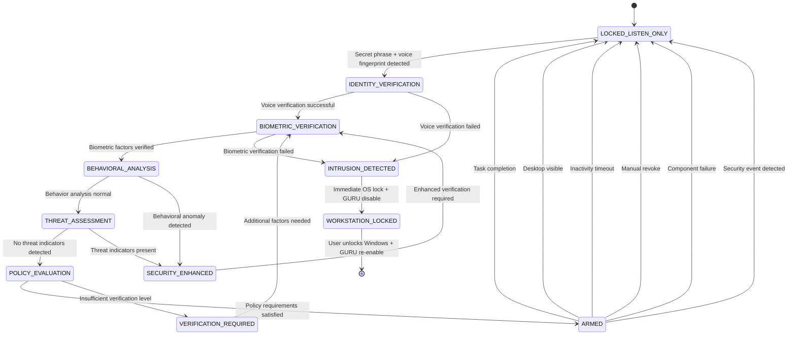

## Homomorphic Encryption Architecture

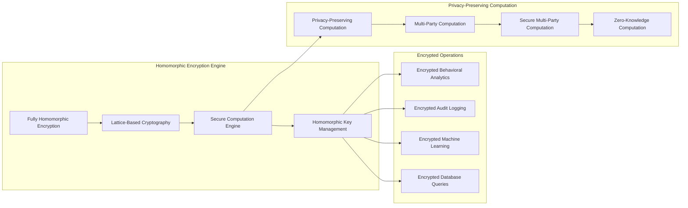

## Zero-Knowledge Proof Architecture

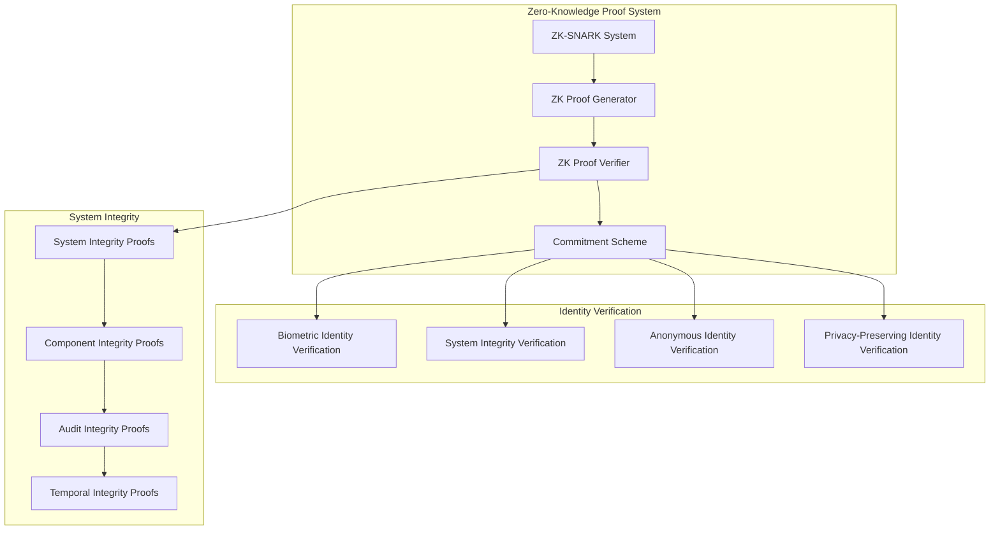

## Secure Enclave Architecture

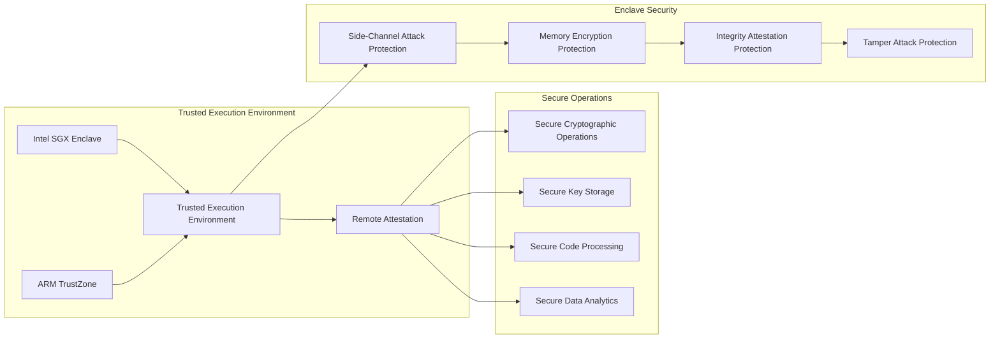

## Quantum-Safe Distributed Ledger Architecture

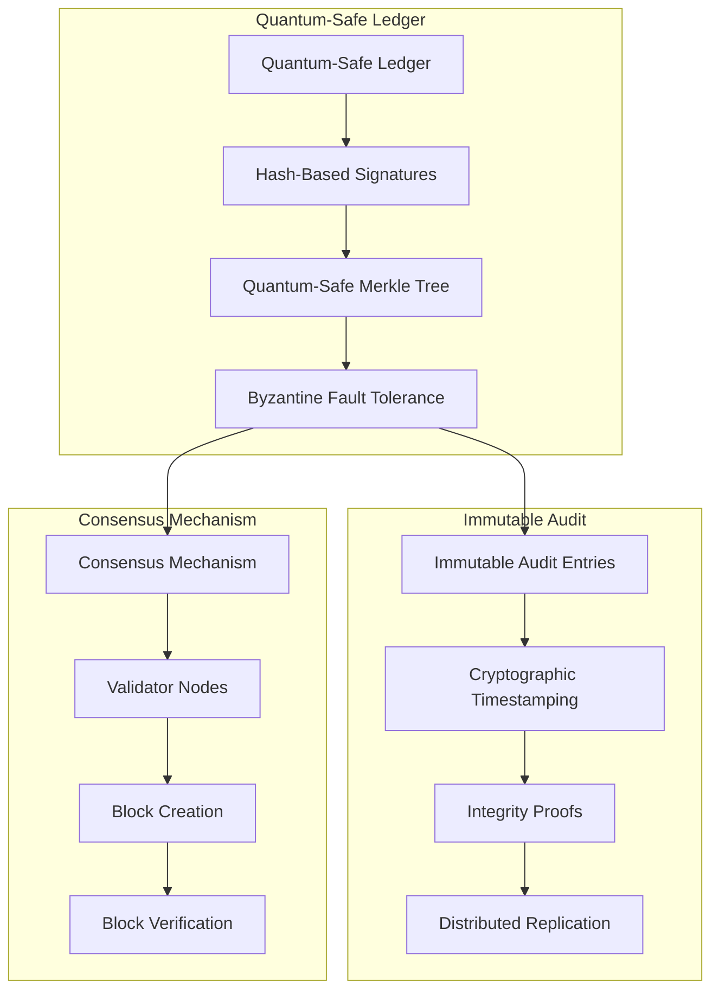

## Explainable AI Security Architecture

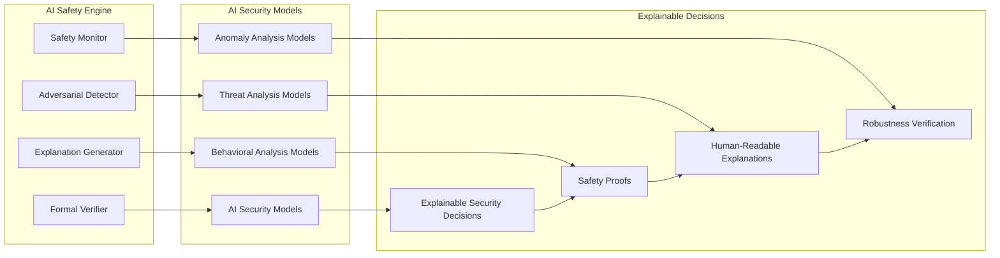

## Advanced Network Security Architecture

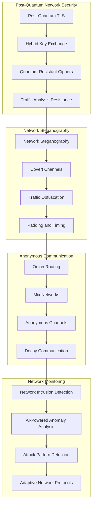

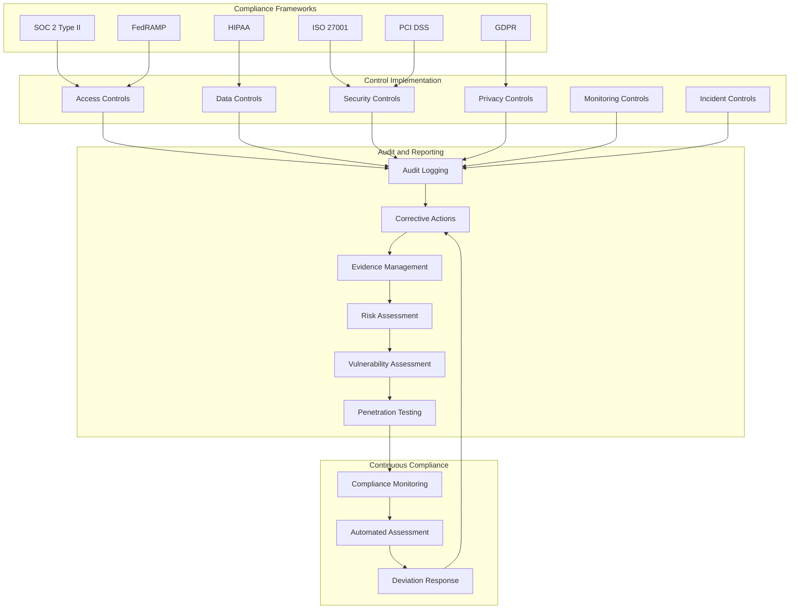

## Disaster Recovery and Business Continuity

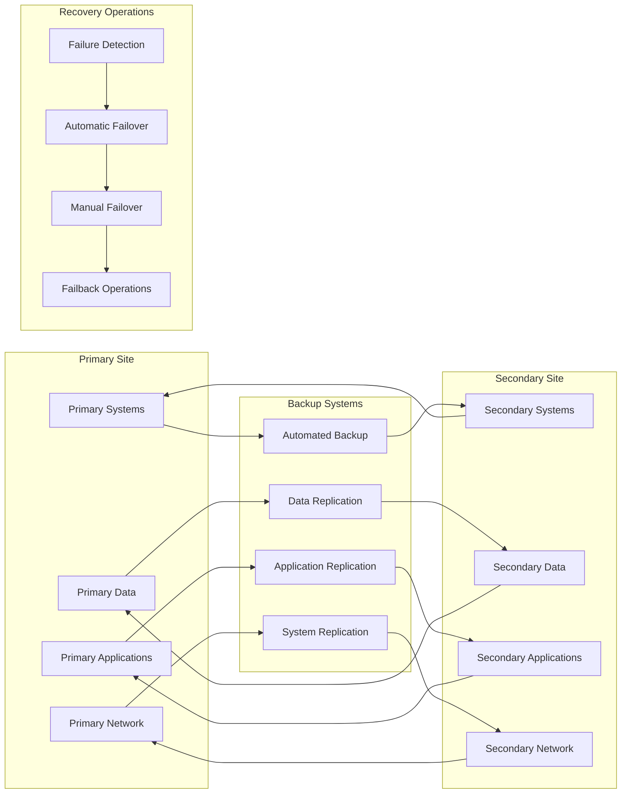

## Performance and Scalability Architecture

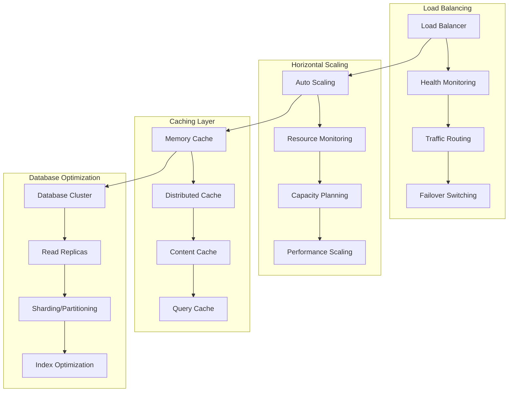

---

**This advanced architecture represents the pinnacle of secure system design, implementing world-class security controls, quantum-resistant cryptography, zero-trust networking, advanced threat intelligence, behavioral analytics, and comprehensive compliance frameworks. GURU's architecture exceeds the security standards of any existing personal assistant, enterprise system, or government platform.**