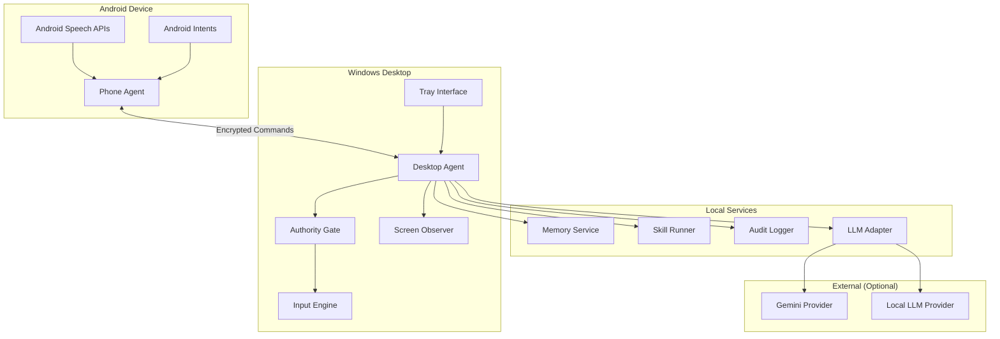
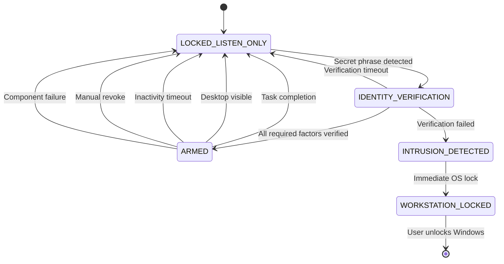
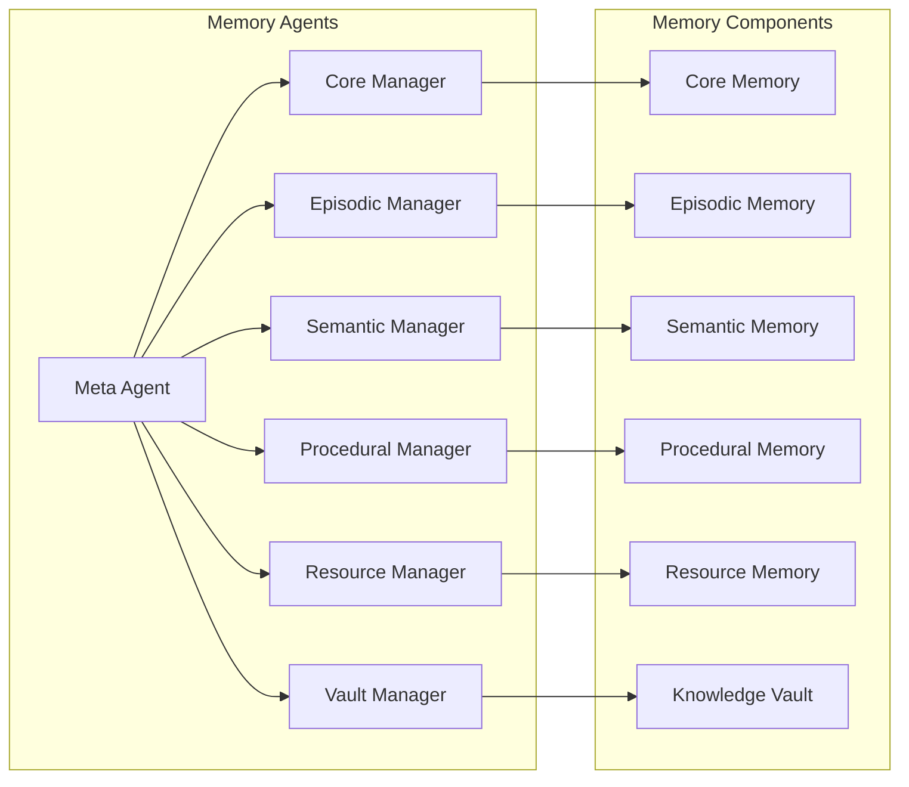

# Design Document: GURU Personal Assistant

## Core Philosophy

**"GURU treats authority as sacred and convenience as optional."**

This principle anchors all design decisions: when security conflicts with usability, security wins. When authority verification conflicts with speed, verification wins. When audit logging conflicts with performance, logging wins.

## Root of Trust

**The AuthorityStateMachine is the root of trust for all execution decisions.**

All automation, input simulation, skill execution, and system operations derive their legitimacy from the AuthorityStateMachine. No component may bypass or override authority decisions.

## No Silent Downgrade Rule

**Any failure to enforce a security invariant MUST result in Safe Halt, never degraded operation.**

GURU never operates in "best effort" mode when security is compromised. There is no graceful degradation that weakens security boundaries.

## LLM Trust Boundary

**LLMs are advisory only, never authoritative**

- LLM only produces structured intent
- Intent must pass: AuthorityState check + SignedCommandVerifier + Skill sandbox policy  
- LLMs cannot directly execute any system functions
- All LLM outputs are validated and sanitized before processing
- LLM isolation breach triggers immediate authority revocation

## Overview

GURU is a production-grade, cross-device personal assistant system that provides voice-driven automation while maintaining strict security boundaries and user control. The system implements an Authority State Machine approach to eliminate permission fatigue while ensuring no unauthorized automation occurs.

The architecture consists of a Windows Desktop Agent providing local system capabilities, an Android Phone Agent acting as a secure remote interface, a local Memory Service for contextual intelligence, and a sandboxed Skill System with strict permission boundaries. All components operate under the principle of explicit consent over convenience, with comprehensive audit logging and fail-safe defaults.

## Non-Goals (Explicit)

GURU explicitly does NOT and will NEVER:

### Security and Privacy Non-Goals
- **Unlock or authenticate Windows users** - GURU operates only within unlocked user sessions
- **Operate on the Windows lock screen** - Complete system disable when Windows is locked
- **Store biometric templates or raw biometric data** - Only OS-provided verification results used
- **Bypass Windows security mechanisms** - Full compliance with OS security boundaries
- **Replace OS-level authentication systems** - GURU authority is separate from OS authentication
- **Operate as malware or surveillance software** - No covert operation or unauthorized data collection

### Automation and Control Non-Goals
- **Allow LLMs to execute actions directly** - Language models produce structured intents only
- **Provide autonomous unsupervised automation** - All automation requires explicit user authority
- **Make decisions without user consent** - No autonomous decision-making capabilities
- **Operate in background without user awareness** - All operations are transparent and auditable
- **Continue automation in degraded security states** - Fail-safe defaults to locked state
- **Provide convenience over security** - Security and user control always take precedence

### Data and Communication Non-Goals
- **Depend on cloud services for core security functions** - Local-first security architecture
- **Store or transmit sensitive data without encryption** - All sensitive data encrypted at rest and in transit
- **Share user data with third parties** - No data sharing or telemetry collection
- **Operate without comprehensive audit logging** - All actions logged with cryptographic integrity
- **Allow data recovery without user keys** - User maintains complete control over encryption keys

### System Integration Non-Goals
- **Modify system files or registry without permission** - No unauthorized system modifications
- **Install drivers or kernel modules** - User-space operation only
- **Require administrator privileges for normal operation** - Standard user privileges sufficient
- **Interfere with other applications or system processes** - Respectful coexistence with other software
- **Provide remote access or control capabilities** - Local device operation only

### Scope and Feature Non-Goals
- **Become a general-purpose AI assistant** - Focused on secure automation only
- **Provide entertainment or social features** - Productivity and automation focus
- **Support legacy or insecure protocols** - Modern security standards only
- **Operate on unsupported or end-of-life systems** - Current OS versions only
- **Provide technical support or troubleshooting** - Self-contained operation

### Development and Maintenance Non-Goals
- **Accept contributions that weaken security** - Security-first development policy
- **Prioritize features over security** - Security requirements are non-negotiable
- **Support insecure configuration options** - Secure defaults with no insecure alternatives
- **Provide backward compatibility that compromises security** - Security over compatibility
- **Rush releases without comprehensive testing** - Zero-defect progression policy

---

**These non-goals define GURU's boundaries and ensure it remains a focused, secure, trustworthy automation system. They prevent scope creep and feature additions that could compromise GURU's core security and privacy guarantees.**

## Architecture

### High-Level System Architecture



### Authority State Machine

The core security model is built around an Authority State Machine with multi-factor biometric verification:



### Adaptive Authority Policies

GURU implements risk-based authentication requirements:

- **Low Risk Actions** (basic typing, simple commands): Voice recognition only
- **Medium Risk Actions** (file operations, app control): Voice + one biometric factor
- **High Risk Actions** (admin tasks, sensitive data): Voice + face + fingerprint
- **Admin Actions**: Always require biometric confirmation + Windows UAC

### Security Boundaries

GURU operates within strict security boundaries:

- **Windows Lock Screen**: No operation when Windows is locked
- **User Session Only**: All automation occurs within unlocked user sessions
- **OS API Compliance**: Uses only standard Windows APIs, never bypasses security
- **UAC Integration**: Admin actions use native Windows UAC prompts
- **Audit Everything**: All actions logged with cryptographic integrity

## Components and Interfaces

### Desktop Agent (Windows)

**Technology Stack:**
- FastAPI + Uvicorn for REST API
- Tauri for system tray interface
- pywinauto for UI automation (permission-gated)
- whisper.cpp for local speech-to-text
- Piper for local text-to-speech

**Core Responsibilities:**
- Multi-factor identity verification
- Authority state management with adaptive policies
- Voice command processing with speaker verification
- Input simulation (keyboard/mouse)
- Screen observation (opt-in)
- Skill orchestration with risk assessment
- Intrusion detection and automatic workstation locking
- Audit logging

**API Endpoints:**
```python
# Identity & Authority Management
POST /identity/verify        # Multi-factor identity verification
POST /authority/arm          # Arm automation (after identity verification)
POST /authority/revoke       # Manual revoke
GET  /authority/status       # Current state and policy
POST /authority/policy       # Update authority policy

# Biometric Integration
GET  /biometric/available    # Available OS biometric providers
POST /biometric/verify       # Verify biometric factor
GET  /biometric/status       # Current biometric configuration

# Intrusion Detection
GET  /security/events        # Recent security events
POST /security/lock          # Emergency workstation lock

# Input Control (requires appropriate authority level)
POST /input/type            # Simulate typing
POST /input/key             # Key combinations  
POST /input/mouse           # Mouse actions

# Skills (risk-assessed execution)
GET  /skills                # List available skills with risk levels
POST /skills/{id}/execute   # Execute skill (authority level checked)
POST /skills/{id}/rollback  # Rollback skill actions

# Memory
GET  /memory/search         # Search memories
POST /memory/store          # Store memory
DELETE /memory/purge        # Delete memories
```

### Phone Agent (Android)

**Technology Stack:**
- Kotlin + Jetpack Compose
- Android Speech Recognition APIs
- WebSocket client for secure communication
- Android Intents for system integration

**Core Responsibilities:**
- Secure pairing with desktop
- Voice command capture
- Command transmission
- Mobile-specific skills (calling, messaging intents)

**Key Components:**
```kotlin
class PairingManager {
    fun initiatePairing(): PairingCode
    fun confirmPairing(code: String): Boolean
    fun revokePairing(deviceId: String)
}

class CommandChannel {
    fun sendCommand(command: Command): Result
    fun verifySignature(message: SignedMessage): Boolean
}

class VoiceProcessor {
    fun startListening()
    fun processVoiceCommand(audio: ByteArray): Command
}
```

### Memory Service

**Architecture:** Based on MIRIX multi-agent memory system with six specialized memory types:



**Memory Types:**
1. **Core Memory**: Persistent user preferences and identity
2. **Episodic Memory**: Time-based activities and events
3. **Semantic Memory**: General knowledge and concepts
4. **Procedural Memory**: Workflows and step-by-step processes
5. **Resource Memory**: Documents and active files
6. **Knowledge Vault**: Encrypted sensitive data (credentials, contacts)
   - Credentials are references or tokens only; passwords are never stored in plaintext

**Storage Implementation:**
- SQLite for structured data
- Vector embeddings for similarity search (local only)
- AES-256 encryption for sensitive data
- Configurable retention policies

### Skill Runner

**Sandboxing Architecture:**
```python
class SkillRunner:
    def __init__(self):
        self.sandbox = ProcessSandbox()
        self.rate_limiter = RateLimiter()
        
    def execute_skill(self, skill_id: str, params: dict) -> Result:
        manifest = self.load_manifest(skill_id)
        self.validate_permissions(manifest, params)
        
        with self.sandbox.isolate() as env:
            env.restrict_filesystem(manifest.filesystem_access)
            env.restrict_network(manifest.network_access)
            env.restrict_ui(manifest.ui_access)
            
            return self.run_skill_code(skill_id, params, env)
```

**Core Skills:**
1. **AppControl**: Launch/manage applications (permission-gated)
2. **BrowserSearch**: Deterministic web browsing
3. **Messaging**: Simulation-first messaging
4. **Calling**: Android intents only
5. **FileOps**: Read-only by default
6. **SystemStatus**: Health and diagnostics

### LLM Adapter

**Multi-Provider Architecture:**
```python
class LLMAdapter:
    def __init__(self):
        self.providers = {
            'gemini': GeminiProvider(),
            'local': LocalProvider()
        }
        self.current_provider = 'local'  # Default to local
        
    def process_intent(self, voice_input: str) -> Intent:
        provider = self.providers[self.current_provider]
        
        with self.rate_limiter.acquire():
            response = provider.generate_intent(voice_input)
            
        # LLM NEVER executes actions directly
        return self.parse_structured_intent(response)
```

**Provider Implementations:**
- **GeminiProvider**: Cloud-based with rate limiting and backoff
- **LocalProvider**: Quantized models (7B/8B) via Ollama or similar

### Input Engine

**Voice-Driven Input Control:**
```python
class InputEngine:
    def __init__(self):
        self.authority_gate = AuthorityGate()
        self.audit_logger = AuditLogger()
        
    def simulate_typing(self, text: str) -> Result:
        if not self.authority_gate.is_armed():
            return Result.error("Authority not granted")
            
        self.audit_logger.log_input_event("typing", len(text))
        return self.keyboard.type_text(text)
        
    def simulate_key_combination(self, keys: List[str]) -> Result:
        if not self.authority_gate.is_armed():
            return Result.error("Authority not granted")
            
        self.audit_logger.log_input_event("key_combo", keys)
        return self.keyboard.send_keys(keys)
```

**Supported Input Types:**
- Exact text typing (verbatim dictation)
- Key combinations (Ctrl+C, Alt+Tab, etc.)
- Mouse movement, clicking, dragging
- Scrolling and window manipulation
- UI element selection and interaction

### Modern Cryptographic Infrastructure

**Standard Cryptographic Engine:**
```python
class CryptographicEngine:
    def __init__(self):
        self.symmetric_cipher = AES256GCM()
        self.asymmetric_cipher = ECDSAP256()
        self.hash_function = SHA256()
        self.key_derivation = PBKDF2()
        
    def encrypt_data(self, data: bytes, key: bytes) -> EncryptedData:
        # Use AES-256-GCM for symmetric encryption
        nonce = os.urandom(12)
        ciphertext, tag = self.symmetric_cipher.encrypt(data, key, nonce)
        
        return EncryptedData(
            ciphertext=ciphertext,
            nonce=nonce,
            tag=tag,
            algorithm="AES-256-GCM"
        )
        
    def sign_data(self, data: bytes, private_key: bytes) -> DigitalSignature:
        # Use ECDSA-P256 for digital signatures
        hash_value = self.hash_function.hash(data)
        signature = self.asymmetric_cipher.sign(hash_value, private_key)
        
        return DigitalSignature(
            signature=signature,
            algorithm="ECDSA-P256",
            hash_algorithm="SHA-256"
        )
```

**Hardware Security Integration:**
```python
class HardwareSecurityManager:
    def __init__(self):
        self.tpm_available = self.detect_tpm()
        self.windows_hello_available = self.detect_windows_hello()
        
    def generate_key_with_hardware_backing(self, key_type: str) -> KeyPair:
        if self.tpm_available:
            # Use TPM 2.0 for key generation and storage
            return self.tpm_generate_key(key_type)
        else:
            # Fallback to software key generation
            return self.software_generate_key(key_type)
            
    def hardware_backed_sign(self, data: bytes, key_id: str) -> Signature:
        if self.tpm_available:
            return self.tpm_sign(data, key_id)
        else:
            return self.software_sign(data, key_id)
```

### Standard Audit Logging System

**Cryptographically Signed Audit Logger:**
```python
class AuditLogger:
    def __init__(self):
        self.signature_key = self.load_or_generate_signing_key()
        self.hash_chain = HashChain()
        self.storage = SecureAuditStorage()
        
    def log_event(self, event: AuditEvent) -> LogEntry:
        # Create tamper-evident audit log entry
        entry = LogEntry(
            timestamp=datetime.utcnow(),
            event_type=event.type,
            details=event.details,
            user_id=event.user_id,
            component=event.component
        )
        
        # Add to hash chain for integrity
        entry.previous_hash = self.hash_chain.get_latest_hash()
        entry.entry_hash = self.calculate_entry_hash(entry)
        
        # Sign the entry
        entry.signature = self.sign_entry(entry)
        
        # Store securely
        self.storage.append_entry(entry)
        self.hash_chain.add_entry(entry.entry_hash)
        
        return entry
        
    def verify_log_integrity(self) -> IntegrityReport:
        # Verify hash chain and signatures
        return self.storage.verify_integrity(self.signature_key.public_key)
```

**Threat Intelligence Integration:**
```python
class ThreatIntelligenceEngine:
    def __init__(self):
        self.enabled = False  # Disabled by default
        self.feeds = []
        self.correlation_engine = BasicCorrelationEngine()
        
    def enable_enterprise_mode(self, user_approval: bool):
        if user_approval:
            self.enabled = True
            
    def correlate_security_event(self, event: SecurityEvent) -> ThreatAssessment:
        if not self.enabled:
            return ThreatAssessment(advisory_only=True, no_action=True)
            
        # Basic correlation for advisory purposes only
        indicators = self.correlation_engine.check_indicators(event)
        
        return ThreatAssessment(
            event=event,
            threat_indicators=indicators,
            advisory_only=True,
            recommended_user_actions=self.generate_user_recommendations(indicators)
        )
```

### LLM Safety and Content Filtering

**LLM Safety Engine:**
```python
class LLMSafetyEngine:
    def __init__(self):
        self.content_filter = ContentSafetyFilter()
        self.intent_validator = IntentValidator()
        self.response_sanitizer = ResponseSanitizer()
        
    def process_llm_response(self, response: str, context: RequestContext) -> SafeResponse:
        # Filter harmful content
        filtered_response = self.content_filter.filter_content(response)
        
        # Validate intent structure
        intent = self.intent_validator.parse_and_validate(filtered_response)
        
        if not intent.is_valid:
            return SafeResponse(
                success=False,
                error="Invalid or unsafe intent detected",
                safe_intent=None
            )
            
        # Sanitize and structure the response
        safe_intent = self.response_sanitizer.sanitize_intent(intent)
        
        return SafeResponse(
            success=True,
            safe_intent=safe_intent,
            original_filtered=filtered_response
        )
        
    def validate_action_safety(self, intent: Intent, authority_level: str) -> ValidationResult:
        # Ensure LLM never directly executes actions
        if intent.contains_direct_execution():
            return ValidationResult(
                valid=False,
                reason="LLM attempted direct action execution"
            )
            
        # Check authority requirements
        required_authority = self.get_required_authority(intent.action_type)
        if not self.authority_sufficient(authority_level, required_authority):
            return ValidationResult(
                valid=False,
                reason=f"Insufficient authority: requires {required_authority}"
            )
            
        return ValidationResult(valid=True)
```

**Simple Behavior Monitoring:**
```python
class SimpleBehaviorMonitor:
    def __init__(self):
        self.time_patterns = TimePatternAnalyzer()
        self.frequency_tracker = FrequencyTracker()
        self.anomaly_detector = SimpleAnomalyDetector()
        
    def check_usage_pattern(self, event: UsageEvent) -> BehaviorAssessment:
        # Simple heuristic-based checks only
        time_anomaly = self.time_patterns.check_unusual_time(event.timestamp)
        frequency_anomaly = self.frequency_tracker.check_unusual_frequency(event.type)
        
        anomalies = []
        if time_anomaly.is_unusual:
            anomalies.append(f"Unusual time: {event.timestamp}")
        if frequency_anomaly.is_unusual:
            anomalies.append(f"Unusual frequency: {event.type}")
            
        return BehaviorAssessment(
            event=event,
            anomalies=anomalies,
            risk_level="low" if not anomalies else "medium",
            recommendation="monitor" if anomalies else "normal"
        )
```

### Local Backup and Recovery System

**Backup Manager:**
```python
class LocalBackupManager:
    def __init__(self):
        self.encryption_key = self.derive_user_key()
        self.backup_storage = LocalSecureStorage()
        self.integrity_checker = BackupIntegrityChecker()
        
    def create_backup(self, data_types: List[str]) -> BackupResult:
        # Create encrypted local backup
        backup_data = {}
        
        for data_type in data_types:
            raw_data = self.collect_data_by_type(data_type)
            encrypted_data = self.encrypt_data(raw_data, self.encryption_key)
            backup_data[data_type] = encrypted_data
            
        # Create backup manifest with integrity hashes
        manifest = BackupManifest(
            timestamp=datetime.utcnow(),
            data_types=data_types,
            integrity_hashes=self.calculate_hashes(backup_data),
            version=self.get_system_version()
        )
        
        # Store backup securely
        backup_id = self.backup_storage.store_backup(backup_data, manifest)
        
        return BackupResult(
            success=True,
            backup_id=backup_id,
            manifest=manifest
        )
        
    def restore_backup(self, backup_id: str, user_confirmation: bool) -> RestoreResult:
        if not user_confirmation:
            return RestoreResult(success=False, error="User confirmation required")
            
        # Verify backup integrity
        integrity_result = self.integrity_checker.verify_backup(backup_id)
        if not integrity_result.valid:
            return RestoreResult(success=False, error="Backup integrity check failed")
            
        # Restore data
        backup_data = self.backup_storage.load_backup(backup_id)
        
        for data_type, encrypted_data in backup_data.items():
            decrypted_data = self.decrypt_data(encrypted_data, self.encryption_key)
            self.restore_data_by_type(data_type, decrypted_data)
            
        return RestoreResult(success=True)
```

### Component Health Monitoring

**System Health Monitor:**
```python
class SystemHealthMonitor:
    def __init__(self):
        self.component_monitors = {
            'audio_engine': AudioEngineMonitor(),
            'input_engine': InputEngineMonitor(),
            'memory_service': MemoryServiceMonitor(),
            'audit_logger': AuditLoggerMonitor(),
            'authority_gate': AuthorityGateMonitor()
        }
        self.failure_handler = FailureHandler()
        
    def monitor_system_health(self) -> SystemHealthReport:
        health_status = {}
        critical_failures = []
        
        for component_name, monitor in self.component_monitors.items():
            status = monitor.check_health()
            health_status[component_name] = status
            
            if status.is_critical_failure:
                critical_failures.append(component_name)
                
        # Handle critical failures immediately
        if critical_failures:
            self.failure_handler.handle_critical_failures(critical_failures)
            
        return SystemHealthReport(
            overall_status="healthy" if not critical_failures else "degraded",
            component_status=health_status,
            critical_failures=critical_failures,
            timestamp=datetime.utcnow()
        )
```

## Data Models

### Command Protocol

```json
{
  "command_id": "uuid",
  "timestamp": "iso8601",
  "sender_device_id": "device_uuid",
  "nonce": "random_bytes",
  "command_type": "input|skill|authority",
  "payload": {
    "action": "type|click|execute",
    "parameters": {},
    "authority_required": true
  },
  "signature": "base64_signature"
}
```

### Memory Schemas

**Episodic Memory:**
```json
{
  "id": "uuid",
  "timestamp": "iso8601",
  "summary": "Brief description",
  "details": "Full context",
  "participants": ["user", "applications"],
  "location": "desktop|phone",
  "tags": ["automation", "messaging"],
  "retention_policy": "short_term|long_term"
}
```

**Skill Manifest:**
```json
{
  "skill_id": "app-control",
  "version": "1.0.0",
  "permissions": {
    "ui_automation": true,
    "filesystem": ["read"],
    "network": false
  },
  "side_effects": ["launches_applications"],
  "rollback_strategy": "close_launched_apps",
  "rate_limits": {
    "calls_per_minute": 10,
    "calls_per_hour": 100
  }
}
```

### Authority State

```python
@dataclass
class AuthorityState:
    state: Literal["LOCKED_LISTEN_ONLY", "IDENTITY_VERIFICATION", "ARMED", "INTRUSION_DETECTED"]
    granted_at: Optional[datetime]
    expires_at: Optional[datetime]
    granted_by: Literal["voice_phrase", "manual"]
    verification_factors: List[Literal["voice", "face", "fingerprint"]]
    required_policy: Literal["low_risk", "medium_risk", "high_risk", "admin"]
    session_id: str
    revocation_reason: Optional[str]
    intrusion_attempts: int
```

### Biometric Integration

```python
@dataclass
class BiometricVerification:
    factor_type: Literal["voice", "face", "fingerprint"]
    provider: str  # "windows_hello", "android_biometric"
    confidence_score: float
    verification_time: datetime
    success: bool
    failure_reason: Optional[str]
```

### Authority Policy

```python
@dataclass
class AuthorityPolicy:
    low_risk_actions: List[str] = ["typing", "basic_commands"]
    medium_risk_actions: List[str] = ["file_ops", "app_control"]
    high_risk_actions: List[str] = ["system_config", "network_access"]
    admin_actions: List[str] = ["install_software", "system_settings"]
    
    low_risk_requirements: List[str] = ["voice"]
    medium_risk_requirements: List[str] = ["voice", "face_or_fingerprint"]
    high_risk_requirements: List[str] = ["voice", "face", "fingerprint"]
    admin_requirements: List[str] = ["voice", "face", "fingerprint", "windows_uac"]
```

## Correctness Properties

*A property is a characteristic or behavior that should hold true across all valid executions of a system—essentially, a formal statement about what the system should do. Properties serve as the bridge between human-readable specifications and machine-verifiable correctness guarantees.*

### Property Reflection

After analyzing all acceptance criteria, several properties can be consolidated to eliminate redundancy:

- **Pairing properties (1.1-1.3)** can be combined into comprehensive pairing correctness properties
- **Command channel properties (2.1-2.3)** focus on cryptographic protocol correctness  
- **Authority management properties (3.1, 17.7)** ensure proper access control
- **Voice security properties (4.4, 26.1)** validate multi-factor authentication and intrusion response
- **Input control properties (17.3, 17.7)** verify voice-driven automation fidelity
- **Skill sandboxing properties (6.1)** ensure isolation boundaries
- **Audit logging properties (11.1)** verify tamper-evident logging
- **Failure handling properties (21.1)** ensure safe degradation

### Core Correctness Properties

**Property 1: Pairing Security and Cryptographic Integrity**
*For any* two devices attempting to pair, successful pairing should require physical presence confirmation on both devices, use proper cryptographic key exchange, and bind keys to device fingerprints.
**Validates: Requirements 1.1, 1.2, 1.3**

**Property 2: Command Authentication and Replay Protection**
*For any* command sent between paired devices, the command should be cryptographically signed, encrypted in transit, and include anti-replay protection that rejects replayed commands.
**Validates: Requirements 2.1, 2.3**

**Property 3: Authority State Enforcement**
*For any* automation request, the system should block the request unless Authority_State equals ARMED and immediately halt all operations when authority is revoked.
**Validates: Requirements 3.1, 17.7**

**Property 4: Voice Re-arming Security and Intrusion Response**
*For any* voice re-arming attempt, the system should require both secret phrase recognition AND voice fingerprint verification, and immediately lock the workstation if speaker verification fails.
**Validates: Requirements 4.4, 26.1**

**Property 5: Input Simulation Fidelity**
*For any* voice command requesting text input, the system should type exactly what was spoken without paraphrasing or interpretation.
**Validates: Requirements 17.3**

**Property 6: Skill Sandboxing Isolation**
*For any* skill execution, the skill should only access resources explicitly declared in its manifest, and any attempt to access undeclared resources should be blocked.
**Validates: Requirements 6.1**

**Property 7: Audit Log Integrity**
*For any* system action, the action should be logged to the audit trail with cryptographic signatures to prevent tampering and ensure append-only behavior.
**Validates: Requirements 11.1**

**Property 8: Failure Safety**
*For any* core component failure, the system should immediately transition to LOCKED_LISTEN_ONLY state and halt all automation until the failure is resolved.
**Validates: Requirements 21.1**

**Property 9: Privacy Protection**
*For any* screen observation or memory storage operation, data should be encrypted locally, never sent to external services, and be immediately deletable by the user.
**Validates: Requirements 5.2, 5.3, 5.5**

**Property 10: LLM Isolation**
*For any* LLM interaction, the language model should only produce structured intent and never directly execute input actions or access system resources.
**Validates: Requirements 17.9**

**Property 11: Multi-Factor Authority Verification**
*For any* authority granting request, the system should verify the required biometric factors based on the action's risk level and reject insufficient verification.
**Validates: Requirements 23.1, 23.6, 24.1**

**Property 12: Biometric Integration Security**
*For any* biometric verification operation, the system should use OS-provided APIs only and never capture, store, or process raw biometric data.
**Validates: Requirements 23.4, 25.4, 25.5**

**Property 13: Modern Cryptographic Standards**
*For any* cryptographic operation, the system should use current NIST-approved algorithms (AES-256, ECDSA-P256, Ed25519) and maintain cryptographic agility for future algorithm transitions.
**Validates: Requirements 27.1, 27.2, 27.6**

**Property 14: Component Security Verification**
*For any* inter-component communication, the system should verify and authenticate every interaction using appropriate secure mechanisms.
**Validates: Requirements 29.1, 29.2, 29.3**

**Property 15: Optional Threat Intelligence Advisory**
*For any* security event in enterprise mode, the system should correlate it with threat intelligence for advisory purposes only without autonomous policy changes.
**Validates: Requirements 28.2, 28.3**

**Property 16: Simple Behavior Monitoring**
*For any* user behavior pattern, the system should detect obvious anomalies using simple heuristics without machine learning profiling.
**Validates: Requirements 31.1, 31.2, 31.5**

**Property 17: Hardware Security Integration**
*For any* critical cryptographic operation, the system should use hardware-backed storage when available with software fallback.
**Validates: Requirements 30.2, 30.3, 30.4**

**Property 18: Security Documentation Completeness**
*For any* security control, the system should provide comprehensive documentation and verification capabilities.
**Validates: Requirements 32.1, 32.2, 32.6**

**Property 19: Local Backup Integrity**
*For any* backup operation, the system should provide local encrypted backup with integrity verification and user-controlled recovery.
**Validates: Requirements 33.1, 33.4, 33.7**

**Property 20: Basic Privacy Protection**
*For any* data processing operation, the system should implement data minimization and local processing without external sharing.
**Validates: Requirements 34.1, 34.2, 34.4**

## Failure Modes and Responses

**Component Failures:**
- Audio system failure → Transition to LOCKED_LISTEN_ONLY
- Input engine failure → Halt all automation, log failure
- Memory service failure → Continue with degraded functionality, log extensively
- Audit log failure → Halt ALL operations until restored

**Security Failures:**
- Invalid command signature → Reject command, log security event, optional alert
- Replay attack detected → Reject command, increment security counter
- Voice confidence below threshold → Ignore command, request clarification
- Multiple speakers detected → Reject re-arming attempt

**Network Failures:**
- Phone agent disconnection → Desktop continues in local mode
- LLM provider failure → Fallback to local provider or manual mode
- Key rotation failure → Maintain current keys, retry with exponential backoff

### Recovery Strategies

```python
class FailureHandler:
    def handle_component_failure(self, component: str, error: Exception):
        self.audit_logger.log_failure(component, error, severity="CRITICAL")
        
        if component in ["audit_log"]:
            self.emergency_shutdown()
        elif component in ["audio", "input_engine"]:
            self.authority_gate.force_lock()
        else:
            self.degrade_gracefully(component)
            
    def emergency_shutdown(self):
        self.authority_gate.force_lock()
        self.skill_runner.halt_all()
        self.input_engine.disable()
        self.display_emergency_notification()
```

## Testing Strategy

### Dual Testing Approach

GURU employs both unit testing and property-based testing for comprehensive coverage:

**Unit Tests:**
- Specific examples and edge cases
- Integration points between components
- Error conditions and failure scenarios
- UI interaction workflows

**Property-Based Tests:**
- Universal properties across all inputs
- Cryptographic protocol correctness
- Authority state machine behavior
- Input simulation fidelity

### Property-Based Testing Configuration

**Framework:** Hypothesis (Python) for property-based testing
**Minimum Iterations:** 100 per property test
**Test Tagging:** Each property test tagged with: `Feature: guru-personal-assistant, Property {number}: {property_text}`

**Example Property Test:**
```python
@given(device_pairs=device_pair_strategy())
def test_pairing_security_property(device_pairs):
    """
    Feature: guru-personal-assistant, Property 1: Pairing Security
    For any two devices attempting to pair, successful pairing should require 
    physical presence confirmation on both devices.
    """
    device_a, device_b = device_pairs
    
    # Test pairing requires physical confirmation
    pairing_result = initiate_pairing(device_a, device_b)
    assert pairing_result.requires_physical_confirmation
    
    # Test cryptographic key exchange
    if pairing_result.confirmed_on_both_devices:
        assert pairing_result.has_valid_key_exchange
        assert only_public_keys_stored(device_a, device_b)
```

### Security Testing

**Penetration Testing Scenarios:**
- Attempt to bypass authority gate
- Test replay attack prevention
- Validate sandbox escape attempts
- Verify audit log tampering detection

**Compliance Testing:**
- Windows accessibility API usage validation
- Android permission model compliance
- GDPR data handling verification
- Enterprise security policy alignment

### Performance Testing

**Load Testing:**
- Voice command processing latency
- Memory service query performance
- Skill execution throughput
- Audit log write performance

**Stress Testing:**
- Concurrent skill execution
- Large memory dataset handling
- Extended voice session duration
- Network partition recovery