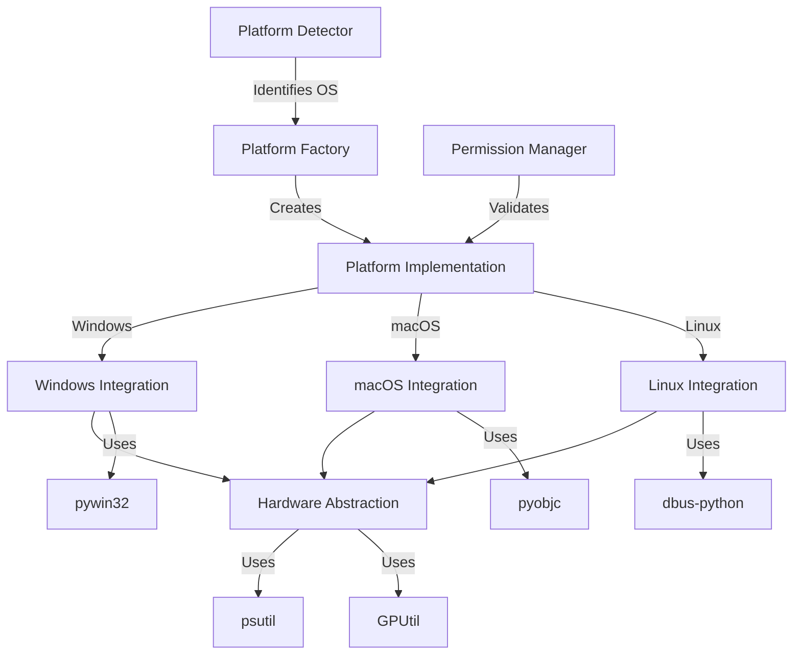
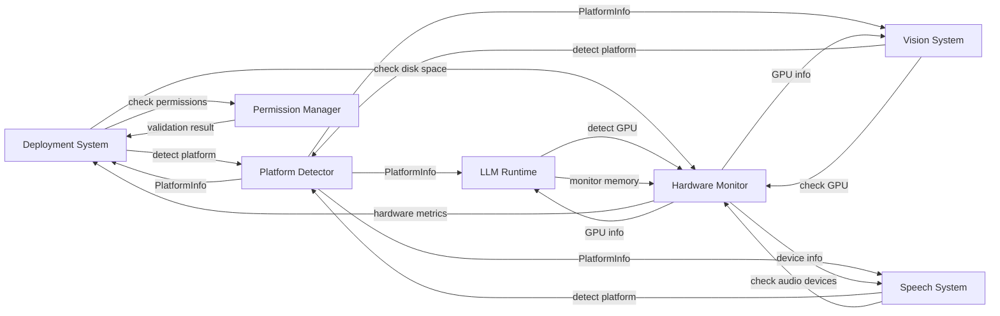

# Design Document: Platform Integration System

## Overview

The Platform Integration System provides comprehensive cross-platform laptop control for AGENT_GURU, enabling Guru and Maya personalities to execute ANY laptop operation through voice commands. This system is the core component that transforms AGENT_GURU from a simple voice assistant into a complete voice-controlled operating system.

**Complete Laptop Control Capabilities**:
- **File Operations**: Create, read, update, delete, move, copy, rename files and directories
- **Application Control**: Open, close, minimize, maximize, switch between applications
- **Text Input**: Type text into any active application or text field
- **Messaging**: Open messaging apps (WhatsApp, Telegram, Slack) and send messages
- **Document Editing**: Open Notepad/TextEdit and write specified content
- **Web Browsing**: Open browsers and navigate to specified URLs
- **System Settings**: Adjust volume, brightness, network settings, display settings
- **Mouse Control**: Move cursor, click, double-click, right-click, drag
- **Keyboard Shortcuts**: Execute keyboard shortcuts (Ctrl+C, Ctrl+V, Alt+Tab, etc.)
- **Window Management**: Arrange windows, snap to sides, manage virtual desktops
- **Media Control**: Play, pause, skip, control media playback
- **Screenshot/Recording**: Capture screenshots and start/stop screen recording
- **Clipboard Management**: Copy, paste, manage clipboard history
- **Search Operations**: Search files, applications, and system settings

The design follows a strategy pattern where platform-specific implementations (Windows, macOS, Linux) are abstracted behind common interfaces, with specialized controllers for each operation category. The system is built in Python using industry-standard libraries: psutil for cross-platform operations, pyautogui for input control, pywin32 for Windows, pyobjc for macOS, and dbus-python for Linux.

## Architecture

### High-Level Architecture

```
┌─────────────────────────────────────────────────────────────────────┐
│              AGENT_GURU Core System (Guru & Maya)                   │
│              Voice Commands → Platform Operations                    │
└─────────────────────┬───────────────────────────────────────────────┘
                      │
                      ▼
┌─────────────────────────────────────────────────────────────────────┐
│         Main OS Controller (Facade)                                 │
│  Routes operations to specialized controllers                       │
└─────────────────────┬───────────────────────────────────────────────┘
                      │
        ┌─────────────┼─────────────┬─────────────┬─────────────┐
        │             │             │             │             │
        ▼             ▼             ▼             ▼             ▼
┌──────────────┐ ┌──────────┐ ┌──────────┐ ┌──────────┐ ┌──────────┐
│    File      │ │   App    │ │   Text   │ │  Mouse/  │ │  System  │
│ Operations   │ │ Control  │ │  Input   │ │ Keyboard │ │ Settings │
│ Controller   │ │Controller│ │Controller│ │Controller│ │Controller│
└──────────────┘ └──────────┘ └──────────┘ └──────────┘ └──────────┘
        │             │             │             │             │
        └─────────────┼─────────────┴─────────────┼─────────────┘
                      │                           │
                      ▼                           ▼
┌─────────────────────────────────┐   ┌─────────────────────────────┐
│   Platform-Specific Integration │   │   Input Control Libraries   │
│   (Windows/macOS/Linux)         │   │   (pyautogui, pynput)       │
└─────────────────────────────────┘   └─────────────────────────────┘
        │             │             │
        ▼             ▼             ▼
┌──────────────┐ ┌──────────┐ ┌──────────────┐
│   Windows    │ │  macOS   │ │    Linux     │
│ Integration  │ │Integration│ │ Integration  │
│  (pywin32)   │ │ (pyobjc) │ │(dbus-python) │
└──────────────┘ └──────────┘ └──────────────┘
        │             │             │
        └─────────────┼─────────────┘
                      │
                      ▼
┌─────────────────────────────────────────────────────────────────────┐
│         Hardware Abstraction Layer                                  │
│         (psutil, GPUtil)                                            │
└─────────────────────────────────────────────────────────────────────┘
```

### Voice Command Execution Flow

```
User Voice Command: "Hey Guru, open YouTube and play music"
        │
        ▼
Speech Engine (guru_speech) → Transcription
        │
        ▼
Agent Orchestration (guru_agent_orchestration) → Command Decomposition
        │
        ├─→ Sub-task 1: Open YouTube
        └─→ Sub-task 2: Play music
        │
        ▼
Policy Engine (guru_policy_engine) → Permission Check
        │
        ▼
Platform Integration (this system) → Execution
        │
        ├─→ ApplicationController.open_application("YouTube")
        │   └─→ Platform-specific browser launch
        │
        └─→ MediaController.play()
            └─→ Platform-specific media key simulation
        │
        ▼
Audit Logging → Record operation
        │
        ▼
Response to User: "YouTube opened and playing music"
```

### Component Interaction



### Design Patterns

1. **Strategy Pattern**: Platform-specific implementations behind common interface
2. **Factory Pattern**: Platform detector creates appropriate implementation
3. **Facade Pattern**: Unified interface hides platform complexity
4. **Adapter Pattern**: Wraps platform-specific APIs with common interface
5. **Controller Pattern**: Specialized controllers for each operation category

## Specialized Controllers

The system uses specialized controllers to organize operations by category. Each controller focuses on a specific type of laptop control operation.

### 1. File Operations Controller
Handles all file and directory operations:
- Create, read, update, delete files
- Move, copy, rename files
- Directory operations (create, list, delete)
- Permission checks before destructive operations
- Audit logging for all file operations

### 2. Application Controller
Manages application lifecycle and window control:
- Open applications by name or path
- Close applications gracefully or forcefully
- Minimize, maximize, restore windows
- Switch between applications (Alt+Tab simulation)
- Focus specific windows
- Platform-specific application launching

### 3. Text Input Controller
Handles text input into any application:
- Type text into active application using pyautogui
- Handle special characters and Unicode
- Typing speed control
- Clipboard integration for large text
- Text formatting (bold, italic, etc.)

### 4. Messaging Controller
Manages messaging application integration:
- Open WhatsApp, Telegram, Slack, Discord
- Send messages to contacts
- Search for contacts
- Platform-specific messaging integration
- Web-based and desktop app support

### 5. System Settings Controller
Controls system-level settings:
- Adjust volume (increase, decrease, mute)
- Adjust brightness
- Network settings (WiFi, Bluetooth, Airplane mode)
- Display settings (resolution, orientation, multiple monitors)
- Platform-specific settings access

### 6. Mouse Controller
Simulates mouse operations using pyautogui:
- Move cursor to coordinates or relative position
- Click, double-click, right-click
- Drag and drop operations
- Scroll operations
- Mouse button hold/release

### 7. Keyboard Controller
Simulates keyboard operations:
- Execute keyboard shortcuts (Ctrl+C, Ctrl+V, Alt+Tab, Win+D)
- Key press, release, hold operations
- Hotkey combinations
- Platform-specific key mappings

### 8. Window Manager
Manages window arrangement and virtual desktops:
- Arrange windows (tile, cascade, grid)
- Snap windows to sides (left half, right half)
- Manage virtual desktops (create, switch, close)
- Platform-specific window management APIs

### 9. Media Controller
Controls media playback:
- Play, pause, stop media
- Skip forward/backward
- Volume control for media
- Platform-specific media key simulation

### 10. Screen Capture Controller
Handles screenshots and recording:
- Capture full screen or specific region
- Start/stop screen recording
- Save to specified locations
- Platform-specific capture tools integration

### 11. Clipboard Manager
Manages clipboard operations:
- Copy text/images to clipboard
- Paste from clipboard
- Clipboard history management
- Clear clipboard

### 12. Search Controller
Handles system-wide search:
- Search files by name or content
- Search applications
- Search system settings
- Platform-specific search integration (Spotlight, Windows Search, etc.)

## Components and Interfaces

### 1. Platform Detector

**Purpose**: Identify the current operating system and select appropriate implementation.

**Interface**:
```python
class PlatformDetector:
    @staticmethod
    def detect() -> PlatformInfo:
        """
        Detect the current operating system.
        
        Returns:
            PlatformInfo containing OS name, version, and architecture
            
        Raises:
            UnsupportedPlatformError: If OS is not Windows, macOS, or Linux
        """
        pass
    
    @staticmethod
    def is_windows() -> bool:
        """Check if running on Windows."""
        pass
    
    @staticmethod
    def is_macos() -> bool:
        """Check if running on macOS."""
        pass
    
    @staticmethod
    def is_linux() -> bool:
        """Check if running on Linux."""
        pass
```

**Data Model**:
```python
@dataclass
class PlatformInfo:
    os_name: str  # "Windows", "macOS", "Linux"
    os_version: str  # e.g., "10.0.19041", "12.3", "5.15.0"
    architecture: str  # "x86", "x64", "ARM64"
    python_version: str
    python_implementation: str  # "CPython", "PyPy"
```

### 2. Platform Integration Interface

**Purpose**: Define common interface for all platform-specific operations.

**Interface**:
```python
class PlatformIntegration(ABC):
    @abstractmethod
    def execute_command(self, command: str, args: List[str]) -> CommandResult:
        """
        Execute a platform-specific command.
        
        Args:
            command: Command to execute
            args: Command arguments
            
        Returns:
            CommandResult with stdout, stderr, and return code
            
        Raises:
            PermissionError: If insufficient permissions
            CommandExecutionError: If command fails
        """
        pass
    
    @abstractmethod
    def get_process_list(self) -> List[ProcessInfo]:
        """Get list of running processes."""
        pass
    
    @abstractmethod
    def start_process(self, executable: str, args: List[str]) -> int:
        """
        Start a new process.
        
        Returns:
            Process ID of started process
        """
        pass
    
    @abstractmethod
    def terminate_process(self, pid: int, force: bool = False) -> bool:
        """
        Terminate a process.
        
        Args:
            pid: Process ID
            force: If True, force kill; if False, graceful termination
            
        Returns:
            True if process was terminated
        """
        pass
    
    @abstractmethod
    def get_system_info(self) -> SystemInfo:
        """Get platform-specific system information."""
        pass
```

### 3. Windows Integration

**Purpose**: Implement Windows-specific operations using pywin32.

**Key Operations**:
- Registry access (read/write/delete keys)
- Windows service management
- Windows API calls
- Process management via Windows APIs

**Implementation Details**:
```python
class WindowsIntegration(PlatformIntegration):
    def read_registry_key(self, hive: int, key_path: str, value_name: str) -> Any:
        """
        Read a Windows registry key.
        
        Args:
            hive: Registry hive (e.g., winreg.HKEY_LOCAL_MACHINE)
            key_path: Path to registry key
            value_name: Name of value to read
            
        Returns:
            Registry value
            
        Raises:
            RegistryKeyNotFoundError: If key doesn't exist
            PermissionError: If insufficient permissions
        """
        pass
    
    def write_registry_key(self, hive: int, key_path: str, 
                          value_name: str, value: Any, value_type: int) -> None:
        """Write a Windows registry key."""
        pass
    
    def get_service_status(self, service_name: str) -> ServiceStatus:
        """Get Windows service status."""
        pass
```

### 4. macOS Integration

**Purpose**: Implement macOS-specific operations using pyobjc and subprocess.

**Key Operations**:
- AppleScript execution
- System preferences access
- Launch services interaction
- Process management via macOS APIs

**Implementation Details**:
```python
class MacOSIntegration(PlatformIntegration):
    def execute_applescript(self, script: str) -> str:
        """
        Execute an AppleScript.
        
        Args:
            script: AppleScript code to execute
            
        Returns:
            Script output
            
        Raises:
            AppleScriptError: If script execution fails
        """
        pass
    
    def get_system_preference(self, domain: str, key: str) -> Any:
        """
        Read a macOS system preference.
        
        Args:
            domain: Preference domain (e.g., "com.apple.dock")
            key: Preference key
            
        Returns:
            Preference value
        """
        pass
    
    def set_system_preference(self, domain: str, key: str, value: Any) -> None:
        """Write a macOS system preference."""
        pass
```

### 5. Linux Integration

**Purpose**: Implement Linux-specific operations using dbus-python and subprocess.

**Key Operations**:
- D-Bus service interaction
- systemd service management
- Desktop environment integration
- Process management via Linux APIs

**Implementation Details**:
```python
class LinuxIntegration(PlatformIntegration):
    def query_dbus_service(self, bus_name: str, object_path: str, 
                          interface: str, method: str) -> Any:
        """
        Query a D-Bus service.
        
        Args:
            bus_name: D-Bus service name
            object_path: Object path
            interface: Interface name
            method: Method to call
            
        Returns:
            Method result
            
        Raises:
            DBusError: If D-Bus operation fails
        """
        pass
    
    def get_systemd_service_status(self, service_name: str) -> ServiceStatus:
        """Get systemd service status via D-Bus."""
        pass
    
    def start_systemd_service(self, service_name: str) -> bool:
        """Start a systemd service."""
        pass
    
    def stop_systemd_service(self, service_name: str) -> bool:
        """Stop a systemd service."""
        pass
```

### 6. Android Integration

**Purpose**: Implement Android-specific operations using pyjnius and Android APIs.

**Key Operations**:
- Intent-based app launching
- Accessibility Service for UI automation
- Storage Access Framework for file operations
- NotificationManager for notifications
- Background service management
- Permission handling

**Implementation Details**:
```python
class AndroidIntegration(PlatformIntegration):
    def launch_app_by_package(self, package_name: str) -> bool:
        """
        Launch Android app by package name.
        
        Args:
            package_name: Android package identifier (e.g., "com.whatsapp")
            
        Returns:
            True if app launched successfully
            
        Raises:
            AppNotFoundError: If package not installed
            PermissionError: If insufficient permissions
        """
        pass
    
    def send_intent(self, action: str, data: Optional[str] = None, 
                   extras: Optional[Dict[str, Any]] = None) -> bool:
        """
        Send Android Intent.
        
        Args:
            action: Intent action (e.g., "android.intent.action.VIEW")
            data: Intent data URI
            extras: Intent extras
            
        Returns:
            True if intent sent successfully
        """
        pass
    
    def simulate_touch(self, x: int, y: int) -> None:
        """Simulate touch event using Accessibility Service."""
        pass
    
    def type_text(self, text: str) -> None:
        """Type text using Accessibility Service."""
        pass
    
    def get_battery_info(self) -> BatteryInfo:
        """Get Android battery information."""
        pass
    
    def request_permission(self, permission: str) -> bool:
        """
        Request Android runtime permission.
        
        Args:
            permission: Permission name (e.g., "android.permission.RECORD_AUDIO")
            
        Returns:
            True if permission granted
        """
        pass
    
    def start_foreground_service(self, service_class: str) -> None:
        """Start Android ForegroundService for always-on operation."""
        pass
    
    def create_notification(self, title: str, message: str, 
                          channel_id: str) -> None:
        """Create Android notification."""
        pass
```

### 7. iOS Integration

**Purpose**: Implement iOS-specific operations using pyobjus and iOS frameworks.

**Key Operations**:
- URL scheme app launching
- Shortcuts automation
- Files app integration
- UserNotifications framework
- Background modes management
- Permission handling

**Implementation Details**:
```python
class IOSIntegration(PlatformIntegration):
    def launch_app_by_url_scheme(self, url_scheme: str) -> bool:
        """
        Launch iOS app by URL scheme.
        
        Args:
            url_scheme: URL scheme (e.g., "whatsapp://")
            
        Returns:
            True if app launched successfully
            
        Raises:
            AppNotFoundError: If app not installed
        """
        pass
    
    def execute_shortcut(self, shortcut_name: str, 
                        input_data: Optional[Dict[str, Any]] = None) -> Any:
        """
        Execute iOS Shortcut.
        
        Args:
            shortcut_name: Name of the shortcut
            input_data: Input data for shortcut
            
        Returns:
            Shortcut output
            
        Raises:
            ShortcutNotFoundError: If shortcut doesn't exist
        """
        pass
    
    def get_battery_info(self) -> BatteryInfo:
        """Get iOS battery information."""
        pass
    
    def request_permission(self, permission: str) -> bool:
        """
        Request iOS permission.
        
        Args:
            permission: Permission type (e.g., "microphone", "camera")
            
        Returns:
            True if permission granted
        """
        pass
    
    def start_background_audio(self) -> None:
        """Start background audio mode for always-on operation."""
        pass
    
    def schedule_background_task(self, task_id: str, 
                                 interval_seconds: int) -> None:
        """Schedule iOS background task."""
        pass
    
    def create_notification(self, title: str, message: str) -> None:
        """Create iOS notification using UserNotifications."""
        pass
```

### 8. Hardware Abstraction

**Purpose**: Provide cross-platform hardware monitoring using psutil and GPUtil, with mobile-specific extensions.

**Interface**:
```python
class HardwareMonitor:
    def get_cpu_usage(self, per_cpu: bool = False) -> Union[float, List[float]]:
        """
        Get CPU usage percentage.
        
        Args:
            per_cpu: If True, return per-CPU usage; if False, return average
            
        Returns:
            CPU usage as percentage (0-100)
        """
        pass
    
    def get_memory_info(self) -> MemoryInfo:
        """Get memory usage information."""
        pass
    
    def get_disk_usage(self, path: str = "/") -> DiskInfo:
        """Get disk usage for specified path."""
        pass
    
    def get_network_interfaces(self) -> List[NetworkInterface]:
        """Get network interface information."""
        pass
    
    def get_gpu_info(self) -> Optional[List[GPUInfo]]:
        """
        Get GPU information if available.
        
        Returns:
            List of GPU info or None if no GPU or GPUtil unavailable
        """
        pass
    
    def get_battery_info(self) -> Optional[BatteryInfo]:
        """
        Get battery information if available.
        
        Returns:
            Battery info or None if no battery
        """
        pass
    
    # Mobile-specific methods
    
    def get_battery_temperature(self) -> Optional[float]:
        """
        Get battery temperature (mobile only).
        
        Returns:
            Temperature in Celsius or None if unavailable
        """
        pass
    
    def get_screen_brightness(self) -> Optional[int]:
        """
        Get screen brightness (mobile only).
        
        Returns:
            Brightness level (0-255) or None if unavailable
        """
        pass
    
    def set_screen_brightness(self, level: int) -> None:
        """
        Set screen brightness (mobile only).
        
        Args:
            level: Brightness level (0-255)
            
        Raises:
            PermissionError: If WRITE_SETTINGS permission not granted
        """
        pass
    
    def get_cellular_info(self) -> Optional[CellularInfo]:
        """
        Get cellular network information (mobile only).
        
        Returns:
            Cellular info or None if unavailable
        """
        pass
    
    def get_location(self) -> Optional[LocationInfo]:
        """
        Get GPS location (mobile only).
        
        Returns:
            Location info or None if unavailable
            
        Raises:
            PermissionError: If location permission not granted
        """
        pass
    
    def get_accelerometer_data(self) -> Optional[AccelerometerData]:
        """
        Get accelerometer data (mobile only).
        
        Returns:
            Accelerometer data or None if unavailable
        """
        pass
    
    def get_thermal_state(self) -> ThermalState:
        """
        Get device thermal state (mobile only).
        
        Returns:
            Thermal state (NORMAL, FAIR, SERIOUS, CRITICAL)
        """
        pass
    
    def is_low_power_mode(self) -> bool:
        """
        Check if device is in low power mode (mobile only).
        
        Returns:
            True if low power mode is active
        """
        pass
    
    def get_device_info(self) -> DeviceInfo:
        """
        Get device information (model, manufacturer, OS version).
        
        Returns:
            Device information
        """
        pass
```

### 7. Permission Manager

**Purpose**: Validate and manage system permissions.

**Interface**:
```python
class PermissionManager:
    def is_elevated(self) -> bool:
        """
        Check if running with elevated privileges.
        
        Returns:
            True if running as admin/root
        """
        pass
    
    def require_elevated(self) -> None:
        """
        Raise error if not running with elevated privileges.
        
        Raises:
            PermissionError: If not elevated
        """
        pass
    
    def can_access_path(self, path: str, mode: str = "r") -> bool:
        """
        Check if current user can access path.
        
        Args:
            path: File or directory path
            mode: Access mode ("r", "w", "x")
            
        Returns:
            True if access is permitted
        """
        pass
    
    def get_current_user(self) -> UserInfo:
        """Get current user information."""
        pass
```

### 9. Platform Factory

**Purpose**: Create appropriate platform implementation based on detected OS.

**Interface**:
```python
class PlatformFactory:
    @staticmethod
    def create() -> PlatformIntegration:
        """
        Create platform integration instance for current OS.
        
        Returns:
            Platform-specific implementation
            
        Raises:
            UnsupportedPlatformError: If OS not supported
        """
        platform_info = PlatformDetector.detect()
        
        if platform_info.os_name == "Windows":
            return WindowsIntegration()
        elif platform_info.os_name == "macOS":
            return MacOSIntegration()
        elif platform_info.os_name == "Linux":
            return LinuxIntegration()
        elif platform_info.os_name == "Android":
            return AndroidIntegration()
        elif platform_info.os_name == "iOS":
            return IOSIntegration()
        else:
            raise UnsupportedPlatformError(f"Unsupported OS: {platform_info.os_name}")
```

### 10. Mobile Background Service Manager

**Purpose**: Manage always-on background service for mobile platforms.

**Interface**:
```python
class MobileBackgroundService:
    """
    Background service manager for mobile platforms.
    
    Handles:
    - ForegroundService (Android) / Background Audio (iOS)
    - Sleep/wake cycles for battery optimization
    - Wake word detection
    - Service lifecycle management
    """
    
    def __init__(self, platform: Union[AndroidIntegration, IOSIntegration]):
        """Initialize background service."""
        self.platform = platform
        self.is_running = False
        self.is_sleeping = False
        self.battery_usage_tracker = BatteryUsageTracker()
    
    async def start_service(self) -> None:
        """
        Start background service.
        
        - Android: Start ForegroundService with notification
        - iOS: Start background audio mode
        """
        pass
    
    async def stop_service(self) -> None:
        """Stop background service and cleanup resources."""
        pass
    
    async def enter_sleep_mode(self) -> None:
        """
        Enter sleep mode for battery optimization.
        
        - Reduce CPU usage to <1%
        - Use minimal wake word detection
        - Target: <5% battery per hour
        """
        pass
    
    async def enter_wake_mode(self) -> None:
        """
        Enter wake mode for full functionality.
        
        - Full voice processing
        - LLM inference
        - Target: <10% battery per hour
        """
        pass
    
    async def handle_wake_word_detected(self) -> None:
        """Handle wake word detection event."""
        pass
    
    async def request_battery_optimization_exemption(self) -> bool:
        """
        Request battery optimization exemption (Android).
        
        Returns:
            True if exemption granted
        """
        pass
    
    async def monitor_battery_usage(self) -> BatteryUsageStats:
        """
        Monitor battery usage statistics.
        
        Returns:
            Battery usage stats (% per hour in sleep/wake modes)
        """
        pass
    
    async def handle_low_battery(self, battery_percent: float) -> None:
        """
        Handle low battery condition.
        
        Args:
            battery_percent: Current battery percentage
        """
        if battery_percent < 20:
            await self.enter_sleep_mode()
        if battery_percent < 10:
            await self.stop_service()
    
    async def handle_thermal_state(self, thermal_state: ThermalState) -> None:
        """
        Handle thermal state changes.
        
        Args:
            thermal_state: Current thermal state
        """
        if thermal_state.state == "critical":
            await self.enter_sleep_mode()
```

## Data Models

### Core Data Structures

```python
@dataclass
class CommandResult:
    stdout: str
    stderr: str
    return_code: int
    execution_time: float  # seconds

@dataclass
class ProcessInfo:
    pid: int
    name: str
    status: str  # "running", "sleeping", "stopped", "zombie"
    cpu_percent: float
    memory_percent: float
    create_time: float  # Unix timestamp

@dataclass
class SystemInfo:
    hostname: str
    platform: str
    platform_version: str
    architecture: str
    processor: str
    cpu_count_physical: int
    cpu_count_logical: int
    boot_time: float  # Unix timestamp

@dataclass
class MemoryInfo:
    total: int  # bytes
    available: int  # bytes
    used: int  # bytes
    percent: float  # 0-100

@dataclass
class DiskInfo:
    total: int  # bytes
    used: int  # bytes
    free: int  # bytes
    percent: float  # 0-100

@dataclass
class NetworkInterface:
    name: str
    addresses: List[str]  # IP addresses
    mac_address: str
    is_up: bool
    speed: Optional[int]  # Mbps

@dataclass
class GPUInfo:
    id: int
    name: str
    load: float  # 0-100
    memory_total: int  # MB
    memory_used: int  # MB
    memory_free: int  # MB
    temperature: Optional[float]  # Celsius

@dataclass
class BatteryInfo:
    percent: float  # 0-100
    power_plugged: bool
    time_remaining: Optional[int]  # seconds, None if plugged in
    temperature: Optional[float]  # Celsius (mobile only)
    health: Optional[str]  # "good", "overheat", "dead", "unknown" (mobile only)

@dataclass
class UserInfo:
    username: str
    uid: int
    gid: int
    home_directory: str
    is_elevated: bool

@dataclass
class ServiceStatus:
    name: str
    status: str  # "running", "stopped", "disabled"
    startup_type: str  # "automatic", "manual", "disabled"

# Mobile-specific data models

@dataclass
class CellularInfo:
    signal_strength: int  # 0-100
    network_type: str  # "4G", "5G", "LTE", "3G", "2G"
    carrier: str
    is_roaming: bool

@dataclass
class LocationInfo:
    latitude: float
    longitude: float
    altitude: Optional[float]  # meters
    accuracy: float  # meters
    timestamp: float  # Unix timestamp

@dataclass
class AccelerometerData:
    x: float  # m/s²
    y: float  # m/s²
    z: float  # m/s²
    timestamp: float  # Unix timestamp

@dataclass
class ThermalState:
    state: str  # "normal", "fair", "serious", "critical"
    temperature: Optional[float]  # Celsius

@dataclass
class DeviceInfo:
    model: str
    manufacturer: str
    os_version: str
    screen_width: int  # pixels
    screen_height: int  # pixels
    dpi: int
```

### Error Hierarchy

```python
class PlatformIntegrationError(Exception):
    """Base exception for platform integration errors."""
    pass

class UnsupportedPlatformError(PlatformIntegrationError):
    """Raised when OS is not supported."""
    pass

class PermissionError(PlatformIntegrationError):
    """Raised when operation requires elevated privileges."""
    pass

class CommandExecutionError(PlatformIntegrationError):
    """Raised when command execution fails."""
    pass

class RegistryKeyNotFoundError(PlatformIntegrationError):
    """Raised when Windows registry key not found."""
    pass

class AppleScriptError(PlatformIntegrationError):
    """Raised when AppleScript execution fails."""
    pass

class DBusError(PlatformIntegrationError):
    """Raised when D-Bus operation fails."""
    pass
```


## Correctness Properties

A property is a characteristic or behavior that should hold true across all valid executions of a system—essentially, a formal statement about what the system should do. Properties serve as the bridge between human-readable specifications and machine-verifiable correctness guarantees.

### Property 1: Platform Detection Correctness

*For any* mocked platform.system() return value that is "Windows", "Darwin", or "Linux", the Platform_Detector should correctly identify the OS and return a PlatformInfo object with matching os_name ("Windows", "macOS", or "Linux" respectively).

**Validates: Requirements 1.1, 1.2**

### Property 2: Factory Creates Correct Implementation

*For any* detected operating system (Windows, macOS, Linux), the PlatformFactory should return an instance of the corresponding platform-specific implementation class (WindowsIntegration, MacOSIntegration, or LinuxIntegration).

**Validates: Requirements 1.5**

### Property 3: Registry Operations Return Valid Data

*For any* valid registry key path and value name, when the Windows_Integration reads the registry, it should either return a value or raise RegistryKeyNotFoundError, never returning None or an invalid type.

**Validates: Requirements 2.2**

### Property 4: Permission Validation Before Writes

*For any* write operation (registry write, file permission change, service modification), the system should call permission validation before executing the write, ensuring no writes occur without permission checks.

**Validates: Requirements 2.3, 7.1, 8.3**

### Property 5: Service Queries Return Valid Status

*For any* service name query (Windows, macOS systemd, Linux systemd), the returned ServiceStatus should have a status field that is one of the valid states: "running", "stopped", or "disabled".

**Validates: Requirements 2.5, 4.2**

### Property 6: Process Creation Returns Valid PID

*For any* valid executable path and arguments, when a process is started on any platform, the returned process ID should be a positive integer greater than 0.

**Validates: Requirements 2.6, 3.6, 4.6, 6.2**

### Property 7: Command Execution Returns Complete Result

*For any* executed command (AppleScript, shell command, subprocess), the returned CommandResult should contain stdout, stderr, return_code, and execution_time fields, with execution_time being non-negative.

**Validates: Requirements 3.2**

### Property 8: System Preferences Return Values

*For any* valid preference domain and key on macOS, querying system preferences should return a value (not None) or raise an error, never silently failing.

**Validates: Requirements 3.3**

### Property 9: Hardware Metrics Are Valid

*For any* hardware metric query (CPU, memory, disk, network), the returned values should be within valid ranges: percentages between 0-100, byte counts non-negative, and all required fields present in the data structure.

**Validates: Requirements 5.1, 5.2, 5.3, 5.4**

### Property 10: GPU Metrics When Available

*For any* system with GPU hardware, when GPU info is queried, the returned GPUInfo list should contain at least one GPU with valid load (0-100), memory values (non-negative), and a non-empty name.

**Validates: Requirements 5.5**

### Property 11: Hardware Query Performance

*For any* hardware metric query, the operation should complete within 1 second, ensuring responsive system monitoring.

**Validates: Requirements 5.6**

### Property 12: Unavailable Metrics Return None

*For any* hardware metric that is unavailable on the current platform (e.g., battery on desktop, GPU on systems without GPU), the query should return None rather than raising an exception.

**Validates: Requirements 5.8**

### Property 13: Process List Contains Valid Data

*For any* process in the returned process list, the ProcessInfo should have a positive PID, non-empty name, valid status (one of "running", "sleeping", "stopped", "zombie"), and non-negative CPU and memory percentages.

**Validates: Requirements 6.1**

### Property 14: Process Termination Removes Process

*For any* running process, after calling terminate_process, the process should no longer appear in the process list or should have status "zombie" or "stopped".

**Validates: Requirements 6.3**

### Property 15: Process Status Is Valid State

*For any* queried process, the returned status should be exactly one of the valid states: "running", "sleeping", "stopped", or "zombie".

**Validates: Requirements 6.4**

### Property 16: Errors Contain Context

*For any* operation failure (process, file, command), the raised exception should contain the relevant identifiers (PID, file path, command name) and operation name in its error message.

**Validates: Requirements 6.6, 8.6, 10.6**

### Property 17: Elevated Privilege Detection

*For any* system state, the Permission_Manager should correctly detect whether the process is running with elevated privileges (admin/root), returning True when elevated and False otherwise.

**Validates: Requirements 7.2**

### Property 18: Permission Errors When Insufficient

*For any* operation requiring elevated privileges, when the current process does not have those privileges, the system should raise PermissionError before attempting the operation.

**Validates: Requirements 7.3**

### Property 19: Permission Errors Are Descriptive

*For any* permission validation failure, the raised PermissionError should include the required permission level in its error message.

**Validates: Requirements 7.6**

### Property 20: Path Normalization Is Platform-Appropriate

*For any* file path string, the normalized path should use the correct path separator for the current platform (backslash on Windows, forward slash on Unix-like systems).

**Validates: Requirements 8.1, 8.4**

### Property 21: File Permissions Have Standard Format

*For any* file permission query, the returned permission information should be in a consistent format across all platforms, using a standardized representation (e.g., Unix-style permission bits or a PermissionInfo object).

**Validates: Requirements 8.2**

### Property 22: Symbolic Link Resolution

*For any* symbolic link path, resolving the link should return the absolute path to the target, and resolving a non-symlink should return the original path unchanged.

**Validates: Requirements 8.5**

### Property 23: System Info Completeness

*For any* system information query, the returned SystemInfo should contain all required fields (hostname, platform, platform_version, architecture, processor, cpu_count_physical, cpu_count_logical, boot_time) with non-empty/non-zero values.

**Validates: Requirements 9.1, 9.2, 9.3, 9.4, 9.5, 9.6**

### Property 24: Error Logging Includes Context

*For any* platform operation that fails, a log entry should be created that includes the platform name, operation name, and error details.

**Validates: Requirements 10.1, 10.6**

### Property 25: Retry Logging Includes Count

*For any* operation that succeeds after one or more retries, the log entry should include the number of retry attempts that were made.

**Validates: Requirements 10.5**

## Error Handling

### Error Categories

1. **Platform Errors**: Unsupported OS, missing platform-specific libraries
2. **Permission Errors**: Insufficient privileges for operations
3. **Execution Errors**: Command/process execution failures
4. **Resource Errors**: Hardware not available, metrics unavailable
5. **Data Errors**: Invalid paths, missing registry keys, invalid service names

### Error Handling Strategy

**Fail Fast**: Detect errors early and raise exceptions immediately rather than returning invalid data.

**Descriptive Errors**: All exceptions include:
- What operation was attempted
- What resource was involved (PID, path, service name)
- Why it failed (permission, not found, unsupported)
- What action the user should take (install library, run as admin)

**Graceful Degradation**: For optional features (GPU metrics, battery info), return None rather than raising exceptions.

**Logging**: All errors are logged with full context before raising exceptions.

### Error Recovery

**Retry Logic**: For transient failures (process not found, temporary permission issues), implement exponential backoff retry:
- Maximum 3 retry attempts
- Initial delay: 100ms
- Exponential backoff: 2x multiplier
- Log retry attempts

**Fallback Mechanisms**:
- If pyobjc unavailable on macOS, fall back to subprocess
- If dbus-python unavailable on Linux, fall back to subprocess
- If GPUtil unavailable, return None for GPU metrics

**Resource Cleanup**: Use context managers for all resource operations:
```python
with platform.open_registry_key(hive, path) as key:
    value = key.read_value(name)
```

## Integration Points

### Overview

The Platform Integration System is the **ONLY** system responsible for platform detection and OS-specific operations in AGENT_GURU. All other systems that need platform-specific functionality MUST integrate through this system's public API.

### Dependent Systems

1. **Guru Deployment System** (guru-deployment-system)
   - Uses PlatformDetector for environment validation
   - Uses PermissionManager for installation privilege checks
   - Uses HardwareMonitor for disk space validation before package installation

2. **Guru LLM Runtime** (guru-llm-runtime)
   - Uses HardwareMonitor for GPU detection and selection
   - Uses HardwareMonitor for memory monitoring during inference

3. **GuruVision Facial Recognition** (guruvision-facial-recognition)
   - Uses HardwareMonitor for GPU availability checks
   - Uses PlatformDetector for platform-specific model optimization

4. **Guru Speech Engine** (guru-speech-engine)
   - Uses HardwareMonitor for audio device detection
   - Uses PlatformDetector for platform-specific audio backend selection

### API Contracts

#### For Deployment System

```python
# Platform detection for environment validation
platform_info = PlatformDetector.detect()
if not platform_info.os_name in ["Windows", "macOS", "Linux"]:
    raise UnsupportedPlatformError()

# Permission validation before installation
permission_manager = PermissionManager()
if requires_elevated:
    permission_manager.require_elevated()

# Disk space validation
hardware_monitor = HardwareMonitor()
disk_info = hardware_monitor.get_disk_usage(install_path)
if disk_info.free < required_space:
    raise InsufficientSpaceError()
```

#### For LLM Runtime

```python
# GPU detection and selection
hardware_monitor = HardwareMonitor()
gpu_info = hardware_monitor.get_gpu_info()
if gpu_info and len(gpu_info) > 0:
    selected_gpu = gpu_info[0]  # Select first available GPU
    use_gpu_inference(selected_gpu.id)
else:
    use_cpu_inference()

# Memory monitoring during inference
memory_info = hardware_monitor.get_memory_info()
if memory_info.percent > 90:
    trigger_memory_cleanup()
```

#### For Vision and Speech Systems

```python
# Platform-specific optimization
platform_info = PlatformDetector.detect()
if platform_info.os_name == "Windows":
    use_directml_backend()
elif platform_info.os_name == "macOS":
    use_metal_backend()
else:
    use_cuda_backend()

# Hardware availability checks
hardware_monitor = HardwareMonitor()
gpu_info = hardware_monitor.get_gpu_info()
if gpu_info:
    enable_gpu_acceleration()
```

### Data Flow



### Integration Rules

1. **No Direct OS Detection**: Systems MUST NOT use `platform.system()`, `os.name`, or `sys.platform` directly. Always use `PlatformDetector.detect()`.

2. **No Direct Hardware Queries**: Systems MUST NOT use `psutil`, `GPUtil`, or platform-specific APIs directly. Always use `HardwareMonitor`.

3. **No Direct Permission Checks**: Systems MUST NOT check `os.geteuid()` or Windows admin status directly. Always use `PermissionManager`.

4. **Centralized Platform Logic**: All platform-specific code paths MUST be in this system. Other systems should be platform-agnostic.

### Error Handling

When integration fails, the Platform Integration System raises specific exceptions:

- `UnsupportedPlatformError`: OS not supported (Windows/macOS/Linux only)
- `PermissionError`: Insufficient privileges for operation
- `PlatformIntegrationError`: General platform operation failure

Dependent systems MUST handle these exceptions and provide user-friendly error messages.

## Testing Strategy

### Dual Testing Approach

The Platform Integration System requires both unit tests and property-based tests for comprehensive coverage:

**Unit Tests**: Focus on specific examples, edge cases, and error conditions
- Test specific registry keys, service names, file paths
- Test error conditions (missing libraries, permission denied)
- Test platform-specific behavior with mocked APIs
- Test integration between components

**Property-Based Tests**: Verify universal properties across all inputs
- Test that all valid inputs produce valid outputs
- Test that error conditions always raise appropriate exceptions
- Test that operations maintain invariants (e.g., process termination removes process)
- Use Hypothesis library for property-based testing in Python

### Property-Based Testing Configuration

**Library**: Use Hypothesis for property-based testing in Python

**Test Configuration**:
- Minimum 100 iterations per property test
- Each test tagged with: **Feature: guru-platform-integration, Property {number}: {property_text}**
- Use custom strategies for generating valid test data (PIDs, paths, service names)

**Example Property Test Structure**:
```python
from hypothesis import given, strategies as st
import pytest

@given(st.integers(min_value=1, max_value=65535))
def test_property_6_process_creation_returns_valid_pid(pid):
    """
    Feature: guru-platform-integration, Property 6: Process Creation Returns Valid PID
    
    For any valid executable path and arguments, when a process is started,
    the returned process ID should be a positive integer greater than 0.
    """
    # Test implementation
    pass
```

### Test Coverage Requirements

- Unit test coverage: ≥90% for all modules
- Property test coverage: All 25 correctness properties implemented
- Integration test coverage: All platform-specific implementations tested
- Error path coverage: All error conditions tested

### Testing Challenges and Solutions

**Challenge 1: Platform-Specific Testing**
- Solution: Use pytest markers to skip tests on unsupported platforms
- Solution: Mock platform-specific APIs for cross-platform testing

**Challenge 2: Permission Testing**
- Solution: Mock permission checks rather than requiring actual elevated privileges
- Solution: Use pytest fixtures to simulate different permission levels

**Challenge 3: Hardware Testing**
- Solution: Mock psutil and GPUtil responses for consistent testing
- Solution: Use property tests to verify handling of various hardware configurations

**Challenge 4: Process Testing**
- Solution: Use short-lived test processes (sleep, echo) for process management tests
- Solution: Clean up all test processes in teardown fixtures

### Test Organization

```
tests/
├── unit/
│   ├── test_platform_detector.py
│   ├── test_windows_integration.py
│   ├── test_macos_integration.py
│   ├── test_linux_integration.py
│   ├── test_hardware_monitor.py
│   ├── test_permission_manager.py
│   └── test_platform_factory.py
├── property/
│   ├── test_properties_platform_detection.py
│   ├── test_properties_process_management.py
│   ├── test_properties_hardware_monitoring.py
│   ├── test_properties_permissions.py
│   └── test_properties_error_handling.py
├── integration/
│   ├── test_cross_platform_operations.py
│   └── test_end_to_end_workflows.py
└── conftest.py  # Shared fixtures and configuration
```

### Continuous Testing

- Run unit tests on every commit
- Run property tests on every commit
- Run integration tests on pull requests
- Use pytest-cov to track coverage
- Use pytest-benchmark for performance regression testing
- Fail CI if coverage drops below 90%
