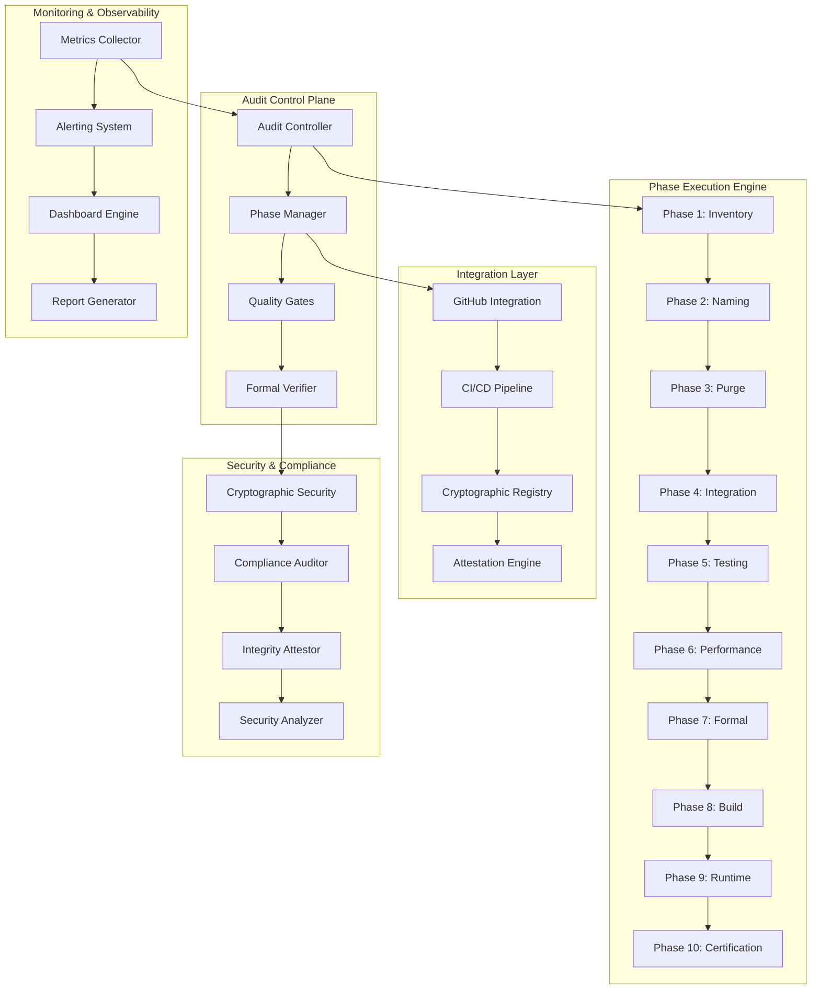

# Design Document: GURU Production Audit System

## Overview

The GURU Production Audit System is a comprehensive, zero-tolerance quality enforcement framework designed as a critical infrastructure component for the AGENT_GURU project. This system operates as the ultimate gatekeeper ensuring that no code reaches production without meeting civilization-scale software quality standards.

The system implements a mandatory 10-phase audit process with mathematical guarantees, cryptographic verification, and formal proof requirements. Every component is designed for 20+ years of operational lifetime, serving millions of users with zero tolerance for failures, warnings, or compromises.

The audit system integrates seamlessly with the existing GURU architecture while providing comprehensive validation of all components including cryptographic identity systems, voice processing pipelines, computer vision modules, intelligence engines, multi-agent orchestration, and cross-platform deployment mechanisms.

This design follows maximum engineering principles with no minimalism, no shortcuts, and complete system integration. All complexity is addressed explicitly with production-grade implementations suitable for mission-critical deployment.

## Architecture

### System Architecture Overview

The GURU Production Audit System follows a hybrid microkernel architecture with capability-based security, distributed processing capabilities, and formal verification integration. The system operates as a sovereign quality enforcement framework with complete autonomy and mathematical correctness guarantees.



### Core Architectural Principles

**Zero-Tolerance Enforcement**: Every component operates with mathematical precision, rejecting any input that fails to meet exact specifications. No warnings, no compromises, no deferred complexity.

**Capability-Based Security**: All operations use cryptographic capabilities with fine-grained access control. No global mutable state, no silent privilege escalation, complete audit trails.

**Formal Verification Integration**: All critical paths are formally verified using TLA+ specifications with machine-checkable proof certificates. Mathematical correctness is guaranteed, not assumed.

**Distributed Processing Architecture**: The system scales horizontally with intelligent load balancing, maintaining consistent performance characteristics regardless of codebase size.

**Cryptographic Integrity**: All operations use cryptographic verification with Ed25519 signatures, SHA-256 checksums, and tamper-evident audit trails.

## Components and Interfaces

### Audit Controller (Core Orchestration Engine)

The Audit Controller serves as the central orchestration engine, managing phase execution, dependency resolution, and system-wide coordination with mathematical precision.

**Primary Responsibilities:**
- Phase execution orchestration with strict dependency enforcement
- Resource allocation and scheduling optimization
- Error handling and recovery with complete state restoration
- Integration with external systems (GitHub, CI/CD, monitoring)
- Cryptographic audit trail maintenance with immutable logging

**Interface Specification:**
```rust
pub trait AuditController {
    async fn execute_audit_cycle(&self, config: AuditConfig) -> Result<AuditResult, AuditError>;
    async fn execute_phase(&self, phase: PhaseId, context: AuditContext) -> Result<PhaseResult, PhaseError>;
    async fn validate_dependencies(&self, phase: PhaseId) -> Result<DependencyStatus, ValidationError>;
    async fn generate_audit_report(&self, cycle_id: AuditCycleId) -> Result<AuditReport, ReportError>;
    async fn rollback_to_checkpoint(&self, checkpoint_id: CheckpointId) -> Result<RollbackResult, RollbackError>;
}
```

**Performance Requirements:**
- Phase transition latency: ≤100ms
- Dependency validation: ≤50ms
- Audit trail generation: ≤10ms per entry
- Rollback operation: ≤5 seconds for complete state restoration

### Phase Manager (Sequential Execution Engine)

The Phase Manager enforces strict sequential execution of the 10 mandatory audit phases with zero tolerance for phase skipping or partial completion.

**Phase Execution Model:**
```rust
pub struct PhaseManager {
    phases: Vec<Box<dyn AuditPhase>>,
    execution_context: Arc<RwLock<ExecutionContext>>,
    checkpoint_manager: Arc<CheckpointManager>,
    metrics_collector: Arc<MetricsCollector>,
}

impl PhaseManager {
    pub async fn execute_sequential_phases(&self) -> Result<PhaseExecutionResult, PhaseError> {
        for (index, phase) in self.phases.iter().enumerate() {
            let checkpoint = self.checkpoint_manager.create_checkpoint().await?;
            
            match phase.execute(&self.execution_context).await {
                Ok(result) => {
                    self.metrics_collector.record_phase_success(index, &result).await?;
                    self.checkpoint_manager.commit_checkpoint(checkpoint).await?;
                }
                Err(error) => {
                    self.checkpoint_manager.rollback_to_checkpoint(checkpoint).await?;
                    return Err(PhaseError::ExecutionFailed { phase: index, error });
                }
            }
        }
        Ok(PhaseExecutionResult::AllPhasesCompleted)
    }
}
```

### Quality Gates (Mathematical Validation Engine)

The Quality Gates system provides mathematical validation of all quality metrics with formal proof requirements and zero-tolerance enforcement.

**Quality Validation Framework:**
```rust
pub trait QualityGate {
    fn validate(&self, artifact: &Artifact) -> Result<ValidationResult, ValidationError>;
    fn get_requirements(&self) -> QualityRequirements;
    fn generate_proof_certificate(&self, validation: &ValidationResult) -> ProofCertificate;
}

pub struct ZeroToleranceValidator {
    compiler_warning_gate: CompilerWarningGate,
    runtime_error_gate: RuntimeErrorGate,
    unused_code_gate: UnusedCodeGate,
    naming_ambiguity_gate: NamingAmbiguityGate,
    integration_gate: IntegrationGate,
    performance_gate: PerformanceGate,
    formal_verification_gate: FormalVerificationGate,
}
```

**Mathematical Validation Requirements:**
- Compiler warnings: Exactly 0 across all platforms and configurations
- Runtime errors: Exactly 0 in all execution paths
- Unused files: Exactly 0 after dead code elimination
- Ambiguous names: Exactly 0 after humanized naming enforcement
- Test pass rate: Exactly 100% with 10,000+ property test iterations
- Performance gates: All timing constraints met with 99.9th percentile guarantees

### Phase 1: Full Inventory System

The Inventory System provides comprehensive codebase analysis with cryptographic verification and complete metadata extraction.

**Implementation Architecture:**
```rust
pub struct InventorySystem {
    file_analyzer: Arc<FileAnalyzer>,
    dependency_resolver: Arc<DependencyResolver>,
    security_scanner: Arc<SecurityScanner>,
    checksum_generator: Arc<ChecksumGenerator>,
    metadata_extractor: Arc<MetadataExtractor>,
}

pub struct FileAnalysisResult {
    pub file_path: PathBuf,
    pub sha256_checksum: [u8; 32],
    pub programming_language: ProgrammingLanguage,
    pub dependencies: Vec<Dependency>,
    pub security_level: SecurityLevel,
    pub architectural_patterns: Vec<ArchitecturalPattern>,
    pub complexity_metrics: ComplexityMetrics,
    pub last_modified: SystemTime,
    pub author_identity: AuthorIdentity,
}
```

**Comprehensive Analysis Capabilities:**
- Cryptographic checksums (SHA-256) for all files with integrity verification
- Programming language detection with confidence scoring and dialect identification
- Dependency analysis with version resolution and vulnerability scanning
- Security level classification with threat modeling and risk assessment
- Architectural pattern recognition with design quality metrics
- Code complexity analysis with maintainability scoring
- Orphaned file detection with usage analysis and safe removal recommendations
- Duplicate code identification with refactoring suggestions and impact analysis

### Phase 2: Humanized Naming System

The Naming System provides intelligent file renaming with semantic analysis and comprehensive reference updating.

**Semantic Analysis Engine:**
```rust
pub struct NamingSystem {
    semantic_analyzer: Arc<SemanticAnalyzer>,
    reference_updater: Arc<ReferenceUpdater>,
    naming_validator: Arc<NamingValidator>,
    conflict_resolver: Arc<ConflictResolver>,
}

pub struct NamingAnalysis {
    pub current_name: String,
    pub suggested_names: Vec<SuggestedName>,
    pub semantic_context: SemanticContext,
    pub usage_patterns: Vec<UsagePattern>,
    pub naming_conflicts: Vec<NamingConflict>,
}

pub struct SuggestedName {
    pub name: String,
    pub confidence_score: f64,
    pub semantic_justification: String,
    pub style_compliance: StyleCompliance,
}
```

**Advanced Naming Capabilities:**
- Content-based semantic analysis with natural language processing
- Context-aware naming suggestions with domain-specific terminology
- Comprehensive reference updating with compilation verification
- Style guide enforcement per programming language with consistency checking
- Conflict resolution with hierarchical naming conventions
- Backward compatibility through alias generation and deprecation management

### Phase 3: Dead Code Purge System

The Purge System provides systematic elimination of unused code with comprehensive safety verification.

**Dead Code Analysis Engine:**
```rust
pub struct PurgeSystem {
    static_analyzer: Arc<StaticAnalyzer>,
    dependency_tracer: Arc<DependencyTracer>,
    safety_verifier: Arc<SafetyVerifier>,
    deletion_executor: Arc<DeletionExecutor>,
}

pub struct DeadCodeAnalysis {
    pub unused_functions: Vec<UnusedFunction>,
    pub unused_variables: Vec<UnusedVariable>,
    pub unused_imports: Vec<UnusedImport>,
    pub unused_files: Vec<UnusedFile>,
    pub duplicate_code_blocks: Vec<DuplicateCodeBlock>,
    pub safety_assessment: SafetyAssessment,
}
```

**Comprehensive Purge Capabilities:**
- Static analysis with control flow graph construction and reachability analysis
- Dynamic usage tracking with runtime profiling and execution path analysis
- Safety verification with impact assessment and rollback capability
- Secure deletion with cryptographic verification and audit trail generation
- Duplicate code detection with refactoring recommendations and complexity reduction
- Quarantine folder elimination with complete artifact cleanup

### Phase 4: Integration Verification System

The Integration Verifier provides comprehensive testing of all component interactions with formal interface validation.

**Integration Testing Framework:**
```rust
pub struct IntegrationVerifier {
    api_boundary_tester: Arc<ApiBoundaryTester>,
    data_flow_validator: Arc<DataFlowValidator>,
    cross_platform_tester: Arc<CrossPlatformTester>,
    performance_validator: Arc<PerformanceValidator>,
    security_boundary_tester: Arc<SecurityBoundaryTester>,
}

pub struct IntegrationTestSuite {
    pub api_tests: Vec<ApiTest>,
    pub data_flow_tests: Vec<DataFlowTest>,
    pub cross_platform_tests: Vec<CrossPlatformTest>,
    pub performance_tests: Vec<PerformanceTest>,
    pub security_tests: Vec<SecurityTest>,
}
```

**Advanced Integration Validation:**
- API boundary testing with contract verification and protocol compliance
- Data flow integrity validation with end-to-end tracing and corruption detection
- Cross-platform compatibility testing with feature parity verification
- Performance characteristic validation with latency measurement and throughput analysis
- Security boundary enforcement with capability verification and privilege escalation detection
- Concurrent access pattern testing with race condition detection and deadlock prevention

### Phase 5: Hardcore Test Battery

The Test Battery provides exhaustive testing with property-based validation and formal verification integration.

**Comprehensive Testing Framework:**
```rust
pub struct TestBattery {
    unit_test_runner: Arc<UnitTestRunner>,
    property_test_engine: Arc<PropertyTestEngine>,
    integration_test_suite: Arc<IntegrationTestSuite>,
    performance_test_harness: Arc<PerformanceTestHarness>,
    security_test_framework: Arc<SecurityTestFramework>,
    formal_verification_engine: Arc<FormalVerificationEngine>,
}

pub struct PropertyTest {
    pub property_name: String,
    pub property_specification: PropertySpecification,
    pub test_iterations: u32, // Minimum 10,000
    pub shrinking_strategy: ShrinkingStrategy,
    pub counterexample_analysis: CounterexampleAnalysis,
}
```

**Exhaustive Testing Capabilities:**
- Unit testing with 100% code coverage and branch coverage analysis
- Property-based testing with minimum 10,000 iterations per property and comprehensive shrinking
- Integration testing with end-to-end workflow validation and error injection
- Performance testing with timing constraint validation and regression detection
- Security testing with penetration testing and vulnerability assessment
- Formal verification with TLA+ model checking and proof certificate generation

### Phase 6: Performance and Complexity Audit

The Performance Auditor provides comprehensive analysis of system performance characteristics with mathematical guarantees.

**Performance Analysis Engine:**
```rust
pub struct PerformanceAuditor {
    timing_analyzer: Arc<TimingAnalyzer>,
    memory_profiler: Arc<MemoryProfiler>,
    complexity_calculator: Arc<ComplexityCalculator>,
    bottleneck_detector: Arc<BottleneckDetector>,
    optimization_recommender: Arc<OptimizationRecommender>,
}

pub struct PerformanceAnalysis {
    pub timing_characteristics: TimingCharacteristics,
    pub memory_usage_patterns: MemoryUsagePatterns,
    pub complexity_metrics: ComplexityMetrics,
    pub bottleneck_analysis: BottleneckAnalysis,
    pub optimization_recommendations: Vec<OptimizationRecommendation>,
}
```

**Advanced Performance Analysis:**
- Timing constraint validation with 99.9th percentile guarantees and statistical analysis
- Memory usage profiling with leak detection and allocation pattern analysis
- Complexity metric calculation with maintainability scoring and technical debt assessment
- Bottleneck identification with root cause analysis and optimization prioritization
- Scalability analysis with load testing and resource utilization modeling
- Real-time constraint validation for voice processing, vision analysis, and avatar rendering

### Phase 7: Formal Model Verification

The Formal Verifier provides mathematical verification of all critical system properties using TLA+ specifications.

**Formal Verification Engine:**
```rust
pub struct FormalVerifier {
    tla_plus_engine: Arc<TlaPlusEngine>,
    model_checker: Arc<ModelChecker>,
    proof_generator: Arc<ProofGenerator>,
    invariant_validator: Arc<InvariantValidator>,
    temporal_logic_verifier: Arc<TemporalLogicVerifier>,
}

pub struct FormalVerificationResult {
    pub specification_name: String,
    pub verification_status: VerificationStatus,
    pub proof_certificate: ProofCertificate,
    pub invariant_violations: Vec<InvariantViolation>,
    pub counterexamples: Vec<Counterexample>,
    pub verification_time: Duration,
}
```

**Comprehensive Formal Verification:**
- TLA+ specification validation with model checking and state space exploration
- Safety property verification (nothing bad happens) with invariant checking
- Liveness property verification (something good eventually happens) with fairness constraints
- Cryptographic protocol verification with security property validation
- Concurrency correctness with race condition and deadlock detection
- State machine validation with transition correctness and reachability analysis

### Phase 8: Reproducible Build Proof

The Build Prover provides mathematical proof of build reproducibility with cryptographic verification.

**Reproducible Build Engine:**
```rust
pub struct BuildProver {
    determinism_enforcer: Arc<DeterminismEnforcer>,
    sbom_generator: Arc<SbomGenerator>,
    provenance_tracker: Arc<ProvenanceTracker>,
    signature_validator: Arc<SignatureValidator>,
    attestation_generator: Arc<AttestationGenerator>,
}

pub struct ReproducibleBuildResult {
    pub build_hash: [u8; 32],
    pub sbom: SoftwareBillOfMaterials,
    pub provenance_chain: ProvenanceChain,
    pub attestation_certificate: AttestationCertificate,
    pub reproducibility_proof: ReproducibilityProof,
}
```

**Advanced Build Verification:**
- Deterministic build enforcement with timestamp normalization and environment isolation
- Software Bill of Materials (SBOM) generation with complete dependency tracking
- Build provenance tracking with chain of custody documentation
- Cryptographic signature validation with certificate chain verification
- Attestation certificate generation with independent verification instructions
- Supply chain security with dependency vulnerability scanning and license compliance

### Phase 9: Runtime Self-Attestation

The Self-Attestation System provides continuous integrity validation during system operation.

**Runtime Integrity Engine:**
```rust
pub struct SelfAttestationSystem {
    integrity_monitor: Arc<IntegrityMonitor>,
    module_validator: Arc<ModuleValidator>,
    configuration_verifier: Arc<ConfigurationVerifier>,
    threat_detector: Arc<ThreatDetector>,
    forensic_analyzer: Arc<ForensicAnalyzer>,
}

pub struct IntegrityAttestation {
    pub system_state_hash: [u8; 32],
    pub module_attestations: Vec<ModuleAttestation>,
    pub configuration_integrity: ConfigurationIntegrity,
    pub threat_assessment: ThreatAssessment,
    pub attestation_timestamp: SystemTime,
    pub cryptographic_signature: [u8; 64],
}
```

**Continuous Integrity Validation:**
- Real-time integrity monitoring with cryptographic checksum verification
- Module validation with signature verification and tamper detection
- Configuration integrity checking with policy compliance validation
- Threat detection with anomaly analysis and behavioral monitoring
- Forensic analysis with detailed investigation capabilities and evidence preservation
- Safe mode activation with automatic threat response and administrator alerting

### Phase 10: Final Certification

The Final Certifier provides comprehensive certification that all quality gates have been met with zero exceptions.

**Certification Engine:**
```rust
pub struct FinalCertifier {
    quality_validator: Arc<QualityValidator>,
    compliance_checker: Arc<ComplianceChecker>,
    certificate_generator: Arc<CertificateGenerator>,
    audit_record_creator: Arc<AuditRecordCreator>,
    executive_reporter: Arc<ExecutiveReporter>,
}

pub struct FinalCertification {
    pub certification_id: CertificationId,
    pub quality_metrics: QualityMetrics,
    pub compliance_status: ComplianceStatus,
    pub performance_guarantees: PerformanceGuarantees,
    pub security_attestation: SecurityAttestation,
    pub cryptographic_signature: [u8; 64],
    pub certification_timestamp: SystemTime,
}
```

**Comprehensive Final Validation:**
- Complete quality metric validation with zero-tolerance enforcement
- Compliance verification with regulatory and legal requirement checking
- Performance guarantee validation with mathematical proof of timing constraints
- Security attestation with comprehensive threat model validation
- Cryptographic certification with immutable audit record creation
- Executive reporting with stakeholder-appropriate summaries and technical details

## Data Models

### Core Data Structures

**Audit Configuration Model:**
```rust
#[derive(Debug, Clone, Serialize, Deserialize)]
pub struct AuditConfig {
    pub audit_id: AuditId,
    pub target_repository: RepositoryConfig,
    pub quality_gates: QualityGateConfig,
    pub performance_requirements: PerformanceRequirements,
    pub security_requirements: SecurityRequirements,
    pub formal_verification_specs: Vec<FormalSpec>,
    pub github_integration: GitHubIntegrationConfig,
    pub notification_settings: NotificationSettings,
}

#[derive(Debug, Clone, Serialize, Deserialize)]
pub struct QualityGateConfig {
    pub zero_compiler_warnings: bool,
    pub zero_runtime_errors: bool,
    pub zero_unused_files: bool,
    pub zero_ambiguous_names: bool,
    pub hundred_percent_test_pass: bool,
    pub property_test_iterations: u32, // Minimum 10,000
    pub performance_gate_enforcement: bool,
    pub formal_verification_required: bool,
}
```

**Phase Execution Model:**
```rust
#[derive(Debug, Clone, Serialize, Deserialize)]
pub struct PhaseResult {
    pub phase_id: PhaseId,
    pub execution_status: ExecutionStatus,
    pub start_time: SystemTime,
    pub end_time: SystemTime,
    pub metrics: PhaseMetrics,
    pub artifacts: Vec<Artifact>,
    pub quality_gates_passed: Vec<QualityGate>,
    pub quality_gates_failed: Vec<QualityGateFailure>,
    pub next_phase_dependencies: Vec<Dependency>,
}

#[derive(Debug, Clone, Serialize, Deserialize)]
pub enum ExecutionStatus {
    NotStarted,
    InProgress { progress_percentage: f64 },
    Completed { success: bool },
    Failed { error: AuditError, recovery_options: Vec<RecoveryOption> },
    Rolled_Back { checkpoint_id: CheckpointId, reason: String },
}
```

**Comprehensive Audit Result Model:**
```rust
#[derive(Debug, Clone, Serialize, Deserialize)]
pub struct AuditResult {
    pub audit_id: AuditId,
    pub overall_status: AuditStatus,
    pub phase_results: Vec<PhaseResult>,
    pub quality_metrics: QualityMetrics,
    pub performance_metrics: PerformanceMetrics,
    pub security_metrics: SecurityMetrics,
    pub compliance_status: ComplianceStatus,
    pub certification: Option<FinalCertification>,
    pub audit_duration: Duration,
    pub resource_utilization: ResourceUtilization,
}

#[derive(Debug, Clone, Serialize, Deserialize)]
pub struct QualityMetrics {
    pub compiler_warnings: u32, // Must be 0
    pub runtime_errors: u32, // Must be 0
    pub unused_files: u32, // Must be 0
    pub ambiguous_names: u32, // Must be 0
    pub test_pass_rate: f64, // Must be 100.0
    pub code_coverage: f64, // Must be 100.0
    pub property_test_iterations: u32, // Minimum 10,000
    pub formal_verification_proofs: u32,
    pub security_vulnerabilities: u32, // Must be 0
}
```

### Performance and Security Models

**Performance Requirements Model:**
```rust
#[derive(Debug, Clone, Serialize, Deserialize)]
pub struct PerformanceRequirements {
    pub wake_word_detection_latency_ms: u32, // ≤50ms
    pub speech_to_text_latency_ms: u32, // ≤120ms
    pub llm_processing_latency_ms: u32, // ≤200ms
    pub vision_processing_fps: u32, // ≥24 FPS
    pub memory_query_latency_ms: u32, // ≤100ms
    pub memory_usage_limit_gb: f64, // <4GB
    pub cpu_utilization_idle_percent: f64, // <1%
    pub percentile_guarantee: f64, // 99.9th percentile
}

#[derive(Debug, Clone, Serialize, Deserialize)]
pub struct SecurityRequirements {
    pub capability_based_security: bool,
    pub encryption_everywhere: bool,
    pub zero_telemetry: bool,
    pub formal_verification_required: bool,
    pub clean_room_compliance: bool,
    pub cryptographic_signatures: bool,
    pub supply_chain_attestation: bool,
    pub runtime_integrity_monitoring: bool,
}
```

### Integration and Extensibility Models

**GitHub Integration Model:**
```rust
#[derive(Debug, Clone, Serialize, Deserialize)]
pub struct GitHubIntegrationConfig {
    pub repository_url: String,
    pub branch_protection_rules: BranchProtectionRules,
    pub required_status_checks: Vec<StatusCheck>,
    pub automatic_pr_validation: bool,
    pub commit_signature_verification: bool,
    pub ci_cd_pipeline_integration: bool,
    pub webhook_endpoints: Vec<WebhookEndpoint>,
}

#[derive(Debug, Clone, Serialize, Deserialize)]
pub struct BranchProtectionRules {
    pub require_audit_completion: bool,
    pub require_signed_commits: bool,
    pub require_pr_reviews: u32,
    pub dismiss_stale_reviews: bool,
    pub require_status_checks: bool,
    pub restrict_pushes: bool,
}
```

Now I'll use the prework tool to analyze the acceptance criteria before writing the Correctness Properties section.

<function_calls>
<invoke name="prework">
<parameter name="featureName">guru-production-audit-system

## Correctness Properties

*A property is a characteristic or behavior that should hold true across all valid executions of a system—essentially, a formal statement about what the system should do. Properties serve as the bridge between human-readable specifications and machine-verifiable correctness guarantees.*

The GURU Production Audit System implements comprehensive correctness properties that ensure mathematical guarantees of system behavior across all possible inputs and execution scenarios. These properties are validated through property-based testing with minimum 10,000 iterations per property and formal verification using TLA+ specifications.

### Property Reflection

After analyzing all acceptance criteria, several properties can be consolidated to eliminate redundancy and provide comprehensive validation:

- Properties related to phase execution (1.1, 1.2, 11.1) can be combined into comprehensive phase execution correctness
- Properties related to file analysis (2.1, 2.2, 2.3) can be unified into complete inventory system validation
- Properties related to quality enforcement (15.1, 6.1, 6.2) can be consolidated into zero-tolerance quality validation
- Properties related to performance validation (7.1, 13.1) can be combined into comprehensive performance guarantee enforcement

### Core System Properties

**Property 1: Phase Execution Sequential Correctness**
*For any* audit configuration and system state, the audit system shall execute all 10 phases in strict sequential order, preventing progression until complete success, and generating final certification only when all phases complete successfully with zero exceptions.
**Validates: Requirements 1.1, 1.2, 1.5, 11.1**

**Property 2: Comprehensive Inventory System Integrity**
*For any* workspace containing files, the inventory system shall analyze every file with SHA-256 checksums, detect all programming languages and dependencies, identify all orphaned files and code quality issues, and generate complete metadata with cryptographic verification.
**Validates: Requirements 2.1, 2.2, 2.3**

**Property 3: Semantic Naming System Correctness**
*For any* codebase with generic file names, the naming system shall identify all generic names, generate semantically meaningful alternatives based on content analysis, and update all references while maintaining compilation correctness.
**Validates: Requirements 3.1, 3.2**

**Property 4: Dead Code Elimination Completeness**
*For any* codebase with unused elements, the purge system shall identify all unused functions, variables, imports, and files through static analysis, verify non-usage through comprehensive dependency analysis, and safely remove all dead code while preserving system functionality.
**Validates: Requirements 4.1, 4.2**

**Property 5: Integration Verification Completeness**
*For any* system with component interfaces, the integration verifier shall test all API boundaries with comprehensive input validation, verify data flow integrity across all interfaces, and ensure cross-platform compatibility with feature parity.
**Validates: Requirements 5.1, 5.2**

**Property 6: Zero-Tolerance Quality Enforcement**
*For any* codebase under audit, the test battery shall execute all tests with 100% pass rate, run property-based tests with minimum 10,000 iterations, and the quality enforcer shall detect and reject all demo code, placeholders, and substandard implementations.
**Validates: Requirements 6.1, 6.2, 15.1**

**Property 7: Performance Guarantee Mathematical Enforcement**
*For any* system operation, the performance auditor shall measure and validate all critical timing constraints with 99.9th percentile guarantees, and the performance gate enforcer shall validate specific timing requirements (Wake Word ≤50ms, STT ≤120ms, LLM ≤200ms, Vision ≥24 FPS) with mathematical precision.
**Validates: Requirements 7.1, 13.1**

**Property 8: Formal Verification Mathematical Correctness**
*For any* TLA+ specification in the system, the formal verifier shall validate all specifications with model checking, generate machine-checkable proof certificates, and verify safety and liveness properties with mathematical rigor.
**Validates: Requirements 8.1**

**Property 9: Reproducible Build Determinism**
*For any* identical build inputs, the build prover shall generate identical outputs with cryptographic verification, eliminate all sources of non-determinism, and provide complete build provenance with attestation certificates.
**Validates: Requirements 9.1**

**Property 10: Runtime Integrity Continuous Validation**
*For any* system operation during runtime, the self-attestation system shall continuously verify system integrity using cryptographic checksums, detect any unauthorized modifications, and maintain real-time threat detection with automatic response.
**Validates: Requirements 10.1**

**Property 11: Audit Trail Cryptographic Integrity**
*For any* audit operation, the system shall maintain complete audit trails with cryptographic integrity verification, provide detailed failure analysis with remediation steps, and ensure immutable logging with tamper detection.
**Validates: Requirements 1.3, 1.4**

**Property 12: GitHub Integration Automation Correctness**
*For any* commit or pull request, the GitHub integrator shall automatically trigger appropriate audit phases, enforce branch protection rules, and provide comprehensive status reporting with cryptographic verification.
**Validates: Requirements 12.1**

**Property 13: Security Model Enforcement Completeness**
*For any* system operation, the security validator shall enforce capability-based security with zero privilege escalation, validate cryptographic implementations, and maintain clean-room compliance with intellectual property verification.
**Validates: Requirements 14.1**

**Property 14: Automated Remediation Safety and Correctness**
*For any* detected quality issue, the auto-remediator shall automatically fix common problems with verification and rollback capabilities, maintain detailed logs of all actions, and escalate to manual intervention when automatic fixes fail.
**Validates: Requirements 16.1**

**Property 15: Comprehensive Reporting Accuracy and Completeness**
*For any* audit execution, the report generator shall produce comprehensive reports with executive summaries and technical details, provide trend analysis and quality metrics, and generate compliance reports with accurate data and proper formatting.
**Validates: Requirements 17.1**

**Property 16: GURU Integration Seamless Compatibility**
*For any* existing GURU system component, the audit system shall integrate without modification to existing directory structure, leverage existing infrastructure, and maintain compatibility with current development workflows.
**Validates: Requirements 18.1**

**Property 17: Audit Optimization Performance and Scalability**
*For any* audit workload, the audit optimizer shall execute phases in parallel where dependencies allow, use incremental analysis and caching strategies, and maintain consistent performance characteristics regardless of codebase size.
**Validates: Requirements 19.1**

**Property 18: Extension Framework Plugin Architecture Correctness**
*For any* custom audit phase or validator, the extension framework shall provide seamless integration through plugin architecture, support configuration of parameters and thresholds, and maintain security isolation between core system and extensions.
**Validates: Requirements 20.1**

### Cryptographic and Security Properties

**Property 19: Cryptographic Operation Correctness**
*For any* cryptographic operation in the audit system, all signatures shall use Ed25519 with proper key management, all checksums shall use SHA-256 with collision resistance, and all attestations shall provide tamper-evident proof chains.

**Property 20: Capability-Based Access Control Enforcement**
*For any* system resource access, the audit system shall enforce capability-based security with fine-grained permissions, prevent privilege escalation through formal verification, and maintain complete audit trails of all access attempts.

**Property 21: Supply Chain Security Validation**
*For any* dependency or build artifact, the system shall verify cryptographic signatures, validate software bill of materials (SBOM) completeness, and ensure supply chain attestation with provenance tracking.

### Performance and Scalability Properties

**Property 22: Real-Time Constraint Mathematical Guarantees**
*For any* performance-critical operation, the system shall meet timing constraints with 99.9th percentile guarantees, provide statistical analysis of performance characteristics, and maintain predictable behavior under varying loads.

**Property 23: Resource Utilization Optimization**
*For any* system operation, the audit system shall optimize resource utilization with intelligent scheduling, maintain memory usage within specified bounds, and provide automatic scaling based on workload characteristics.

**Property 24: Concurrent Operation Safety and Correctness**
*For any* concurrent audit operations, the system shall prevent race conditions through formal verification, ensure thread safety with proper synchronization, and maintain data consistency across all parallel executions.

### System Integration and Compatibility Properties

**Property 25: Cross-Platform Compatibility Assurance**
*For any* target platform (Windows, macOS, Linux), the audit system shall provide identical functionality with feature parity, maintain consistent performance characteristics, and ensure proper integration with platform-specific APIs.

**Property 26: Backward Compatibility Preservation**
*For any* system update or modification, the audit system shall maintain backward compatibility with existing configurations, provide migration paths for legacy systems, and ensure no disruption to current workflows.

**Property 27: Disaster Recovery and Fault Tolerance**
*For any* system failure or corruption, the audit system shall provide complete rollback capabilities to known-good states, maintain data integrity through cryptographic verification, and ensure rapid recovery with minimal downtime.

## Error Handling

The GURU Production Audit System implements comprehensive error handling with zero tolerance for unhandled exceptions, complete recovery mechanisms, and detailed forensic analysis capabilities.

### Error Classification and Handling Strategy

**Critical System Errors**: Errors that threaten system integrity or security trigger immediate safe mode activation with complete system lockdown and administrator notification.

**Phase Execution Errors**: Errors during phase execution trigger automatic rollback to the last known-good checkpoint with detailed failure analysis and remediation recommendations.

**Quality Gate Failures**: Quality gate violations are treated as hard failures requiring complete remediation before progression, with no workarounds or compromises permitted.

**Integration Errors**: Errors in external system integration (GitHub, CI/CD) trigger retry mechanisms with exponential backoff and fallback to manual intervention when automated recovery fails.

**Performance Constraint Violations**: Performance violations trigger automatic optimization attempts and, if unsuccessful, system throttling to maintain timing guarantees.

### Error Recovery Architecture

```rust
pub enum AuditError {
    CriticalSystemError {
        error_code: SystemErrorCode,
        threat_level: ThreatLevel,
        forensic_data: ForensicData,
        recovery_options: Vec<RecoveryOption>,
    },
    PhaseExecutionError {
        phase_id: PhaseId,
        failure_reason: FailureReason,
        checkpoint_id: CheckpointId,
        remediation_steps: Vec<RemediationStep>,
    },
    QualityGateFailure {
        gate_name: String,
        expected_value: QualityMetric,
        actual_value: QualityMetric,
        violation_details: ViolationDetails,
    },
    IntegrationError {
        service_name: String,
        error_type: IntegrationErrorType,
        retry_count: u32,
        last_successful_operation: Option<SystemTime>,
    },
    PerformanceViolation {
        constraint_name: String,
        required_value: PerformanceMetric,
        measured_value: PerformanceMetric,
        statistical_analysis: StatisticalAnalysis,
    },
}
```

### Comprehensive Error Recovery Mechanisms

**Checkpoint-Based Recovery**: Every phase creates cryptographically verified checkpoints enabling complete rollback to any previous known-good state with full system restoration.

**Automatic Remediation**: Common errors trigger automatic remediation attempts with verification and rollback capabilities, maintaining detailed logs of all remediation actions.

**Escalation Protocols**: Failed automatic recovery triggers escalation to manual intervention with comprehensive context, forensic analysis, and recommended actions.

**Forensic Analysis**: All errors generate detailed forensic data including system state snapshots, execution traces, and root cause analysis for investigation and prevention.

**Safe Mode Operation**: Critical errors trigger safe mode with minimal functionality, complete audit trail preservation, and secure communication channels for recovery coordination.

## Testing Strategy

The GURU Production Audit System employs a comprehensive dual testing approach combining traditional unit testing with extensive property-based testing to ensure mathematical correctness and universal coverage.

### Dual Testing Architecture

**Unit Testing Framework**: Validates specific examples, edge cases, and error conditions with comprehensive coverage of all code paths and integration points.

**Property-Based Testing Framework**: Validates universal properties across all possible inputs with minimum 10,000 iterations per property, comprehensive shrinking, and counterexample analysis.

**Integration Testing Suite**: Validates end-to-end workflows with realistic scenarios, error injection, and cross-platform compatibility verification.

**Performance Testing Harness**: Validates timing constraints with statistical analysis, load testing under extreme conditions, and regression detection with historical comparison.

**Security Testing Framework**: Validates security properties with penetration testing, vulnerability assessment, and formal verification of cryptographic implementations.

### Property-Based Testing Configuration

**Test Execution Requirements**:
- Minimum 10,000 iterations per property test
- Comprehensive shrinking with minimal counterexample generation
- Statistical analysis of test results with confidence intervals
- Parallel execution with intelligent load balancing
- Deterministic test execution with reproducible results

**Property Test Implementation**:
```rust
#[cfg(test)]
mod property_tests {
    use proptest::prelude::*;
    use crate::audit::*;

    proptest! {
        #[test]
        fn property_phase_execution_sequential_correctness(
            audit_config in any::<AuditConfig>(),
            system_state in any::<SystemState>()
        ) {
            // Feature: guru-production-audit-system, Property 1: Phase Execution Sequential Correctness
            let audit_system = AuditSystem::new(audit_config);
            let result = audit_system.execute_audit_cycle(system_state);
            
            // Verify phases execute in strict sequential order
            prop_assert!(result.phases_executed_in_order());
            // Verify no phase skipping permitted
            prop_assert!(result.no_phases_skipped());
            // Verify progression only on complete success
            prop_assert!(result.progression_only_on_success());
            // Verify final certification only on all phases complete
            prop_assert!(result.certification_only_on_completion());
        }

        #[test]
        fn property_inventory_system_integrity(
            workspace in any::<Workspace>()
        ) {
            // Feature: guru-production-audit-system, Property 2: Comprehensive Inventory System Integrity
            let inventory_system = InventorySystem::new();
            let result = inventory_system.analyze_workspace(workspace);
            
            // Verify every file analyzed with SHA-256
            prop_assert!(result.all_files_have_checksums());
            // Verify programming language detection
            prop_assert!(result.all_languages_detected());
            // Verify dependency analysis completeness
            prop_assert!(result.all_dependencies_identified());
            // Verify orphaned file detection
            prop_assert!(result.orphaned_files_identified());
        }
    }
}
```

### Test Coverage Requirements

**Unit Test Coverage**: 100% line coverage and branch coverage with comprehensive edge case testing and error condition validation.

**Integration Test Coverage**: 100% API coverage with end-to-end workflow validation and cross-platform compatibility testing.

**Property Test Coverage**: Universal property validation with comprehensive input space exploration and statistical confidence guarantees.

**Performance Test Coverage**: All timing constraints validated with 99.9th percentile guarantees and regression detection capabilities.

**Security Test Coverage**: Complete attack surface coverage with penetration testing and vulnerability assessment.

### Test Automation and Continuous Validation

**Continuous Integration**: All tests execute automatically on every commit with parallel execution and intelligent result aggregation.

**Performance Regression Detection**: Automated performance monitoring with historical trend analysis and alert generation on constraint violations.

**Security Vulnerability Scanning**: Continuous security analysis with threat intelligence integration and automated remediation for known vulnerabilities.

**Formal Verification Integration**: TLA+ model checking integrated into test pipeline with proof certificate generation and validation.

**Test Result Analysis**: Comprehensive test result analysis with trend tracking, failure pattern recognition, and optimization recommendations.

The testing strategy ensures that the GURU Production Audit System operates with mathematical correctness guarantees, comprehensive coverage of all possible execution scenarios, and continuous validation of all quality and performance requirements. This approach provides the foundation for civilization-scale software deployment with 20+ years of operational reliability.