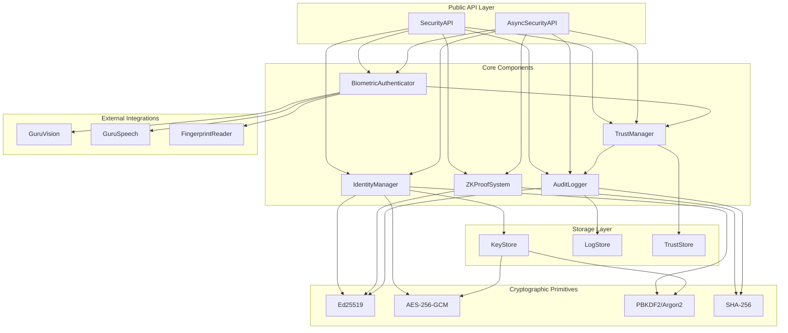

# Design Document: Core Security & Cryptography

## Overview

The Core Security & Cryptography system is a Python-based security foundation for AGENT_GURU. It provides five core capabilities:

1. **Cryptographic Identity Management**: Ed25519 key pair generation, secure storage, and lifecycle management
2. **Biometric Authentication**: Multi-modal biometric verification (face, voice, fingerprint) with confidence scoring
3. **Zero-Knowledge Proofs**: Privacy-preserving identity verification using zk-SNARKs
4. **Audit Logging**: Immutable, cryptographically-signed security event logs
5. **Trust Management**: Dynamic trust scoring and relationship graph management

The system is designed with security-first principles: all keys encrypted at rest, constant-time operations for sensitive comparisons, no secrets in logs, and comprehensive error handling that doesn't leak information.

## Integration Points

This system serves as the CENTRAL SECURITY LAYER for AGENT_GURU. All security-related operations must go through this system.

### Dependencies

**Upstream Dependencies** (systems this component depends on):
- **GuruVision** (guruvision-facial-recognition): Face detection and embedding extraction
- **guru_speech** (guru-speech-engine): Voice feature extraction
- **Platform Integration** (guru-platform-integration): Platform-specific fingerprint readers

**Downstream Dependencies** (systems that depend on this component):
- **Policy Engine** (guru-policy-engine): Uses TrustManager for trust-based policies
- **LLM Runtime** (guru-llm-runtime): Uses IdentityManager for API key management
- **Deployment System** (guru-deployment-system): Uses cryptographic verification
- **All other systems**: Use BiometricAuthenticator for user authentication

### API Contracts

**GuruVision Integration:**
```python
class GuruVisionClient:
    """Client interface for GuruVision face recognition."""
    
    def extract_face_embedding(self, image_data: bytes) -> np.ndarray:
        """Extract 512-dimensional face embedding."""
        pass
    
    def detect_faces(self, image_data: bytes) -> List[FaceDetection]:
        """Detect faces in image."""
        pass
```

**guru_speech Integration:**
```python
class GuruSpeechClient:
    """Client interface for guru_speech voice processing."""
    
    def extract_voice_features(self, audio_data: bytes) -> np.ndarray:
        """Extract voice biometric features."""
        pass
```

**Policy Engine Integration:**
```python
# Policy engine queries trust scores for access control
trust_score = trust_manager.compute_trust_score(profile_id)

# Policy engine evaluates trust-based policies
policy_decision = policy_engine.evaluate_trust_policy(
    profile_id=profile_id,
    trust_score=trust_score,
    required_level=0.7
)
```

### Data Flow

1. **Biometric Authentication Flow:**
   - User provides biometric data (face/voice/fingerprint)
   - BiometricAuthenticator receives raw data
   - Delegates to GuruVision/guru_speech for feature extraction
   - Performs matching against stored templates
   - Updates TrustManager with authentication result
   - Logs event to AuditLogger
   - Returns authentication result

2. **Trust-Based Access Control Flow:**
   - Application requests access for identity
   - TrustManager computes trust score
   - Trust score passed to Policy Engine
   - Policy Engine evaluates trust-based policy
   - AuditLogger records decision
   - Access granted/denied

## Architecture

### High-Level Architecture



### Design Principles

1. **Defense in Depth**: Multiple layers of security (encryption at rest, secure memory handling, audit logging)
2. **Fail Secure**: All error paths default to denying access and logging the attempt
3. **Privacy by Design**: ZK proofs and minimal information disclosure in errors
4. **Performance**: All operations meet strict performance targets through efficient algorithms
5. **Testability**: Deterministic test mode for reproducible testing without compromising production security

## Components and Interfaces

### 1. IdentityManager

Manages cryptographic identities and key lifecycle.

```python
from typing import Optional, Dict
from dataclasses import dataclass
from datetime import datetime

@dataclass
class KeyPair:
    """Ed25519 key pair."""
    public_key: bytes  # 32 bytes
    private_key: bytes  # 64 bytes (includes public key)
    created_at: datetime
    deprecated_at: Optional[datetime] = None

@dataclass
class IdentityProfile:
    """Named identity with associated keys."""
    profile_id: str
    name: str
    key_pair: KeyPair
    metadata: Dict[str, str]

class IdentityManager:
    """Manages cryptographic identities."""
    
    def __init__(self, key_store: 'KeyStore', audit_logger: 'AuditLogger'):
        self._key_store = key_store
        self._audit_logger = audit_logger
    
    def create_identity(self, profile_name: str) -> IdentityProfile:
        """
        Generate a new identity with Ed25519 key pair.
        
        Performance: <100ms
        
        Args:
            profile_name: Human-readable name for the identity
            
        Returns:
            IdentityProfile with generated keys
            
        Raises:
            SecurityError: If key generation fails
        """
        pass
    
    def rotate_key(self, profile_id: str) -> KeyPair:
        """
        Generate new key pair and deprecate old one.
        
        Args:
            profile_id: Identity to rotate
            
        Returns:
            New KeyPair
            
        Raises:
            SecurityError: If rotation fails
            IdentityNotFoundError: If profile doesn't exist
        """
        pass
    
    def derive_key(self, master_key: bytes, context: str, index: int) -> bytes:
        """
        Derive child key from master key using KDF.
        
        Uses PBKDF2 with 100,000+ iterations or Argon2.
        
        Args:
            master_key: Master key material
            context: Derivation context (e.g., "signing", "encryption")
            index: Child key index
            
        Returns:
            Derived key bytes
        """
        pass
    
    def sign(self, profile_id: str, message: bytes) -> bytes:
        """
        Sign message with identity's private key.
        
        Performance: <10ms
        
        Args:
            profile_id: Identity to sign with
            message: Message to sign
            
        Returns:
            Ed25519 signature (64 bytes)
            
        Raises:
            SecurityError: If signing fails
            IdentityNotFoundError: If profile doesn't exist
        """
        pass
    
    def verify(self, public_key: bytes, message: bytes, signature: bytes) -> bool:
        """
        Verify Ed25519 signature.
        
        Performance: <10ms
        
        Args:
            public_key: Public key (32 bytes)
            message: Original message
            signature: Signature to verify (64 bytes)
            
        Returns:
            True if signature is valid
        """
        pass
    
    def get_identity(self, profile_id: str) -> IdentityProfile:
        """Retrieve identity profile."""
        pass
    
    def list_identities(self) -> list[IdentityProfile]:
        """List all identity profiles."""
        pass

### 2. KeyStore

Secure storage for cryptographic keys with encryption at rest.

```python
from typing import Optional
import secrets

class KeyStore:
    """Encrypted key storage."""
    
    def __init__(self, storage_path: str, master_password: str):
        """
        Initialize key store.
        
        Args:
            storage_path: Path to encrypted key database
            master_password: Password for key encryption
        """
        self._storage_path = storage_path
        self._encryption_key = self._derive_encryption_key(master_password)
    
    def store_key(self, key_id: str, key_material: bytes) -> None:
        """
        Store key encrypted with AES-256-GCM.
        
        Args:
            key_id: Unique identifier for the key
            key_material: Key bytes to store
            
        Raises:
            SecurityError: If encryption or storage fails
        """
        pass
    
    def retrieve_key(self, key_id: str) -> bytes:
        """
        Retrieve and decrypt key.
        
        Key is decrypted in memory only, never written to disk.
        
        Args:
            key_id: Key identifier
            
        Returns:
            Decrypted key material
            
        Raises:
            KeyNotFoundError: If key doesn't exist
            SecurityError: If decryption fails
        """
        pass
    
    def delete_key(self, key_id: str) -> None:
        """
        Securely delete key.
        
        Zeros memory before deletion.
        
        Args:
            key_id: Key to delete
        """
        pass
    
    def _derive_encryption_key(self, password: str) -> bytes:
        """
        Derive encryption key from password using PBKDF2.
        
        Uses 100,000+ iterations with random salt.
        """
        pass
    
    def _secure_zero(self, data: bytearray) -> None:
        """Zero memory to prevent key material leakage."""
        pass

### 3. BiometricAuthenticator

Multi-modal biometric authentication with confidence scoring. This is the ONLY biometric authentication interface in the system - all other components (GuruVision, guru_speech) provide feature extraction only and integrate through this interface.

**Integration Points:**
- **GuruVision**: Provides face detection and embedding extraction
- **guru_speech**: Provides voice feature extraction
- **Fingerprint Reader**: Platform-specific fingerprint capture

```python
from enum import Enum
from typing import Optional, List
from dataclasses import dataclass

class BiometricType(Enum):
    FACE = "face"
    VOICE = "voice"
    FINGERPRINT = "fingerprint"

@dataclass
class BiometricResult:
    """Result of biometric verification."""
    success: bool
    confidence: float  # 0.0 to 1.0
    biometric_type: BiometricType
    error_message: Optional[str] = None

@dataclass
class FusedBiometricResult:
    """Result of multi-factor biometric fusion."""
    success: bool
    fused_confidence: float  # 0.0 to 1.0
    individual_results: List[BiometricResult]

class BiometricAuthenticator:
    """Multi-modal biometric authentication - CENTRAL AUTHENTICATION INTERFACE."""
    
    def __init__(
        self,
        guruvision_client: 'GuruVisionClient',
        guru_speech_client: 'GuruSpeechClient',
        fingerprint_reader: Optional['FingerprintReader'],
        trust_manager: 'TrustManager'
    ):
        """
        Initialize biometric authenticator with feature extraction clients.
        
        Args:
            guruvision_client: Face detection and embedding extraction
            guru_speech_client: Voice feature extraction
            fingerprint_reader: Platform-specific fingerprint capture
            trust_manager: Trust scoring and policy evaluation
        """
        self._guruvision = guruvision_client
        self._guru_speech = guru_speech_client
        self._fingerprint = fingerprint_reader
        self._trust_manager = trust_manager
    
    def authenticate_face(self, profile_id: str, image_data: bytes) -> BiometricResult:
        """
        Authenticate using face recognition.
        
        Delegates to GuruVision for embedding extraction, performs authentication here.
        
        Performance: <500ms
        
        Args:
            profile_id: Identity to verify
            image_data: Face image (JPEG/PNG)
            
        Returns:
            BiometricResult with confidence score
        """
        pass
    
    def authenticate_voice(self, profile_id: str, audio_data: bytes) -> BiometricResult:
        """
        Authenticate using voice biometrics.
        
        Delegates to guru_speech for feature extraction, performs authentication here.
        
        Performance: <500ms
        
        Args:
            profile_id: Identity to verify
            audio_data: Voice sample (WAV/MP3)
            
        Returns:
            BiometricResult with confidence score
        """
        pass
    
    def authenticate_fingerprint(self, profile_id: str) -> BiometricResult:
        """
        Authenticate using fingerprint.
        
        Performance: <500ms
        
        Args:
            profile_id: Identity to verify
            
        Returns:
            BiometricResult with confidence score
        """
        pass
    
    def authenticate_multi_factor(
        self,
        profile_id: str,
        face_image: Optional[bytes] = None,
        voice_audio: Optional[bytes] = None,
        use_fingerprint: bool = False
    ) -> FusedBiometricResult:
        """
        Authenticate using multiple biometric factors.
        
        Computes weighted fusion of available factors.
        
        Args:
            profile_id: Identity to verify
            face_image: Optional face image
            voice_audio: Optional voice sample
            use_fingerprint: Whether to use fingerprint
            
        Returns:
            FusedBiometricResult with combined confidence
        """
        pass
    
    def enroll_biometric(
        self,
        profile_id: str,
        biometric_type: BiometricType,
        biometric_data: bytes
    ) -> bool:
        """
        Enroll biometric template for an identity.
        
        Extracts features and stores encrypted template.
        
        Args:
            profile_id: Identity to enroll
            biometric_type: Type of biometric
            biometric_data: Raw biometric data (image/audio/fingerprint)
            
        Returns:
            True if enrollment successful
        """
        pass
    
    def _compute_fused_score(self, results: List[BiometricResult]) -> float:
        """
        Compute weighted fusion of biometric scores.
        
        Weights based on reliability:
        - Face: 0.4
        - Voice: 0.3
        - Fingerprint: 0.3
        """
        pass

### 4. ZKProofSystem

Zero-knowledge proof generation and verification.

```python
from dataclasses import dataclass
from datetime import datetime
from typing import Dict, Any

@dataclass
class ZKProof:
    """Zero-knowledge proof."""
    proof_data: bytes
    public_inputs: Dict[str, Any]
    timestamp: datetime
    proof_type: str  # "zk-snark", etc.

@dataclass
class IdentityClaim:
    """Claim about an identity."""
    claim_type: str  # "age_over_18", "has_credential", etc.
    claim_value: Any
    profile_id: str

class ZKProofSystem:
    """Zero-knowledge proof generation and verification."""
    
    def __init__(self, identity_manager: 'IdentityManager'):
        self._identity_manager = identity_manager
    
    def generate_proof(self, claim: IdentityClaim) -> ZKProof:
        """
        Generate zero-knowledge proof for identity claim.
        
        Proves claim without revealing identity or private key.
        
        Args:
            claim: Identity claim to prove
            
        Returns:
            ZKProof that can be verified
            
        Raises:
            SecurityError: If proof generation fails
        """
        pass
    
    def verify_proof(self, proof: ZKProof, expected_claim_type: str) -> bool:
        """
        Verify zero-knowledge proof.
        
        Performance: <100ms
        
        Args:
            proof: Proof to verify
            expected_claim_type: Expected type of claim
            
        Returns:
            True if proof is valid and not replayed
            
        Raises:
            SecurityError: If verification fails
            ReplayAttackError: If timestamp indicates replay
        """
        pass
    
    def _check_replay(self, proof: ZKProof) -> bool:
        """Check if proof timestamp indicates replay attack."""
        pass

### 5. AuditLogger

Immutable audit logging with cryptographic signatures.

```python
from enum import Enum
from dataclasses import dataclass
from datetime import datetime
from typing import Optional, List, Dict, Any

class EventType(Enum):
    KEY_GENERATED = "key_generated"
    KEY_ROTATED = "key_rotated"
    AUTHENTICATION_SUCCESS = "authentication_success"
    AUTHENTICATION_FAILURE = "authentication_failure"
    ZK_PROOF_GENERATED = "zk_proof_generated"
    ZK_PROOF_VERIFIED = "zk_proof_verified"
    TRUST_RELATIONSHIP_CREATED = "trust_relationship_created"
    TRUST_RELATIONSHIP_REVOKED = "trust_relationship_revoked"
    POLICY_VIOLATION = "policy_violation"

@dataclass
class AuditLogEntry:
    """Immutable audit log entry."""
    entry_id: str
    timestamp: datetime
    event_type: EventType
    actor_id: Optional[str]  # Identity that performed action
    target_id: Optional[str]  # Identity affected by action
    outcome: str  # "success", "failure", "denied"
    details: Dict[str, Any]
    signature: bytes  # Ed25519 signature of entry
    tampered: bool = False  # Set to True if signature verification fails

@dataclass
class LogQuery:
    """Query parameters for audit logs."""
    start_time: Optional[datetime] = None
    end_time: Optional[datetime] = None
    event_types: Optional[List[EventType]] = None
    actor_id: Optional[str] = None
    target_id: Optional[str] = None
    outcome: Optional[str] = None

class AuditLogger:
    """Immutable audit logging with cryptographic signatures."""
    
    def __init__(self, log_store: 'LogStore', identity_manager: 'IdentityManager'):
        self._log_store = log_store
        self._identity_manager = identity_manager
        self._system_profile_id = "system"  # System identity for signing logs
    
    def log_event(
        self,
        event_type: EventType,
        actor_id: Optional[str],
        target_id: Optional[str],
        outcome: str,
        details: Dict[str, Any]
    ) -> AuditLogEntry:
        """
        Log security event with cryptographic signature.
        
        Performance: <50ms
        
        Args:
            event_type: Type of security event
            actor_id: Identity performing action
            target_id: Identity affected by action
            outcome: Result of action
            details: Additional event details (sanitized)
            
        Returns:
            Signed AuditLogEntry
            
        Raises:
            SecurityError: If logging fails
        """
        pass
    
    def query_logs(self, query: LogQuery) -> List[AuditLogEntry]:
        """
        Query audit logs with filters.
        
        Verifies signatures and marks tampered entries.
        
        Args:
            query: Query parameters
            
        Returns:
            List of matching log entries
        """
        pass
    
    def export_logs(self, query: LogQuery, format: str = "json") -> str:
        """
        Export audit logs in structured format.
        
        Args:
            query: Query parameters
            format: Export format ("json" or "csv")
            
        Returns:
            Formatted log data
        """
        pass
    
    def verify_log_integrity(self, entry: AuditLogEntry) -> bool:
        """
        Verify cryptographic signature of log entry.
        
        Returns:
            True if signature is valid
        """
        pass
    
    def _sanitize_details(self, details: Dict[str, Any]) -> Dict[str, Any]:
        """Remove secrets and sensitive data from log details."""
        pass

### 6. TrustManager

Dynamic trust scoring and relationship management.

```python
from dataclasses import dataclass
from typing import List, Dict, Optional
from datetime import datetime

@dataclass
class TrustRelationship:
    """Trust relationship between two identities."""
    from_id: str
    to_id: str
    trust_level: float  # 0.0 to 1.0
    created_at: datetime
    metadata: Dict[str, str]

@dataclass
class TrustScore:
    """Computed trust score for an identity."""
    profile_id: str
    score: float  # 0.0 to 1.0
    computed_at: datetime
    factors: Dict[str, float]  # Breakdown of score components

class TrustManager:
    """Trust scoring and relationship management.
    
    IMPORTANT: This component computes trust scores ONLY. 
    Policy evaluation is handled by guru-policy-engine.
    """
    
    def __init__(self, trust_store: 'TrustStore', audit_logger: 'AuditLogger'):
        self._trust_store = trust_store
        self._audit_logger = audit_logger
        self._default_trust = 0.5
    
    def compute_trust_score(self, profile_id: str) -> TrustScore:
        """
        Compute trust score for identity.
        
        Performance: <100ms
        
        Considers:
        - Authentication history (success/failure rate)
        - Biometric confidence scores
        - Trust relationships
        - Time since last activity
        
        Args:
            profile_id: Identity to score
            
        Returns:
            TrustScore with breakdown
        """
        pass
    
    def create_relationship(
        self,
        from_id: str,
        to_id: str,
        trust_level: float
    ) -> TrustRelationship:
        """
        Create trust relationship.
        
        Args:
            from_id: Trusting identity
            to_id: Trusted identity
            trust_level: Trust level (0.0 to 1.0)
            
        Returns:
            Created TrustRelationship
            
        Raises:
            ValueError: If trust_level out of range
        """
        pass
    
    def revoke_relationship(self, from_id: str, to_id: str) -> None:
        """
        Revoke trust relationship.
        
        Args:
            from_id: Trusting identity
            to_id: Trusted identity
        """
        pass
    
    def get_relationships(self, profile_id: str, transitive: bool = False) -> List[TrustRelationship]:
        """
        Get trust relationships for identity.
        
        Args:
            profile_id: Identity to query
            transitive: Include transitive relationships
            
        Returns:
            List of trust relationships
        """
        pass
    
    def _compute_transitive_trust(self, from_id: str, to_id: str, max_hops: int = 3) -> float:
        """
        Compute transitive trust with decay.
        
        Decay factor: 0.8 per hop
        """
        pass

## Data Models

### Storage Schema

#### KeyStore Database (SQLite)

```sql
CREATE TABLE keys (
    key_id TEXT PRIMARY KEY,
    encrypted_key BLOB NOT NULL,
    nonce BLOB NOT NULL,  -- AES-GCM nonce
    created_at TIMESTAMP NOT NULL,
    deprecated_at TIMESTAMP
);

CREATE TABLE identity_profiles (
    profile_id TEXT PRIMARY KEY,
    name TEXT NOT NULL,
    public_key BLOB NOT NULL,
    private_key_id TEXT NOT NULL,  -- References keys.key_id
    metadata TEXT,  -- JSON
    created_at TIMESTAMP NOT NULL,
    FOREIGN KEY (private_key_id) REFERENCES keys(key_id)
);
```

#### LogStore Database (SQLite)

```sql
CREATE TABLE audit_logs (
    entry_id TEXT PRIMARY KEY,
    timestamp TIMESTAMP NOT NULL,
    event_type TEXT NOT NULL,
    actor_id TEXT,
    target_id TEXT,
    outcome TEXT NOT NULL,
    details TEXT,  -- JSON (sanitized)
    signature BLOB NOT NULL,
    INDEX idx_timestamp (timestamp),
    INDEX idx_event_type (event_type),
    INDEX idx_actor (actor_id),
    INDEX idx_target (target_id)
);
```

#### TrustStore Database (SQLite)

```sql
CREATE TABLE trust_relationships (
    relationship_id TEXT PRIMARY KEY,
    from_id TEXT NOT NULL,
    to_id TEXT NOT NULL,
    trust_level REAL NOT NULL CHECK (trust_level >= 0.0 AND trust_level <= 1.0),
    created_at TIMESTAMP NOT NULL,
    metadata TEXT,  -- JSON
    UNIQUE (from_id, to_id),
    INDEX idx_from (from_id),
    INDEX idx_to (to_id)
);

CREATE TABLE trust_history (
    history_id TEXT PRIMARY KEY,
    profile_id TEXT NOT NULL,
    timestamp TIMESTAMP NOT NULL,
    event_type TEXT NOT NULL,  -- "auth_success", "auth_failure", "biometric_score"
    score_impact REAL NOT NULL,
    INDEX idx_profile (profile_id),
    INDEX idx_timestamp (timestamp)
);
```

### Configuration Model

```python
from dataclasses import dataclass
from typing import Optional

@dataclass
class SecurityConfig:
    """Security system configuration."""
    
    # Key derivation
    kdf_algorithm: str = "pbkdf2"  # "pbkdf2" or "argon2"
    kdf_iterations: int = 100000  # Minimum for PBKDF2
    
    # Trust thresholds
    default_trust_score: float = 0.5
    min_trust_for_operations: float = 0.6
    biometric_threshold: float = 0.7
    
    # Performance
    key_generation_timeout_ms: int = 100
    signature_timeout_ms: int = 10
    biometric_timeout_ms: int = 500
    trust_computation_timeout_ms: int = 100
    audit_log_timeout_ms: int = 50
    
    # Storage paths
    key_store_path: str = "~/.guru/security/keys.db"
    log_store_path: str = "~/.guru/security/audit.db"
    trust_store_path: str = "~/.guru/security/trust.db"
    
    # Test mode
    test_mode: bool = False
    test_seed: Optional[int] = None
    
    def validate(self) -> None:
        """Validate configuration meets security standards."""
        if self.kdf_iterations < 100000:
            raise ValueError("KDF iterations must be >= 100000")
        if not (0.0 <= self.default_trust_score <= 1.0):
            raise ValueError("Trust scores must be between 0.0 and 1.0")
        if not (0.0 <= self.min_trust_for_operations <= 1.0):
            raise ValueError("Trust thresholds must be between 0.0 and 1.0")
        if not (0.0 <= self.biometric_threshold <= 1.0):
            raise ValueError("Biometric threshold must be between 0.0 and 1.0")
```

## Correctness Properties

A property is a characteristic or behavior that should hold true across all valid executions of a system—essentially, a formal statement about what the system should do. Properties serve as the bridge between human-readable specifications and machine-verifiable correctness guarantees.

### Property 1: Key Storage Round-Trip

*For any* generated key pair, storing the private key and then retrieving it should produce the same key material (after decryption).

**Validates: Requirements 1.2, 2.1**

### Property 2: Key Derivation Determinism

*For any* master key, context string, and index, deriving a child key multiple times should produce the same result. Additionally, different contexts or indices should produce different keys.

**Validates: Requirements 1.3, 2.2**

### Property 3: Key Rotation Preserves Identity

*For any* identity profile, rotating the key should result in a new key pair that is different from the old key, and the old key should be marked as deprecated while the profile ID remains unchanged.

**Validates: Requirements 1.4**

### Property 4: Profile Key Uniqueness

*For any* set of identity profiles, each profile should have a unique key pair (no two profiles share the same public or private key).

**Validates: Requirements 1.5, 1.6**

### Property 5: Signature Round-Trip

*For any* message and key pair, signing the message with the private key and then verifying with the public key should return true. Verifying with a different public key or a modified message should return false.

**Validates: Requirements 3.3**

### Property 6: Signature Completeness

*For any* message of any length (including very long messages), signing and verifying should work correctly without truncation.

**Validates: Requirements 3.4**

### Property 7: Error Messages Never Expose Secrets

*For any* error that occurs during key operations, signature operations, or proof generation, the error message should not contain any key material, private keys, or sensitive cryptographic data.

**Validates: Requirements 2.4, 3.5, 7.4, 15.2**

### Property 8: Biometric Confidence Score Range

*For any* successful biometric verification (face, voice, or fingerprint), the returned confidence score should be between 0.0 and 1.0 inclusive.

**Validates: Requirements 4.3, 5.3**

### Property 9: Biometric Failure Includes Reason

*For any* failed biometric verification, the error should include a non-empty reason describing why the verification failed.

**Validates: Requirements 4.4, 5.4**

### Property 10: Highest Quality Sample Selection

*For any* set of biometric samples with quality scores, the authenticator should select the sample with the highest quality score for verification.

**Validates: Requirements 4.5**

### Property 11: Biometric Fusion Score Computation

*For any* set of biometric results with confidence scores, the fused confidence score should be a weighted combination of the individual scores, and the fused score should be between 0.0 and 1.0.

**Validates: Requirements 6.1, 6.2**

### Property 12: Partial Biometric Failure Resilience

*For any* multi-factor authentication attempt where at least one factor succeeds, the system should still compute a fused score and not fail immediately.

**Validates: Requirements 6.3**

### Property 13: Biometric Threshold Enforcement

*For any* fused biometric score and configured threshold, authentication should succeed if and only if the score exceeds the threshold.

**Validates: Requirements 6.5**

### Property 14: ZK Proof Round-Trip

*For any* valid identity claim, generating a proof and then verifying it should return true. The proof should not contain the private key or identity in plaintext.

**Validates: Requirements 7.1, 7.2, 8.1**

### Property 15: ZK Proof Timestamp Presence

*For any* generated ZK proof, the proof should include a timestamp field that is non-null and represents the time of generation.

**Validates: Requirements 7.3**

### Property 16: ZK Proof Replay Detection

*For any* ZK proof with a timestamp older than the configured replay window, verification should reject the proof as a potential replay attack.

**Validates: Requirements 8.2**

### Property 17: Invalid ZK Proof Rejection

*For any* ZK proof that has been tampered with (modified proof data or public inputs), verification should return false with a reason for rejection.

**Validates: Requirements 8.4**

### Property 18: Audit Log Entry Completeness

*For any* security event that is logged, the resulting audit log entry should include all required fields: timestamp, event type, actor identity, target identity, outcome, and a cryptographic signature.

**Validates: Requirements 9.2, 9.3**

### Property 19: Audit Log Tamper Detection

*For any* audit log entry whose signature or content has been modified, querying the logs should detect the tampering and mark the entry as compromised.

**Validates: Requirements 9.4, 9.5**

### Property 20: Audit Log Sanitization

*For any* security event containing sensitive data (keys, passwords, secrets), the logged event details should not contain the sensitive data in plaintext.

**Validates: Requirements 9.6, 15.4**

### Property 21: Audit Log Query Filtering

*For any* log query with filters (time range, event type, actor ID), the returned entries should match all specified filters, and no entries that don't match should be returned.

**Validates: Requirements 10.1, 10.2, 10.3**

### Property 22: Audit Log Export Format Validity

*For any* audit log export in JSON or CSV format, the exported data should be valid according to the format specification and parseable by standard parsers.

**Validates: Requirements 10.4**

### Property 23: Audit Log Export Includes Verification Status

*For any* exported audit log entry, the export should include the signature verification status (valid, invalid, or tampered).

**Validates: Requirements 10.5**

### Property 24: Trust Score Range Invariant

*For any* identity, the computed trust score should always be between 0.0 and 1.0 inclusive, regardless of authentication history or relationships.

**Validates: Requirements 11.6**

### Property 25: Trust Score Factors

*For any* identity with authentication history, biometric scores, or trust relationships, the computed trust score should reflect these factors (changing any factor should change the score).

**Validates: Requirements 11.2**

### Property 26: Authentication Events Affect Trust Score

*For any* identity, successful authentications should increase the trust score (or maintain it if already high), and failed authentications should decrease the trust score (or maintain it if already low).

**Validates: Requirements 11.4, 11.5**

### Property 27: Trust Relationship Round-Trip

*For any* two identities, creating a trust relationship between them should make the relationship retrievable via queries.

**Validates: Requirements 12.1**

### Property 28: Transitive Trust Computation

*For any* chain of trust relationships (A trusts B, B trusts C), querying transitive relationships from A should include C with a trust level that reflects the decay factor for multi-hop relationships.

**Validates: Requirements 12.2, 12.5**

### Property 29: Trust Revocation Removes Relationship

*For any* existing trust relationship, revoking it should make the relationship no longer appear in queries.

**Validates: Requirements 12.3**

### Property 30: Trust Query Completeness

*For any* identity, querying trust relationships with transitive=True should return both direct relationships and transitive relationships computed from the trust graph.

**Validates: Requirements 12.4**

### Property 31: Trust Policy Threshold Enforcement

*For any* trust policy with a minimum trust score requirement, evaluating the policy for an identity should deny access if the identity's trust score is below the threshold, and allow access if at or above the threshold.

**Validates: Requirements 13.2**

### Property 32: Trust Policy Relationship Verification

*For any* trust policy requiring specific trust relationships, evaluating the policy should verify that all required relationships exist before allowing access.

**Validates: Requirements 13.3**

### Property 33: Trust Policy Evaluation Logging

*For any* trust policy evaluation (success or failure), the evaluation should be logged in the audit log with the identity, policy, and outcome.

**Validates: Requirements 13.4, 13.5**

### Property 34: Error Messages Include Error Codes

*For any* error returned by the security system, the error should include a machine-readable error code in addition to the human-readable message.

**Validates: Requirements 15.5**

### Property 35: Authentication Errors Don't Reveal Identity Existence

*For any* authentication attempt with an identity that doesn't exist, the error message should be generic and not reveal whether the identity exists or not (same error as wrong credentials).

**Validates: Requirements 15.3**

### Property 36: Configuration Validation Enforces Security Standards

*For any* security configuration, validation should reject configurations that don't meet minimum security standards (e.g., KDF iterations < 100,000, trust thresholds outside [0.0, 1.0]).

**Validates: Requirements 17.2, 17.3**

## Error Handling

### Error Hierarchy

```python
class SecurityError(Exception):
    """Base exception for security system errors."""
    def __init__(self, message: str, error_code: str):
        super().__init__(message)
        self.error_code = error_code

class KeyGenerationError(SecurityError):
    """Error during key generation."""
    pass

class KeyStorageError(SecurityError):
    """Error during key storage or retrieval."""
    pass

class KeyNotFoundError(SecurityError):
    """Requested key does not exist."""
    pass

class IdentityNotFoundError(SecurityError):
    """Requested identity does not exist."""
    pass

class SignatureError(SecurityError):
    """Error during signature generation or verification."""
    pass

class BiometricError(SecurityError):
    """Error during biometric authentication."""
    pass

class ZKProofError(SecurityError):
    """Error during ZK proof generation or verification."""
    pass

class ReplayAttackError(ZKProofError):
    """ZK proof timestamp indicates replay attack."""
    pass

class AuditLogError(SecurityError):
    """Error during audit logging."""
    pass

class TrustError(SecurityError):
    """Error during trust operations."""
    pass

class PolicyViolationError(TrustError):
    """Trust policy not satisfied."""
    pass

class ConfigurationError(SecurityError):
    """Invalid configuration."""
    pass
```

### Error Handling Principles

1. **No Secret Leakage**: Error messages never contain key material, passwords, or sensitive data
2. **Timing Attack Prevention**: Authentication errors use constant-time responses
3. **Information Minimization**: Errors don't reveal whether identities exist
4. **Structured Errors**: All errors include machine-readable error codes
5. **Audit Trail**: All errors are logged (with sanitized details)
6. **Fail Secure**: Errors default to denying access

### Error Code Conventions

Error codes follow the pattern: `COMPONENT_ERROR_TYPE`

Examples:
- `KEY_GENERATION_FAILED`
- `KEY_NOT_FOUND`
- `SIGNATURE_INVALID`
- `BIOMETRIC_CONFIDENCE_LOW`
- `ZK_PROOF_REPLAY_DETECTED`
- `AUDIT_LOG_TAMPERED`
- `TRUST_SCORE_BELOW_THRESHOLD`
- `POLICY_RELATIONSHIP_MISSING`
- `CONFIG_INVALID_KDF_ITERATIONS`

## Testing Strategy

### Dual Testing Approach

The security system requires both unit tests and property-based tests for comprehensive coverage:

1. **Unit Tests**: Verify specific examples, edge cases, and integration points
2. **Property Tests**: Verify universal properties across all inputs

Both are complementary and necessary. Unit tests catch concrete bugs in specific scenarios, while property tests verify general correctness across a wide input space.

### Property-Based Testing

**Library**: `hypothesis` (Python's leading property-based testing library)

**Configuration**:
- Minimum 100 iterations per property test (due to randomization)
- Each test tagged with feature name and property number
- Tag format: `# Feature: guru-security-cryptography, Property N: <property text>`

**Test Organization**:
```
tests/
├── unit/
│   ├── test_identity_manager.py
│   ├── test_key_store.py
│   ├── test_biometric_authenticator.py
│   ├── test_zk_proof_system.py
│   ├── test_audit_logger.py
│   └── test_trust_manager.py
├── property/
│   ├── test_key_properties.py
│   ├── test_signature_properties.py
│   ├── test_biometric_properties.py
│   ├── test_zk_proof_properties.py
│   ├── test_audit_log_properties.py
│   └── test_trust_properties.py
└── integration/
    ├── test_guruvision_integration.py
    ├── test_guru_speech_integration.py
    └── test_end_to_end.py
```

### Unit Testing Focus

Unit tests should focus on:
- Specific examples demonstrating correct behavior
- Edge cases (empty inputs, boundary values, null/None handling)
- Error conditions and exception handling
- Integration points with external systems (GuruVision, guru_speech)
- Configuration loading and validation
- Test mode behavior

Avoid writing too many unit tests for scenarios that property tests cover comprehensively.

### Property Testing Focus

Property tests should focus on:
- Round-trip properties (encrypt/decrypt, sign/verify, generate/verify proofs)
- Invariants (score ranges, key uniqueness, log completeness)
- Metamorphic properties (authentication events affect trust scores)
- Error handling (no secrets in errors, proper error codes)
- Query correctness (filtering, completeness)

### Example Property Test

```python
from hypothesis import given, strategies as st
import pytest

# Feature: guru-security-cryptography, Property 5: Signature Round-Trip
@given(
    message=st.binary(min_size=1, max_size=10000),
    seed=st.integers(min_value=0, max_value=2**32-1)
)
def test_signature_round_trip(message, seed, identity_manager):
    """For any message and key pair, signing then verifying should succeed."""
    # Generate deterministic key pair for test
    profile = identity_manager.create_identity(f"test_profile_{seed}")
    
    # Sign message
    signature = identity_manager.sign(profile.profile_id, message)
    
    # Verify with correct public key should succeed
    assert identity_manager.verify(profile.key_pair.public_key, message, signature)
    
    # Verify with modified message should fail
    if len(message) > 1:
        modified_message = message[:-1] + bytes([message[-1] ^ 0xFF])
        assert not identity_manager.verify(
            profile.key_pair.public_key, modified_message, signature
        )
```

### Integration Testing

Integration tests verify:
- GuruVision face recognition integration
- guru_speech voice biometric integration
- Fingerprint reader integration (platform-dependent)
- End-to-end authentication flows
- Multi-component interactions

### Performance Testing

Performance tests verify:
- Key generation < 100ms
- Signature operations < 10ms
- Biometric verification < 500ms
- Trust score computation < 100ms
- Audit log writes < 50ms
- ZK proof verification < 100ms

Performance tests should run separately from functional tests and may be excluded from CI/CD pipelines.

### Test Coverage Requirements

- Minimum 90% code coverage
- All public APIs must have tests
- All error paths must have tests
- All properties must have property tests
- Critical paths (key generation, signing, authentication) must have both unit and property tests

### Test Mode

The system provides a test mode for deterministic testing:

```python
config = SecurityConfig(
    test_mode=True,
    test_seed=42  # Deterministic seed for key generation
)
```

In test mode:
- Key generation is deterministic (same seed produces same keys)
- Biometric authentication can be bypassed with test credentials
- All operations are marked as "TEST" in audit logs
- Test credentials are rejected in production mode

Test mode requires a system restart to enable/disable, preventing accidental use in production.
