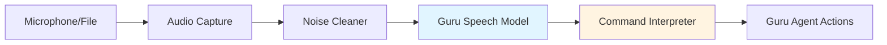

# Design Document: Guru Speech Engine

## Overview

The Guru Speech Engine is a custom speech recognition system built around the Whisper small model with optimized settings for performance and accuracy. The system implements a four-stage audio processing pipeline:

1. **Audio Capture**: Real-time microphone input or file-based audio
2. **Noise Reduction**: Pre-processing using noisereduce library
3. **Speech Transcription**: faster-whisper with int8 quantization and beam_size=5
4. **Command Interpretation**: Pattern matching to map transcriptions to agent actions

The architecture is designed for extensibility, allowing future fine-tuning with custom voice data while maintaining a clean separation of concerns between audio processing, transcription, and command interpretation.

## Architecture



### Component Hierarchy

```
GuruSpeechEngine (Facade)
├── AudioCapture (Input Layer)
│   ├── MicrophoneCapture
│   └── FileCapture
├── NoiseCleaner (Pre-processing)
├── WhisperTranscriber (Core Model)
│   └── ModelLoader
└── CommandInterpreter (Post-processing)
    └── CommandRegistry
```

### Data Flow

1. **Audio Input** → Raw audio data (numpy array, sample rate)
2. **Noise Reduction** → Cleaned audio data (numpy array)
3. **Transcription** → TranscriptionResult (text, language, confidence)
4. **Command Detection** → CommandResult (action_id, parameters, raw_text)

## Components and Interfaces

### 1. GuruSpeechEngine (Main Facade)

The primary interface for the speech recognition system.

```python
class GuruSpeechEngine:
    """
    Main facade for the Guru Speech Engine.
    Coordinates audio capture, noise reduction, transcription, and command interpretation.
    """
    
    def __init__(
        self,
        model_path: Optional[str] = None,
        compute_type: str = "int8",
        beam_size: int = 5,
        enable_noise_reduction: bool = True
    ):
        """
        Initialize the speech engine.
        
        Args:
            model_path: Path to custom model weights (None for default Whisper small)
            compute_type: Compute type for faster-whisper ("int8", "float16", "float32")
            beam_size: Beam size for decoding (higher = more accurate but slower)
            enable_noise_reduction: Whether to apply noise reduction
        """
        pass
    
    def transcribe_microphone(
        self,
        duration: Optional[float] = None,
        language: Optional[str] = None
    ) -> TranscriptionResult:
        """
        Capture and transcribe audio from microphone.
        
        Args:
            duration: Recording duration in seconds (None for continuous)
            language: Force specific language (None for auto-detect)
            
        Returns:
            TranscriptionResult with text, language, and confidence
        """
        pass
    
    def transcribe_file(
        self,
        file_path: str,
        language: Optional[str] = None
    ) -> TranscriptionResult:
        """
        Transcribe audio from file.
        
        Args:
            file_path: Path to audio file
            language: Force specific language (None for auto-detect)
            
        Returns:
            TranscriptionResult with text, language, and confidence
        """
        pass
    
    def interpret_command(
        self,
        transcription: TranscriptionResult
    ) -> CommandResult:
        """
        Interpret transcribed text as a command.
        
        Args:
            transcription: Result from transcription
            
        Returns:
            CommandResult with action_id and parameters
        """
        pass
    
    def process_voice_command(
        self,
        duration: Optional[float] = None
    ) -> CommandResult:
        """
        End-to-end: capture audio, transcribe, and interpret command.
        
        Args:
            duration: Recording duration in seconds
            
        Returns:
            CommandResult ready for Guru Agent
        """
        pass
```

### 2. NoiseCleaner (noise.py)

Handles audio pre-processing and noise reduction.

```python
class NoiseCleaner:
    """
    Applies noise reduction to audio signals using noisereduce library.
    """
    
    def __init__(
        self,
        stationary: bool = True,
        prop_decrease: float = 1.0
    ):
        """
        Initialize noise cleaner.
        
        Args:
            stationary: Whether to use stationary noise reduction
            prop_decrease: Proportion of noise to reduce (0.0 to 1.0)
        """
        pass
    
    def clean(
        self,
        audio_data: np.ndarray,
        sample_rate: int
    ) -> np.ndarray:
        """
        Apply noise reduction to audio.
        
        Args:
            audio_data: Raw audio as numpy array
            sample_rate: Sample rate in Hz
            
        Returns:
            Cleaned audio as numpy array
        """
        pass
    
    def clean_file(
        self,
        input_path: str,
        output_path: str
    ) -> None:
        """
        Clean audio file and save result.
        
        Args:
            input_path: Path to input audio file
            output_path: Path to save cleaned audio
        """
        pass
```

### 3. WhisperTranscriber (speech.py)

Core transcription engine using faster-whisper.

```python
class WhisperTranscriber:
    """
    Wraps faster-whisper for optimized speech-to-text transcription.
    """
    
    def __init__(
        self,
        model_size: str = "small",
        model_path: Optional[str] = None,
        compute_type: str = "int8",
        beam_size: int = 5,
        device: str = "cpu"
    ):
        """
        Initialize Whisper transcriber.
        
        Args:
            model_size: Whisper model size ("tiny", "base", "small", "medium", "large")
            model_path: Path to custom model (overrides model_size)
            compute_type: Compute type for inference
            beam_size: Beam size for decoding
            device: Device to run on ("cpu", "cuda")
        """
        pass
    
    def transcribe(
        self,
        audio_data: np.ndarray,
        sample_rate: int,
        language: Optional[str] = None
    ) -> TranscriptionResult:
        """
        Transcribe audio to text.
        
        Args:
            audio_data: Audio as numpy array
            sample_rate: Sample rate in Hz
            language: Force language (None for auto-detect)
            
        Returns:
            TranscriptionResult with text, language, confidence
        """
        pass
    
    def transcribe_file(
        self,
        file_path: str,
        language: Optional[str] = None
    ) -> TranscriptionResult:
        """
        Transcribe audio file.
        
        Args:
            file_path: Path to audio file
            language: Force language (None for auto-detect)
            
        Returns:
            TranscriptionResult with text, language, confidence
        """
        pass
```

### 4. CommandInterpreter (commands.py)

Maps transcribed text to agent actions.

```python
class CommandInterpreter:
    """
    Interprets transcribed text as commands for the Guru Agent.
    Uses pattern matching and fuzzy matching for command detection.
    """
    
    def __init__(self):
        """Initialize command interpreter with default command registry."""
        pass
    
    def register_command(
        self,
        patterns: List[str],
        action_id: str,
        description: str = ""
    ) -> None:
        """
        Register a new command pattern.
        
        Args:
            patterns: List of text patterns that trigger this command
            action_id: Action identifier for Guru Agent
            description: Human-readable description
        """
        pass
    
    def interpret(
        self,
        text: str,
        language: str = "en"
    ) -> CommandResult:
        """
        Interpret text as a command.
        
        Args:
            text: Transcribed text
            language: Language code for language-specific matching
            
        Returns:
            CommandResult with action_id and parameters
        """
        pass
    
    def get_registered_commands(self) -> List[Dict[str, Any]]:
        """
        Get list of all registered commands.
        
        Returns:
            List of command definitions
        """
        pass
```

### 5. Audio Capture Components

```python
class AudioCapture:
    """Base class for audio capture."""
    
    def capture(self, duration: Optional[float] = None) -> Tuple[np.ndarray, int]:
        """
        Capture audio.
        
        Args:
            duration: Duration in seconds (None for continuous)
            
        Returns:
            Tuple of (audio_data, sample_rate)
        """
        pass

class MicrophoneCapture(AudioCapture):
    """Captures audio from system microphone using sounddevice."""
    
    def __init__(
        self,
        sample_rate: int = 16000,
        channels: int = 1
    ):
        """
        Initialize microphone capture.
        
        Args:
            sample_rate: Sample rate in Hz
            channels: Number of audio channels
        """
        pass

class FileCapture(AudioCapture):
    """Loads audio from files using soundfile."""
    
    def load_file(self, file_path: str) -> Tuple[np.ndarray, int]:
        """
        Load audio from file.
        
        Args:
            file_path: Path to audio file
            
        Returns:
            Tuple of (audio_data, sample_rate)
        """
        pass
```

## Data Models

### TranscriptionResult

```python
@dataclass
class TranscriptionResult:
    """Result from speech transcription."""
    
    text: str
    """Transcribed text"""
    
    language: str
    """Detected or specified language code (e.g., 'en', 'hi', 'pa')"""
    
    confidence: float
    """Confidence score (0.0 to 1.0)"""
    
    segments: List[TranscriptionSegment]
    """Individual segments with timestamps"""
    
    duration: float
    """Audio duration in seconds"""

@dataclass
class TranscriptionSegment:
    """Individual segment of transcription with timing."""
    
    text: str
    start: float  # seconds
    end: float    # seconds
    confidence: float
```

### CommandResult

```python
@dataclass
class CommandResult:
    """Result from command interpretation."""
    
    action_id: Optional[str]
    """Action identifier (None if no command detected)"""
    
    parameters: Dict[str, Any]
    """Extracted parameters for the action"""
    
    raw_text: str
    """Original transcribed text"""
    
    confidence: float
    """Confidence in command detection (0.0 to 1.0)"""
    
    language: str
    """Language of the command"""
    
    is_command: bool
    """Whether a command was detected"""

@dataclass
class CommandPattern:
    """Definition of a command pattern."""
    
    patterns: List[str]
    """Text patterns that trigger this command"""
    
    action_id: str
    """Action identifier"""
    
    description: str
    """Human-readable description"""
    
    languages: List[str]
    """Supported languages for this command"""
    
    parameter_extractors: Dict[str, Callable]
    """Functions to extract parameters from matched text"""
```

### Configuration Models

```python
@dataclass
class ModelConfig:
    """Configuration for Whisper model."""
    
    model_size: str = "small"
    model_path: Optional[str] = None
    compute_type: str = "int8"
    beam_size: int = 5
    device: str = "cpu"
    
@dataclass
class NoiseReductionConfig:
    """Configuration for noise reduction."""
    
    enabled: bool = True
    stationary: bool = True
    prop_decrease: float = 1.0

@dataclass
class AudioConfig:
    """Configuration for audio capture."""
    
    sample_rate: int = 16000
    channels: int = 1
    chunk_size: int = 1024
```

## Default Command Registry

The system will ship with a default set of commands:

```python
DEFAULT_COMMANDS = [
    CommandPattern(
        patterns=["open youtube", "youtube kholo", "youtube ਖੋਲ੍ਹੋ"],
        action_id="OPEN_YOUTUBE",
        description="Open YouTube",
        languages=["en", "hi", "pa"]
    ),
    CommandPattern(
        patterns=["search for *", "* dhundo", "* ਲੱਭੋ"],
        action_id="SEARCH",
        description="Search for something",
        languages=["en", "hi", "pa"],
        parameter_extractors={"query": lambda text: extract_after_keyword(text)}
    ),
    CommandPattern(
        patterns=["play music", "music chalao", "music ਚਲਾਓ"],
        action_id="PLAY_MUSIC",
        description="Play music",
        languages=["en", "hi", "pa"]
    ),
    # Additional commands can be registered at runtime
]
```


## Correctness Properties

A property is a characteristic or behavior that should hold true across all valid executions of a system—essentially, a formal statement about what the system should do. Properties serve as the bridge between human-readable specifications and machine-verifiable correctness guarantees.

### Property 1: Transcription Result Completeness

*For any* valid audio input, transcription should return a TranscriptionResult containing non-empty text, a valid language code, a confidence score between 0.0 and 1.0, and a non-negative duration.

**Validates: Requirements 1.4, 7.1, 7.2**

### Property 2: Noise Cleaner Format Compatibility

*For any* audio input (numpy array with sample rate), the Noise_Cleaner output should be a numpy array with the same sample rate and compatible shape for the Whisper_Model.

**Validates: Requirements 2.4**

### Property 3: Command Pattern Matching and Mapping

*For any* registered command pattern and any text that matches that pattern, the Command_Interpreter should return a CommandResult with the correct action_id associated with that pattern.

**Validates: Requirements 4.1, 4.2**

### Property 4: Unrecognized Text Passthrough

*For any* text that does not match any registered command pattern, the Command_Interpreter should return a CommandResult with is_command=False and raw_text equal to the input text.

**Validates: Requirements 4.4**

### Property 5: Error Context Preservation

*For any* component failure during audio processing, the Guru_Speech_Engine should return an error that includes the original error message and identifies which component failed.

**Validates: Requirements 10.1, 10.4**

### Property 6: Model Reuse Across Requests

*For any* sequence of transcription requests to the same GuruSpeechEngine instance, the Whisper model should be loaded exactly once and reused for all subsequent requests.

**Validates: Requirements 11.3**

### Property 7: Command Result Structure Completeness

*For any* command interpretation result where is_command=True, the CommandResult should contain a non-null action_id, a parameters dictionary, the raw_text, a confidence score between 0.0 and 1.0, and a valid language code.

**Validates: Requirements 12.1, 12.3**

## Error Handling

### Error Categories

1. **Audio Capture Errors**
   - Microphone unavailable or access denied
   - Invalid audio device configuration
   - Audio buffer overflow/underflow

2. **File Processing Errors**
   - File not found or inaccessible
   - Unsupported audio format
   - Corrupted audio data

3. **Model Errors**
   - Model files not found
   - Insufficient memory for model loading
   - Invalid model configuration
   - Inference failures

4. **Processing Errors**
   - Noise reduction failures
   - Transcription timeouts
   - Invalid audio format or sample rate

### Error Handling Strategy

```python
class GuruSpeechError(Exception):
    """Base exception for Guru Speech Engine."""
    
    def __init__(
        self,
        message: str,
        component: str,
        original_error: Optional[Exception] = None
    ):
        self.message = message
        self.component = component
        self.original_error = original_error
        super().__init__(self.format_message())
    
    def format_message(self) -> str:
        """Format error message with context."""
        msg = f"[{self.component}] {self.message}"
        if self.original_error:
            msg += f"\nCaused by: {type(self.original_error).__name__}: {str(self.original_error)}"
        return msg

class AudioCaptureError(GuruSpeechError):
    """Errors during audio capture."""
    pass

class ModelLoadError(GuruSpeechError):
    """Errors during model loading."""
    pass

class TranscriptionError(GuruSpeechError):
    """Errors during transcription."""
    pass

class CommandInterpretationError(GuruSpeechError):
    """Errors during command interpretation."""
    pass
```

### Error Recovery

- **Microphone failures**: Provide clear instructions for checking permissions and device availability
- **Model loading failures**: Include troubleshooting steps (check disk space, verify model files, try different compute type)
- **Transcription failures**: Log audio characteristics (duration, sample rate) for debugging
- **Command interpretation failures**: Fall back to returning raw transcription text

### Logging Strategy

```python
import logging

logger = logging.getLogger("guru_speech")

# Log levels:
# - DEBUG: Detailed processing information (audio characteristics, model parameters)
# - INFO: Normal operations (transcription started/completed, commands detected)
# - WARNING: Recoverable issues (low confidence transcription, no command match)
# - ERROR: Failures that prevent operation (model load failure, audio capture error)
```

## Testing Strategy

### Dual Testing Approach

The Guru Speech Engine will use both unit tests and property-based tests for comprehensive coverage:

- **Unit tests**: Verify specific examples, edge cases, and error conditions
- **Property tests**: Verify universal properties across all inputs

Together, these approaches provide comprehensive coverage where unit tests catch concrete bugs and property tests verify general correctness.

### Property-Based Testing

We will use **Hypothesis** (Python's property-based testing library) for property tests.

**Configuration:**
- Each property test will run a minimum of 100 iterations
- Each test will be tagged with a comment referencing the design property
- Tag format: `# Feature: guru-speech-engine, Property {number}: {property_text}`

**Property Test Examples:**

```python
from hypothesis import given, strategies as st
import numpy as np

@given(
    audio=st.lists(st.floats(min_value=-1.0, max_value=1.0), min_size=1600, max_size=16000),
    sample_rate=st.sampled_from([8000, 16000, 22050, 44100])
)
def test_transcription_result_completeness(audio, sample_rate):
    """
    Feature: guru-speech-engine, Property 1: Transcription Result Completeness
    For any valid audio input, transcription should return complete result.
    """
    engine = GuruSpeechEngine()
    audio_array = np.array(audio, dtype=np.float32)
    
    result = engine.transcribe(audio_array, sample_rate)
    
    assert result.text is not None
    assert len(result.text) >= 0
    assert result.language in ["en", "hi", "pa", "unknown"]
    assert 0.0 <= result.confidence <= 1.0
    assert result.duration >= 0.0

@given(
    pattern=st.text(min_size=1, max_size=50),
    action_id=st.text(min_size=1, max_size=20)
)
def test_command_pattern_matching(pattern, action_id):
    """
    Feature: guru-speech-engine, Property 3: Command Pattern Matching and Mapping
    For any registered pattern, matching text should return correct action_id.
    """
    interpreter = CommandInterpreter()
    interpreter.register_command([pattern], action_id)
    
    result = interpreter.interpret(pattern)
    
    assert result.is_command is True
    assert result.action_id == action_id
```

### Unit Testing

Unit tests will focus on:

1. **Specific Examples**
   - Test "open youtube" → OPEN_YOUTUBE mapping
   - Test English, Hindi, Punjabi language support with sample audio
   - Test configuration with int8 compute type and beam_size=5

2. **Edge Cases**
   - Empty audio input
   - Very short audio (< 1 second)
   - Very long audio (> 60 seconds)
   - Silent audio (all zeros)
   - Audio with extreme noise

3. **Error Conditions**
   - Invalid file paths
   - Unsupported audio formats
   - Microphone access denied
   - Model loading failures
   - Invalid configuration parameters

4. **Integration Points**
   - Pipeline flow: capture → clean → transcribe → interpret
   - File and microphone input produce same output format
   - Custom model loading
   - Command registration and retrieval

### Test Coverage Goals

- **Code coverage**: Minimum 80% line coverage
- **Property coverage**: All 7 correctness properties implemented as property tests
- **Language coverage**: Test samples for English, Hindi, and Punjabi
- **Format coverage**: Test WAV, MP3, and FLAC file formats
- **Error coverage**: Test all error categories with specific examples

### Testing Dependencies

```
pytest>=7.0.0
hypothesis>=6.0.0
pytest-cov>=4.0.0
soundfile>=0.12.0
sounddevice>=0.4.0
```

### Continuous Testing

- Run property tests with 100 iterations in CI/CD
- Run unit tests on every commit
- Generate coverage reports
- Test on multiple Python versions (3.8, 3.9, 3.10, 3.11)
- Test on multiple platforms (Linux, macOS, Windows)
