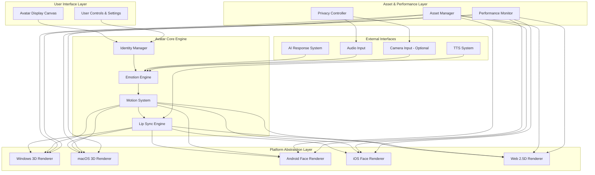
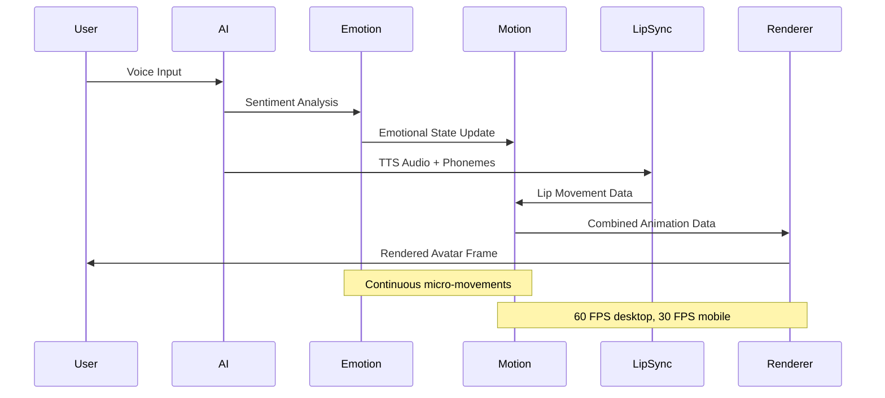
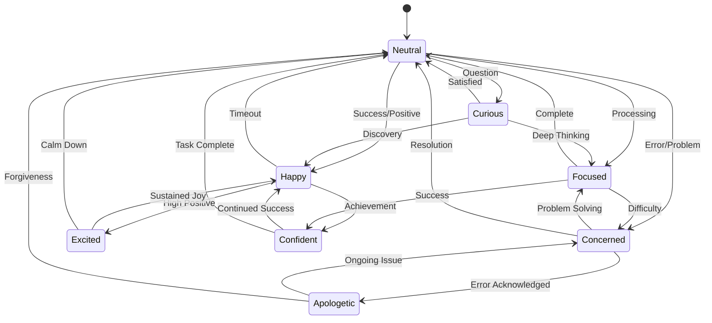
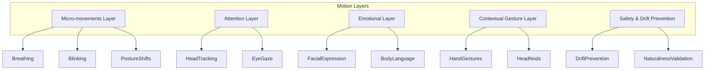

# Design Document: GURU Humanized Avatar System

## Overview

The GURU Humanized Avatar System is a production-grade, real-time digital human interface that creates emotionally responsive, naturally animated avatars across Windows, macOS, Android, iOS, and Web platforms. The system combines advanced emotion detection, procedural motion generation, phoneme-based lip synchronization, and platform-optimized rendering to deliver a seamless digital companion experience.

The architecture prioritizes privacy-first design with local-only processing, cross-platform consistency, and performance optimization. The system supports full-body 3D rendering on desktop platforms, face-focused 3D on mobile, and optimized 2.5D rendering on web platforms while maintaining consistent personality and behavior across all variants.

## Architecture

### System Architecture Overview



### Component Interaction Flow



## Components and Interfaces

### Identity Manager

**Purpose**: Manages user avatar customization, identity persistence, and cross-platform synchronization.

**Core Interface**:
```typescript
interface IdentityManager {
  // Identity Configuration
  createIdentity(config: AvatarIdentityConfig): Promise<AvatarIdentity>
  updateIdentity(identity: AvatarIdentity, updates: Partial<AvatarIdentityConfig>): Promise<void>
  getActiveIdentity(): AvatarIdentity
  
  // Cross-platform Sync
  syncIdentityAcrossDevices(identity: AvatarIdentity): Promise<void>
  validateIdentityCompatibility(platform: Platform): boolean
  
  // Asset Management
  loadIdentityAssets(identity: AvatarIdentity, platform: Platform): Promise<AvatarAssets>
  migrateIdentityVersion(oldVersion: string, newVersion: string): Promise<void>
}

interface AvatarIdentityConfig {
  gender: 'male' | 'female' | 'non-binary'
  voiceStyle: 'calm' | 'friendly' | 'professional' | 'energetic'
  personalityTone: 'co-worker' | 'best-friend' | 'assistant' | 'mentor'
  accent?: string
  facialFeatures?: FacialFeaturePreset
  expressiveness: 'low' | 'medium' | 'high'
  gestureIntensity: 'subtle' | 'natural' | 'expressive'
  voicePersonality: 'formal' | 'friendly' | 'casual'
  minimalMode: boolean
}
```

**Key Features**:
- Encrypted local storage with cross-device synchronization
- Semantic versioning for identity data migration
- Platform-specific asset optimization
- Rollback capability for failed updates

### Emotion Engine

**Purpose**: Processes emotional context from multiple inputs and manages smooth emotional state transitions.

**Core Interface**:
```typescript
interface EmotionEngine {
  // State Management
  getCurrentEmotionalState(): EmotionalState
  setEmotionalState(state: EmotionalState, transitionDuration?: number): void
  
  // Input Processing
  processVoiceTone(audioFeatures: AudioFeatures): EmotionalState
  processSentiment(text: string, sentiment: SentimentAnalysis): EmotionalState
  processCommandResult(success: boolean, context?: string): EmotionalState
  
  // Normalization & Safety
  normalizeEmotionalState(): void
  resetEmotionalDrift(): void
  
  // Configuration
  setEmotionalResponsiveness(level: 'low' | 'medium' | 'high'): void
  enableUserOverride(enabled: boolean): void
}

interface EmotionalState {
  primary: 'neutral' | 'happy' | 'focused' | 'curious' | 'concerned' | 'confident' | 'apologetic' | 'excited'
  intensity: number // 0.0 to 1.0
  secondary?: EmotionalState
  timestamp: number
  transitionSpeed: number
}
```

**Emotional State Graph**:


### Motion System

**Purpose**: Generates procedural human-like movements, gestures, and micro-animations based on emotional state and context.

**Core Interface**:
```typescript
interface MotionSystem {
  // Motion Generation
  generateMicroMovements(): MotionFrame
  generateContextualGesture(context: GestureContext): MotionSequence
  generateEmotionalPosture(emotion: EmotionalState): PostureAdjustment
  
  // State Management
  enterListeningMode(): void
  enterSpeakingMode(): void
  enterThinkingMode(): void
  enterIdleMode(): void
  
  // Attention & Focus
  setAttentionTarget(x: number, y: number): void
  trackAudioSource(direction: AudioDirection): void
  
  // Motion Quality
  preventMotionDrift(): void
  randomizeIdleMotions(): void
  validateMotionNaturalness(): boolean
}

interface MotionFrame {
  breathing: BreathingState
  blinking: BlinkState
  eyeTracking: EyePosition
  postureShift: PostureAdjustment
  headPosition: HeadOrientation
  timestamp: number
}

interface GestureContext {
  type: 'emphasis' | 'explanation' | 'greeting' | 'thinking' | 'error' | 'success'
  intensity: number
  duration: number
  emotionalState: EmotionalState
}
```

**Motion Layer Architecture**:


### Lip Sync Engine

**Purpose**: Provides real-time phoneme-to-viseme mapping with emotion-aware mouth movement generation.

**Core Interface**:
```typescript
interface LipSyncEngine {
  // Phoneme Processing
  processPhonemeStream(phonemes: PhonemeSequence): VisemeSequence
  syncWithAudio(audioBuffer: AudioBuffer, phonemes: PhonemeSequence): SyncedAnimation
  
  // Emotion Integration
  applyEmotionalModulation(visemes: VisemeSequence, emotion: EmotionalState): VisemeSequence
  
  // Timing & Quality
  validateSyncAccuracy(audio: AudioBuffer, animation: VisemeSequence): SyncQuality
  adjustLatencyCompensation(latency: number): void
  
  // Breathing & Pauses
  generateBreathingPauses(sentences: SentenceBreak[]): BreathingAnimation
  insertEmphasisNods(emphasisWords: WordTiming[]): HeadNodSequence
}

interface PhonemeSequence {
  phonemes: Phoneme[]
  timing: TimingData[]
  emphasis: EmphasisMarker[]
  totalDuration: number
}

interface VisemeSequence {
  visemes: Viseme[]
  transitions: TransitionCurve[]
  emotionalModulation: EmotionModifier[]
  breathingPauses: BreathingMarker[]
}
```

**Phoneme-to-Viseme Mapping** (Based on industry standards):
```typescript
const PHONEME_VISEME_MAP = {
  // Bilabial sounds
  'p': 'PP', 'b': 'PP', 'm': 'PP',
  
  // Labiodental sounds  
  'f': 'FF', 'v': 'FF',
  
  // Dental sounds
  'th': 'TH', 'dh': 'TH',
  
  // Alveolar sounds
  't': 'DD', 'd': 'DD', 'n': 'nn', 'l': 'DD',
  
  // Velar sounds
  'k': 'kk', 'g': 'kk', 'ng': 'nn',
  
  // Fricatives
  's': 'SS', 'z': 'SS', 'sh': 'CH', 'zh': 'CH',
  
  // Vowels
  'aa': 'aa', 'ae': 'aa', 'ah': 'aa',
  'e': 'E', 'eh': 'E', 'er': 'E',
  'i': 'ih', 'ih': 'ih', 'iy': 'ih',
  'o': 'oh', 'oh': 'oh', 'ow': 'oh',
  'u': 'ou', 'uh': 'ou', 'uw': 'ou',
  
  // Silence
  'sil': 'sil'
}
```

### Platform Renderer

**Purpose**: Provides platform-optimized 3D/2.5D rendering with consistent visual quality and performance.

**Core Interface**:
```typescript
interface PlatformRenderer {
  // Rendering Pipeline
  initializeRenderer(canvas: HTMLCanvasElement | NativeCanvas): Promise<void>
  renderFrame(animationData: AnimationFrame): Promise<void>
  
  // Platform Optimization
  detectPlatformCapabilities(): PlatformCapabilities
  optimizeForPlatform(platform: Platform): RenderingConfig
  
  // Quality Management
  setQualityLevel(level: 'low' | 'medium' | 'high' | 'ultra'): void
  enableDynamicQuality(enabled: boolean): void
  
  // Asset Loading
  loadAvatarAssets(assets: AvatarAssets): Promise<void>
  preloadNextFrame(animationData: AnimationFrame): void
  
  // Performance Monitoring
  getCurrentFPS(): number
  getMemoryUsage(): MemoryStats
  getGPUUsage(): GPUStats
}

interface PlatformCapabilities {
  maxTextureSize: number
  supportedFormats: string[]
  hardwareAcceleration: boolean
  maxVertexCount: number
  shaderComplexity: 'basic' | 'advanced' | 'compute'
  memoryLimit: number
}
```

**Platform-Specific Rendering Strategies**:

| Platform | Rendering API | Avatar Type | Target FPS | Memory Limit |
|----------|---------------|-------------|------------|--------------|
| Windows | DirectX 12 / Vulkan | Full-body 3D | 60+ | 300MB |
| macOS | Metal | Full-body 3D | 60+ | 300MB |
| Android | Vulkan / OpenGL ES | Face-only 3D | 30+ | 150MB |
| iOS | Metal | Face-only 3D | 30+ | 150MB |
| Web | WebGPU / WebGL | Upper-body 2.5D | 30+ | 100MB |

## Data Models

### Avatar Identity Data Model

```typescript
interface AvatarIdentity {
  id: string
  version: string
  created: Date
  lastModified: Date
  
  // Visual Configuration
  appearance: {
    gender: 'male' | 'female' | 'non-binary'
    facialFeatures: FacialFeatureSet
    skinTone: ColorValue
    hairStyle: HairStyleConfig
    eyeColor: ColorValue
  }
  
  // Personality Configuration
  personality: {
    voiceStyle: 'calm' | 'friendly' | 'professional' | 'energetic'
    tone: 'co-worker' | 'best-friend' | 'assistant' | 'mentor'
    accent?: AccentConfig
    expressiveness: EmotionalRange
    gestureStyle: GestureProfile
  }
  
  // Platform Assets
  assets: {
    [platform: string]: PlatformAssetSet
  }
  
  // Privacy & Security
  encryption: EncryptionMetadata
  signature: DigitalSignature
}

interface FacialFeatureSet {
  faceShape: MorphTargetWeights
  eyeShape: MorphTargetWeights
  noseShape: MorphTargetWeights
  mouthShape: MorphTargetWeights
  jawline: MorphTargetWeights
}

interface EmotionalRange {
  intensity: number // 0.0 to 1.0
  responsiveness: number // 0.0 to 1.0
  stability: number // 0.0 to 1.0
  userOverride: boolean
}
```

### Animation Data Model

```typescript
interface AnimationFrame {
  timestamp: number
  frameId: string
  
  // Facial Animation
  facial: {
    expression: FacialExpression
    lipSync: VisemeFrame
    eyeMovement: EyeAnimation
    blinking: BlinkFrame
  }
  
  // Body Animation (when supported)
  body?: {
    posture: PostureFrame
    gestures: GestureFrame[]
    breathing: BreathingFrame
    headOrientation: HeadFrame
  }
  
  // Metadata
  emotionalState: EmotionalState
  quality: QualityMetrics
  platform: Platform
}

interface FacialExpression {
  morphTargets: MorphTargetWeights
  intensity: number
  transitionCurve: AnimationCurve
  duration: number
}

interface VisemeFrame {
  currentViseme: Viseme
  nextViseme?: Viseme
  transitionProgress: number // 0.0 to 1.0
  emotionalModulation: EmotionModifier
}
```

### Asset Management Data Model

```typescript
interface AvatarAssets {
  version: string
  platform: Platform
  quality: QualityLevel
  
  // 3D Assets
  meshes: {
    head: MeshAsset
    body?: MeshAsset
    hair: MeshAsset
    accessories?: MeshAsset[]
  }
  
  // Textures
  textures: {
    diffuse: TextureAsset[]
    normal: TextureAsset[]
    specular: TextureAsset[]
    emission?: TextureAsset[]
  }
  
  // Animation Rigs
  rigs: {
    facial: FacialRig
    body?: BodyRig
    morphTargets: MorphTargetSet
  }
  
  // Shaders
  shaders: {
    vertex: ShaderAsset[]
    fragment: ShaderAsset[]
    compute?: ShaderAsset[]
  }
  
  // Metadata
  signature: DigitalSignature
  checksum: string
  size: number
}

interface MeshAsset {
  format: 'GLTF' | 'USDZ' | 'FBX'
  lodLevels: LODLevel[]
  vertexCount: number
  triangleCount: number
  boundingBox: BoundingBox
  url: string
  checksum: string
}
```

## Correctness Properties

*A property is a characteristic or behavior that should hold true across all valid executions of a system—essentially, a formal statement about what the system should do. Properties serve as the bridge between human-readable specifications and machine-verifiable correctness guarantees.*

### Property 1: Avatar Identity Persistence and Synchronization
*For any* avatar identity configuration, storing the identity then retrieving it should produce an equivalent configuration, and synchronizing across devices should maintain consistency within the specified time limits.
**Validates: Requirements 1.2, 1.3, 15.5**

### Property 2: Emotional State Consistency and Transitions  
*For any* sequence of emotional inputs (voice tone, sentiment, command results), the emotion engine should produce appropriate emotional states with smooth transitions that never exceed maximum transition speeds or skip intermediate states.
**Validates: Requirements 2.1, 2.2, 2.3, 2.5, 2.6**

### Property 3: Procedural Motion Generation and Naturalness
*For any* avatar state and context, the motion system should generate natural human-like movements where no animation loops more than twice, micro-movements are always present, and gestures are contextually appropriate.
**Validates: Requirements 3.1, 3.2, 3.3, 3.4, 3.6, 3.7**

### Property 4: Lip Sync Accuracy and Timing
*For any* phoneme sequence and emotional state, the lip sync engine should generate visemes that accurately represent the phonemes within timing tolerances and apply appropriate emotional modulation.
**Validates: Requirements 4.1, 4.2, 4.6**

### Property 5: Platform Performance Compliance
*For any* platform and avatar configuration, the system should meet platform-specific performance requirements (FPS, memory, CPU/GPU usage, startup time) while maintaining core functionality.
**Validates: Requirements 6.1, 6.2, 6.3, 6.4, 6.5, 6.6**

### Property 6: Privacy Protection and Local Processing
*For any* system operation involving biometric data, all processing should occur locally with no unauthorized data transmission, storage, or access, and privacy controls should be respected.
**Validates: Requirements 7.1, 7.2, 7.3, 7.4, 7.6**

### Property 7: Cross-Platform Behavior Consistency
*For any* avatar identity and interaction sequence, the personality, behavior, and timing should remain consistent across all supported platforms within specified variance tolerances.
**Validates: Requirements 15.1, 15.2, 15.3, 15.4, 15.5**

### Property 8: API Response Time and Functionality
*For any* valid API call (emotion, gesture, attention, mode control, voice sync), the system should execute within 100ms and produce the expected avatar behavior changes.
**Validates: Requirements 11.1, 11.2, 11.3, 11.4, 11.5, 11.6**

### Property 9: Failure Recovery and System Resilience
*For any* subsystem failure scenario, the avatar system should gracefully degrade to safe fallback modes, log failures appropriately, and attempt recovery at specified intervals.
**Validates: Requirements 13.1, 13.2, 13.3, 13.4, 13.5, 13.6**

### Property 10: Asset Integrity and Version Management
*For any* avatar asset or version update, the system should maintain integrity through signatures and checksums, handle migrations safely, and provide rollback capability when needed.
**Validates: Requirements 9.2, 9.5, 14.1, 14.2, 14.3, 14.4, 14.5**

### Property 11: Long-Session Stability and Drift Prevention
*For any* extended usage session, the system should prevent animation drift, emotional drift, and memory growth while maintaining performance and naturalness over time.
**Validates: Requirements 19.1, 19.2, 19.3, 19.4, 19.5**

### Property 12: User Control Override Authority
*For any* user preference setting, the system should respect user choices over automatic behavior, provide all specified control options, and maintain preference persistence.
**Validates: Requirements 16.1, 16.2, 16.3, 16.4, 16.5**

## Error Handling

### Subsystem Failure Recovery

The avatar system implements a multi-layered failure recovery strategy:

**Graceful Degradation Hierarchy**:
1. **Full System**: Complete avatar with all features
2. **Reduced Quality**: Lower LOD models, simplified animations
3. **Essential Mode**: Face-only with basic expressions
4. **Minimal Mode**: Static avatar with text-only feedback
5. **Fallback Mode**: Text-based interface only

**Failure Detection and Response**:
```typescript
interface FailureHandler {
  detectFailure(subsystem: Subsystem): FailureType
  triggerFallback(failure: FailureType): FallbackMode
  attemptRecovery(subsystem: Subsystem): Promise<boolean>
  logFailure(failure: FailureEvent): void
}

enum FailureType {
  RENDERING_FAILURE = 'rendering',
  EMOTION_PROCESSING_FAILURE = 'emotion',
  MOTION_GENERATION_FAILURE = 'motion',
  LIP_SYNC_FAILURE = 'lipsync',
  ASSET_LOADING_FAILURE = 'assets',
  PERFORMANCE_DEGRADATION = 'performance'
}
```

**Recovery Strategies**:
- **Rendering Failures**: Switch from GPU to CPU rendering, reduce quality
- **Emotion Failures**: Default to neutral state, disable emotion detection
- **Motion Failures**: Use basic idle animations, disable procedural generation
- **Lip Sync Failures**: Continue speech without mouth animation
- **Asset Failures**: Use cached assets, download alternatives
- **Performance Issues**: Reduce frame rate, lower quality, disable features

### Privacy and Security Error Handling

**Privacy Violation Prevention**:
```typescript
interface PrivacyGuard {
  validateDataAccess(operation: DataOperation): boolean
  blockUnauthorizedAccess(resource: PrivateResource): void
  auditDataFlow(dataType: BiometricDataType): AuditLog
  enforceRetentionPolicy(data: TemporaryData): void
}
```

**Security Measures**:
- Asset signature verification with rejection of tampered files
- Encrypted storage with key rotation
- Network traffic monitoring for unauthorized data transmission
- Camera/microphone access controls with user indicators
- Biometric data purging after processing

### Performance Monitoring and Adaptive Quality

**Real-time Performance Adjustment**:
```typescript
interface AdaptiveQuality {
  monitorPerformance(): PerformanceMetrics
  adjustQuality(metrics: PerformanceMetrics): QualityAdjustment
  predictPerformanceIssues(trend: PerformanceTrend): boolean
  optimizeForBattery(batteryLevel: number): OptimizationStrategy
}
```

**Quality Adjustment Strategies**:
- Frame rate reduction (60→30→15 FPS)
- LOD level reduction (High→Medium→Low)
- Feature disabling (shadows→lighting→textures)
- Animation simplification (full→face→minimal)
- Memory optimization (asset unloading, cache reduction)

## Testing Strategy

### Dual Testing Approach

The avatar system requires both unit testing and property-based testing for comprehensive coverage:

**Unit Tests** focus on:
- Specific avatar identity configurations
- Known emotional state transitions
- Platform-specific rendering scenarios
- API endpoint functionality
- Error condition handling
- Integration between components

**Property-Based Tests** focus on:
- Universal properties across all inputs
- Cross-platform consistency validation
- Performance compliance across scenarios
- Privacy protection verification
- Long-term stability testing
- Randomized interaction sequences

### Property-Based Testing Configuration

**Testing Framework**: Hypothesis (Python) for backend components, fast-check (TypeScript) for frontend components

**Test Configuration**:
- Minimum 100 iterations per property test
- Extended runs (1000+ iterations) for critical properties
- Platform-specific test suites for each supported platform
- Performance benchmarking with statistical analysis

**Property Test Examples**:

```python
# Property 2: Emotional State Consistency
@given(emotion_sequences=st.lists(st.sampled_from(EmotionalInput)))
def test_emotional_transitions_are_smooth(emotion_sequences):
    """Feature: humanized-avatar-system, Property 2: Emotional State Consistency and Transitions"""
    engine = EmotionEngine()
    
    previous_state = None
    for emotion_input in emotion_sequences:
        current_state = engine.process_input(emotion_input)
        
        if previous_state:
            transition_speed = calculate_transition_speed(previous_state, current_state)
            assert transition_speed <= MAX_TRANSITION_SPEED
            assert not has_sudden_jumps(previous_state, current_state)
        
        previous_state = current_state

# Property 5: Platform Performance Compliance  
@given(platforms=st.sampled_from(Platform), configs=st.sampled_from(AvatarConfig))
def test_performance_meets_platform_requirements(platform, config):
    """Feature: humanized-avatar-system, Property 5: Platform Performance Compliance"""
    renderer = create_platform_renderer(platform)
    avatar = create_avatar(config)
    
    performance = measure_performance(renderer, avatar, duration=60)
    
    requirements = get_platform_requirements(platform)
    assert performance.fps >= requirements.min_fps
    assert performance.memory_usage <= requirements.max_memory
    assert performance.cpu_usage <= requirements.max_cpu
    assert performance.startup_time <= requirements.max_startup_time
```

**Testing Infrastructure**:
- Automated cross-platform testing pipeline
- Performance regression detection
- Privacy compliance verification
- Long-running stability tests (6+ hours)
- Memory leak detection
- Battery drain measurement on mobile platforms

**Test Data Generation**:
- Randomized avatar configurations
- Synthetic emotional input sequences  
- Generated speech with phoneme timing
- Simulated platform capabilities
- Stress test scenarios (high load, low resources)
- Edge cases (network failures, corrupted assets)
```

Now I need to use the prework tool to analyze the acceptance criteria before writing the correctness properties section.

<function_calls>
<invoke name="prework">
<parameter name="featureName">humanized-avatar-system