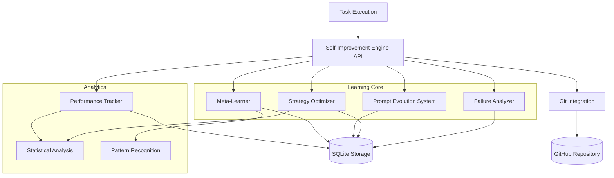
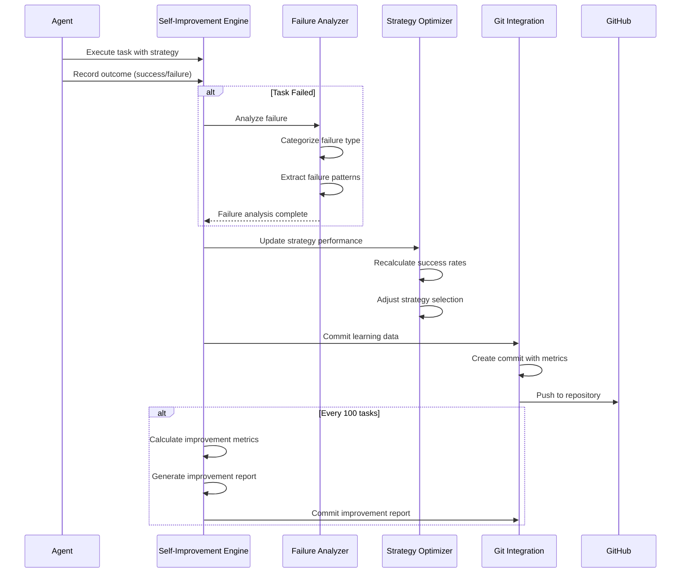

# Design Document: Self-Improvement Engine

## Overview

The Self-Improvement Engine is the core differentiator of Agent_Guru that enables autonomous learning and continuous optimization. This system implements self-rewriting agent architecture and learning reasoning strategies over time—two of the mandatory architectural innovations. The engine analyzes failures, identifies reasoning mistakes, rewrites prompts, optimizes tool usage, and measurably improves performance without human intervention.

**Core Innovation**: Unlike traditional static agents, this system creates a feedback loop where the agent observes its own behavior, learns from mistakes, and modifies its own operational parameters. After 100 tasks, the agent must demonstrate statistically significant improvement in success rate, reasoning accuracy, and task completion efficiency.

**Key Capabilities**:
- **Failure Analysis**: Captures and categorizes failures (hallucinations, tool errors, reasoning errors)
- **Strategy Learning**: Discovers which approaches work best for different task types
- **Prompt Evolution**: Automatically refines prompts based on outcomes
- **Performance Tracking**: Measures improvement over time with statistical rigor
- **Meta-Learning**: Identifies patterns in success and failure across tasks

**Architecture Principles**:
1. **Observable**: Every task execution is instrumented for analysis
2. **Measurable**: All improvements are quantified with confidence intervals
3. **Incremental**: Learning happens continuously, not in batch
4. **Versioned**: All changes (prompts, strategies) are versioned in Git
5. **Reversible**: Poor changes can be rolled back automatically
6. **Testable**: Property-based tests verify learning effectiveness

The system uses Python with:
- **SQLite**: For structured storage of failures, strategies, and metrics
- **NumPy/SciPy**: For statistical analysis and confidence intervals
- **GitPython**: For automated commits of learned improvements
- **scikit-learn**: For pattern recognition and clustering

## Integration Points

This system integrates with all Agent_Guru components to observe and improve their behavior.

### Dependencies

**Upstream Dependencies** (systems this component depends on):
- **Agent Orchestration** (guru-agent-orchestration): Observes task execution outcomes
- **Memory System** (guru-memory-system): Stores learning data and retrieves historical patterns
- **LLM Runtime** (guru-llm-runtime): Monitors LLM responses for hallucinations and errors

**Downstream Dependencies** (systems that depend on this component):
- **Agent Orchestration**: Uses optimized strategies from Strategy_Optimizer
- **LLM Runtime**: Uses evolved prompts from Prompt_Evolution_System

### API Contracts

**Agent Orchestration Integration:**
```python
class SelfImprovementEngine:
    """Core self-improvement system."""
    
    def record_task_execution(
        self,
        task_id: str,
        task_type: str,
        strategy_used: str,
        success: bool,
        execution_time_ms: float,
        error_details: Optional[Dict] = None
    ) -> None:
        """
        Record task execution outcome for learning.
        
        Called by Agent Orchestration after each task.
        """
        pass
    
    def get_optimal_strategy(
        self,
        task_type: str
    ) -> Strategy:
        """
        Get the optimal strategy for a task type.
        
        Returns strategy with highest success rate.
        """
        pass
```

**LLM Runtime Integration:**
```python
class SelfImprovementEngine:
    def get_evolved_prompt(
        self,
        prompt_type: str,
        context: Dict[str, Any]
    ) -> str:
        """
        Get evolved prompt for LLM Runtime.
        
        Returns the current best-performing prompt version.
        """
        pass
    
    def record_llm_response(
        self,
        prompt_id: str,
        response: str,
        was_successful: bool,
        hallucination_detected: bool
    ) -> None:
        """
        Record LLM response quality for prompt evolution.
        """
        pass
```

### Data Flow

1. **Task Execution Flow:**
   - Agent Orchestration starts task
   - Self-Improvement Engine provides optimal strategy
   - Task executes with instrumentation
   - Outcome recorded in Self-Improvement Engine
   - Strategy performance updated
   - If 100 tasks completed, trigger improvement analysis

2. **Failure Learning Flow:**
   - Task fails
   - Failure_Analyzer categorizes failure type
   - Failure stored with full context
   - Pattern analysis identifies common failure modes
   - Strategy_Optimizer adjusts strategy selection
   - Prompt_Evolution_System refines prompts if needed

3. **GitHub Commit Flow:**
   - Task completes
   - Performance_Tracker updates metrics
   - Changes serialized to JSON
   - GitPython creates commit with learning data
   - Commit pushed to repository
   - Local backup maintained

## Architecture

### Component Diagram



### Learning Cycle



## Components and Interfaces

### 1. Self-Improvement Engine API (`self_improvement_engine.py`)

The main interface for all self-improvement operations.

```python
from typing import Dict, Any, Optional, List
from dataclasses import dataclass
from datetime import datetime
from enum import Enum

class FailureType(Enum):
    """Types of failures the system can learn from."""
    REASONING_ERROR = "reasoning_error"
    TOOL_ERROR = "tool_error"
    HALLUCINATION = "hallucination"
    TIMEOUT = "timeout"
    RESOURCE_ERROR = "resource_error"
    UNKNOWN = "unknown"

@dataclass
class TaskExecution:
    """Record of a single task execution."""
    task_id: str
    task_type: str
    strategy_id: str
    timestamp: datetime
    success: bool
    execution_time_ms: float
    failure_type: Optional[FailureType]
    error_details: Optional[Dict[str, Any]]
    context: Dict[str, Any]

@dataclass
class Strategy:
    """A strategy for executing tasks."""
    strategy_id: str
    name: str
    description: str
    task_types: List[str]
    parameters: Dict[str, Any]
    success_rate: float
    total_executions: int
    created_at: datetime
    last_updated: datetime

class SelfImprovementEngine:
    """
    Main interface for self-improvement operations.
    
    Coordinates all learning components and provides unified API.
    """
    
    def __init__(
        self,
        storage_path: str,
        git_repo_path: str,
        improvement_threshold: float = 0.15,
        measurement_window: int = 100
    ):
        """
        Initialize self-improvement engine.
        
        Args:
            storage_path: Path to SQLite database
            git_repo_path: Path to Git repository for versioning
            improvement_threshold: Minimum relative improvement required (15%)
            measurement_window: Number of tasks for improvement measurement (100)
        """
        self.storage_path = storage_path
        self.git_repo_path = git_repo_path
        self.improvement_threshold = improvement_threshold
        self.measurement_window = measurement_window
        
        # Initialize components
        self.failure_analyzer = FailureAnalyzer(storage_path)
        self.strategy_optimizer = StrategyOptimizer(storage_path)
        self.prompt_evolution = PromptEvolutionSystem(storage_path)
        self.performance_tracker = PerformanceTracker(storage_path)
        self.meta_learner = MetaLearner(storage_path)
        self.git_integration = GitIntegration(git_repo_path)
    
    def record_task_execution(
        self,
        task_id: str,
        task_type: str,
        strategy_used: str,
        success: bool,
        execution_time_ms: float,
        error_details: Optional[Dict] = None,
        context: Optional[Dict] = None
    ) -> None:
        """
        Record task execution outcome for learning.
        
        This is the main entry point called by Agent Orchestration.
        
        Args:
            task_id: Unique task identifier
            task_type: Type of task executed
            strategy_used: Strategy ID that was used
            success: Whether task succeeded
            execution_time_ms: Task execution time
            error_details: Details if task failed
            context: Additional context about execution
        """
        execution = TaskExecution(
            task_id=task_id,
            task_type=task_type,
            strategy_id=strategy_used,
            timestamp=datetime.now(),
            success=success,
            execution_time_ms=execution_time_ms,
            failure_type=self._classify_failure(error_details) if not success else None,
            error_details=error_details,
            context=context or {}
        )
        
        # Record in performance tracker
        self.performance_tracker.record_execution(execution)
        
        # If failed, analyze failure
        if not success:
            self.failure_analyzer.analyze_failure(execution)
        
        # Update strategy performance
        self.strategy_optimizer.update_strategy_performance(
            strategy_used, success, execution_time_ms
        )
        
        # Feed to meta-learner
        self.meta_learner.process_execution(execution)
        
        # Commit to Git
        self.git_integration.commit_execution_data(execution)
        
        # Check if we've hit measurement window
        if self.performance_tracker.get_total_executions() % self.measurement_window == 0:
            self._generate_improvement_report()
    
    def get_optimal_strategy(
        self,
        task_type: str,
        context: Optional[Dict] = None
    ) -> Strategy:
        """
        Get the optimal strategy for a task type.
        
        Uses meta-learner to match context patterns and strategy optimizer
        to select highest-performing strategy.
        
        Args:
            task_type: Type of task to execute
            context: Optional context for pattern matching
            
        Returns:
            Strategy with highest success rate for this task type
        """
        # Get pattern-based recommendations
        recommended_strategies = self.meta_learner.recommend_strategies(
            task_type, context
        )
        
        # Get performance-based ranking
        ranked_strategies = self.strategy_optimizer.rank_strategies(
            task_type, recommended_strategies
        )
        
        # Return top strategy with exploration
        return self.strategy_optimizer.select_with_exploration(ranked_strategies)
    
    def get_evolved_prompt(
        self,
        prompt_type: str,
        context: Dict[str, Any]
    ) -> str:
        """
        Get evolved prompt for LLM Runtime.
        
        Returns the current best-performing prompt version.
        
        Args:
            prompt_type: Type of prompt needed
            context: Context for prompt generation
            
        Returns:
            Evolved prompt text
        """
        return self.prompt_evolution.get_current_prompt(prompt_type, context)
    
    def record_llm_response(
        self,
        prompt_id: str,
        response: str,
        was_successful: bool,
        hallucination_detected: bool
    ) -> None:
        """
        Record LLM response quality for prompt evolution.
        
        Args:
            prompt_id: ID of prompt that was used
            response: LLM response text
            was_successful: Whether response led to successful task
            hallucination_detected: Whether hallucination was detected
        """
        self.prompt_evolution.record_prompt_outcome(
            prompt_id, was_successful, hallucination_detected
        )
        
        if hallucination_detected:
            self.failure_analyzer.record_hallucination(prompt_id, response)
    
    def get_improvement_metrics(self) -> Dict[str, Any]:
        """
        Get current improvement metrics.
        
        Returns:
            Dictionary with success rate, reasoning accuracy, efficiency metrics
        """
        return self.performance_tracker.get_current_metrics()
    
    def inject_test_failure(
        self,
        failure_type: FailureType,
        task_type: str,
        context: Dict[str, Any]
    ) -> None:
        """
        Inject a test failure for validation.
        
        Used by testing framework to verify learning.
        
        Args:
            failure_type: Type of failure to inject
            task_type: Task type for the failure
            context: Failure context
        """
        test_execution = TaskExecution(
            task_id=f"test_{datetime.now().timestamp()}",
            task_type=task_type,
            strategy_id="test_strategy",
            timestamp=datetime.now(),
            success=False,
            execution_time_ms=0.0,
            failure_type=failure_type,
            error_details={"test": True, "context": context},
            context=context
        )
        
        self.failure_analyzer.analyze_failure(test_execution)
    
    def _classify_failure(self, error_details: Optional[Dict]) -> FailureType:
        """Classify failure type from error details."""
        if not error_details:
            return FailureType.UNKNOWN
        
        error_type = error_details.get("type", "").lower()
        
        if "reasoning" in error_type or "logic" in error_type:
            return FailureType.REASONING_ERROR
        elif "tool" in error_type or "function" in error_type:
            return FailureType.TOOL_ERROR
        elif "hallucination" in error_type or "fabrication" in error_type:
            return FailureType.HALLUCINATION
        elif "timeout" in error_type:
            return FailureType.TIMEOUT
        elif "resource" in error_type or "memory" in error_type:
            return FailureType.RESOURCE_ERROR
        else:
            return FailureType.UNKNOWN
    
    def _generate_improvement_report(self) -> None:
        """Generate improvement report after measurement window."""
        report = self.performance_tracker.generate_improvement_report(
            self.measurement_window
        )
        
        # Commit report to Git
        self.git_integration.commit_improvement_report(report)
        
        # Check if improvement threshold met
        if report["relative_improvement"] < self.improvement_threshold:
            # Trigger alert
            self._trigger_improvement_alert(report)
    
    def _trigger_improvement_alert(self, report: Dict[str, Any]) -> None:
        """Trigger alert if improvement targets not met."""
        # Log alert
        print(f"WARNING: Improvement target not met. Report: {report}")
        
        # Could integrate with monitoring system here
```

### 2. Failure Analyzer (`failure_analyzer.py`)

Captures and categorizes failures for learning.

```python
from typing import Dict, List, Optional, Any
from dataclasses import dataclass
from datetime import datetime
import sqlite3
import json

@dataclass
class FailurePattern:
    """A pattern identified across multiple failures."""
    pattern_id: str
    failure_type: FailureType
    common_features: Dict[str, Any]
    occurrence_count: int
    first_seen: datetime
    last_seen: datetime

class FailureAnalyzer:
    """
    Analyzes failures to identify patterns and root causes.
    
    Categorizes failures and extracts common patterns for learning.
    """
    
    def __init__(self, storage_path: str):
        """Initialize with database path."""
        self.storage_path = storage_path
        self._init_database()
    
    def _init_database(self) -> None:
        """Initialize database schema."""
        conn = sqlite3.connect(self.storage_path)
        cursor = conn.cursor()
        
        cursor.execute("""
            CREATE TABLE IF NOT EXISTS failures (
                id TEXT PRIMARY KEY,
                task_id TEXT NOT NULL,
                task_type TEXT NOT NULL,
                strategy_id TEXT NOT NULL,
                failure_type TEXT NOT NULL,
                timestamp TEXT NOT NULL,
                execution_context TEXT NOT NULL,
                error_details TEXT NOT NULL,
                reasoning_step TEXT,
                tool_name TEXT,
                hallucination_content TEXT
            )
        """)
        
        cursor.execute("""
            CREATE TABLE IF NOT EXISTS failure_patterns (
                pattern_id TEXT PRIMARY KEY,
                failure_type TEXT NOT NULL,
                common_features TEXT NOT NULL,
                occurrence_count INTEGER NOT NULL,
                first_seen TEXT NOT NULL,
                last_seen TEXT NOT NULL
            )
        """)
        
        cursor.execute("""
            CREATE INDEX IF NOT EXISTS idx_failures_type 
            ON failures(failure_type)
        """)
        
        cursor.execute("""
            CREATE INDEX IF NOT EXISTS idx_failures_task_type 
            ON failures(task_type)
        """)
        
        conn.commit()
        conn.close()
    
    def analyze_failure(self, execution: TaskExecution) -> None:
        """
        Analyze a failed task execution.
        
        Categorizes failure, extracts context, and identifies patterns.
        
        Args:
            execution: Failed task execution record
        """
        # Store failure
        self._store_failure(execution)
        
        # Extract specific failure details
        if execution.failure_type == FailureType.REASONING_ERROR:
            self._analyze_reasoning_error(execution)
        elif execution.failure_type == FailureType.TOOL_ERROR:
            self._analyze_tool_error(execution)
        elif execution.failure_type == FailureType.HALLUCINATION:
            self._analyze_hallucination(execution)
        
        # Update patterns
        self._update_failure_patterns(execution)
    
    def _store_failure(self, execution: TaskExecution) -> None:
        """Store failure in database."""
        conn = sqlite3.connect(self.storage_path)
        cursor = conn.cursor()
        
        cursor.execute("""
            INSERT INTO failures (
                id, task_id, task_type, strategy_id, failure_type,
                timestamp, execution_context, error_details,
                reasoning_step, tool_name, hallucination_content
            ) VALUES (?, ?, ?, ?, ?, ?, ?, ?, ?, ?, ?)
        """, (
            f"failure_{execution.task_id}",
            execution.task_id,
            execution.task_type,
            execution.strategy_id,
            execution.failure_type.value,
            execution.timestamp.isoformat(),
            json.dumps(execution.context),
            json.dumps(execution.error_details or {}),
            execution.error_details.get("reasoning_step") if execution.error_details else None,
            execution.error_details.get("tool_name") if execution.error_details else None,
            execution.error_details.get("hallucination_content") if execution.error_details else None
        ))
        
        conn.commit()
        conn.close()
    
    def _analyze_reasoning_error(self, execution: TaskExecution) -> None:
        """Analyze reasoning error to identify logical mistake."""
        if not execution.error_details:
            return
        
        reasoning_step = execution.error_details.get("reasoning_step")
        if reasoning_step:
            # Extract the specific logical step where reasoning diverged
            # This would integrate with LLM Runtime to get reasoning trace
            pass
    
    def _analyze_tool_error(self, execution: TaskExecution) -> None:
        """Analyze tool error to identify misuse pattern."""
        if not execution.error_details:
            return
        
        tool_name = execution.error_details.get("tool_name")
        if tool_name:
            # Record which tool was misused and how
            # This helps Strategy Optimizer avoid similar mistakes
            pass
    
    def _analyze_hallucination(self, execution: TaskExecution) -> None:
        """Analyze hallucination to identify fabricated information."""
        if not execution.error_details:
            return
        
        hallucination_content = execution.error_details.get("hallucination_content")
        if hallucination_content:
            # Record what was fabricated vs what was correct
            # This helps Prompt Evolution System refine prompts
            pass
    
    def _update_failure_patterns(self, execution: TaskExecution) -> None:
        """Update failure patterns based on new failure."""
        # Extract features from failure
        features = self._extract_failure_features(execution)
        
        # Find matching patterns
        matching_pattern = self._find_matching_pattern(
            execution.failure_type, features
        )
        
        if matching_pattern:
            # Update existing pattern
            self._increment_pattern_count(matching_pattern.pattern_id)
        else:
            # Create new pattern
            self._create_new_pattern(execution.failure_type, features)
    
    def _extract_failure_features(self, execution: TaskExecution) -> Dict[str, Any]:
        """Extract features from failure for pattern matching."""
        features = {
            "task_type": execution.task_type,
            "strategy_id": execution.strategy_id,
            "failure_type": execution.failure_type.value
        }
        
        if execution.error_details:
            features.update({
                k: v for k, v in execution.error_details.items()
                if k in ["tool_name", "reasoning_step", "error_category"]
            })
        
        return features
    
    def _find_matching_pattern(
        self,
        failure_type: FailureType,
        features: Dict[str, Any]
    ) -> Optional[FailurePattern]:
        """Find existing pattern matching these features."""
        conn = sqlite3.connect(self.storage_path)
        cursor = conn.cursor()
        
        cursor.execute("""
            SELECT pattern_id, failure_type, common_features, 
                   occurrence_count, first_seen, last_seen
            FROM failure_patterns
            WHERE failure_type = ?
        """, (failure_type.value,))
        
        for row in cursor.fetchall():
            stored_features = json.loads(row[2])
            if self._features_match(features, stored_features):
                conn.close()
                return FailurePattern(
                    pattern_id=row[0],
                    failure_type=FailureType(row[1]),
                    common_features=stored_features,
                    occurrence_count=row[3],
                    first_seen=datetime.fromisoformat(row[4]),
                    last_seen=datetime.fromisoformat(row[5])
                )
        
        conn.close()
        return None
    
    def _features_match(
        self,
        features1: Dict[str, Any],
        features2: Dict[str, Any],
        threshold: float = 0.7
    ) -> bool:
        """Check if two feature sets match above threshold."""
        common_keys = set(features1.keys()) & set(features2.keys())
        if not common_keys:
            return False
        
        matching = sum(
            1 for k in common_keys
            if features1[k] == features2[k]
        )
        
        return (matching / len(common_keys)) >= threshold
    
    def _increment_pattern_count(self, pattern_id: str) -> None:
        """Increment occurrence count for pattern."""
        conn = sqlite3.connect(self.storage_path)
        cursor = conn.cursor()
        
        cursor.execute("""
            UPDATE failure_patterns
            SET occurrence_count = occurrence_count + 1,
                last_seen = ?
            WHERE pattern_id = ?
        """, (datetime.now().isoformat(), pattern_id))
        
        conn.commit()
        conn.close()
    
    def _create_new_pattern(
        self,
        failure_type: FailureType,
        features: Dict[str, Any]
    ) -> None:
        """Create new failure pattern."""
        conn = sqlite3.connect(self.storage_path)
        cursor = conn.cursor()
        
        pattern_id = f"pattern_{datetime.now().timestamp()}"
        now = datetime.now().isoformat()
        
        cursor.execute("""
            INSERT INTO failure_patterns (
                pattern_id, failure_type, common_features,
                occurrence_count, first_seen, last_seen
            ) VALUES (?, ?, ?, ?, ?, ?)
        """, (
            pattern_id,
            failure_type.value,
            json.dumps(features),
            1,
            now,
            now
        ))
        
        conn.commit()
        conn.close()
    
    def get_failure_patterns(
        self,
        failure_type: Optional[FailureType] = None,
        min_occurrences: int = 2
    ) -> List[FailurePattern]:
        """
        Get identified failure patterns.
        
        Args:
            failure_type: Optional filter by failure type
            min_occurrences: Minimum occurrences to include
            
        Returns:
            List of failure patterns
        """
        conn = sqlite3.connect(self.storage_path)
        cursor = conn.cursor()
        
        query = """
            SELECT pattern_id, failure_type, common_features,
                   occurrence_count, first_seen, last_seen
            FROM failure_patterns
            WHERE occurrence_count >= ?
        """
        params = [min_occurrences]
        
        if failure_type:
            query += " AND failure_type = ?"
            params.append(failure_type.value)
        
        query += " ORDER BY occurrence_count DESC"
        
        cursor.execute(query, params)
        
        patterns = [
            FailurePattern(
                pattern_id=row[0],
                failure_type=FailureType(row[1]),
                common_features=json.loads(row[2]),
                occurrence_count=row[3],
                first_seen=datetime.fromisoformat(row[4]),
                last_seen=datetime.fromisoformat(row[5])
            )
            for row in cursor.fetchall()
        ]
        
        conn.close()
        return patterns
    
    def record_hallucination(
        self,
        prompt_id: str,
        hallucination_content: str
    ) -> None:
        """Record a hallucination for prompt evolution."""
        # This would be called by LLM Runtime when hallucination detected
        # Store for Prompt Evolution System to use
        pass
```

