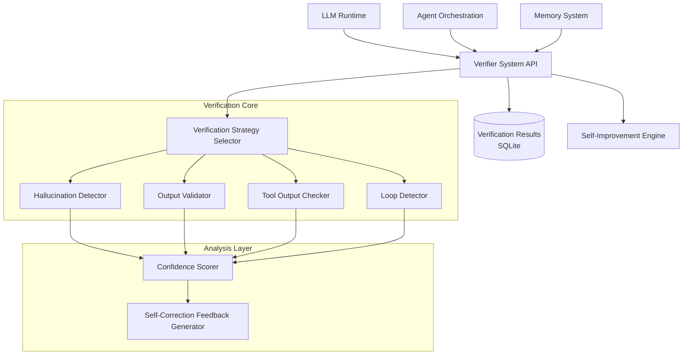
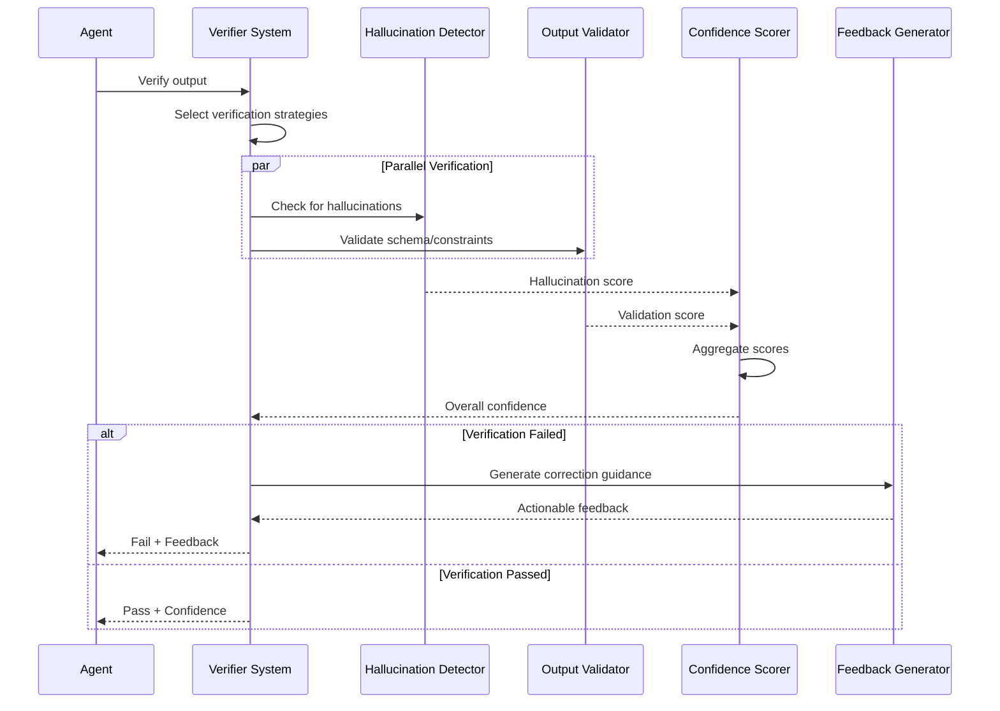

# Design Document: Verifier System

## Overview

The Verifier System is a critical reliability layer for Agent_Guru that ensures correctness and prevents errors from propagating through the autonomous AI system. It implements multi-layered verification with self-correction capabilities, detecting hallucinations, validating outputs, preventing infinite loops, and ensuring failure-resilient execution.

**Core Innovation**: Unlike traditional validation systems that simply pass/fail, this system provides actionable feedback for self-correction. When verification fails, the system analyzes the failure, identifies the specific issue, and provides guidance to improve the output—creating a feedback loop that enhances agent reliability over time.

**Key Capabilities**:
- **Hallucination Detection**: Multi-technique approach to identify fabricated information
- **Output Validation**: Schema and constraint verification for structured outputs
- **Tool Output Verification**: Validates tool execution results before use
- **Loop Detection**: Prevents infinite loops in agent reasoning
- **Confidence Scoring**: Assigns reliability scores to all outputs
- **Self-Correction Feedback**: Provides actionable guidance when verification fails
- **Integration with Self-Improvement**: Reports failures for learning

**Architecture Principles**:
1. **Multi-Layered**: Multiple verification techniques applied in parallel
2. **Fast**: Sub-200ms latency for 95% of verifications
3. **Accurate**: <5% false positives, <2% false negatives
4. **Actionable**: Failures include specific correction guidance
5. **Observable**: Comprehensive logging for debugging and monitoring
6. **Adaptive**: Learns from verification patterns over time

The system uses Python with:
- **Pydantic**: For schema validation and type checking
- **NumPy/SciPy**: For statistical analysis and confidence scoring
- **SQLite**: For verification result storage and audit trail
- **asyncio**: For parallel verification execution


## Integration Points

This system integrates with all Agent_Guru components to intercept and verify outputs before they are used.

### Dependencies

**Upstream Dependencies** (systems this component depends on):
- **LLM Runtime** (guru-llm-runtime): Intercepts LLM responses for verification
- **Agent Orchestration** (guru-agent-orchestration): Validates task outputs
- **Memory System** (guru-memory-system): Prevents storing hallucinated information

**Downstream Dependencies** (systems that depend on this component):
- **Self-Improvement Engine** (self-improvement-engine): Receives verification failure reports for learning
- **All agent components**: Rely on verified outputs for correctness

### API Contracts

**LLM Runtime Integration:**
```python
class VerifierSystem:
    """Core verification system."""
    
    async def verify_llm_response(
        self,
        response: str,
        context: Dict[str, Any],
        expected_format: Optional[str] = None
    ) -> VerificationResult:
        """
        Verify LLM response for hallucinations and correctness.
        
        Called by LLM Runtime before returning response to agent.
        
        Returns:
            VerificationResult with pass/fail, confidence, and feedback
        """
        pass
```

**Agent Orchestration Integration:**
```python
class VerifierSystem:
    async def verify_task_output(
        self,
        task_id: str,
        output: Any,
        expected_schema: Dict[str, Any]
    ) -> VerificationResult:
        """
        Verify task output before marking task complete.
        
        Called by Agent Orchestration after task execution.
        """
        pass
```

**Memory System Integration:**
```python
class VerifierSystem:
    async def verify_before_storage(
        self,
        content: str,
        metadata: Dict[str, Any]
    ) -> VerificationResult:
        """
        Verify information before storing in Memory System.
        
        Prevents hallucinated information from being persisted.
        """
        pass
```

### Data Flow

1. **LLM Response Verification Flow:**
   - LLM Runtime generates response
   - Verifier System intercepts response
   - Hallucination Detector analyzes for fabrications
   - Output Validator checks format/constraints
   - Confidence Scorer computes reliability score
   - If pass: response forwarded to agent
   - If fail: feedback provided for retry

2. **Task Output Verification Flow:**
   - Agent completes task
   - Agent Orchestration requests verification
   - Output Validator checks schema compliance
   - Tool Output Checker validates tool results
   - Loop Detector checks for circular reasoning
   - Verification Result returned to orchestrator
   - If fail: task retried with feedback

3. **Failure Reporting Flow:**
   - Verification fails
   - Verifier System generates detailed feedback
   - Failure reported to Self-Improvement Engine
   - Self-Improvement Engine analyzes pattern
   - Learning applied to prevent future failures


## Architecture

### Component Diagram



### Verification Pipeline




## Components and Interfaces

### 1. Verifier System API (`verifier_system.py`)

The main interface for all verification operations.

```python
from typing import Dict, Any, Optional, List
from dataclasses import dataclass
from datetime import datetime
from enum import Enum
import asyncio

class VerificationStatus(Enum):
    """Verification outcome status."""
    PASSED = "passed"
    FAILED = "failed"
    UNCERTAIN = "uncertain"

@dataclass
class VerificationResult:
    """Result of a verification operation."""
    status: VerificationStatus
    confidence_score: float  # 0.0 to 1.0
    feedback_messages: List[str]
    strategies_applied: List[str]
    hallucinations_detected: List[str]
    constraint_violations: List[str]
    timestamp: datetime
    verification_latency_ms: float
    metadata: Dict[str, Any]

class VerifierSystem:
    """
    Main interface for verification operations.
    
    Coordinates all verification components and provides unified API.
    """
    
    def __init__(
        self,
        storage_path: str,
        false_positive_threshold: float = 0.05,
        false_negative_threshold: float = 0.02,
        latency_target_ms: float = 200.0
    ):
        """
        Initialize verifier system.
        
        Args:
            storage_path: Path to SQLite database for results
            false_positive_threshold: Maximum acceptable false positive rate (5%)
            false_negative_threshold: Maximum acceptable false negative rate (2%)
            latency_target_ms: Target latency for 95th percentile (200ms)
        """
        self.storage_path = storage_path
        self.false_positive_threshold = false_positive_threshold
        self.false_negative_threshold = false_negative_threshold
        self.latency_target_ms = latency_target_ms
        
        # Initialize components
        self.strategy_selector = VerificationStrategySelector()
        self.hallucination_detector = HallucinationDetector()
        self.output_validator = OutputValidator()
        self.tool_output_checker = ToolOutputChecker()
        self.loop_detector = LoopDetector()
        self.confidence_scorer = ConfidenceScorer()
        self.feedback_generator = SelfCorrectionFeedbackGenerator()
        self.result_storage = VerificationResultStorage(storage_path)
    
    async def verify_llm_response(
        self,
        response: str,
        context: Dict[str, Any],
        expected_format: Optional[str] = None
    ) -> VerificationResult:
        """
        Verify LLM response for hallucinations and correctness.
        
        Args:
            response: LLM response text
            context: Context including prompt, conversation history
            expected_format: Optional expected format (json, markdown, etc.)
            
        Returns:
            VerificationResult with pass/fail, confidence, and feedback
        """
        start_time = datetime.now()
        
        # Select verification strategies
        strategies = self.strategy_selector.select_for_llm_response(
            response, context, expected_format
        )
        
        # Execute verifications in parallel
        verification_tasks = []
        
        if "hallucination_detection" in strategies:
            verification_tasks.append(
                self.hallucination_detector.detect(response, context)
            )
        
        if "format_validation" in strategies and expected_format:
            verification_tasks.append(
                self.output_validator.validate_format(response, expected_format)
            )
        
        # Wait for all verifications
        results = await asyncio.gather(*verification_tasks, return_exceptions=True)
        
        # Aggregate results
        hallucinations = []
        constraint_violations = []
        verification_scores = []
        
        for result in results:
            if isinstance(result, Exception):
                # Log error but continue
                continue
            
            if hasattr(result, "hallucinations"):
                hallucinations.extend(result.hallucinations)
            if hasattr(result, "violations"):
                constraint_violations.extend(result.violations)
            if hasattr(result, "score"):
                verification_scores.append(result.score)
        
        # Compute overall confidence
        confidence = self.confidence_scorer.aggregate_scores(verification_scores)
        
        # Determine status
        status = self._determine_status(confidence, hallucinations, constraint_violations)
        
        # Generate feedback if failed
        feedback_messages = []
        if status == VerificationStatus.FAILED:
            feedback_messages = self.feedback_generator.generate_feedback(
                hallucinations, constraint_violations, context
            )
        
        # Calculate latency
        latency_ms = (datetime.now() - start_time).total_seconds() * 1000
        
        # Create result
        result = VerificationResult(
            status=status,
            confidence_score=confidence,
            feedback_messages=feedback_messages,
            strategies_applied=strategies,
            hallucinations_detected=hallucinations,
            constraint_violations=constraint_violations,
            timestamp=datetime.now(),
            verification_latency_ms=latency_ms,
            metadata={"type": "llm_response", "context": context}
        )
        
        # Store result
        await self.result_storage.store(result)
        
        # Report to self-improvement if failed
        if status == VerificationStatus.FAILED:
            await self._report_to_self_improvement(result)
        
        return result
    
    async def verify_task_output(
        self,
        task_id: str,
        output: Any,
        expected_schema: Dict[str, Any]
    ) -> VerificationResult:
        """
        Verify task output before marking task complete.
        
        Args:
            task_id: Task identifier
            output: Task output to verify
            expected_schema: Expected output schema
            
        Returns:
            VerificationResult
        """
        start_time = datetime.now()
        
        # Select strategies
        strategies = self.strategy_selector.select_for_task_output(
            output, expected_schema
        )
        
        # Execute verifications
        verification_tasks = []
        
        if "schema_validation" in strategies:
            verification_tasks.append(
                self.output_validator.validate_schema(output, expected_schema)
            )
        
        if "tool_output_check" in strategies:
            verification_tasks.append(
                self.tool_output_checker.check_output(output)
            )
        
        # Wait for verifications
        results = await asyncio.gather(*verification_tasks, return_exceptions=True)
        
        # Aggregate and create result (similar to verify_llm_response)
        # ... (implementation similar to above)
        
        pass
    
    async def verify_before_storage(
        self,
        content: str,
        metadata: Dict[str, Any]
    ) -> VerificationResult:
        """
        Verify information before storing in Memory System.
        
        Args:
            content: Content to verify
            metadata: Metadata about content
            
        Returns:
            VerificationResult
        """
        # Primarily check for hallucinations
        return await self.verify_llm_response(
            response=content,
            context=metadata,
            expected_format=None
        )
    
    def _determine_status(
        self,
        confidence: float,
        hallucinations: List[str],
        violations: List[str]
    ) -> VerificationStatus:
        """Determine verification status from signals."""
        if hallucinations or violations:
            return VerificationStatus.FAILED
        
        if confidence >= 0.8:
            return VerificationStatus.PASSED
        elif confidence >= 0.5:
            return VerificationStatus.UNCERTAIN
        else:
            return VerificationStatus.FAILED
    
    async def _report_to_self_improvement(
        self,
        result: VerificationResult
    ) -> None:
        """Report verification failure to Self-Improvement Engine."""
        # This would integrate with Self-Improvement Engine
        # to report failures for learning
        pass
    
    async def get_accuracy_metrics(self) -> Dict[str, float]:
        """
        Get current accuracy metrics.
        
        Returns:
            Dictionary with false_positive_rate, false_negative_rate
        """
        return await self.result_storage.compute_accuracy_metrics()
    
    async def inject_test_hallucination(
        self,
        content: str,
        hallucination_type: str
    ) -> None:
        """
        Inject test hallucination for validation.
        
        Used by testing framework to verify detection.
        """
        await self.hallucination_detector.inject_test_hallucination(
            content, hallucination_type
        )
```


### 2. Hallucination Detector (`hallucination_detector.py`)

Detects fabricated information using multiple techniques.

```python
from typing import List, Dict, Any, Optional
from dataclasses import dataclass
import re

@dataclass
class HallucinationDetectionResult:
    """Result of hallucination detection."""
    hallucinations: List[str]
    score: float  # 0.0 = no hallucinations, 1.0 = definite hallucinations
    detection_methods: List[str]
    confidence: float

class HallucinationDetector:
    """
    Detects hallucinations using multiple techniques.
    
    Techniques:
    1. Factual consistency checking
    2. Cross-reference validation
    3. Confidence signal analysis
    4. Pattern-based detection
    """
    
    def __init__(self):
        """Initialize hallucination detector."""
        self.known_facts_cache = {}
        self.hallucination_patterns = self._load_hallucination_patterns()
    
    async def detect(
        self,
        response: str,
        context: Dict[str, Any]
    ) -> HallucinationDetectionResult:
        """
        Detect hallucinations in response.
        
        Args:
            response: Text to check for hallucinations
            context: Context including prompt, conversation history
            
        Returns:
            HallucinationDetectionResult
        """
        hallucinations = []
        detection_methods = []
        scores = []
        
        # Technique 1: Factual consistency
        factual_issues = await self._check_factual_consistency(response, context)
        if factual_issues:
            hallucinations.extend(factual_issues)
            detection_methods.append("factual_consistency")
            scores.append(0.8)
        
        # Technique 2: Cross-reference validation
        cross_ref_issues = await self._cross_reference_validation(response, context)
        if cross_ref_issues:
            hallucinations.extend(cross_ref_issues)
            detection_methods.append("cross_reference")
            scores.append(0.9)
        
        # Technique 3: Confidence signal analysis
        confidence_issues = await self._analyze_confidence_signals(response)
        if confidence_issues:
            hallucinations.extend(confidence_issues)
            detection_methods.append("confidence_signals")
            scores.append(0.6)
        
        # Technique 4: Pattern-based detection
        pattern_issues = await self._pattern_based_detection(response)
        if pattern_issues:
            hallucinations.extend(pattern_issues)
            detection_methods.append("pattern_based")
            scores.append(0.7)
        
        # Aggregate score
        overall_score = max(scores) if scores else 0.0
        confidence = sum(scores) / len(scores) if scores else 1.0
        
        return HallucinationDetectionResult(
            hallucinations=hallucinations,
            score=overall_score,
            detection_methods=detection_methods,
            confidence=confidence
        )
    
    async def _check_factual_consistency(
        self,
        response: str,
        context: Dict[str, Any]
    ) -> List[str]:
        """Check for factual inconsistencies."""
        issues = []
        
        # Extract claims from response
        claims = self._extract_claims(response)
        
        # Check each claim against known facts
        for claim in claims:
            if not await self._verify_claim(claim, context):
                issues.append(f"Unverified claim: {claim}")
        
        return issues
    
    async def _cross_reference_validation(
        self,
        response: str,
        context: Dict[str, Any]
    ) -> List[str]:
        """Cross-reference response with context."""
        issues = []
        
        # Check if response contradicts context
        contradictions = self._find_contradictions(response, context)
        for contradiction in contradictions:
            issues.append(f"Contradiction: {contradiction}")
        
        return issues
    
    async def _analyze_confidence_signals(
        self,
        response: str
    ) -> List[str]:
        """Analyze confidence signals in response."""
        issues = []
        
        # Look for hedging language that might indicate uncertainty
        hedging_patterns = [
            r"I think",
            r"probably",
            r"might be",
            r"could be",
            r"I'm not sure"
        ]
        
        for pattern in hedging_patterns:
            if re.search(pattern, response, re.IGNORECASE):
                issues.append(f"Uncertainty signal detected: {pattern}")
        
        return issues
    
    async def _pattern_based_detection(
        self,
        response: str
    ) -> List[str]:
        """Detect hallucinations using known patterns."""
        issues = []
        
        for pattern in self.hallucination_patterns:
            if pattern.matches(response):
                issues.append(f"Known hallucination pattern: {pattern.name}")
        
        return issues
    
    def _extract_claims(self, text: str) -> List[str]:
        """Extract factual claims from text."""
        # Simple sentence splitting for now
        # In production, would use NLP for claim extraction
        sentences = text.split(". ")
        return [s.strip() for s in sentences if s.strip()]
    
    async def _verify_claim(
        self,
        claim: str,
        context: Dict[str, Any]
    ) -> bool:
        """Verify a claim against known facts."""
        # Check cache first
        if claim in self.known_facts_cache:
            return self.known_facts_cache[claim]
        
        # Check against context
        # In production, would integrate with knowledge base
        verified = self._claim_in_context(claim, context)
        
        # Cache result
        self.known_facts_cache[claim] = verified
        
        return verified
    
    def _claim_in_context(
        self,
        claim: str,
        context: Dict[str, Any]
    ) -> bool:
        """Check if claim is supported by context."""
        # Simple keyword matching for now
        # In production, would use semantic similarity
        context_text = str(context)
        return any(word in context_text for word in claim.split())
    
    def _find_contradictions(
        self,
        response: str,
        context: Dict[str, Any]
    ) -> List[str]:
        """Find contradictions between response and context."""
        contradictions = []
        
        # Extract key facts from context
        context_facts = self._extract_facts_from_context(context)
        
        # Extract facts from response
        response_facts = self._extract_claims(response)
        
        # Check for contradictions
        for resp_fact in response_facts:
            for ctx_fact in context_facts:
                if self._facts_contradict(resp_fact, ctx_fact):
                    contradictions.append(
                        f"Response '{resp_fact}' contradicts context '{ctx_fact}'"
                    )
        
        return contradictions
    
    def _extract_facts_from_context(
        self,
        context: Dict[str, Any]
    ) -> List[str]:
        """Extract facts from context."""
        facts = []
        
        # Extract from conversation history
        if "conversation_history" in context:
            for message in context["conversation_history"]:
                if isinstance(message, dict) and "content" in message:
                    facts.extend(self._extract_claims(message["content"]))
        
        return facts
    
    def _facts_contradict(self, fact1: str, fact2: str) -> bool:
        """Check if two facts contradict each other."""
        # Simple negation detection for now
        # In production, would use semantic analysis
        negation_words = ["not", "no", "never", "none"]
        
        fact1_lower = fact1.lower()
        fact2_lower = fact2.lower()
        
        # Check if one contains negation and they share keywords
        fact1_has_negation = any(neg in fact1_lower for neg in negation_words)
        fact2_has_negation = any(neg in fact2_lower for neg in negation_words)
        
        if fact1_has_negation != fact2_has_negation:
            # One has negation, other doesn't - check for shared keywords
            fact1_words = set(fact1_lower.split())
            fact2_words = set(fact2_lower.split())
            shared = fact1_words & fact2_words
            return len(shared) > 2  # Arbitrary threshold
        
        return False
    
    def _load_hallucination_patterns(self) -> List[Any]:
        """Load known hallucination patterns."""
        # In production, would load from database
        return []
    
    async def inject_test_hallucination(
        self,
        content: str,
        hallucination_type: str
    ) -> None:
        """Inject test hallucination for validation."""
        # Used by testing framework
        pass
```


### 3. Output Validator (`output_validator.py`)

Validates outputs against schemas and constraints.

```python
from typing import Dict, Any, List, Optional
from dataclasses import dataclass
from pydantic import BaseModel, ValidationError
import json

@dataclass
class ValidationResult:
    """Result of output validation."""
    violations: List[str]
    score: float  # 0.0 = many violations, 1.0 = no violations
    valid: bool

class OutputValidator:
    """
    Validates outputs against schemas and constraints.
    
    Supports:
    - JSON schema validation
    - Type checking
    - Format validation
    - Constraint verification
    """
    
    def __init__(self):
        """Initialize output validator."""
        pass
    
    async def validate_schema(
        self,
        output: Any,
        schema: Dict[str, Any]
    ) -> ValidationResult:
        """
        Validate output against schema.
        
        Args:
            output: Output to validate
            schema: JSON schema or Pydantic model
            
        Returns:
            ValidationResult
        """
        violations = []
        
        try:
            # If schema is a Pydantic model
            if isinstance(schema, type) and issubclass(schema, BaseModel):
                schema.parse_obj(output)
            else:
                # JSON schema validation
                self._validate_json_schema(output, schema)
        except ValidationError as e:
            violations = [str(err) for err in e.errors()]
        except Exception as e:
            violations = [f"Validation error: {str(e)}"]
        
        valid = len(violations) == 0
        score = 1.0 if valid else max(0.0, 1.0 - (len(violations) * 0.2))
        
        return ValidationResult(
            violations=violations,
            score=score,
            valid=valid
        )
    
    async def validate_format(
        self,
        output: str,
        expected_format: str
    ) -> ValidationResult:
        """
        Validate output format.
        
        Args:
            output: Output string
            expected_format: Expected format (json, markdown, xml, etc.)
            
        Returns:
            ValidationResult
        """
        violations = []
        
        if expected_format == "json":
            violations = self._validate_json_format(output)
        elif expected_format == "markdown":
            violations = self._validate_markdown_format(output)
        elif expected_format == "xml":
            violations = self._validate_xml_format(output)
        else:
            violations = [f"Unknown format: {expected_format}"]
        
        valid = len(violations) == 0
        score = 1.0 if valid else 0.0
        
        return ValidationResult(
            violations=violations,
            score=score,
            valid=valid
        )
    
    def _validate_json_schema(
        self,
        output: Any,
        schema: Dict[str, Any]
    ) -> None:
        """Validate against JSON schema."""
        # In production, would use jsonschema library
        # For now, basic type checking
        if "type" in schema:
            expected_type = schema["type"]
            actual_type = type(output).__name__
            
            type_map = {
                "object": "dict",
                "array": "list",
                "string": "str",
                "number": ["int", "float"],
                "boolean": "bool"
            }
            
            expected = type_map.get(expected_type, expected_type)
            if isinstance(expected, list):
                if actual_type not in expected:
                    raise ValidationError(
                        f"Expected {expected}, got {actual_type}"
                    )
            elif actual_type != expected:
                raise ValidationError(
                    f"Expected {expected}, got {actual_type}"
                )
    
    def _validate_json_format(self, output: str) -> List[str]:
        """Validate JSON format."""
        violations = []
        
        try:
            json.loads(output)
        except json.JSONDecodeError as e:
            violations.append(f"Invalid JSON: {str(e)}")
        
        return violations
    
    def _validate_markdown_format(self, output: str) -> List[str]:
        """Validate Markdown format."""
        violations = []
        
        # Basic markdown validation
        # Check for common markdown elements
        if not any(marker in output for marker in ["#", "*", "-", "`"]):
            violations.append("No markdown formatting detected")
        
        return violations
    
    def _validate_xml_format(self, output: str) -> List[str]:
        """Validate XML format."""
        violations = []
        
        try:
            import xml.etree.ElementTree as ET
            ET.fromstring(output)
        except ET.ParseError as e:
            violations.append(f"Invalid XML: {str(e)}")
        
        return violations
```

### 4. Tool Output Checker (`tool_output_checker.py`)

Validates tool execution results.

```python
from typing import Dict, Any, List, Optional
from dataclasses import dataclass

@dataclass
class ToolCheckResult:
    """Result of tool output check."""
    violations: List[str]
    score: float
    valid: bool

class ToolOutputChecker:
    """
    Validates tool execution results.
    
    Checks:
    - Tool execution success
    - Output format correctness
    - Semantic consistency
    """
    
    def __init__(self):
        """Initialize tool output checker."""
        self.tool_schemas = {}
    
    async def check_output(
        self,
        output: Any,
        tool_name: Optional[str] = None
    ) -> ToolCheckResult:
        """
        Check tool output validity.
        
        Args:
            output: Tool output to check
            tool_name: Optional tool name for schema lookup
            
        Returns:
            ToolCheckResult
        """
        violations = []
        
        # Check for error indicators
        if isinstance(output, dict):
            if "error" in output:
                violations.append(f"Tool error: {output['error']}")
            if "success" in output and not output["success"]:
                violations.append("Tool execution failed")
        
        # Check against tool schema if available
        if tool_name and tool_name in self.tool_schemas:
            schema_violations = self._check_against_schema(
                output, self.tool_schemas[tool_name]
            )
            violations.extend(schema_violations)
        
        # Check semantic consistency
        semantic_violations = self._check_semantic_consistency(output)
        violations.extend(semantic_violations)
        
        valid = len(violations) == 0
        score = 1.0 if valid else max(0.0, 1.0 - (len(violations) * 0.3))
        
        return ToolCheckResult(
            violations=violations,
            score=score,
            valid=valid
        )
    
    def _check_against_schema(
        self,
        output: Any,
        schema: Dict[str, Any]
    ) -> List[str]:
        """Check output against tool schema."""
        violations = []
        
        # Basic schema checking
        if "required_fields" in schema:
            for field in schema["required_fields"]:
                if isinstance(output, dict) and field not in output:
                    violations.append(f"Missing required field: {field}")
        
        return violations
    
    def _check_semantic_consistency(
        self,
        output: Any
    ) -> List[str]:
        """Check semantic consistency of output."""
        violations = []
        
        # Check for obviously invalid values
        if isinstance(output, dict):
            for key, value in output.items():
                if value is None and key in ["result", "data", "output"]:
                    violations.append(f"Null value for key field: {key}")
        
        return violations
    
    def register_tool_schema(
        self,
        tool_name: str,
        schema: Dict[str, Any]
    ) -> None:
        """Register schema for a tool."""
        self.tool_schemas[tool_name] = schema
```


### 5. Loop Detector (`loop_detector.py`)

Detects and prevents infinite loops in agent reasoning.

```python
from typing import List, Dict, Any, Optional
from dataclasses import dataclass
from datetime import datetime
import hashlib

@dataclass
class LoopDetectionResult:
    """Result of loop detection."""
    loop_detected: bool
    loop_pattern: Optional[List[str]]
    score: float  # 0.0 = no loop, 1.0 = definite loop
    diagnostic_info: Dict[str, Any]

class LoopDetector:
    """
    Detects infinite loops in agent reasoning.
    
    Tracks:
    - State repetition
    - Circular logic patterns
    - Execution traces
    """
    
    def __init__(
        self,
        repetition_threshold: int = 3,
        max_trace_length: int = 100
    ):
        """
        Initialize loop detector.
        
        Args:
            repetition_threshold: Number of repetitions to flag as loop
            max_trace_length: Maximum execution trace length to track
        """
        self.repetition_threshold = repetition_threshold
        self.max_trace_length = max_trace_length
        self.execution_traces: Dict[str, List[str]] = {}
    
    async def detect_loop(
        self,
        agent_id: str,
        current_state: Dict[str, Any]
    ) -> LoopDetectionResult:
        """
        Detect if agent is in an infinite loop.
        
        Args:
            agent_id: Agent identifier
            current_state: Current reasoning state
            
        Returns:
            LoopDetectionResult
        """
        # Get or create trace for this agent
        if agent_id not in self.execution_traces:
            self.execution_traces[agent_id] = []
        
        trace = self.execution_traces[agent_id]
        
        # Hash current state for comparison
        state_hash = self._hash_state(current_state)
        
        # Add to trace
        trace.append(state_hash)
        
        # Trim trace if too long
        if len(trace) > self.max_trace_length:
            trace = trace[-self.max_trace_length:]
            self.execution_traces[agent_id] = trace
        
        # Check for repetition
        repetition_count = trace.count(state_hash)
        loop_detected = repetition_count >= self.repetition_threshold
        
        # Extract loop pattern if detected
        loop_pattern = None
        if loop_detected:
            loop_pattern = self._extract_loop_pattern(trace, state_hash)
        
        # Calculate score
        score = min(1.0, repetition_count / self.repetition_threshold)
        
        # Diagnostic info
        diagnostic_info = {
            "trace_length": len(trace),
            "repetition_count": repetition_count,
            "state_hash": state_hash,
            "timestamp": datetime.now().isoformat()
        }
        
        return LoopDetectionResult(
            loop_detected=loop_detected,
            loop_pattern=loop_pattern,
            score=score,
            diagnostic_info=diagnostic_info
        )
    
    def _hash_state(self, state: Dict[str, Any]) -> str:
        """Hash state for comparison."""
        # Convert state to stable string representation
        state_str = json.dumps(state, sort_keys=True)
        return hashlib.sha256(state_str.encode()).hexdigest()[:16]
    
    def _extract_loop_pattern(
        self,
        trace: List[str],
        repeated_hash: str
    ) -> List[str]:
        """Extract the loop pattern from trace."""
        # Find all occurrences of repeated hash
        indices = [i for i, h in enumerate(trace) if h == repeated_hash]
        
        if len(indices) < 2:
            return [repeated_hash]
        
        # Extract pattern between first two occurrences
        start = indices[0]
        end = indices[1]
        pattern = trace[start:end]
        
        return pattern
    
    def reset_trace(self, agent_id: str) -> None:
        """Reset execution trace for agent."""
        if agent_id in self.execution_traces:
            del self.execution_traces[agent_id]
    
    def get_trace(self, agent_id: str) -> List[str]:
        """Get execution trace for agent."""
        return self.execution_traces.get(agent_id, [])
```

### 6. Confidence Scorer (`confidence_scorer.py`)

Computes confidence scores from verification signals.

```python
from typing import List, Dict, Any
import numpy as np

class ConfidenceScorer:
    """
    Computes confidence scores from verification signals.
    
    Aggregates multiple verification scores into overall confidence.
    """
    
    def __init__(self):
        """Initialize confidence scorer."""
        self.weights = {
            "hallucination": 0.4,
            "validation": 0.3,
            "tool_check": 0.2,
            "loop_detection": 0.1
        }
    
    def aggregate_scores(
        self,
        scores: List[float],
        weights: Optional[List[float]] = None
    ) -> float:
        """
        Aggregate multiple scores into overall confidence.
        
        Args:
            scores: List of verification scores (0.0 to 1.0)
            weights: Optional weights for each score
            
        Returns:
            Aggregated confidence score (0.0 to 1.0)
        """
        if not scores:
            return 0.0
        
        if weights is None:
            # Equal weighting
            return float(np.mean(scores))
        
        # Weighted average
        weighted_sum = sum(s * w for s, w in zip(scores, weights))
        weight_sum = sum(weights)
        
        return weighted_sum / weight_sum if weight_sum > 0 else 0.0
    
    def compute_confidence(
        self,
        hallucination_score: float,
        validation_score: float,
        tool_check_score: Optional[float] = None,
        loop_detection_score: Optional[float] = None
    ) -> float:
        """
        Compute overall confidence from component scores.
        
        Args:
            hallucination_score: Score from hallucination detection (0=bad, 1=good)
            validation_score: Score from output validation (0=bad, 1=good)
            tool_check_score: Optional score from tool checking
            loop_detection_score: Optional score from loop detection
            
        Returns:
            Overall confidence score (0.0 to 1.0)
        """
        scores = []
        weights = []
        
        # Hallucination (inverted - 0 means hallucination detected)
        scores.append(1.0 - hallucination_score)
        weights.append(self.weights["hallucination"])
        
        # Validation
        scores.append(validation_score)
        weights.append(self.weights["validation"])
        
        # Tool check
        if tool_check_score is not None:
            scores.append(tool_check_score)
            weights.append(self.weights["tool_check"])
        
        # Loop detection (inverted - 0 means no loop)
        if loop_detection_score is not None:
            scores.append(1.0 - loop_detection_score)
            weights.append(self.weights["loop_detection"])
        
        return self.aggregate_scores(scores, weights)
```


### 7. Self-Correction Feedback Generator (`feedback_generator.py`)

Generates actionable feedback for self-correction.

```python
from typing import List, Dict, Any

class SelfCorrectionFeedbackGenerator:
    """
    Generates actionable feedback when verification fails.
    
    Provides specific guidance for correcting outputs.
    """
    
    def __init__(self):
        """Initialize feedback generator."""
        pass
    
    def generate_feedback(
        self,
        hallucinations: List[str],
        violations: List[str],
        context: Dict[str, Any]
    ) -> List[str]:
        """
        Generate actionable feedback messages.
        
        Args:
            hallucinations: Detected hallucinations
            violations: Constraint violations
            context: Context for feedback generation
            
        Returns:
            List of feedback messages
        """
        feedback = []
        
        # Feedback for hallucinations
        for hallucination in hallucinations:
            feedback.append(
                self._generate_hallucination_feedback(hallucination, context)
            )
        
        # Feedback for violations
        for violation in violations:
            feedback.append(
                self._generate_violation_feedback(violation, context)
            )
        
        # General improvement suggestions
        if hallucinations or violations:
            feedback.append(
                "Consider revising your response to address the issues above."
            )
        
        return feedback
    
    def _generate_hallucination_feedback(
        self,
        hallucination: str,
        context: Dict[str, Any]
    ) -> str:
        """Generate feedback for hallucination."""
        if "Unverified claim" in hallucination:
            claim = hallucination.replace("Unverified claim: ", "")
            return (
                f"The claim '{claim}' could not be verified. "
                f"Please provide evidence or remove this claim."
            )
        elif "Contradiction" in hallucination:
            return (
                f"Detected contradiction: {hallucination}. "
                f"Please ensure consistency with the context."
            )
        elif "Uncertainty signal" in hallucination:
            return (
                f"Detected uncertainty: {hallucination}. "
                f"If you're unsure, please state that explicitly or gather more information."
            )
        else:
            return f"Potential hallucination detected: {hallucination}"
    
    def _generate_violation_feedback(
        self,
        violation: str,
        context: Dict[str, Any]
    ) -> str:
        """Generate feedback for constraint violation."""
        if "Missing required field" in violation:
            field = violation.replace("Missing required field: ", "")
            return f"Please include the required field: {field}"
        elif "Invalid JSON" in violation:
            return "The output is not valid JSON. Please ensure proper JSON formatting."
        elif "Expected" in violation and "got" in violation:
            return f"Type mismatch: {violation}. Please correct the output type."
        else:
            return f"Constraint violation: {violation}"
```

### 8. Verification Strategy Selector (`strategy_selector.py`)

Selects appropriate verification strategies for each task.

```python
from typing import List, Dict, Any, Optional

class VerificationStrategySelector:
    """
    Selects appropriate verification strategies for each task.
    
    Chooses which verification methods to apply based on task type.
    """
    
    def __init__(self):
        """Initialize strategy selector."""
        pass
    
    def select_for_llm_response(
        self,
        response: str,
        context: Dict[str, Any],
        expected_format: Optional[str]
    ) -> List[str]:
        """
        Select strategies for LLM response verification.
        
        Args:
            response: LLM response
            context: Context including prompt
            expected_format: Expected format if specified
            
        Returns:
            List of strategy names to apply
        """
        strategies = []
        
        # Always check for hallucinations
        strategies.append("hallucination_detection")
        
        # If format specified, validate format
        if expected_format:
            strategies.append("format_validation")
        
        # If response contains factual claims, enable cross-reference
        if self._contains_factual_claims(response):
            strategies.append("cross_reference_validation")
        
        return strategies
    
    def select_for_task_output(
        self,
        output: Any,
        expected_schema: Dict[str, Any]
    ) -> List[str]:
        """
        Select strategies for task output verification.
        
        Args:
            output: Task output
            expected_schema: Expected output schema
            
        Returns:
            List of strategy names to apply
        """
        strategies = []
        
        # Always validate schema
        strategies.append("schema_validation")
        
        # If output contains tool results, check them
        if self._contains_tool_results(output):
            strategies.append("tool_output_check")
        
        return strategies
    
    def _contains_factual_claims(self, text: str) -> bool:
        """Check if text contains factual claims."""
        # Simple heuristic: look for declarative sentences
        # In production, would use NLP
        factual_indicators = ["is", "are", "was", "were", "has", "have"]
        return any(indicator in text.lower() for indicator in factual_indicators)
    
    def _contains_tool_results(self, output: Any) -> bool:
        """Check if output contains tool results."""
        if isinstance(output, dict):
            return "tool_output" in output or "tool_result" in output
        return False
```


### 9. Verification Result Storage (`result_storage.py`)

Stores verification results for analysis and monitoring.

```python
from typing import Dict, Any, List, Optional
from datetime import datetime, timedelta
import sqlite3
import json

class VerificationResultStorage:
    """
    Stores verification results for analysis and monitoring.
    
    Provides audit trail and accuracy metrics.
    """
    
    def __init__(self, storage_path: str):
        """Initialize result storage."""
        self.storage_path = storage_path
        self._init_database()
    
    def _init_database(self) -> None:
        """Initialize database schema."""
        conn = sqlite3.connect(self.storage_path)
        cursor = conn.cursor()
        
        cursor.execute("""
            CREATE TABLE IF NOT EXISTS verification_results (
                id TEXT PRIMARY KEY,
                timestamp TEXT NOT NULL,
                status TEXT NOT NULL,
                confidence_score REAL NOT NULL,
                verification_latency_ms REAL NOT NULL,
                strategies_applied TEXT NOT NULL,
                hallucinations_detected TEXT NOT NULL,
                constraint_violations TEXT NOT NULL,
                feedback_messages TEXT NOT NULL,
                metadata TEXT NOT NULL
            )
        """)
        
        cursor.execute("""
            CREATE INDEX IF NOT EXISTS idx_timestamp 
            ON verification_results(timestamp)
        """)
        
        cursor.execute("""
            CREATE INDEX IF NOT EXISTS idx_status 
            ON verification_results(status)
        """)
        
        conn.commit()
        conn.close()
    
    async def store(self, result: 'VerificationResult') -> None:
        """Store verification result."""
        conn = sqlite3.connect(self.storage_path)
        cursor = conn.cursor()
        
        result_id = f"result_{datetime.now().timestamp()}"
        
        cursor.execute("""
            INSERT INTO verification_results (
                id, timestamp, status, confidence_score,
                verification_latency_ms, strategies_applied,
                hallucinations_detected, constraint_violations,
                feedback_messages, metadata
            ) VALUES (?, ?, ?, ?, ?, ?, ?, ?, ?, ?)
        """, (
            result_id,
            result.timestamp.isoformat(),
            result.status.value,
            result.confidence_score,
            result.verification_latency_ms,
            json.dumps(result.strategies_applied),
            json.dumps(result.hallucinations_detected),
            json.dumps(result.constraint_violations),
            json.dumps(result.feedback_messages),
            json.dumps(result.metadata)
        ))
        
        conn.commit()
        conn.close()
    
    async def compute_accuracy_metrics(self) -> Dict[str, float]:
        """
        Compute accuracy metrics.
        
        Returns:
            Dictionary with false_positive_rate, false_negative_rate
        """
        conn = sqlite3.connect(self.storage_path)
        cursor = conn.cursor()
        
        # Get results from last 24 hours
        since = (datetime.now() - timedelta(hours=24)).isoformat()
        
        cursor.execute("""
            SELECT status, metadata
            FROM verification_results
            WHERE timestamp >= ?
        """, (since,))
        
        total = 0
        false_positives = 0
        false_negatives = 0
        
        for row in cursor.fetchall():
            status = row[0]
            metadata = json.loads(row[1])
            
            # Check if ground truth available
            if "ground_truth" not in metadata:
                continue
            
            total += 1
            ground_truth = metadata["ground_truth"]
            
            if status == "failed" and ground_truth == "correct":
                false_positives += 1
            elif status == "passed" and ground_truth == "incorrect":
                false_negatives += 1
        
        conn.close()
        
        if total == 0:
            return {
                "false_positive_rate": 0.0,
                "false_negative_rate": 0.0,
                "sample_size": 0
            }
        
        return {
            "false_positive_rate": false_positives / total,
            "false_negative_rate": false_negatives / total,
            "sample_size": total
        }
    
    async def get_latency_percentiles(self) -> Dict[str, float]:
        """Get latency percentiles."""
        conn = sqlite3.connect(self.storage_path)
        cursor = conn.cursor()
        
        # Get latencies from last 24 hours
        since = (datetime.now() - timedelta(hours=24)).isoformat()
        
        cursor.execute("""
            SELECT verification_latency_ms
            FROM verification_results
            WHERE timestamp >= ?
            ORDER BY verification_latency_ms
        """, (since,))
        
        latencies = [row[0] for row in cursor.fetchall()]
        conn.close()
        
        if not latencies:
            return {"p50": 0.0, "p95": 0.0, "p99": 0.0}
        
        import numpy as np
        return {
            "p50": float(np.percentile(latencies, 50)),
            "p95": float(np.percentile(latencies, 95)),
            "p99": float(np.percentile(latencies, 99))
        }
```

## Data Models

### Core Data Models

```python
from pydantic import BaseModel, Field
from typing import List, Dict, Any, Optional
from datetime import datetime
from enum import Enum

class VerificationStatus(str, Enum):
    """Verification outcome status."""
    PASSED = "passed"
    FAILED = "failed"
    UNCERTAIN = "uncertain"

class VerificationResult(BaseModel):
    """Result of a verification operation."""
    status: VerificationStatus
    confidence_score: float = Field(ge=0.0, le=1.0)
    feedback_messages: List[str] = Field(default_factory=list)
    strategies_applied: List[str] = Field(default_factory=list)
    hallucinations_detected: List[str] = Field(default_factory=list)
    constraint_violations: List[str] = Field(default_factory=list)
    timestamp: datetime = Field(default_factory=datetime.now)
    verification_latency_ms: float = Field(ge=0.0)
    metadata: Dict[str, Any] = Field(default_factory=dict)

class HallucinationDetectionResult(BaseModel):
    """Result of hallucination detection."""
    hallucinations: List[str] = Field(default_factory=list)
    score: float = Field(ge=0.0, le=1.0)
    detection_methods: List[str] = Field(default_factory=list)
    confidence: float = Field(ge=0.0, le=1.0)

class ValidationResult(BaseModel):
    """Result of output validation."""
    violations: List[str] = Field(default_factory=list)
    score: float = Field(ge=0.0, le=1.0)
    valid: bool

class ToolCheckResult(BaseModel):
    """Result of tool output check."""
    violations: List[str] = Field(default_factory=list)
    score: float = Field(ge=0.0, le=1.0)
    valid: bool

class LoopDetectionResult(BaseModel):
    """Result of loop detection."""
    loop_detected: bool
    loop_pattern: Optional[List[str]] = None
    score: float = Field(ge=0.0, le=1.0)
    diagnostic_info: Dict[str, Any] = Field(default_factory=dict)
```


## Correctness Properties

*A property is a characteristic or behavior that should hold true across all valid executions of a system—essentially, a formal statement about what the system should do. Properties serve as the bridge between human-readable specifications and machine-verifiable correctness guarantees.*

### Property 1: Multi-Technique Hallucination Detection

*For any* LLM response, when analyzed by the Hallucination_Detector, all configured detection techniques (factual consistency, cross-reference, confidence signals, pattern-based) should be applied and their results aggregated.

**Validates: Requirements 1.1, 1.2, 1.3, 1.4**

### Property 2: Hallucination Detection Specificity

*For any* detected hallucination, the Hallucination_Detector should provide the specific fabricated content or contradiction in the detection result.

**Validates: Requirements 1.5**

### Property 3: Schema Validation Completeness

*For any* output and schema, the Output_Validator should verify all schema constraints including types, formats, required fields, and nested structures at all levels.

**Validates: Requirements 2.1, 2.2, 2.3, 2.5**

### Property 4: Validation Failure Specificity

*For any* validation failure, the Output_Validator should provide detailed error messages specifying which constraints were violated and where.

**Validates: Requirements 2.4**

### Property 5: Tool Output Safety Verification

*For any* tool execution output, the Tool_Output_Checker should verify it matches expected patterns, contains no error indicators, and is semantically consistent with the requested operation before marking it safe.

**Validates: Requirements 3.1, 3.2, 3.3, 3.4, 3.5**

### Property 6: Loop Detection via State Tracking

*For any* sequence of agent reasoning states, the Loop_Detector should track all states and flag a loop when any state is repeated beyond the configured threshold.

**Validates: Requirements 4.1, 4.2**

### Property 7: Loop Termination with Diagnostics

*For any* detected loop, the Loop_Detector should terminate the process, preserve the full execution trace, and provide diagnostic information including the loop pattern.

**Validates: Requirements 4.3, 4.4, 4.5**

### Property 8: Confidence Score Bounds and Aggregation

*For any* agent output with multiple verification signals, the Confidence_Scorer should compute a confidence score between 0.0 and 1.0 by aggregating all signals, reducing the score for failures and increasing it for high consistency.

**Validates: Requirements 5.1, 5.2, 5.3, 5.4**

### Property 9: Low Confidence Triggers Additional Verification

*For any* output with confidence score below the configured threshold, the Confidence_Scorer should recommend additional verification.

**Validates: Requirements 5.5**

### Property 10: Strategy Selection Based on Task Type

*For any* verification request, the Verification_Strategy_Selector should analyze the task type and enable appropriate strategies: hallucination detection for factual claims, schema validation for structured output, and tool checking for tool execution.

**Validates: Requirements 6.1, 6.2, 6.3, 6.4**

### Property 11: Parallel Strategy Execution

*For any* verification request with multiple applicable strategies, the Verifier_System should execute all strategies in parallel rather than sequentially.

**Validates: Requirements 6.5, 12.2**

### Property 12: Failure Generates Actionable Feedback

*For any* verification failure, the Verifier_System should generate Self_Correction_Feedback that includes specific examples of issues (hallucinations, violations, rejections) and suggestions for correction.

**Validates: Requirements 7.1, 7.2, 7.3, 7.4, 7.5**

### Property 13: LLM Response Interception and Forwarding

*For any* LLM response, the Verifier_System should intercept it before reaching the agent, verify it, forward it if verification passes, and block it with feedback if verification fails.

**Validates: Requirements 8.1, 8.2, 8.3**

### Property 14: Non-Blocking Concurrent Verification

*For any* set of concurrent verification requests, the Verifier_System should process them independently without blocking each other.

**Validates: Requirements 8.4**

### Property 15: Verification Result Logging

*For any* completed verification, the Verifier_System should log the Verification_Result including input, output, status, confidence, and strategies applied.

**Validates: Requirements 8.5, 16.1**

### Property 16: Task Output Validation Before Completion

*For any* agent task completion, the Verifier_System should validate the output before allowing Agent_Orchestration to mark it complete, notifying on success or requesting retry with feedback on failure.

**Validates: Requirements 9.1, 9.2, 9.3**

### Property 17: Retry Exhaustion Escalation

*For any* task with validation failures, after the maximum retry attempts are exhausted, the Verifier_System should escalate the failure.

**Validates: Requirements 9.4**

### Property 18: Confidence Score Attachment

*For any* validated output, the Verifier_System should attach the confidence score to the result.

**Validates: Requirements 9.5**

### Property 19: Pre-Storage Verification

*For any* information about to be stored in Memory_System, the Verifier_System should verify its correctness, block storage if hallucinations are detected, and allow storage with confidence metadata if verification passes.

**Validates: Requirements 10.1, 10.2, 10.3**

### Property 20: Retrieval Includes Confidence Metadata

*For any* information retrieved from Memory_System, the Verifier_System should include confidence scores in the response.

**Validates: Requirements 10.4**

### Property 21: Time-Based Re-Verification Flagging

*For any* stored information with degraded confidence scores over time, the Verifier_System should flag it for re-verification.

**Validates: Requirements 10.5**

### Property 22: Failure Reporting to Self-Improvement

*For any* verification failure, the Verifier_System should report it to Self_Improvement_Engine with the original output, verification results, and aggregated statistics when patterns emerge.

**Validates: Requirements 11.1, 11.2, 11.3**

### Property 23: Historical Verification Data Retrieval

*For any* request from Self_Improvement_Engine, the Verifier_System should provide historical verification results and track changes in success rates over time.

**Validates: Requirements 11.4, 11.5**

### Property 24: Verification Latency Target

*For any* set of verification requests, at least 95% should complete within 200ms.

**Validates: Requirements 12.1**

### Property 25: High Latency Logging

*For any* verification that exceeds latency thresholds, the Verifier_System should log performance warnings with metrics.

**Validates: Requirements 12.3, 16.3**

### Property 26: Priority-Based Verification

*For any* set of verification requests with different priorities, high-priority tasks should be verified before lower-priority tasks.

**Validates: Requirements 12.4**

### Property 27: Verification Result Caching

*For any* identical verification inputs, the Verifier_System should reuse cached results rather than re-executing verification.

**Validates: Requirements 12.5**

### Property 28: False Positive Rate Bound

*For any* set of verifications with ground truth data, the False_Positive_Rate (correct outputs flagged as failures) should be below 5%.

**Validates: Requirements 13.1**

### Property 29: False Negative Rate Bound

*For any* set of verifications with ground truth data, the False_Negative_Rate (incorrect outputs passed as correct) should be below 2%.

**Validates: Requirements 13.2**

### Property 30: Accuracy Degradation Alerting

*For any* time period where verification accuracy degrades beyond thresholds, the Verifier_System should generate alerts to operators.

**Validates: Requirements 13.3**

### Property 31: Accuracy Metrics with Ground Truth

*For any* verification with ground truth data available, the Verifier_System should measure and report accuracy metrics including false positive and false negative rates.

**Validates: Requirements 13.4**

### Property 32: Pre-Deployment Strategy Validation

*For any* verification strategy update, the Verifier_System should validate accuracy before deployment.

**Validates: Requirements 13.5**

### Property 33: Verification Result Structure Completeness

*For any* completed verification, the Verification_Result should include status (pass/fail), confidence score (0.0-1.0), feedback messages, and metadata about applied strategies.

**Validates: Requirements 14.1, 14.2, 14.3, 14.4, 14.5**

### Property 34: Test Mode Injection Acceptance

*For any* injected hallucination or malformed output when testing mode is enabled, the Verifier_System should accept it, track detection rates, and provide detailed diagnostics.

**Validates: Requirements 15.1, 15.2, 15.3, 15.4**

### Property 35: Production Mode Behavior

*For any* verification when testing mode is disabled, the Verifier_System should operate in production mode with normal verification behavior.

**Validates: Requirements 15.5**

### Property 36: Failure Diagnostic Logging

*For any* verification failure, the Verifier_System should log detailed diagnostic information beyond the standard verification result.

**Validates: Requirements 16.2**

### Property 37: Pattern Change Alerting

*For any* significant change in verification patterns (success rates, failure types, latency), the Verifier_System should generate alerts.

**Validates: Requirements 16.4**

### Property 38: Log Filtering Support

*For any* log query, the Verifier_System should support filtering by verification type, result status, time range, and other criteria.

**Validates: Requirements 16.5**

### Property 39: Configuration Flexibility

*For any* configuration parameter (confidence thresholds, strategy enablement, latency limits, loop thresholds), the Verifier_System should support runtime configuration changes.

**Validates: Requirements 17.1, 17.2, 17.3, 17.4**

### Property 40: Configuration Validation

*For any* configuration change, the Verifier_System should validate it before activation, rejecting invalid configurations.

**Validates: Requirements 17.5**


## Error Handling

### Error Types

The Verifier_System defines the following exception hierarchy:

```python
class VerificationError(Exception):
    """Base exception for all verification errors."""
    pass

class HallucinationDetectionError(VerificationError):
    """Raised when hallucination detection fails."""
    pass

class ValidationError(VerificationError):
    """Raised when output validation fails."""
    pass

class ToolCheckError(VerificationError):
    """Raised when tool output checking fails."""
    pass

class LoopDetectionError(VerificationError):
    """Raised when loop detection fails."""
    pass

class VerificationTimeoutError(VerificationError):
    """Raised when verification exceeds time limits."""
    pass

class ConfigurationError(VerificationError):
    """Raised when configuration is invalid."""
    pass
```

### Error Handling Strategies

1. **Verification Component Failures**:
   - Log error with full context
   - Continue with other verification strategies
   - Reduce confidence score for failed component
   - Include error in diagnostic information
   - Do not fail entire verification unless all components fail

2. **Timeout Handling**:
   - Set per-component timeout (e.g., 150ms)
   - Cancel slow verifications after timeout
   - Log timeout event with performance metrics
   - Return partial results from completed components
   - Mark result as "uncertain" if critical components timeout

3. **Invalid Input Handling**:
   - Validate inputs before verification
   - Raise `ValidationError` for invalid inputs
   - Provide specific error messages
   - Do not attempt verification on invalid inputs

4. **Configuration Errors**:
   - Validate configuration on load
   - Raise `ConfigurationError` for invalid config
   - Fall back to default configuration if possible
   - Log configuration errors prominently

5. **Storage Failures**:
   - Retry storage operations (up to 3 times)
   - Log storage failures
   - Continue verification even if storage fails
   - Queue results for later storage if database unavailable

### Graceful Degradation

When components fail, the Verifier_System degrades gracefully:

- **Hallucination Detector Failure**: Continue with other verifications, mark confidence as uncertain
- **Output Validator Failure**: Attempt basic type checking, reduce confidence
- **Tool Checker Failure**: Warn but allow output, reduce confidence significantly
- **Loop Detector Failure**: Continue without loop detection, log warning
- **Storage Failure**: Continue verification, queue results for later storage

## Testing Strategy

### Dual Testing Approach

The Verifier_System requires both unit tests and property-based tests for comprehensive coverage:

**Unit Tests**:
- Specific examples of hallucinations and their detection
- Edge cases (empty outputs, malformed data, null values)
- Error conditions (timeouts, invalid inputs, component failures)
- Integration points with LLM Runtime, Agent Orchestration, Memory System
- Configuration validation
- Logging and alerting behavior

**Property-Based Tests**:
- Universal properties that hold for all inputs
- Comprehensive input coverage through randomization
- Adversarial testing with injected errors
- Performance and accuracy validation
- Minimum 100 iterations per property test

### Property-Based Testing Configuration

All property tests must:
- Run minimum 100 iterations (due to randomization)
- Reference their design document property
- Use tag format: **Feature: verifier-system, Property {number}: {property_text}**
- Generate diverse inputs (valid, invalid, edge cases)
- Measure and assert on accuracy metrics

### Adversarial Testing Requirements

The testing strategy must include adversarial tests that:

1. **Inject Hallucinations**:
   - Generate responses with fabricated facts
   - Create contradictions with context
   - Insert uncertainty signals
   - Verify detection rate >95%

2. **Inject Malformed Outputs**:
   - Generate invalid JSON, XML, markdown
   - Create type mismatches
   - Violate schema constraints
   - Verify detection rate >98%

3. **Inject Tool Errors**:
   - Generate tool outputs with error indicators
   - Create semantically inconsistent results
   - Verify detection rate >95%

4. **Create Infinite Loops**:
   - Generate circular reasoning patterns
   - Repeat states beyond threshold
   - Verify detection rate 100%

5. **Measure False Positives/Negatives**:
   - Generate correct outputs and verify they pass
   - Generate incorrect outputs and verify they fail
   - Measure false positive rate <5%
   - Measure false negative rate <2%

### Performance Testing

Performance tests must verify:

- **Latency**: 95th percentile <200ms
- **Throughput**: Handle 100+ concurrent verifications
- **Parallel Execution**: Multiple strategies run concurrently
- **Caching**: Identical inputs return cached results
- **Priority**: High-priority tasks verified first

### Testing Framework

Use **Hypothesis** (Python) for property-based testing:

```python
from hypothesis import given, strategies as st
import hypothesis.strategies as st

@given(
    response=st.text(min_size=10, max_size=1000),
    context=st.dictionaries(st.text(), st.text())
)
def test_hallucination_detection_always_returns_result(response, context):
    """
    Feature: verifier-system, Property 1: Multi-Technique Hallucination Detection
    
    For any LLM response, hallucination detection should apply all techniques
    and return a result.
    """
    detector = HallucinationDetector()
    result = await detector.detect(response, context)
    
    assert result is not None
    assert isinstance(result, HallucinationDetectionResult)
    assert 0.0 <= result.score <= 1.0
    assert len(result.detection_methods) > 0
```

### Integration Testing

Integration tests must verify:

- **LLM Runtime Integration**: Responses intercepted and verified
- **Agent Orchestration Integration**: Task outputs validated before completion
- **Memory System Integration**: Information verified before storage
- **Self-Improvement Integration**: Failures reported correctly

### Accuracy Validation

Accuracy tests must:

- Use ground truth datasets
- Measure false positive rate
- Measure false negative rate
- Verify rates meet requirements (<5% FP, <2% FN)
- Test with diverse input types

## Deployment Considerations

### Monitoring

Production deployment must include:

- **Latency Monitoring**: Track p50, p95, p99 latencies
- **Accuracy Monitoring**: Track false positive/negative rates
- **Throughput Monitoring**: Track verifications per second
- **Error Rate Monitoring**: Track component failure rates
- **Alert Configuration**: Alert on degraded accuracy or high latency

### Scaling

The Verifier_System scales through:

- **Parallel Execution**: Multiple strategies run concurrently
- **Caching**: Reduce redundant verifications
- **Async I/O**: Non-blocking verification operations
- **Stateless Design**: Easy horizontal scaling

### Configuration Management

Production configuration should:

- Use environment variables for thresholds
- Support runtime configuration updates
- Validate all configuration changes
- Log configuration changes
- Support A/B testing of strategies
