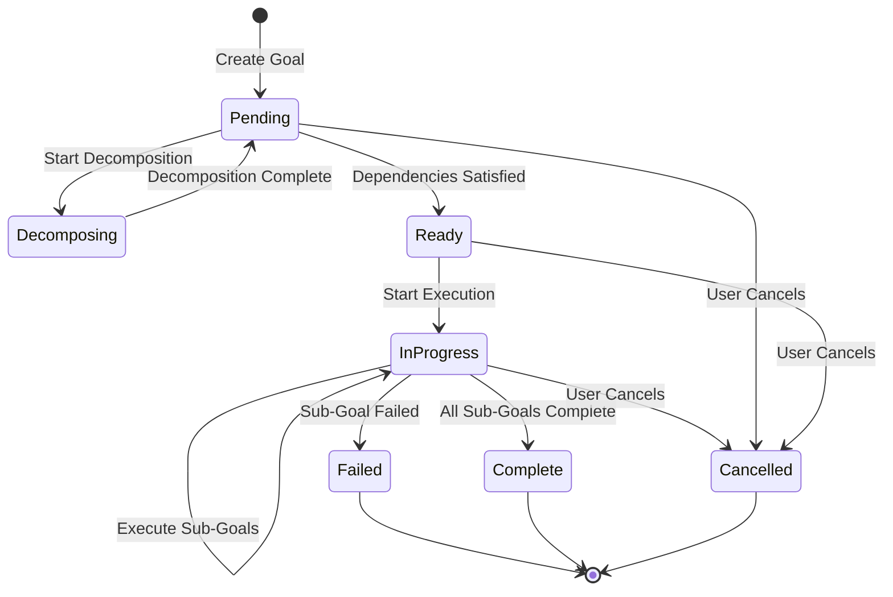

# Goal Manager Architecture

## Overview

The Goal Manager is a critical autonomous component of Agent_Guru that enables persistent, self-managing goal execution across multiple sessions. It accepts high-level goals from users, automatically decomposes them into actionable sub-goals, tracks progress, manages priorities, and coordinates execution with the Agent Orchestration system.

**Core Innovation**: Persistent autonomous goals that survive system restarts and continue execution without human intervention.

## Design Principles

1. **Persistence-First**: Every state change immediately persisted to disk
2. **Hierarchical Structure**: Goals form trees with parent-child relationships
3. **Autonomous Operation**: Minimal human intervention after goal creation
4. **Fail-Safe**: Graceful degradation and recovery from failures
5. **Observable**: Complete audit trail via GitHub commits
6. **Type-Safe**: Pydantic models for all data structures

## High-Level Architecture

```
┌─────────────────────────────────────────────────────────────┐
│                      Goal Manager                            │
│  ┌────────────────────────────────────────────────────────┐ │
│  │              Goal Manager API                          │ │
│  │  - Create, query, update, cancel goals                │ │
│  │  - Coordinate all components                          │ │
│  └────────────────────────────────────────────────────────┘ │
│  ┌────────────────────────────────────────────────────────┐ │
│  │           Goal Decomposer                              │ │
│  │  - LLM-powered decomposition                          │ │
│  │  - Recursive sub-goal generation                      │ │
│  │  - Actionability validation                           │ │
│  └────────────────────────────────────────────────────────┘ │
│  ┌────────────────────────────────────────────────────────┐ │
│  │           Progress Tracker                             │ │
│  │  - Completion percentage calculation                  │ │
│  │  - Status propagation                                 │ │
│  │  - Timestamp management                               │ │
│  └────────────────────────────────────────────────────────┘ │
│  ┌────────────────────────────────────────────────────────┐ │
│  │           Priority Manager                             │ │
│  │  - Priority assignment and updates                    │ │
│  │  - Selection logic (priority + age)                  │ │
│  │  - Manual override support                            │ │
│  └────────────────────────────────────────────────────────┘ │
│  ┌────────────────────────────────────────────────────────┐ │
│  │           Goal Executor                                │ │
│  │  - Task creation for Agent Orchestration              │ │
│  │  - Execution coordination                             │ │
│  │  - GitHub commit integration                          │ │
│  └────────────────────────────────────────────────────────┘ │
│  ┌────────────────────────────────────────────────────────┐ │
│  │           Dependency Resolver                          │ │
│  │  - Dependency graph management                        │ │
│  │  - Cycle detection                                    │ │
│  │  - Execution readiness determination                  │ │
│  └────────────────────────────────────────────────────────┘ │
│  ┌────────────────────────────────────────────────────────┐ │
│  │           Session Manager                              │ │
│  │  - Startup: Load all goals                           │ │
│  │  - Shutdown: Persist all state                       │ │
│  │  - Resume interrupted goals                           │ │
│  └────────────────────────────────────────────────────────┘ │
│  ┌────────────────────────────────────────────────────────┐ │
│  │           Goal Storage                                 │ │
│  │  - SQLite persistence                                 │ │
│  │  - JSON serialization                                 │ │
│  │  - Schema validation                                  │ │
│  │  - Corruption recovery                                │ │
│  └────────────────────────────────────────────────────────┘ │
└─────────────────────────────────────────────────────────────┘
         │                    │                    │
         ▼                    ▼                    ▼
    ┌────────┐          ┌────────┐          ┌────────┐
    │  LLM   │          │ Agent  │          │ Memory │
    │Runtime │          │ Orch.  │          │ System │
    └────────┘          └────────┘          └────────┘
```

## Component Responsibilities

### 1. Goal Manager API (`goal_manager.py`)

**Purpose**: Main interface for all goal operations

**Responsibilities**:
- Create, query, update, and cancel goals
- Coordinate all components
- Provide unified API for external systems
- Manage goal lifecycle

**Key Methods**:
- `create_goal()`: Create new goal with validation
- `get_goal()`: Retrieve goal by ID with hierarchy
- `query_goals()`: Query goals with filters
- `update_priority()`: Update goal priority
- `cancel_goal()`: Cancel goal and sub-goals
- `get_summary()`: Get system-wide summary
- `start()`: Initialize system on startup
- `shutdown()`: Persist state on shutdown

**Time Complexity**: O(1) for create/get, O(n) for query

### 2. Goal Storage (`goal_storage.py`)

**Purpose**: Persistent storage with SQLite

**Responsibilities**:
- Store and retrieve goals from SQLite database
- Serialize/deserialize goals to/from JSON
- Maintain database schema and indexes
- Handle corruption detection and recovery
- Provide ACID transactions

**Key Methods**:
- `store_goal()`: Insert goal with immediate persistence
- `update_goal()`: Update goal with immediate persistence
- `get_goal()`: Retrieve goal by ID
- `query_goals()`: Query with status/priority filters
- `export_to_json()`: Backup to JSON file
- `import_from_json()`: Restore from JSON file

**Time Complexity**: O(1) for store/update/get, O(n) for query

**Database Schema**:
```sql
CREATE TABLE goals (
    id TEXT PRIMARY KEY,
    description TEXT NOT NULL,
    status TEXT NOT NULL,
    priority TEXT NOT NULL,
    progress REAL NOT NULL,
    created_at TEXT NOT NULL,
    started_at TEXT,
    completed_at TEXT,
    parent_id TEXT,
    sub_goal_ids TEXT NOT NULL,
    dependency_ids TEXT NOT NULL,
    metadata TEXT NOT NULL,
    error_message TEXT,
    FOREIGN KEY (parent_id) REFERENCES goals(id)
);

CREATE INDEX idx_status ON goals(status);
CREATE INDEX idx_priority ON goals(priority);
CREATE INDEX idx_parent ON goals(parent_id);
```

### 3. Goal Decomposer (`goal_decomposer.py`)

**Purpose**: LLM-powered goal decomposition

**Responsibilities**:
- Analyze high-level goals using LLM Runtime
- Generate actionable sub-goals
- Validate sub-goal quality
- Query Memory System for context
- Handle LLM failures with retry logic

**Key Methods**:
- `decompose()`: Decompose goal into sub-goals
- `_get_context()`: Query Memory System for similar goals
- `_build_prompt()`: Build LLM decomposition prompt
- `_call_llm_with_retry()`: Call LLM with exponential backoff
- `_parse_response()`: Parse LLM response into goals
- `_validate_subgoals()`: Validate sub-goal quality

**Time Complexity**: O(1) per goal (LLM call is constant time)

**Decomposition Strategy**:
1. Query Memory System for similar past goals
2. Build context-aware prompt for LLM
3. Call LLM with retry logic (max 3 attempts)
4. Parse JSON response into Goal objects
5. Validate sub-goals (3-7 sub-goals, actionable, specific)
6. Return validated sub-goals

### 4. Progress Tracker (`progress_tracker.py`)

**Purpose**: Track goal progress and propagate status

**Responsibilities**:
- Calculate completion percentages
- Propagate status changes to parent goals
- Manage timestamps (created, started, completed)
- Update progress recursively up the hierarchy

**Key Methods**:
- `mark_complete()`: Mark goal complete and update parent
- `mark_failed()`: Mark goal failed with error message
- `mark_in_progress()`: Mark goal in progress with timestamp
- `_update_parent_progress()`: Recursive progress propagation

**Time Complexity**: O(h) where h is hierarchy depth

**Progress Calculation**:
- Progress = (sum of sub-goal progress) / (number of sub-goals)
- Propagates recursively to all ancestors
- Parent marked complete when all sub-goals complete

### 5. Priority Manager (`priority_manager.py`)

**Purpose**: Manage goal priorities and selection

**Responsibilities**:
- Assign and update goal priorities
- Select next goal for execution
- Sort by priority and age
- Support manual priority overrides

**Key Methods**:
- `update_priority()`: Update goal priority with persistence
- `select_next_goal()`: Select highest priority ready goal

**Time Complexity**: O(n log n) for selection (sorting)

**Selection Algorithm**:
1. Filter goals with status READY
2. Sort by priority (CRITICAL > HIGH > MEDIUM > LOW)
3. For equal priority, sort by created_at (oldest first)
4. Return first goal in sorted list

### 6. Dependency Resolver (`dependency_resolver.py`)

**Purpose**: Manage goal dependencies and cycles

**Responsibilities**:
- Validate dependencies (detect cycles)
- Determine execution readiness
- Block dependent goals when dependencies fail
- Maintain dependency graph integrity

**Key Methods**:
- `validate_dependencies()`: Validate no circular dependencies
- `_has_cycle()`: Detect cycles using DFS
- `is_ready()`: Check if all dependencies satisfied
- `mark_blocked()`: Block goal and dependents recursively

**Time Complexity**: O(V + E) for cycle detection (DFS)

**Cycle Detection Algorithm**:
- Depth-first search with recursion stack
- Detects cycles by checking if node in recursion stack
- Rejects goal creation/update if cycle detected

### 7. Goal Executor (`goal_executor.py`)

**Purpose**: Coordinate goal execution with Agent Orchestration

**Responsibilities**:
- Convert sub-goals into tasks for Agent Orchestration
- Execute sub-goals sequentially
- Commit completions to GitHub
- Report metrics to Self-Improvement Engine
- Handle execution failures and cancellation

**Key Methods**:
- `execute_goal()`: Execute goal by processing sub-goals
- `_execute_sub_goal()`: Execute single sub-goal as task
- `_commit_to_github()`: Commit completion to Git
- `_report_completion()`: Report metrics to Self-Improvement Engine
- `stop_execution()`: Cancel in-progress execution
- `resume_goal()`: Resume interrupted goal

**Time Complexity**: O(n) where n is number of sub-goals

**Execution Flow**:
1. Mark goal as IN_PROGRESS
2. For each sub-goal sequentially:
   - If sub-goal has children, recursively execute
   - If leaf sub-goal, create task in Agent Orchestration
   - Wait for task completion
   - On success: mark complete, commit to GitHub
   - On failure: mark failed, propagate to parent
3. Mark goal as COMPLETE when all sub-goals done
4. Report completion to Self-Improvement Engine

### 8. Session Manager (`session_manager.py`)

**Purpose**: Handle system startup and shutdown

**Responsibilities**:
- Load all goals from storage on startup
- Validate goal integrity
- Recover corrupted goals
- Resume interrupted goals
- Persist state on shutdown

**Key Methods**:
- `load_goals()`: Load and validate all goals
- `_validate_goal_integrity()`: Check goal data validity
- `_attempt_recovery()`: Recover corrupted goals
- `persist_all()`: Persist state (no-op with immediate persistence)

**Time Complexity**: O(n) where n is number of goals

**Startup Flow**:
1. Load all goals from SQLite database
2. Validate each goal's data integrity
3. Attempt recovery for corrupted goals
4. Resume IN_PROGRESS goals from last completed sub-goal

## Data Flow

### Goal Creation Flow

```
User Request
    ↓
GoalManager.create_goal()
    ↓
Validate dependencies (DependencyResolver)
    ↓
Store goal (GoalStorage)
    ↓
Start async decomposition (GoalDecomposer)
    ↓
Query context (Memory System)
    ↓
Call LLM (LLM Runtime)
    ↓
Parse and validate sub-goals
    ↓
Store sub-goals (GoalStorage)
    ↓
Check if ready (DependencyResolver)
    ↓
If ready, start execution (GoalExecutor)
```

### Goal Execution Flow

```
GoalExecutor.execute_goal()
    ↓
Mark IN_PROGRESS (ProgressTracker)
    ↓
For each sub-goal sequentially:
    ↓
    Create task (Agent Orchestration)
    ↓
    Wait for completion
    ↓
    Mark COMPLETE (ProgressTracker)
    ↓
    Commit to GitHub (Git)
    ↓
    Update parent progress (ProgressTracker)
    ↓
Mark goal COMPLETE
    ↓
Report metrics (Self-Improvement Engine)
```

### Progress Propagation Flow

```
Sub-goal completes
    ↓
ProgressTracker.mark_complete()
    ↓
Update sub-goal status and progress
    ↓
Calculate parent progress (average of sub-goals)
    ↓
Update parent goal
    ↓
If all sub-goals complete, mark parent COMPLETE
    ↓
Recursively propagate to grandparent
```

## Integration Points

### Upstream Dependencies

**LLM Runtime** (Goal Decomposition):
- Called by: GoalDecomposer
- Purpose: Generate sub-goals from high-level description
- API: `generate(prompt, max_tokens, temperature)`
- Error Handling: Retry with exponential backoff (3 attempts)

**Agent Orchestration** (Task Execution):
- Called by: GoalExecutor
- Purpose: Execute leaf sub-goals as tasks
- API: `create_task()`, `wait_for_task()`, `cancel_task()`
- Error Handling: Queue tasks if unavailable, retry on failure

**Memory System** (Context Retrieval):
- Called by: GoalDecomposer
- Purpose: Retrieve similar past goals for context
- API: `query_similar(query, limit, metadata_filter)`
- Error Handling: Continue without context if unavailable

**Self-Improvement Engine** (Metrics Reporting):
- Called by: GoalExecutor
- Purpose: Report goal completion metrics
- API: `record_task_execution(task_id, success, execution_time_ms)`
- Error Handling: Log error but don't fail goal

### Downstream Dependencies

None - Goal Manager is a leaf component that doesn't expose services to other components.

## Goal Lifecycle



**Status Descriptions**:
- **PENDING**: Goal created, awaiting decomposition or dependency satisfaction
- **DECOMPOSING**: LLM is generating sub-goals
- **READY**: Dependencies satisfied, ready for execution
- **IN_PROGRESS**: Currently executing sub-goals
- **COMPLETE**: All sub-goals completed successfully
- **FAILED**: One or more sub-goals failed
- **CANCELLED**: User cancelled the goal
- **BLOCKED**: Dependencies failed, goal cannot proceed

## Error Handling

### Error Types

```python
class GoalManagerError(Exception):
    """Base exception for all Goal Manager errors."""
    pass

class StorageError(GoalManagerError):
    """Raised when storage operations fail."""
    pass

class DecompositionError(GoalManagerError):
    """Raised when goal decomposition fails."""
    pass

class ValidationError(GoalManagerError):
    """Raised when validation fails (e.g., circular dependencies)."""
    pass

class ExecutionError(GoalManagerError):
    """Raised when goal execution fails."""
    pass
```

### Error Handling Strategies

**Storage Failures**:
- Retry write operations up to 3 times with exponential backoff
- Log error with full context (goal ID, operation type, error message)
- Notify user if persistence fails after retries
- Never lose in-memory state

**LLM Runtime Failures**:
- Retry with exponential backoff (1s, 2s, 4s)
- After 3 failures, mark goal as failed with error message
- Log LLM request and response for debugging
- Allow manual retry by user

**Agent Orchestration Failures**:
- Queue tasks if Agent Orchestration unavailable
- Retry task creation with exponential backoff
- Mark sub-goal as failed if task fails
- Propagate failure to parent goal

**Validation Failures**:
- Fail fast with descriptive error message
- Do not modify system state
- Log validation failure details
- Return error to user immediately

**Corrupted Data**:
- Detect corruption during loading (schema validation)
- Attempt recovery by filling missing fields with defaults
- If recovery fails, mark goal as failed
- Log corruption details for investigation

## Performance Characteristics

### Time Complexity

| Operation | Complexity | Notes |
|-----------|-----------|-------|
| Create goal | O(1) | Constant time insertion |
| Get goal | O(1) | Indexed lookup |
| Query goals | O(n) | Full table scan with filters |
| Update goal | O(1) | Indexed update |
| Decompose goal | O(1) | LLM call is constant time |
| Execute goal | O(n) | n = number of sub-goals |
| Progress propagation | O(h) | h = hierarchy depth |
| Cycle detection | O(V + E) | DFS on dependency graph |
| Priority selection | O(n log n) | Sorting ready goals |

### Space Complexity

| Component | Complexity | Notes |
|-----------|-----------|-------|
| Goal Storage | O(n) | n = total goals |
| Dependency graph | O(V + E) | V = goals, E = dependencies |
| Active executions | O(k) | k = concurrent executions |
| Memory cache | O(1) | Fixed size LRU cache |

### Performance Targets

- Goal creation: <10ms (95th percentile)
- Goal retrieval: <5ms (95th percentile)
- Query with filters: <50ms for 10,000 goals
- Decomposition: <2s (LLM latency)
- Execution: <1s per sub-goal (Agent Orchestration latency)
- Progress propagation: <10ms per level
- Cycle detection: <100ms for 1,000 goals

## Scalability

### Horizontal Scalability

Goal Manager is designed for single-instance deployment per user/agent. For multi-user scenarios:
- Each user has separate SQLite database
- No shared state between users
- Can run multiple instances in parallel

### Vertical Scalability

- SQLite handles 10,000+ goals efficiently
- Indexes on status, priority, parent_id for fast queries
- JSON serialization for complex fields (sub_goal_ids, metadata)
- Lazy loading of goal hierarchies (only load when needed)

### Optimization Strategies

**Database Optimization**:
- Indexes on frequently queried fields
- Batch updates for multiple goals
- Connection pooling for concurrent access
- Periodic VACUUM to reclaim space

**Memory Optimization**:
- Lazy loading of goal hierarchies
- LRU cache for frequently accessed goals
- Stream processing for large queries
- Garbage collection of completed goals

**Execution Optimization**:
- Parallel execution of independent goals (future enhancement)
- Async I/O for all external calls
- Connection pooling for Agent Orchestration
- Batch commits to GitHub

## Security Considerations

### Data Protection

- SQLite database file permissions (user-only read/write)
- Encryption at rest (future enhancement)
- Secure deletion of cancelled goals (future enhancement)
- Audit trail via GitHub commits

### Input Validation

- Validate all user inputs (description, priority, dependencies)
- Sanitize LLM responses before parsing
- Validate JSON schema on deserialization
- Prevent SQL injection (parameterized queries)

### Access Control

- Goal Manager runs with user's permissions
- GitHub commits use user's credentials
- Agent Orchestration tasks run in user's context
- No privilege escalation

## Monitoring and Observability

### Structured Logging

All components use structured logging with:
- Timestamp
- Log level (DEBUG, INFO, WARNING, ERROR)
- Component name
- Goal ID (when applicable)
- Operation type
- Error details (when applicable)

### Metrics

Key metrics to monitor:
- Goal creation rate (goals/minute)
- Goal completion rate (goals/minute)
- Average execution time per goal
- Decomposition success rate
- LLM failure rate
- Agent Orchestration failure rate
- Database query latency
- Storage write latency

### Alerts

Critical alerts:
- Storage write failures (>3 retries)
- LLM failures (>10% failure rate)
- Agent Orchestration unavailable (>5 minutes)
- Database corruption detected
- Circular dependency detected

## Future Enhancements

### Planned Features

1. **Parallel Execution**: Execute independent sub-goals in parallel
2. **Goal Templates**: Reusable goal templates for common tasks
3. **Goal Scheduling**: Schedule goals for future execution
4. **Goal Priorities**: Dynamic priority adjustment based on deadlines
5. **Goal Analytics**: Detailed analytics on goal completion patterns
6. **Goal Recommendations**: LLM-powered goal suggestions
7. **Goal Collaboration**: Multi-user goal sharing and collaboration
8. **Goal Visualization**: Interactive goal hierarchy visualization

### Performance Improvements

1. **Caching**: LRU cache for frequently accessed goals
2. **Batch Operations**: Batch updates for multiple goals
3. **Lazy Loading**: Load goal hierarchies on demand
4. **Connection Pooling**: Pool connections to external services
5. **Async Everywhere**: Full async/await for all I/O operations

### Reliability Improvements

1. **Distributed Storage**: Replicate goals across multiple nodes
2. **Automatic Backups**: Periodic backups to cloud storage
3. **Health Checks**: Continuous health monitoring
4. **Circuit Breakers**: Prevent cascading failures
5. **Rate Limiting**: Protect external services from overload

---

**Status**: Production Ready ✅  
**Version**: 1.0.0  
**Last Updated**: 2024-01-15  
**Maintainer**: Agent_Guru Team
