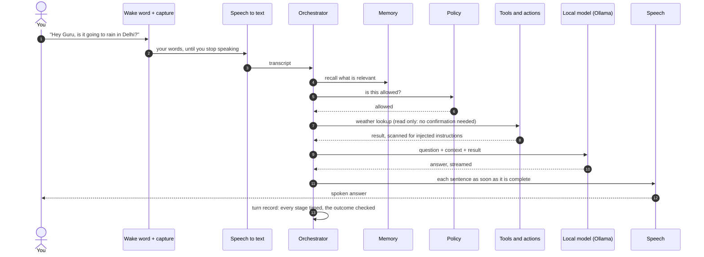
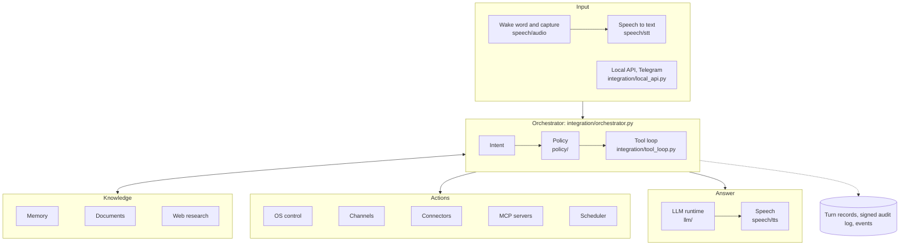
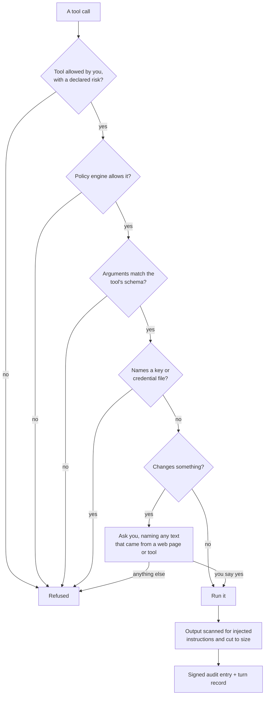

<div align="center">

# Agent Guru

**A voice assistant that runs on your own computer.**<br>
Say "Hey Guru" or "Hey Maya", ask a question or give a command, and hear the answer.<br>
The model, speech recognition and speech run locally; nothing goes to the cloud unless you turn it on.

</div>

<p align="center">
  <a href="https://github.com/Surajsharma0804/Agent_Guru/actions/workflows/ci.yml"></a>
  <a href="LICENSE"></a>
  
  
  <a href="https://ollama.com"></a>
</p>

<p align="center">
  <a href="#quick-start">Quick start</a> &middot;
  <a href="#what-it-can-do">What it can do</a> &middot;
  <a href="#how-a-turn-works">How a turn works</a> &middot;
  <a href="#safety-model">Safety model</a> &middot;
  <a href="#commands">Commands</a> &middot;
  <a href="#measured-performance">Measured performance</a> &middot;
  <a href="#known-limitations">Known limitations</a>
</p>

> [!NOTE]
> Agent Guru is developed and used daily on Windows 11 (RTX 2050 laptop, 4 GB VRAM). Its test suite runs on
> Linux in CI on Python 3.11, 3.12 and 3.13. macOS, Linux desktop and mobile adapters exist in the code but have
> not been tried on real devices. See [Platform support](#platform-support).

---

## Quick start

You need Python 3.11, 3.12 or 3.13, a microphone and speakers, and [Ollama](https://ollama.com).

```bash
# 1. A local model for Ollama (the assistant's default)
ollama pull gemma4

# 2. Agent Guru and its dependencies
git clone https://github.com/Surajsharma0804/Agent_Guru.git
cd Agent_Guru
python -m venv .venv
.venv\Scripts\activate            # Windows   (Linux/macOS: source .venv/bin/activate)
pip install torch torchvision torchaudio --index-url https://download.pytorch.org/whl/cpu
pip install -r requirements.txt

# 3. Check the machine, then start the assistant
python -m Agent_Guru doctor
python main.py
```

Say **"Hey Guru"** (analytical) or **"Hey Maya"** (warm), then say what you want.

<details>
<summary><strong>Optional: speech recognition on an NVIDIA GPU</strong></summary>
<br>

Speech recognition uses faster-whisper (CTranslate2), not torch. To run it on the GPU it needs the CUDA 12 cuBLAS
and cuDNN 9 libraries, about 2 GB:

```bash
pip install nvidia-cublas-cu12 "nvidia-cudnn-cu12==9.*"   # or: pip install -e ".[gpu]"
```

At start the assistant tries a short transcription on the GPU and uses it only if that works. The log says which:
`Whisper base loaded on the GPU (cuda, int8_float16)`, or a warning starting `Speech recognition runs on the CPU`
with the reason.
</details>

<details>
<summary><strong>Optional: type instead of speaking, or use it from other apps</strong></summary>
<br>

Turn on the local API (127.0.0.1 only) in `settings.toml` in the data folder (`%LOCALAPPDATA%\agent_guru` on
Windows):

```toml
AGENT_GURU_API = true
```

Then `python -m Agent_Guru ask "what is on my calendar tomorrow"`, `python -m Agent_Guru chat`, or open
`http://127.0.0.1:8765/` for the dashboard. Any OpenAI client can use `http://127.0.0.1:8765/v1` as its base URL;
the key is printed by `python -m Agent_Guru api key`.
</details>

---

## What it can do

| Area | Examples | What makes it trustworthy |
|:--|:--|:--|
| **Conversation** | "What did we talk about yesterday?", "Remember that my sister's birthday is in March" | Memory is searched by meaning and by names and numbers; facts it learns are kept with where they came from |
| **The computer** | "Open Notepad", "Set the volume to 40", "Take a screenshot", "Play the next song" | Each action is checked afterwards: it says *done* only when it saw the result |
| **Messages** | "Send Rahul on WhatsApp: running late" | On WhatsApp it reads the draft back before sending; on every channel it reports *sent* only when the app or service confirmed it |
| **Research** | "What changed in the new tax rules?" | Answers cite numbered sources; invented links and unsupported numbers are removed before you hear them |
| **Scheduling** | "Remind me at 9 pm", "Check the Delhi weather every hour and tell me if it changes" | Actions run later only with your approval for that exact action, which expires |
| **Your accounts** (optional) | "Any mail from Rahul about Friday?", "Add a dentist appointment at 4" | Sign-in on the provider's page; tokens are encrypted on disk; sending and adding wait for your yes |
| **Tools** | Any [MCP](https://modelcontextprotocol.io) server you allow | Only the tools you allow, with the risk you declare, and every call audited |

<details>
<summary><strong>Everything in more detail</strong></summary>
<br>

**Voice**
- Wake words "Hey Guru" and "Hey Maya", two personalities, replies spoken sentence by sentence as they are written.
- Speech recognition with faster-whisper; speech with Kokoro, falling back to the system voice.
- English and Hinglish; other languages are detected and answered in kind.

**Computer control** (`Agent_Guru/platform`)
- Apps, files, windows, volume and brightness, media keys, screenshots, typing, browser automation.
- Files that hold keys or credentials (SSH keys, `.env`, browser password stores) are refused to every file tool.

**Messaging** (`Agent_Guru/platform/channels`)
- WhatsApp Desktop, plus Telegram, Slack, email (SMTP), Discord, Signal, SMS (Twilio), Matrix, Zulip, Mastodon,
  LINE, Viber, Messenger, Reddit, IRC, Twitch, and webhooks for Teams, Google Chat, Mattermost, Rocket.Chat and Feishu.
- Ask it from Telegram: messages from chats you list become typed turns; every other chat is ignored.

**Knowledge**
- Documents you add (`python -m Agent_Guru documents add file.pdf`) are answered from with citations.
- Web research (Wikipedia, DuckDuckGo) with pages read safely: private network addresses are refused at every redirect.

**Accounts and sources** (`Agent_Guru/connectors`, each offered only once you set it up)
- Gmail or Outlook or IMAP mail; Google or Outlook calendar or an `.ics` file; contacts; Google Drive and Tasks;
  Notion; an Obsidian vault; GitHub notifications; Dropbox; Oura; Strava; Spotify; news feeds and Hacker News.

**Models** (`Agent_Guru/llm`)
- Ollama by default. Any engine with an OpenAI-compatible API (llama.cpp server, vLLM, LM Studio, SGLang, LiteLLM).
- Cloud models (OpenAI, Anthropic, Gemini) only when you allow the cloud and give a key.
- A fallback engine when the main one fails; routing by question difficulty that never makes an easy question wait
  for a model swap.

**Learning** (`Agent_Guru/self_improvement`)
- Say "that was wrong" after a bad answer, or "that was right" (or "sahi hai") after a good one. `python -m Agent_Guru
  learn tune` proposes guidance from your marked mistakes and good answers, and keeps it only if the evaluation set
  improves with nothing lost. Rollback is one command.
- Missed the moment? `python -m Agent_Guru learn rate` shows your recent unrated turns one at a time (request and
  reply) and takes r for right, w for wrong, s to skip, q to stop; `--limit N` sets how many (20 by default). By default
  only turns marked right go into the fine-tuning file `learn export` writes.
</details>

---

## How a turn works



A change (sending a message, deleting a file, scheduling an action) stops at step 7 and asks you first; your next
words answer the question.

## Architecture



<details>
<summary><strong>Project layout</strong></summary>
<br>

```
main.py                     starts the assistant (also: python -m Agent_Guru)
Agent_Guru/
  integration/              orchestrator, tool loop, MCP toolbox, research, tasks, local API, event bus
  speech/                   wake word, capture, speech to text, text to speech
  llm/                      runtime, Ollama and OpenAI-compatible adapters, routing, model catalog
  platform/                 OS controllers, channels, reminders and scheduling, documents, web search
  connectors/               OAuth sign-in and account tools
  memory/                   conversation memory and learned facts
  policy/                   policy engine and its audit log
  security/                 audit log, sensitive-file policy, taint labels, secret store
  self_improvement/         prompt tuning, training data export, learning engine
  reasoning/                reasoning engine, skills, its own HTTP API
  vision/, emotion/, avatar/
scripts/                    evaluations, benchmarks, CI helpers
docs/architecture/          roadmap, capability registry, provenance
```
</details>

---

## Safety model

Every tool call, whether the model asked for it, a schedule ran it, or another agent sent it, takes the same path:



- **Approval** comes only from your own words in the next turn. A model, a web page, an email or a tool's output
  can never approve anything.
- **Results are reported as they are**: done, failed, refused, or *could not confirm*. It does not say "done" for
  something it could not see happen.
- **The audit log** is a hash chain signed with a key protected by Windows DPAPI; tampering shows.
- **Secrets** (API keys, tokens) are read from the environment or `.env`, never from `settings.toml`; keys the
  assistant creates are encrypted with DPAPI.
- **Network**: the local API listens on 127.0.0.1 only and is off by default; the Telegram bot uses long polling,
  so no port is opened.

---

## Commands

`python -m Agent_Guru <command>`; `python -m Agent_Guru help` lists them.

| Command | What it does |
|:--|:--|
| *(none)* | start the assistant |
| `doctor` | check the machine |
| `ask` / `chat` | ask the running assistant, typed |
| `config` | show or change `settings.toml`, checked |
| `model` / `models` | the model in use, or switch; the installed models and whether they fit the GPU |
| `recipes` | list, show or apply a named set of settings (`default`, `low-vram`, `private`, `research`) |
| `documents` | add, remove or list documents to answer from |
| `memory` | what it remembers about you, or forget one thing |
| `tasks` | reminders, checks and actions that are scheduled |
| `connect` | sign in to Google, Microsoft, Strava or Spotify |
| `mcp` | list or call tools on MCP servers, through the policy |
| `api` | the local HTTP API: its state, or your key |
| `telegram` | the Telegram bot: its state, or who has written to it |
| `learn` | tune the prompt from mistakes, roll back, export training data, or rate earlier turns (`learn rate`) |
| `skills` | import a skill after checking it, or find repeated tool sequences |
| `eval` / `bench` | score it on its evaluation set; time every stage of spoken turns |

## Configuration

Settings live in `settings.toml` in the data folder. Only known settings are taken, each checked; a misspelled
name is refused with a suggestion.

```toml
OLLAMA_MODEL = "gemma4"
AGENT_GURU_RESEARCH = true        # web research for questions that need live information
AGENT_GURU_API = false            # the local HTTP API and dashboard
```

Or apply a recipe: `python -m Agent_Guru recipes apply private` turns off everything that reaches the network.

---

## Measured performance

Measured on the development laptop (Intel i5-12450H, RTX 2050 4 GB, Windows 11) with gemma4. Nothing here is an
estimate; each figure comes from the evaluation scripts in `scripts/` or the turn records.

| What | Result |
|:--|:--|
| Transcribing a 2.5 s command (Whisper base) | 1.8 s on the CPU, 0.2 s on the GPU |
| First sentence of an answer ready after the request (gemma4, streamed) | about 2.1 s |
| Research questions answered with correct citations (`scripts/research_eval.py`) | 6 of 6, typed and spoken |
| Tool-use evaluation (`scripts/tool_loop_eval.py`) | 9 of 11 (misses: two tools chained in one turn) |
| Start to listening (warm start) | about 12 s |
| Automated tests | 6,380 passed in the last full local run; CI runs the suite on Python 3.11, 3.12 and 3.13 |

### Choosing a model

`OLLAMA_MODEL` (in `settings.toml` or the environment) picks the model every part of the assistant uses; the
context window is `AGENT_GURU_NUM_CTX` (default 6144). Measured 2026-10-26 on the same laptop, Ollama 0.40.3, each
model at context 6144 and 100% on the GPU. Speed is three spoken questions, three runs each, through the full
pipeline (`python -m Agent_Guru bench`); quality is the turn evaluation set (`python -m Agent_Guru eval`, 23 cases)
and `scripts/tool_loop_eval.py` (11 cases).

| Model | GPU memory in use | Tokens/s | First text | First audio ready | Turn evaluation | Tool cases, answers right |
|:--|--:|--:|--:|--:|--:|--:|
| gemma4:latest (default) | 3.8 to 3.9 GB | 28 | 0.76 s | 2.47 s | 16/23 | 11/11 |
| gemma4:e2b (`low-vram` recipe) | 3.0 GB | 121 | 0.68 s | 2.15 s | 17/23 | 6/11 |
| qwen2.5:1.5b | 1.3 GB | 85 | 0.56 s | 2.03 s | 18/23 | 5/11 |
| gemma3:1b | 1.0 GB | 94 | 0.55 s | 1.87 s | 10/23 | 4/11 |

The smaller models answer sooner, but by under 0.6 s to first audio, and they lose the tools: gemma4:e2b says it
will check and calls nothing, qwen2.5:1.5b answers live questions without its tools and makes the facts up (a
"heatwave" in Delhi, "sunny" in London), and Ollama does not offer tools to gemma3:1b at all. Keep the default
when it fits on the GPU. On a card where it does not, gemma4:e2b is the better small choice: it fails by not
answering, where qwen2.5:1.5b fails by answering wrongly.

gemma4:e2b is what the `low-vram` recipe uses (`python -m Agent_Guru recipes apply low-vram`, which also sets the
context to 4096; the row above was measured at 6144). Expect it to answer 6 of the 11 tool cases. When a question
needs a tool it says it will check and then does not, so the miss is a non-answer you can see, not a wrong fact.

## Platform support

| Platform | State |
|:--|:--|
| Windows 11 | Developed and used daily. Device control and WhatsApp Desktop verified. |
| Linux | Test suite passes in CI. Desktop use not tried. |
| macOS | Adapters in the code; not tried. |
| Android, iOS | Adapters in the code; not tried. |

## Known limitations

- **False wakes**: when the openWakeWord model is not available, the fallback detector reacts to loud speech, not
  only to the wake phrase. Each false wake starts a turn.
- **4 GB of VRAM**: gemma4 does not fit entirely beside speech recognition, so part of it runs on the CPU. The
  `low-vram` recipe switches to the smaller gemma4:e2b, which gets 6 of 11 tool cases right against 11 of 11 (see
  "Choosing a model"). Swapping between models takes 17 to 19 s.
- **No code execution**: the assistant does not run code it writes. A sandbox needs an isolation boundary that can be
  demonstrated (Windows Sandbox, Docker or WSL), which this machine does not have.
- **Accounts and channels** need your own credentials (OAuth client ids, bot tokens) and were checked against local
  test servers, not your accounts.

---

<details>
<summary><strong>Troubleshooting</strong></summary>
<br>

| Problem | Try |
|:--|:--|
| Anything | `python -m Agent_Guru doctor` checks Ollama, the model, GPU, microphone, speaker and the data folder |
| "Ollama is not answering" | Start Ollama, then `ollama list`; the model in `OLLAMA_MODEL` must be there |
| It does not hear the wake word | Check the microphone in Windows settings and that the right input device is the default |
| Speech recognition is slow | See [GPU speech recognition](#quick-start); the log says whether it runs on the GPU |
| An answer was wrong | Say "that was wrong" (or later, `learn rate`); it is marked, and `learn tune` can learn from it |
</details>

<details>
<summary><strong>Development</strong></summary>
<br>

```bash
pip install -e ".[test]"
pytest                                   # the full suite takes 35 to 70 minutes
ruff check . --select F,E9,PLE           # the blocking lint gate
bandit -r Agent_Guru -c pyproject.toml   # the blocking security gate
```

CI runs the suite on Python 3.11, 3.12 and 3.13, and fails a run that did not execute every collected test.
Design records are in [`docs/architecture/`](docs/architecture/): the roadmap, the capability registry (where each
feature lives, so it is not built twice) and the provenance of every component.

Contributions are welcome: open an issue first for anything large, keep each change focused, add a test that fails
without it, and explain in the commit message what was wrong and how it is now.
</details>

---

## Copyright, licence and attribution

AGENT_GURU is an open-source project created by **Suraj Sharma**.

Copyright &copy; 2026 Suraj Sharma.
Repository: https://github.com/Surajsharma0804/Agent_Guru

The project is distributed under the **Apache License 2.0**; see [LICENSE](LICENSE) and [NOTICE](NOTICE).
Redistributions must comply with the licence and keep the copyright, licence and NOTICE texts.
Contributions are accepted under the same licence (section 5 of the Apache License 2.0).

The AGENT_GURU name and branding are not licensed for use as an endorsement or to imply
official affiliation; the Apache License 2.0 grants no trademark rights (section 6).

## Acknowledgements

Agent Guru builds on these projects, each under its own licence:

| Project | Used for |
|:--|:--|
| [Ollama](https://ollama.com) | running the local model |
| [faster-whisper](https://github.com/SYSTRAN/faster-whisper) and CTranslate2 | speech recognition |
| [Kokoro](https://huggingface.co/hexgrad/Kokoro-82M) via [kokoro-onnx](https://github.com/thewh1teagle/kokoro-onnx) | speech (with eSpeak NG, GPL-3, for pronunciation) |
| [openWakeWord](https://github.com/dscripka/openWakeWord) and [Silero VAD](https://github.com/snakers4/silero-vad) | wake word and speech detection |
| [sentence-transformers](https://www.sbert.net) | searching memory and documents by meaning |
| [InsightFace](https://github.com/deepinsight/insightface) and [OpenCV](https://opencv.org) | vision (models under their own terms) |
| [PyTorch](https://pytorch.org), [FastAPI](https://fastapi.tiangolo.com), [pywinauto](https://github.com/pywinauto/pywinauto) | the rest of the stack |

<p align="center"><a href="#agent-guru">Back to top</a></p>
