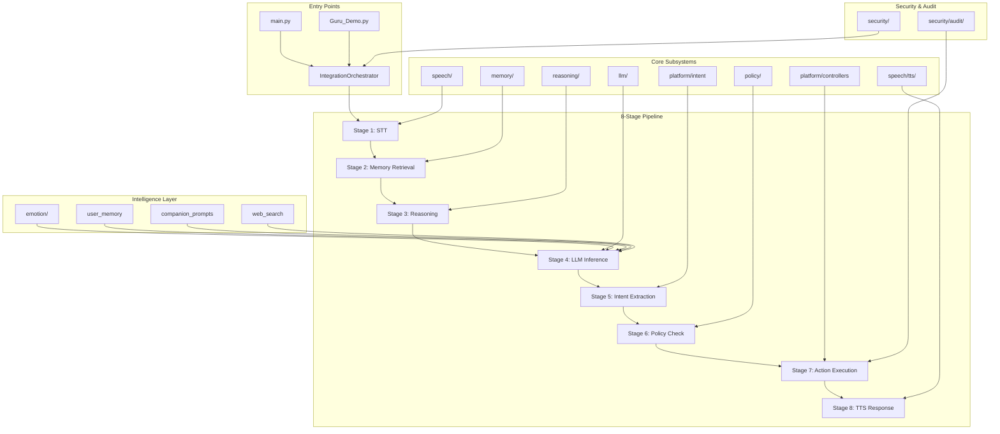

# Agent Guru — Architecture Overview

> Generated: 2026-06-13 | Version: 1.0

## System Architecture



## Module Dependency Map

### Critical Path (must work for basic functionality)
```
main.py
  └─ IntegrationOrchestrator (integration/orchestrator.py)
       ├─ speech/ (STT + TTS + Wake Word)
       │    ├─ audio/ (capture, streaming, noise cancellation)
       │    ├─ stt/ (Whisper STT, language detection)
       │    ├─ tts/ (voice synthesis, cloning)
       │    └─ models.py (PersonalityType, AudioConfig)
       ├─ llm/ (LLM runtime)
       │    ├─ companion_prompts.py (Guru/Maya persona prompts)
       │    ├─ models.py (CompletionRequest, Message)
       │    ├─ providers/ (Ollama, etc.)
       │    └─ model_router/ (multi-model routing)
       ├─ emotion/ (emotion detection + adaptation)
       │    ├─ detector.py (14-emotion keyword + multimodal)
       │    └─ adapter.py (empathy response adaptation)
       ├─ memory/ (conversation + personality memory)
       ├─ platform/ (OS interaction)
       │    ├─ intent_recognizer.py
       │    ├─ controllers/ (Windows, macOS, Linux)
       │    └─ features/ (user_memory, web_search, reminders, dictation, etc.)
       ├─ policy/ (RBAC, action gating)
       └─ security/audit/ (event logging)
```

### Extended Modules (enhance but not required for core)
```
reasoning/       — Advanced reasoning (345 files, largest module)
vision/          — Face detection/recognition
self_improvement/ — Meta-learning, stability monitoring
agents/          — Multi-agent orchestration
goal_manager/    — Goal planning/tracking
verifier/        — Fact verification
avatar/          — Visual avatar
sdk/             — Public API
```

### Infrastructure Modules
```
deployment/   — Docker, K8s, Terraform
core/         — AgentGuru service, config
health/       — Health checks
resilience/   — Circuit breakers
```

### Support Modules (minimal)
```
context/      — Context aggregation (191 lines)
translation/  — Language translation (189 lines)
learning/     — Online learning (172 lines)
fusion/       — Multimodal fusion (125 lines)
training/     — Model training (66 lines)
utils/        — Shared utilities (65 lines)
skills/       — Skill registry (374 lines)
iot/          — IoT control (422 lines)
sync/         — Data sync (245 lines)
proactive/    — Proactive suggestions (207 lines)
explainability/ — XAI (342 lines)
```

## Data Flow

```
User speaks → Wake Word Detection → Audio Capture → Whisper STT
  → Transcript → Emotion Detection → User Memory Lookup
  → Companion Prompt Build (persona + facts + emotion + date)
  → LLM Inference (Ollama/Gemma3:4b)
  → Intent Extraction (rule-based, no LLM)
  → Policy Check (RBAC)
  → Action Execution (OS control, browser, search, etc.)
  → TTS Response → Speaker Output
```

## Key Design Decisions

1. **Local-first**: All processing runs locally (Ollama, Whisper, pyttsx3). No cloud dependencies for core functionality.
2. **Companion-first**: Personalities (Guru/Maya) defined in centralized prompts. Emotion detection drives tone adaptation.
3. **Lazy imports**: Large file (orchestrator.py) uses lazy imports inside methods to avoid circular imports and optional dependency failures.
4. **GPU-aware**: Automatic CUDA detection, GPU pool management, VRAM-constrained model selection.
5. **8-stage pipeline**: Fixed pipeline stages with clear boundaries. Each stage is independently testable.
